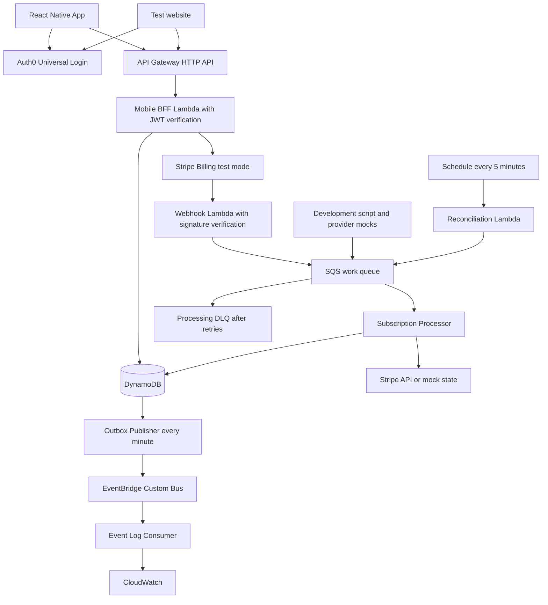

# PremiumPass

## Project overview for a hands-on weekend

**Goal:** Build a React Native demo app with Auth0 and an AWS backend that translates subscriptions from multiple purchase channels into central, server-verified entitlements.

**Scope:** About 16 hours of implementation across Saturday and Sunday, assuming prepared accounts and a working development environment. Allow additional setup time if starting React Native or CDK from scratch. Keep the app small; focus on backend architecture and understandable failure handling.

**As of:** October 10, 2026. This document is a blueprint; its checklists describe outcomes to implement and verify. See the [README](README.md) for setup and executable commands, [AGENTS.md](AGENTS.md) for agent rules, [docs/DECISIONS.md](docs/DECISIONS.md) for decision status, and [docs/TASKS.md](docs/TASKS.md) for actionable tasks. Code and documentation use English throughout.

PremiumPass is a fictional learning application with synthetic score data. It prepares you for work on mobile BFFs, AWS Serverless, and subscription systems. It does not represent any known internal SCHUFA architecture or real credit-scoring logic.

## Contents

1. [Outcome and scope](#1-outcome-and-scope)
2. [Learning objectives](#2-learning-objectives)
3. [Preparation and technology choices](#3-preparation-and-technology-choices)
4. [Architecture and responsibilities](#4-architecture-and-responsibilities)
5. [React Native and Auth0](#5-react-native-and-auth0)
6. [API and user mapping](#6-api-and-user-mapping)
7. [Subscriptions and entitlements](#7-subscriptions-and-entitlements)
8. [DynamoDB and concurrency](#8-dynamodb-and-concurrency)
9. [Stripe Billing in test mode](#9-stripe-billing-in-test-mode)
10. [Apple and Google provider mocks](#10-apple-and-google-provider-mocks)
11. [Events and reliable processing](#11-events-and-reliable-processing)
12. [Reconciliation](#12-reconciliation)
13. [Security and operations](#13-security-and-operations)
14. [Repository and CI/CD](#14-repository-and-cicd)
15. [Manual checks and failure experiments](#15-manual-checks-and-failure-experiments)
16. [Saturday and Sunday](#16-saturday-and-sunday)
17. [Acceptance and final demo](#17-acceptance-and-final-demo)
18. [Further work after the weekend](#18-further-work-after-the-weekend)
19. [Official sources](#19-official-sources)

## 1 Outcome and scope

By Sunday, you can log into the app, see the Free state, complete a Stripe test purchase in the browser, and use Premium features with the same identity. Then demonstrate cancellation, expiration, duplicate events, and recovery from a missed update.

| Feature | Free | Premium |
|---|---|---|
| Profile and current synthetic score | Yes | Yes |
| Historical demo scores | No | Yes |
| Extended demo analysis | No | Yes |
| Notification entitlement | No | Yes, as a feature flag |

**Demo product:** `premium_monthly`, a fictional EUR 4.99 per month. Stripe processes test payments only. Actual push notifications, emails, and credit analysis are outside the weekend scope.

### Required core

- React Native with TypeScript, three screens, and real Auth0 login.
- AWS HTTP API as the HTTP entry point, Auth0 token verification directly in TypeScript Lambdas, and DynamoDB.
- Stripe Billing with hosted checkout, webhook, and test subscription.
- SQS with DLQ, idempotent processing, and concurrent update handling.
- Central subscription and entitlement logic for Stripe and Apple/Google mocks.
- EventBridge with an observable consumer and a small outbox for pending events.
- Scheduled and manually triggered reconciliation.
- CDK, manual functional checks, GitHub Actions, and a reproducible final demo.

### Deliberate limits

One AWS account, one region, one development stage, one Premium product, and two test users are enough. Build the app for one primary verification platform, such as the iOS simulator. An additional Android run is an extension; record it as verified only if it actually happened.

Real store purchases, app store publication, plan changes, proration, tax logic, refund processing, account merging, and production-grade high availability remain follow-up topics. Apple and Google use deterministic adapter mocks; these do not prove real store integration.

**Purchase path:** Stripe checkout starts on a separate small test website. The mobile app displays status and entitlements. Before publication, review the product, distribution region, storefront, and applicable payment rules separately. Using an external browser does not automatically make a purchase path compliant. See the [Apple App Review Guidelines](https://developer.apple.com/app-store/review/guidelines/#in-app-purchase) and [Google Play Payments Policy](https://support.google.com/googleplay/android-developer/answer/9858738).

## 2 Learning objectives

| Topic | Hands-on exercise | What you can explain afterward |
|---|---|---|
| OAuth/OIDC and Auth0 | Implement native login and backend JWT verification | Identity, token validation, scopes, and domain access rights are different concepts |
| Mobile BFF | Build app-oriented status responses and a Premium endpoint | Why the app needs no provider details to authorize access |
| AWS Lambda and TypeScript | Deploy small handlers with shared domain logic | Boundaries between transport, domain logic, and external adapters |
| DynamoDB | Implement access patterns, conditional writes, and transactions | How concurrent updates avoid lost changes |
| Stripe Billing | Purchase a test subscription and process its lifecycle | Why checkout success and Premium activation are separate |
| SQS and DLQ | Trigger duplicates, retries, and a permanent failure | Why at-least-once delivery requires idempotent consumers |
| EventBridge | Route and observe domain changes | The difference between a work queue and an event bus |
| Provider abstraction | Send Apple/Google fixtures through the same pipeline | What normalization simplifies and where provider differences remain |
| Reconciliation | Repair a missed webhook without redelivery | How provider state restores system consistency |
| CI/CD and operations | Perform a verified development deployment through OIDC | The difference between a successful local check and a verified live flow |

## 3 Preparation and technology choices

### Before the first work session

- [ ] Choose an AWS development account, CLI access through SSO or a suitable local profile, and a region such as `eu-central-1`.
- [ ] Use an existing Auth0 tenant or create a development tenant; follow the [Auth0 setup guide](docs/AUTH0_SETUP.md) for the Custom API, Native Application, permissions, and two test users.
- [ ] Create an additional Auth0 SPA application for the local test website in the same tenant. Both clients use the same API audience and user connection.
- [ ] Prepare a Stripe test environment, product, and recurring test price.
- [ ] Start Xcode/Simulator or Android Studio/Emulator and check the React Native development build.
- [ ] Set up Node.js, the package manager, CDK, and Stripe CLI; create a GitHub repository.
- [ ] Configure a small AWS budget with an alert. A budget alert does not automatically cap spending.

Allow about 45–90 minutes for preparation, plus any longer installations or account activation delays.

| Area | Demo choice |
|---|---|
| Mobile | React Native, TypeScript, Expo development build, `react-native-auth0` |
| Test website | Minimal Vite page, Auth0 SPA SDK, login and checkout button |
| Backend | Hono and TypeScript on AWS Lambda, shared domain modules |
| Runtime | Node.js 24 on Lambda; pin compatible local tooling and dependencies in the lockfile |
| API | API Gateway **HTTP API** for routing, CORS, and throttling; no Gateway authorizer |
| API authentication | Shared backend authentication component for Auth0 access tokens and scopes |
| Database | One demo DynamoDB table with on-demand capacity |
| Asynchronous processing | SQS Standard Queue, processing DLQ, EventBridge custom bus |
| Infrastructure | AWS CDK v2 in TypeScript, one development stack |
| Verification | No automated tests; typechecking, linting, builds, CDK synthesis, and manual functional checks |
| Deployment | GitHub Actions with AWS OIDC; development deployment initially triggered manually |

`react-native-auth0` requires native components and does not work in Expo Go. Select Expo, React Native, and SDK versions using their compatibility guidance. [Auth0 SDK](https://github.com/auth0/react-native-auth0) · [AWS Lambda Runtimes](https://docs.aws.amazon.com/lambda/latest/dg/lambda-runtimes.html)

### Framework selection

**Hono is selected** as the HTTP framework; the user delegated the choice with straightforward Lambda integration as the priority. A shared app factory contains routes and authentication middleware. The local entry uses `@hono/node-server`; the Lambda entry uses `handle(app)` from `@hono/aws-lambda`. Hono middleware authenticates requests before protected routes, without a Gateway authorizer. Use an established JWT library; `jose` is recommended. Do not implement custom cryptography. Details are in [docs/DECISIONS.md](docs/DECISIONS.md). [Hono Lambda](https://hono.dev/docs/getting-started/aws-lambda) · [Hono Node.js](https://hono.dev/docs/getting-started/nodejs)

The SQS processor, reconciliation, and outbox remain independent of the HTTP framework. The domain remains independent of Hono.

## 4 Architecture and responsibilities



**Flow:** The app and test website sign in through Auth0 and send its access token through API Gateway to the BFF. The BFF verifies the token and required scopes before returning user data or creating checkout sessions. Webhooks and reconciliation submit work to SQS. The processor reads current provider state and stores subscriptions, entitlements, and pending domain events together. The publisher reads the outbox; EventBridge distributes its events to an observable consumer.

| Component | Responsibility |
|---|---|
| BFF Lambda | Verify Auth0 access tokens and scopes, validate input, resolve account ownership, return read models, initiate checkout |
| Webhook Lambda | Verify the Stripe signature, enqueue supported events in SQS, then acknowledge |
| Subscription Processor | Read provider state, normalize it, derive entitlements, persist atomically |
| Provider adapter | Encapsulate differences between Stripe, Apple mock, and Google mock |
| Reconciliation Lambda | Find due accounts/subscriptions and request synchronization |
| Outbox Publisher | Send unacknowledged domain events to EventBridge |
| Event Log Consumer | Make changes visible in CloudWatch with stable event IDs |

Subscription Service and Entitlement Service are **logically separate modules in the same processor**. Their changes can therefore share a DynamoDB transaction. An additional asynchronous entitlement projection would be a later extension. EventBridge distributes domain changes in this demo; Premium endpoint access does not depend on how quickly the event log consumer runs.

## 5 React Native and Auth0

### Three screens

| Screen | Content and behavior |
|---|---|
| Login | Open Universal Login, display cancellation/errors, support logout |
| Dashboard | Display profile, synthetic score, Free/Premium status, and refresh button |
| Premium | Display features and subscription status, load protected history, explain synchronization in progress |

Reload `/v1/me/entitlements` when the app gains focus and on manual refresh. Display a waiting state while a purchase is being processed. Optionally poll every two seconds for up to 30 seconds; afterward, keep the refresh button available. An offline cached display is not evidence of a valid backend entitlement.

### Implement authentication

1. Configure a native Auth0 application with Authorization Code Flow and PKCE.
2. Configure the bundle identifier, Android package name, app scheme, callback URLs, and logout URLs exactly as required by the SDK guide.
3. Give the Custom API its own audience, such as `https://api.premiumpass.example`. This is an API identifier and need not be a reachable website.
4. Request `openid profile email` and required API scopes at login: `read:me`, `read:premium`, and additionally `write:checkout` for the test website.
5. Obtain and renew access tokens through the SDK Credentials Manager. For longer-lived login, add refresh token rotation and the required offline access configuration.
6. Send API requests with `Authorization: Bearer <access-token>`; an ID token is not an API credential.

Do not store tokens in AsyncStorage or logs. The Auth0 domain and client ID are public app configuration; a client secret does not belong in a native app. Use SDK calls appropriate to the selected version. [Auth0 React Native SDK](https://github.com/auth0/react-native-auth0)

### Verify tokens directly in the backend

API Gateway forwards the `Authorization` header to the HTTP Lambda. Configure neither a JWT authorizer nor a Lambda authorizer at the Gateway. The shared authentication component runs before every protected BFF route; new routes are protected by default. Auth0 still issues tokens and handles login.

The backend component uses an established JWT library to check:

1. The Bearer header and token format; decoding alone is insufficient.
2. The signature against public keys from the configured Auth0 tenant; allow only `RS256` for the demo.
3. Exact `iss`, including its trailing slash, the configured API audience in `aud`, required `exp`, optional `nbf`, and a non-empty `sub`. Set a small fixed clock tolerance.
4. Route-specific scopes from the verified `scope` claim.

Build an internal authentication context containing `issuer`, `subject`, and `scopes` from verified claims. Only this context may determine user mapping. Never treat unverified claims, client-provided user IDs, or `requestContext.authorizer` values as proof of identity. Do not accept ID tokens as API access tokens. [Auth0 Access Token Validation](https://auth0.com/docs/secure/tokens/access-tokens/validate-access-tokens) · [Auth0 JWT Validation](https://auth0.com/docs/secure/tokens/json-web-tokens/validate-json-web-tokens)

### Key retrieval and failure behavior

Derive the JWKS URL from the fixed, trusted Auth0 domain; do not fetch a URL supplied by a token. Cache keys across warm Lambda invocations, support rotation, and limit refreshes for unknown `kid` values. Network timeouts and refresh limits prevent unbounded retrieval per request. [Auth0 JSON Web Key Sets](https://auth0.com/docs/secure/tokens/json-web-tokens/json-web-key-sets)

Missing or invalid tokens return `401`; a valid token without the required scope returns `403`. If key retrieval fails and the token cannot be verified using the valid cache, grant no access; the demo returns `503`. A token that can be fully verified using a still-valid cached key requires no additional online Auth0 request.

The Stripe webhook has its own handler and signature verification and needs no Auth0 token. API Gateway handles CORS preflights. AWS permissions control SQS and scheduled handlers; these do not accept a mobile user's token.

### Separate authentication from authorization

Scope checks also run in the backend. `read:premium` is the technical prerequisite for the route; the current entitlement check then decides access to Premium data. An authenticated Free user with that scope still receives `403`.

Invalid requests are rejected only after reaching Lambda. Gateway throttling and Lambda concurrency therefore remain part of the development configuration.

## 6 API and user mapping

### Planned endpoints

JWT and scope checks in this table run entirely in the backend.

| Method and path | Protection | Result |
|---|---|---|
| `GET /v1/me` | JWT, `read:me` | Own internal user ID and minimal profile |
| `GET /v1/me/subscriptions` | JWT, `read:me` | Own normalized subscriptions and synchronization status |
| `GET /v1/me/entitlements` | JWT, `read:me` | Effective features, revision, and validity boundaries |
| `GET /v1/premium/score-history` | JWT, `read:premium`, entitlement | Synthetic history or `403` |
| `POST /v1/billing/stripe/checkout-session` | JWT, `write:checkout` | Hosted test checkout URL |
| `POST /v1/webhooks/stripe` | Stripe signature | `2xx` after successful queue acceptance |

Trigger reconciliation and mock scenarios through local development scripts with AWS IAM permissions. No public admin endpoint is needed.

**Error convention:** `400` for invalid payloads or webhook signatures; `401` for missing/invalid authentication; `403` for a missing scope or entitlement; `409` for conflicting idempotency data or an ongoing purchase attempt; `503` when token verification is technically unavailable without a usable key cache. Keep internal details in logs; API errors contain a code and request ID.

### Link accounts reliably

Create an internal `userId` once from the validated `iss`/`sub` pair. Email addresses are not stable keys. Create the `stripeCustomerId` mapping only on the server and persist it before checkout.

The test website signs in with the same Auth0 account and connection as the app. Do not automatically merge two different Auth0 identities, even when their email addresses match.

At checkout, the client sends only `planId: "premium_monthly"` and an idempotency key. The backend determines `userId`, Stripe customer, price, return URLs, and the purchasable product. A supplied identifier belonging to another user must not change account ownership.

Example planned API response:

```json
{
  "userId": "demo-user-a",
  "features": {
    "scoreHistory": true,
    "advancedInsights": true,
    "scoreNotifications": true
  },
  "effectiveUntil": "2026-11-10T10:00:00Z",
  "revision": 7,
  "syncStatus": "current",
  "evaluatedAt": "2026-10-10T10:01:00Z"
}
```

`effectiveUntil` is the next relevant expiration boundary in the current read model. Reevaluate time boundaries on every backend access; do not rely solely on stored booleans.

## 7 Subscriptions and entitlements

A **subscription** describes the contract observed at the provider. An **entitlement** describes the resulting domain access right. The provider is authoritative for its payment/contract state; PremiumPass is authoritative for mapping those facts to its own features.

### Normalized model

```typescript
type Provider = 'stripe' | 'apple_mock' | 'google_mock';

type SubscriptionState =
  | 'pending' | 'trialing' | 'active' | 'past_due'
  | 'paused' | 'canceled' | 'expired' | 'revoked';

interface Subscription {
  userId: string;
  provider: Provider;
  providerSubscriptionId: string;
  productId: 'premium_monthly';
  state: SubscriptionState;
  providerStatus: string;
  cancelAtPeriodEnd: boolean;
  accessUntil: string | null;
  graceUntil: string | null;
  verifiedAt: string;
  revision: number;
}
```

`accessUntil` is a **verified access boundary**. Never copy it blindly from the nominal end of an unpaid billing period. Stripe mapping and fixtures produce this boundary according to the demo policy below.

### Explicit demo policy

| State | Access |
|---|---|
| No subscription / `pending` | Free |
| `trialing` | Until the confirmed trial end; trials are initially disabled in checkout |
| `active` | Until `accessUntil`, unless a confirmed block applies |
| `active` and `cancelAtPeriodEnd=true` | Premium continues until the confirmed expiration boundary |
| `past_due` | Previously granted access remains valid; 24 hours of grace after it ends, provided access existed before |
| `paused`, `canceled`, `expired`, `revoked` | This subscription grants no access |
| Provider technically unavailable | Keep the last verified state; do not invent an additional access period |

The demo sets a **24-hour** grace period only after a previously verified access period. Retries must not reset its start. A purchase that failed initially does not gain Premium access through grace. This is a product decision, not a general Stripe/Apple/Google rule.

Stripe demo mapping: `incomplete` → `pending`, `incomplete_expired` → `expired`, `unpaid` → blocked, normalized here as `expired`. Also retain the original status. `cancel_at_period_end=true` is a property of a still-running subscription; it does not immediately mean `canceled`. The core scope does not automatically equate refunds with revocation. A real refund policy remains a follow-up topic. [Stripe Subscription Lifecycle](https://docs.stripe.com/billing/subscriptions/overview)

### Multiple purchase channels

A user's features are the union of all currently valid grants. If the Apple mock ends while Stripe remains valid, Premium stays active. A single provider event must therefore never blindly set `isPremium=false` for the whole user.

Implement the calculation as the pure function `deriveEntitlements(subscriptions, now)`. Pass time as a parameter so expiration boundaries can be checked without waiting. Unknown products or unrecognized provider states grant no new access; keep these cases visible for investigation.

## 8 DynamoDB and concurrency

### Access patterns first

1. Map an `iss`/`sub` identity to an internal user ID.
2. Read the user's own profile, subscriptions, and entitlements.
3. Map a provider customer or subscription to a user.
4. Detect an event that has already been processed.
5. Find due synchronizations and pending outbox entries.

### Proposed demo table

| PK | SK | Contents |
|---|---|---|
| `IDENTITY#<identityHash>` | `MAP` | `iss`, `sub`, internal `userId` |
| `USER#<userId>` | `PROFILE` | Minimal profile, Stripe customer mapping |
| `USER#<userId>` | `SUB#<provider>#<id>` | Normalized subscription |
| `USER#<userId>` | `ENTITLEMENTS` | Grants, effective features, aggregate revision |
| `PROVIDER#<provider>#<externalId>` | `OWNER` | Unique ownership mapping, object type |
| `EVENT#<provider>#<eventId>` | `PROCESSED` | Timestamp, result, optional retention boundary |
| `CHECKOUT#<userId>#<requestId>` | `REQUEST` | Request hash, Stripe key, session ID, processing status |
| `OUTBOX#<domainEventId>` | `EVENT` | Payload, `pending`/`sent`, creation time |
| `MOCK#<provider>#<id>` | `STATE` | Separate simulated provider state |

Compute the identity hash from an unambiguous serialization of `iss` and `sub`. Always namespace provider IDs by provider and object type.

For this tiny demo, reconciliation and the outbox publisher may use paginated scans. This is a deliberate cost/scaling limit: scan filters do not save read capacity. A later improvement is a due-time GSI, partitioned if necessary. Normal user requests use `GetItem` or `Query` on their partition.

### Atomic processing

A successful change writes the following in **one** DynamoDB transaction:

1. The event completion marker, only if its ID does not already exist.
2. The normalized subscription.
3. Entitlements derived from all subscriptions, with an incremented aggregate revision.
4. An outbox entry with a stable domain event ID, if domain state changed.

A condition on the previous aggregate revision prevents lost updates across multiple subscriptions belonging to one user. All writers use this shared path. On conflict, reread **both local data and provider state**, then recompute. Use a bounded number of immediate attempts with jitter; afterward, let SQS retry.

Read the relevant local revision before fetching provider state and check it at commit time. Load the revision and related local subscription data from the base table using consistent reads: revision first, subscriptions afterward. The commit condition detects changes during this read sequence. This prevents a stale fetch that finishes later from overwriting a newer concurrent commit. Provider reads and the local transaction are still not a distributed transaction; subsequent events and reconciliation correct intervening external changes.

When domain state is unchanged, update verification metadata and complete the work event without emitting another domain change event. This prevents event loops. [DynamoDB Transactions](https://docs.aws.amazon.com/amazondynamodb/latest/developerguide/transaction-apis.html)

TTL is only for eventual cleanup of completed technical records. DynamoDB does not delete expired TTL records at the exact expiration time. Enforce entitlement expiration in code; do not delete pending outbox entries through TTL. [DynamoDB TTL](https://docs.aws.amazon.com/amazondynamodb/latest/developerguide/TTL.html)

## 9 Stripe Billing in test mode

### Set up checkout

1. Create the `PremiumPass Premium` test product and a monthly price.
2. Accept only the server-configured `priceId` for `premium_monthly`; quantity one, test card payment, no trial or plan changes in the core scope.
3. Create a Stripe customer server-side on the first purchase and store its ownership mapping. Make this creation step idempotent as well.
4. Create a checkout session with `mode=subscription`, the stored customer, and approved success/cancel URLs.
5. Add an internal user reference to session and subscription metadata on the server. This metadata helps with mapping but does not replace verification of stored customer ownership.
6. The test website opens the returned hosted checkout URL.

Use a stable idempotency key for each purchase attempt. Reusing a key with different request contents returns local `409`. Restrict concurrent attempts by one user with a conditional record for the active purchase attempt. After a timeout, recover the associated session instead of immediately creating another subscription. Stripe's limited idempotency key retention does not replace a durable local purchase mapping. [Stripe Checkout Session API](https://docs.stripe.com/api/checkout/sessions/create) · [Stripe Idempotency](https://docs.stripe.com/api/idempotent_requests)

### Process webhooks

Subscribe to at least:

- `checkout.session.completed`
- `customer.subscription.created`
- `customer.subscription.updated`
- `customer.subscription.deleted`
- `invoice.paid`
- `invoice.payment_failed`

The handler verifies `Stripe-Signature` with this endpoint's secret against unchanged request bytes. Correctly decode an API Gateway Base64 body, if present, before passing it to the Stripe library. Parse and enqueue a small synchronization job only after signature verification. Return `2xx` only after successful enqueueing; return an error during a queue outage so Stripe can retry. Validly signed event types that are not needed may intentionally be acknowledged without processing. [Stripe Webhooks](https://docs.stripe.com/webhooks)

A job contains fields such as provider, event ID, event type, affected object ID, receipt time, and correlation ID. Do not log card data or complete sensitive payloads.

**Activation rule:** Neither the success redirect nor `checkout.session.completed` alone activates Premium. The processor loads the actual subscription and the invoice relevant to the current service period. In the simplified plan model, a matching paid invoice extends the access boundary only together with a valid subscription state. An isolated `invoice.paid` is insufficient. Stripe notes that even `active` does not necessarily mean all older invoices have been paid. [Stripe Subscription Webhooks](https://docs.stripe.com/billing/subscriptions/webhooks)

Use IDs and period fields from the pinned Stripe API/SDK version. Do not copy older examples without checking them, especially subscription items and invoice references. Local Stripe CLI forwarding and the deployed webhook use different signing secrets.

### Three Stripe exercises

1. Complete a test purchase and observe activation in the app and backend.
2. Cancel at period end in the Stripe test dashboard; Premium must remain active until that boundary.
3. Use a separate API-created test clock scenario for renewal or a failed recurring payment. The clock is a Stripe testing feature, not a change to the entire AWS system clock. Choose supported flows using [Stripe Test Clocks](https://docs.stripe.com/billing/testing/test-clocks).

## 10 Apple and Google provider mocks

### Shared contract

```typescript
interface BillingProvider {
  fetchCurrentSubscription(reference: string): Promise<ProviderSnapshot>;
}

interface PurchaseVerifier {
  verifyPurchase(reference: string, expectedUserId: string): Promise<VerifiedPurchase>;
}
```

`ProviderSnapshot` contains the owner reference, product, original status, access boundaries, and provider metadata. `VerifiedPurchase` associates a verified purchase reference with the expected user. Stripe uses checkout, so do not artificially force store purchase verification into every adapter.

Implementations: `StripeBillingProvider`, `AppleMockBillingProvider`, `GoogleMockBillingProvider`. Mocks read state from their own fixture records, separate from the local subscription read model. This separation lets reconciliation actually repair a deliberately stale local state.

### Deterministic scenarios

| Fixture | Expected state |
|---|---|
| `purchase_active` | The assigned test user receives Premium |
| `renewal_paid` | The validity boundary is extended once |
| `cancel_at_period_end` | Current access remains valid until its boundary |
| `expired` | This provider's grant ends |
| `revoked` | This provider's grant is revoked immediately |
| `payment_failed` | Existing access/defined grace applies; no unlimited extension |
| `provider_unavailable` | Synchronization fails in a reproducible way |
| `wrong_owner` | Verification rejects another user's purchase reference |

A development script updates mock state and optionally emits a synchronization job. `emitEvent=false` creates the reconciliation scenario. Reuse the same event ID for duplicates; send an older notification after a newer one to simulate delayed delivery. The processor still reads current mock state.

Retain Apple/Google-specific IDs, environment, and statuses as provider data. Mocks simulate domain scenarios; they implement neither real JWS/certificate verification nor Google Pub/Sub authentication.

Later real adapters require Apple transaction validation and Server Notifications, plus Google purchase validation, acknowledgement, and Real-time Developer Notifications. Local StoreKit checks and Apple's sandbox are different stages; Google requires appropriate Play configuration and test accounts. [Apple Testing](https://developer.apple.com/documentation/storekit/testing-at-all-stages-of-development-with-xcode-and-the-sandbox) · [Google Billing Tests](https://developer.android.com/google/play/billing/test)

## 11 Events and reliable processing

### SQS as the work queue

Use a Standard Queue. Deliveries may be duplicated or reordered; the processor enforces domain correctness. A FIFO queue alone would solve neither delayed provider webhooks nor all external race conditions.

**Initial demo configuration:** Processor timeout 30 seconds, batch size one, no batching window, visibility timeout at least 180 seconds, `maxReceiveCount=5`, source retention four days, and DLQ retention 14 days. Verify these values under actual runtime conditions. AWS recommends at least six times the Lambda timeout plus any batching window. [AWS SQS Event Source](https://docs.aws.amazon.com/lambda/latest/dg/services-sqs-configure.html)

Provider calls have their own short timeouts; use bounded retries with backoff/jitter for `429` and transient failures. Then fail the job. Do not run long waiting loops inside a Lambda.

If batch processing is added later, enable `ReportBatchItemFailures` and report only failed SQS message IDs. Otherwise, successful messages in the same batch may be processed again. Attach the DLQ through the **source SQS queue's** redrive policy. [AWS SQS Error Handling](https://docs.aws.amazon.com/lambda/latest/dg/services-sqs-errorhandling.html)

### Idempotency and ordering

- Deduplicate by provider and event ID; the event ID is not the SQS message ID.
- Mark an event complete only within the successful state transaction.
- Different events with the same domain outcome must not extend access twice.
- Use webhooks as triggers to read current provider state.
- `event.created` is not a reliable total ordering key; different Stripe events may share the same timestamp to the second. [Stripe Event Ordering](https://docs.stripe.com/webhooks#event-ordering)

### Small outbox for EventBridge

The direct pattern of saving the database and then sending an event has a crash window. Instead, the transaction stores a `pending` event with a stable `domainEventId`. A publisher runs every minute, reads pending entries, and sends them to the bus created by CDK.

Example:

```json
{
  "source": "premiumpass.subscriptions",
  "detail-type": "EntitlementsChanged",
  "detail": {
    "schemaVersion": 1,
    "domainEventId": "demo-user-a:7",
    "userId": "demo-user-a",
    "revision": 7,
    "reason": "provider_sync",
    "occurredAt": "2026-10-10T10:01:00Z"
  }
}
```

`PutEvents` may report individual failed entries despite HTTP `200`. The publisher checks `FailedEntryCount` and every result; only accepted events are marked `sent`. A crash after sending may create duplicates. Stable domain event IDs and aggregate revisions allow later consumers to process events idempotently. [EventBridge PutEvents](https://docs.aws.amazon.com/eventbridge/latest/APIReference/API_PutEvents.html)

The demo consumer logs `domainEventId`, revision, and reason. Duplicate log lines are allowed and identifiable; they do not represent duplicate domain changes. EventBridge acceptance does not prove successful consumer execution. Configure a failure destination for failed asynchronous invocations of the target Lambda; handle EventBridge target delivery failures separately through retries/DLQ.

### Reprocess the DLQ

Investigate failures using the correlation ID, fix the cause, and then redrive selected messages at a bounded rate. A controlled poison event demonstrates the path into the DLQ. Redriving without fixing the cause would repeat the same loop.

## 12 Reconciliation

Reconciliation resynchronizes local state with the provider. It uses the same normalization, entitlement calculation, and transaction as webhook jobs.

### Run every five minutes

1. Read known customer mappings and due subscription records with pagination.
2. For each known Stripe customer, discover relevant subscriptions, including ended states. This also finds subscriptions whose initial webhook never arrived.
3. Read the mocks' separate state storage.
4. Enqueue synchronization jobs with deterministic IDs based on provider, reference, and run ID. Duplicates within one run are harmless; the next run uses new IDs.
5. Repair local discrepancies through the shared processor and label the reason `reconciliation`.
6. Record `lastReconciledAt`, failures, and discrepancies found. During provider outages, do not interpret a missing response object as an ended subscription.

The Stripe customer mapping must exist before checkout so step two also works without a local subscription. Purchases created externally in the dashboard and not associated with a known customer account are not automatically assigned to a user.

Regardless of provider changes, the processor must reevaluate due expiration boundaries. Expired grants therefore disappear even without a cancellation webhook. The synchronous Premium endpoint check already prevents access beyond the allowed boundary before reconciliation runs.

### Concrete experiment

Activate the Apple mock. Then change it to `expired` and deliberately suppress the event. The stored subscription initially remains stale. Trigger reconciliation manually and show that it corrects the subscription record and entitlement. Trigger the same run again: no additional domain effect.

**Measurable demo target:** Repair a missed update within seven minutes under healthy dependencies: five minutes until the next run plus processing buffer. This is a project acceptance target, not an AWS guarantee.

## 13 Security and operations

### Security boundaries

| Boundary | Implementation |
|---|---|
| User → backend | Verify JWT signatures and claims in the backend; enforce route scopes and ownership checks |
| App → Premium data | Check entitlement and expiration on every protected request |
| Stripe → webhook | Verify the signature before enqueueing; do not require an Auth0 JWT for this route |
| Development script → AWS | Local AWS profile/IAM; provide mock functions only in development |
| Lambda → AWS resources | Separate roles with permissions restricted to required tables, queue, bus, and secrets |
| GitHub → AWS | OIDC with a trust policy restricted to repository and branch/environment |

Store the Stripe secret key and webhook secret in AWS Secrets Manager; give Lambdas only the read permissions they need. CDK outputs contain no secrets. Example configuration and `.env.example` may contain only placeholders or public values.

The BFF needs no write access to domain entitlements; the processor owns those writes. Protect provider customer and purchase mappings against ownership changes with conditional writes. A later real store adapter must also prevent a second user from claiming the same purchase reference.

Use Zod or an equivalent schema tool to validate requests and normalized events. Allowlist products and redirect destinations on the server. Restrict CORS for the local test website to its actual origin; CORS does not replace authorization. Deliberately limit payload size, API throttling, and Lambda concurrency.

Use test data only. Do not log Bearer tokens, signing secrets, full payment objects, or personal data. Technical references, request IDs, and status transitions are sufficient for this demo.

### Observability

Structured logs include at least `requestId`, `correlationId`, `provider`, `providerEventId`, `domainEventId`, `revision`, `outcome`, and, where applicable, a non-sensitive error code. Omit fields that are unavailable.

| Signal | Initial demo threshold |
|---|---|
| Visible messages in the processing DLQ | Alert at one message |
| Age of the oldest SQS message | Alert above two minutes |
| Repeated processor/reconciliation failures | Alert after multiple failures within a short observation window |
| Age of the oldest pending outbox entry | Alert above three minutes |
| Last successful reconciliation run | Alert after more than ten minutes without success |

Thresholds are exercise values. Limit log retention, for example to seven days. Monitor the corresponding failure queues for EventBridge target and Lambda consumer failures as well. Acceptance by the bus is not evidence that target processing completed successfully. [EventBridge DLQs](https://docs.aws.amazon.com/eventbridge/latest/userguide/eb-rule-dlq.html) · [Lambda Async Error Handling](https://docs.aws.amazon.com/lambda/latest/dg/invocation-async-error-handling.html)

### Cost and cleanup

The small development stack uses no VPC or NAT Gateway unless private resources are required. Limit data volume, logs, and scheduled invocations; do not assume everything is free. After the demo, stop schedules or remove the development stack and review actual costs.

Explicitly choose a removal policy for demo data. A later `cdk destroy` affects only the selected development stack; it does not automatically remove Stripe webhooks/test subscriptions or Auth0 applications. Treat CDK bootstrap resources separately as well.

## 14 Repository and CI/CD

### Planned structure

A private **pnpm workspace monorepo** keeps the app, backend, and infrastructure together. One shared lockfile fixes dependencies. The target structure below grows incrementally: P01 creates only root tooling and `services/bff`; P03 adds `infra`.

```text
schufa-lab/
  apps/
    mobile/                  React Native, Expo development build, Auth0
    checkout-web/            Small Stripe test website
  services/
    bff/                     Hono app, local entry, and Lambda entry
    stripe-webhook/          Separate HTTP handler with raw-body signature verification
    workers/                 Separate Lambda entries for processor,
                             reconciliation, outbox publisher, and event log
  packages/
    domain/                  Subscription model and entitlement rules
    contracts/               Shared API and event schemas
    providers/               Stripe and Apple/Google mocks, when sharing is needed
    persistence/             DynamoDB access and transactions, when sharing is needed
  infra/                     CDK app and stack
  scripts/                   Seed, mock scenarios, and reconciliation
  docs/                      Decisions, tasks, and demo record
  .github/workflows/         Added later with CI/CD
  package.json               Private root, toolchain pins, shared scripts
  pnpm-workspace.yaml        apps/*, services/*, packages/*, infra
  pnpm-lock.yaml             One lockfile for the repository
  tsconfig.base.json         Shared base with package-specific extensions
  AGENTS.md
  PROJECT_PLAN.md
  README.md
```

**Package boundaries:**

- Each workspace package gets its own `package.json`, `private: true`, a name such as `@premiumpass/bff`, and its own scripts. Use `workspace:*` for internal dependencies and explicit package exports for imports, not relative paths into another package's `src` directory.
- `domain` contains business rules without Hono, AWS, or React dependencies. `contracts` contains transferable DTOs and schemas; the mobile app imports neither backend adapters nor secret configuration.
- Authentication middleware initially stays in the BFF. Provider and persistence code starts in its service and is extracted into a package only when actual sharing is needed. No empty speculative packages or cyclic dependencies.
- A workspace package need not correspond to one Lambda function. CDK bundles each required entry separately; `workers` can provide multiple functions. Infrastructure must not import application entry points that start servers.
- Do not create test packages or test frameworks. Node and Expo may use different TypeScript configurations.
- Root scripts coordinate typechecking, linting, formatting checks, and builds through pnpm. Turbo/Nx or a custom build system are not planned for this demo. Document executable commands in the README only after introducing them.

pnpm supports this workspace structure, and `workspace:*` requires local package resolution. [pnpm Workspaces](https://pnpm.io/workspaces)

### Reproducible infrastructure

CDK creates the HTTP API, Lambda functions, table, queue/DLQ, custom bus, rules, schedules, log groups, and IAM roles. HTTP routes have no Gateway authorizer. Supply issuer and audience as non-secret backend configuration; the HTTP Lambda needs outbound HTTPS access to the configured Auth0 JWKS endpoint. Populate real secret values separately. Initially configure Auth0 applications and Stripe test products manually and document their non-secret IDs.

Bootstrap the selected account/region combination before the first deployment. Bootstrapping creates resources such as deployment artifact storage and is separate from deploying the application stack. [AWS CDK Bootstrapping](https://docs.aws.amazon.com/cdk/v2/guide/bootstrapping.html)

### CI on every pull request

1. Use pinned Node/package manager versions and install with the frozen lockfile.
2. Check formatting, linting, and TypeScript.
3. Build the application.
4. Synthesize CDK once infrastructure exists.
5. Publish build artifacts.

Local mock runs require no cloud secrets. A PR from an unknown fork receives neither Stripe credentials nor AWS deployment permissions.

### CD to the development stage

A `workflow_dispatch` from the intended branch deploys to development after CI passes. Use short-lived OIDC credentials for AWS access; grant `id-token: write` and `contents: read` only in the relevant job. The trust policy checks `aud=sts.amazonaws.com` and the actual repository/environment `sub` format. Do not allow arbitrary repositories or branches. [GitHub OIDC with AWS](https://docs.github.com/en/actions/how-tos/secure-your-work/security-harden-deployments/oidc-in-aws)

Then check manually: an unauthorized request is rejected, a protected request works, and a controlled mock event reaches the processor. Use a dedicated test identity, not an Auth0 admin token. Also verify real mobile login manually.

Record a failed manual run as missing/failed evidence in the demo record. For the demo, a documented rollback by redeploying the previous working commit is sufficient; automated canary deployments are a later topic.

## 15 Manual checks and failure experiments

### Manual verification layers

| Layer | Contents | Evidence |
|---|---|---|
| Domain logic | JWT verification and scopes, status/product mapping, expiration/grace rules, multiple providers | Authentication and domain rules work for defined inputs |
| Adapters | Stripe payload fixtures, mock providers, unknown statuses | External models are translated in a controlled way |
| Integration | Protected backend routes, authentication context, DynamoDB transaction, conditional writes, inbox/outbox | Authentication runs before domain logic; use the development stack to verify AWS semantics as well |
| Infrastructure | HTTP/Lambda integration without a Gateway authorizer, authentication configuration, IAM, queue/DLQ, schedules, timeout/retention | CDK creates the intended resources |
| Live end-to-end | Auth0 → app → AWS → real Stripe test purchase → entitlements | Real integration works on the documented verification platform |

**User requirement:** Do not write automated tests or configure a test framework for this learning project. The following scenarios are a manual learning and demo checklist. Typechecking, linting, formatting checks, and builds remain automated development checks; a successful build does not replace a live run.

### Manual scenarios (T01–T22)

| ID | Experiment | Expected result |
|---|---|---|
| T01 | Valid access token with scope | `200` on the user's own profile route |
| T02 | Missing, tampered, or expired token; wrong audience/issuer; disallowed algorithm | Backend returns `401`; no domain logic executes |
| T03 | Valid token without the required scope | Backend returns `403`; no domain logic executes |
| T04 | Free user with the scope requests Premium history | `403`; `200` after activation |
| T05 | User B submits identifiers belonging to A | No access to another user's data or purchase ownership |
| T06 | Stripe test purchase using the same account in web and app | Correct subscription and Premium access after synchronization |
| T07 | Send the same checkout request twice, including concurrently | Same purchase attempt; no second subscription for the same request |
| T08 | Tampered or incorrectly signed webhook | `400`, no SQS job |
| T09 | Queue acceptance fails during webhook handling | No success acknowledgement; redelivery remains possible |
| T10 | Send the same provider event ten times | One domain effect, not ten access extensions |
| T11 | Deliver an older event after a newer one | Current provider state remains authoritative |
| T12 | Update two providers for one user concurrently | No lost update; remaining valid grants stay effective |
| T13 | Cancel at period end, then move the clock beyond that boundary | Premium before expiration; access denied afterward according to policy |
| T14 | Renewal fails and grace expires | No unlimited access or grace extended by retries |
| T15 | Provider times out or returns `429` | Bounded retries; no invented access extension |
| T16 | Permanently failing job | DLQ after retries; an alert becomes visible |
| T17 | Fix the cause and redrive the DLQ message | Successful processing without duplicate effects |
| T18 | Inject a crash before or after the DynamoDB commit | No partial changes before commit; harmless retry after commit |
| T19 | Partial `PutEvents` failure or publisher crash after sending | Pending entries remain retryable; duplicates are identifiable |
| T20 | Change mock state and suppress the event | Reconciliation repairs local state within the demo target |
| T21 | Process a new Stripe purchase while deliberately skipping its initial webhook | Reconciliation discovers the subscription through the known customer |
| T22 | Let a valid grant expire without another event | Premium API already denies access based on the time boundary |

Also check the authentication component with locally signed test tokens and a controlled JWKS: key rotation, unknown `kid`, cache reuse, and a JWKS outage without a usable key. Grant no access when verification is impossible. Call the local BFF directly over HTTP to confirm that protection does not depend on the Gateway.

T10–T19 can largely be explored with deterministic fixtures and failure injection. T06 must include a real Stripe test purchase. Also demonstrate T16/T17 in the AWS development stack to verify the real DLQ configuration.

Manual scenarios may use a shared injectable clock. Time travel with mock data is distinct from Stripe Test Clocks. Never present test data or simulation results as real store verification.

## 16 Saturday and Sunday

**Working model:** Eight hours of work each day, with lunch from 13:00 to 14:00. Include short breaks within work blocks. The plan is ambitious for an experienced developer; version or account issues will extend it. Try the implementation manually as it grows; use afternoon sessions for integration and failure experiments.

### Saturday: from login to first Premium access

| Time | Work | Visible result |
|---|---|---|
| 09:00–10:00 | Hono skeleton, pnpm workspace, CDK, HTTP API, first Lambda and table | Deployable backend skeleton and development stack |
| 10:00–11:00 | Auth0 API, backend token verification, JWKS cache, scopes, identity mapping | Own profile route protected in the backend; invalid-token cases understood |
| 11:00–13:00 | React Native login, dashboard, Premium screen, entitlement read model | User A logs in and sees Free; Premium endpoint returns `403` |
| 13:00–14:00 | Lunch | — |
| 14:00–15:30 | Test website, Auth0 web login, Stripe customer and checkout | Hosted test purchase with correct account association |
| 15:30–17:00 | Webhook, SQS, processor, Stripe mapping, atomic persistence | Signed event produces central subscription/entitlement state |
| 17:00–18:00 | Complete Stripe flow, user B, duplicate-event smoke check | App shows Premium; B remains Free; initial verification notes saved |

**Saturday milestone:** A real Stripe test purchase grants server-authorized Premium access through webhook and queue processing. The UI never enables Premium solely because checkout redirected back.

### Sunday: failures and reproducible operation

| Time | Work | Visible result |
|---|---|---|
| 09:00–10:00 | Apple/Google adapters, separate mock states, scenario script | Both mocks use the same processor and rules |
| 10:00–11:15 | Finish idempotency and concurrency handling; retries/DLQ | Duplicates, conflicts, and permanent failures handled predictably |
| 11:15–12:15 | Outbox publisher, EventBridge, event log consumer | Domain change appears in the consumer log with a stable ID |
| 12:15–13:00 | Reconciliation schedule, customer discovery, expiration checks | Missed mock event repaired automatically |
| 13:00–14:00 | Lunch | — |
| 14:00–15:00 | Walk through scenarios manually; trigger reconciliation/outbox failures | Critical flows understood and documented |
| 15:00–16:00 | GitHub Actions, OIDC, CDK synthesis, development deployment | Successful deployment from a known commit |
| 16:00–17:15 | CloudWatch, real DLQ/redrive, second identity, live regression | Operational signals and security boundaries demonstrated |
| 17:15–18:00 | Final demo, README, open issues, cleanup | Reproducible demo with an accurate verification status |

### If time runs short

Cut styling, the second mobile platform run, real push notifications, and additional plans first. Operate mocks through scripts instead of building an admin screen. A smaller intermediate step is manually triggered CD using existing development access.

Signature verification, ownership mapping, entitlement checks, idempotency, and atomic persistence remain core requirements. If core items remain open, document the result as a **partial MVP** and list the outstanding acceptance criteria. Complete the full robust version in another work session.

## 17 Acceptance and final demo

### Definition of done

- [ ] A fresh local setup can be reproduced from the README using non-secret configuration values.
- [ ] Hono starts locally; the same app structure is verified through the Lambda adapter.
- [ ] CDK creates the entire development stack; external Auth0/Stripe steps are documented.
- [ ] All user routes verify Auth0 tokens and scopes in the backend without requiring a Gateway authorizer.
- [ ] JWT signatures, claims, key rotation, and JWKS outages have been checked; the Stripe webhook uses its separate signature protection.
- [ ] Login, logout, and status refresh work on the documented mobile platform.
- [ ] User A's Stripe test purchase activates Premium within the demo target of 30 seconds after a processable webhook under healthy dependencies.
- [ ] User B gains neither another user's data nor Premium access by manipulating IDs.
- [ ] Apple and Google mocks use the same central subscription/entitlement logic.
- [ ] Cancellation at period end, expiration, payment failure, and multiple providers follow the defined policy.
- [ ] Ten deliveries of one event produce only one domain effect.
- [ ] Concurrent updates lose no valid entitlement; conflicts are retried.
- [ ] A permanent failure reaches the DLQ and can be redriven successfully after correction.
- [ ] A crash between state persistence and event publication loses no outbox event.
- [ ] EventBridge and consumer processing can be traced through `domainEventId`; target and execution failures are discoverable.
- [ ] Reconciliation repairs a missed state change and discovers a subscription whose initial webhook was missed.
- [ ] Time-based entitlements expire even without a new provider event.
- [ ] CI is green, a development deployment through OIDC has completed, and manual smoke checks are documented.
- [ ] Secrets and complete tokens are absent from the repository, app bundle, and logs.
- [ ] The README documents cost/cleanup steps, demo limits, and checks not performed.

The 30-second and seven-minute targets measure this demo under healthy dependencies. They are not guaranteed provider latency or production SLAs.

### Final demo in about ten minutes

1. **Minutes 0–1:** Explain the architecture and distinguish identity, subscription, and entitlement.
2. **Minutes 1–3:** Log in as A, show Free, complete a Stripe test purchase in the browser, refresh the app, and load history.
3. **Minutes 3–4:** Log in as B and show that Premium access is unavailable.
4. **Minutes 4–5:** Send the same event multiple times and demonstrate unchanged domain effects.
5. **Minutes 5–6:** Demonstrate mock cancellation and expiration using a controlled clock.
6. **Minutes 6–8:** Change mock state without an event; manual reconciliation repairs the read model.
7. **Minutes 8–9:** Show a prepared DLQ case, correction, and redrive.
8. **Minutes 9–10:** Explain the domain event, pipeline, and three deliberate architecture decisions.

### Evidence in the repository

A short `docs/demo-record.md` records the commit, date, stage/region, platform checked, scenarios performed, and remaining gaps. A few redacted screenshots and technical references are sufficient. Mark only checks actually performed as successful.

Record three decisions in brief notes: server-side entitlements instead of a client flag; atomic subscription/entitlement updates with an outbox; periodic provider reconciliation in addition to webhooks.

## 18 Further work after the weekend

| Topic | Next hands-on exercise |
|---|---|
| Real Apple integration | Compare StoreKit testing stages, make a sandbox purchase, validate signed transactions and Server Notifications |
| Real Google integration | Connect a Play test account, purchase token, server-side validation, acknowledgement, and RTDN |
| Scaling | Replace scans with due-time indexes; measure provider rate limits and bounded concurrency |
| Event system | Publish the outbox through DynamoDB Streams; explore recovery and longer outages |
| Domain model | Explicitly model upgrades/downgrades, multiple products, proration, refunds, and account linking |
| Deployment | Add Lambda versions/aliases, canary deployment, and automatic rollback |
| Mobile | Check a second platform, real purchase restoration, and better offline/error states |
| Operations | Measure load behavior, time to consistency, and alert quality |

Retrospective questions: What protects against duplicate delivery? Where is the authoritative contract state? Which failures can reconciliation repair? How is another user's purchase reference rejected? What happens when payment is confirmed but the provider is temporarily unavailable? Which compromises would no longer be sufficient in production?

## 19 Official sources

These links point to vendor documentation. Recheck API versions, SDK compatibility, and store rules before later implementation or publication. Schedules, demo pricing, grace policy, and acceptance thresholds in this document are deliberately chosen project requirements.

### Auth0 and mobile

- [Auth0 React Native SDK](https://github.com/auth0/react-native-auth0) — native setup, Expo compatibility, and Credentials Manager.
- [Auth0 Expo Authentication Guide](https://developer.auth0.com/resources/guides/mobile/react-native/expo-authentication) — audience and protected API requests.
- [Auth0 Access Token Validation](https://auth0.com/docs/secure/tokens/access-tokens/validate-access-tokens) — backend verification of API access tokens and scopes.
- [Auth0 JWT Validation](https://auth0.com/docs/secure/tokens/json-web-tokens/validate-json-web-tokens) — signature verification and established JWT libraries.
- [Auth0 JSON Web Key Sets](https://auth0.com/docs/secure/tokens/json-web-tokens/json-web-key-sets) — public signing keys and rotation.

### AWS Serverless

- [Lambda Runtimes](https://docs.aws.amazon.com/lambda/latest/dg/lambda-runtimes.html) — supported Node.js runtimes.
- [Lambda with SQS](https://docs.aws.amazon.com/lambda/latest/dg/with-sqs.html) — delivery and processing model.
- [SQS Event Source configuration](https://docs.aws.amazon.com/lambda/latest/dg/services-sqs-configure.html) — timeout, batches, and queue configuration.
- [SQS Error Handling](https://docs.aws.amazon.com/lambda/latest/dg/services-sqs-errorhandling.html) — retries and partial batch responses.
- [DynamoDB Transactions](https://docs.aws.amazon.com/amazondynamodb/latest/developerguide/transaction-apis.html) — atomic changes and conflicts.
- [DynamoDB TTL](https://docs.aws.amazon.com/amazondynamodb/latest/developerguide/TTL.html) — asynchronous cleanup of expired records.
- [EventBridge PutEvents](https://docs.aws.amazon.com/eventbridge/latest/APIReference/API_PutEvents.html) — results for individual published events.
- [EventBridge DLQs](https://docs.aws.amazon.com/eventbridge/latest/userguide/eb-rule-dlq.html) — failed target delivery.
- [Lambda Async Error Handling](https://docs.aws.amazon.com/lambda/latest/dg/invocation-async-error-handling.html) — failures after asynchronous acceptance.
- [CDK Bootstrapping](https://docs.aws.amazon.com/cdk/v2/guide/bootstrapping.html) — preparing an account/region combination.

### Stripe Billing

- [Create a Checkout Session](https://docs.stripe.com/api/checkout/sessions/create) — server-side initiation of hosted checkout.
- [Subscription Lifecycle](https://docs.stripe.com/billing/subscriptions/overview) — states and lifecycle.
- [Subscription Webhooks](https://docs.stripe.com/billing/subscriptions/webhooks) — invoice/subscription events and access.
- [Webhook basics](https://docs.stripe.com/webhooks) — signatures, duplicates, delivery order, and retries.
- [Idempotent Requests](https://docs.stripe.com/api/idempotent_requests) — retries for Stripe writes.
- [Test Clocks](https://docs.stripe.com/billing/testing/test-clocks) — controlled billing scenarios.

### Store testing and publication

- [Apple StoreKit Testing](https://developer.apple.com/documentation/storekit/testing-at-all-stages-of-development-with-xcode-and-the-sandbox) — local testing and sandbox.
- [Apple App Review Guidelines](https://developer.apple.com/app-store/review/guidelines/#in-app-purchase) — payment and purchase rules in their applicable context.
- [Google Play Billing Tests](https://developer.android.com/google/play/billing/test) — license testers and subscription scenarios.
- [Google Play Payments Policy](https://support.google.com/googleplay/android-developer/answer/9858738) — payment requirements for Play apps.

### CI/CD

- [GitHub Actions OIDC with AWS](https://docs.github.com/en/actions/how-tos/secure-your-work/security-harden-deployments/oidc-in-aws) — short-lived credentials and restricted trust policies.
