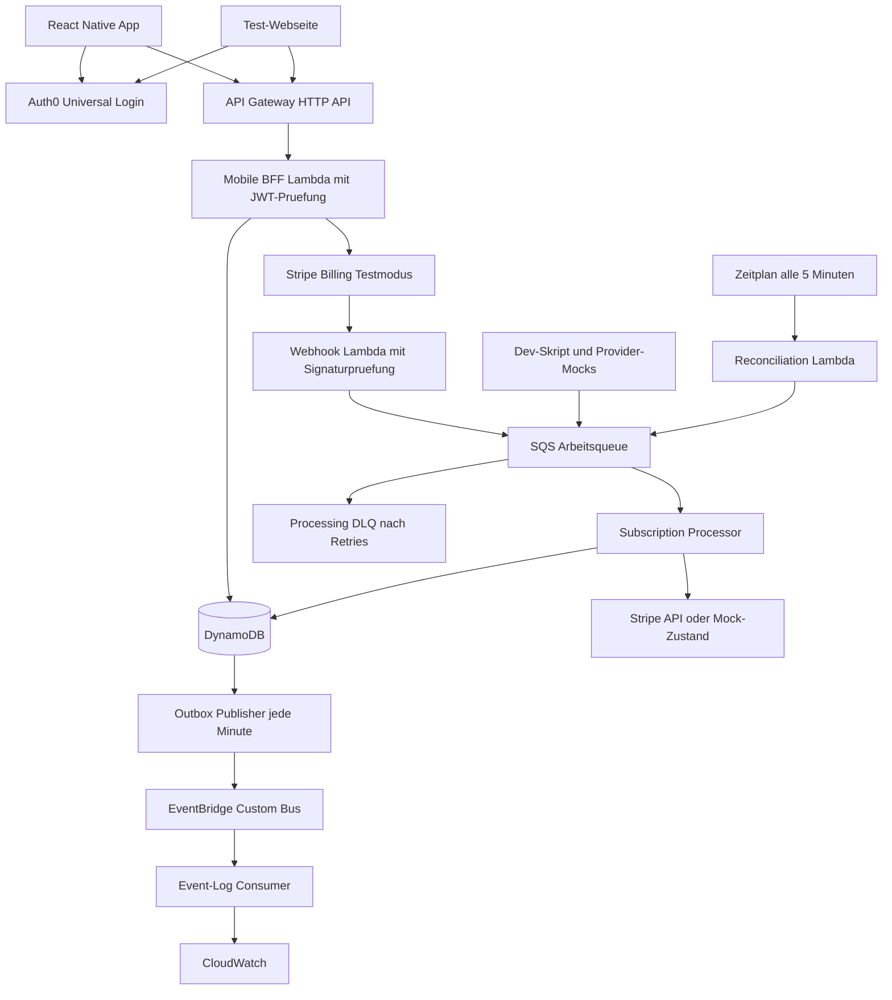

# PremiumPass

## Projektübersicht für ein Hands-on-Wochenende

**Ziel:** Eine React-Native-Demo-App mit Auth0 und einem AWS-Backend bauen, das Abonnements aus mehreren Kaufkanälen in zentrale, serverseitig geprüfte Berechtigungen übersetzt.

**Umfang:** Rund 16 Stunden Umsetzung, verteilt auf Samstag und Sonntag, bei vorbereiteten Accounts und funktionierender Entwicklungsumgebung. Wer React Native oder CDK komplett neu aufsetzt, sollte zusätzliche Einrichtungszeit einplanen. Die App bleibt klein; der Schwerpunkt liegt auf Backend-Architektur und nachvollziehbarer Fehlerbehandlung.

**Stand:** 10. Oktober 2026. Dieses Dokument ist ein Bauplan; seine Checklisten beschreiben die noch zu implementierenden und zu prüfenden Ergebnisse. Einstieg und ausführbare Befehle stehen im [README](README.md), Agent-Regeln in [AGENTS.md](AGENTS.md), Entscheidungsstatus in [docs/DECISIONS.md](docs/DECISIONS.md) und umsetzbare Aufgaben in [docs/TASKS.md](docs/TASKS.md).

PremiumPass ist eine fiktive Lernanwendung mit synthetischen Score-Daten. Sie dient zur Vorbereitung auf Aufgaben rund um Mobile BFFs, AWS Serverless und Subscription-Systeme. Sie bildet keine bekannte interne Architektur oder reale Bonitätslogik der SCHUFA ab.

## Inhalt

1. [Ergebnis und Projektumfang](#1-ergebnis-und-projektumfang)
2. [Lernziele](#2-lernziele)
3. [Vorbereitung und Technologieentscheidungen](#3-vorbereitung-und-technologieentscheidungen)
4. [Architektur und Verantwortlichkeiten](#4-architektur-und-verantwortlichkeiten)
5. [React Native und Auth0](#5-react-native-und-auth0)
6. [API und Benutzerzuordnung](#6-api-und-benutzerzuordnung)
7. [Subscriptions und Entitlements](#7-subscriptions-und-entitlements)
8. [DynamoDB und Nebenläufigkeit](#8-dynamodb-und-nebenläufigkeit)
9. [Stripe Billing im Testmodus](#9-stripe-billing-im-testmodus)
10. [Apple und Google als Provider-Mocks](#10-apple-und-google-als-provider-mocks)
11. [Events und zuverlässige Verarbeitung](#11-events-und-zuverlässige-verarbeitung)
12. [Reconciliation](#12-reconciliation)
13. [Security und Betrieb](#13-security-und-betrieb)
14. [Repository und CI/CD](#14-repository-und-cicd)
15. [Tests und Fehlerexperimente](#15-tests-und-fehlerexperimente)
16. [Samstag und Sonntag](#16-samstag-und-sonntag)
17. [Abnahme und Abschlussdemo](#17-abnahme-und-abschlussdemo)
18. [Vertiefung nach dem Wochenende](#18-vertiefung-nach-dem-wochenende)
19. [Offizielle Quellen](#19-offizielle-quellen)

## 1 Ergebnis und Projektumfang

Am Sonntag kannst du dich in der App anmelden, den Free-Zustand sehen, im Browser einen Stripe-Testkauf durchführen und anschließend Premium-Funktionen über dieselbe Identität nutzen. Danach demonstrierst du Kündigung, Ablauf, doppelte Ereignisse und die Reparatur eines verpassten Updates.

| Funktion | Free | Premium |
|---|---|---|
| Profil und aktueller synthetischer Score | Ja | Ja |
| Historische Demo-Score-Werte | Nein | Ja |
| Erweiterte Demo-Auswertung | Nein | Ja |
| Berechtigung für Benachrichtigungen | Nein | Ja, als Feature-Flag |

**Konkretes Demoprodukt:** `premium_monthly`, fiktiv 4,99 EUR pro Monat. Stripe verarbeitet ausschließlich Testzahlungen. Tatsächliche Push-Mitteilungen, E-Mails und fachliche Bonitätsauswertungen gehören nicht zum Wochenende.

### Verpflichtender Kern

- React Native mit TypeScript, drei Screens und echtem Auth0-Login.
- AWS HTTP API als HTTP-Einstieg, Auth0-Tokenprüfung direkt in den TypeScript-Lambdas und DynamoDB.
- Stripe Billing mit gehostetem Checkout, Webhook und Testabonnement.
- SQS mit DLQ, idempotente Verarbeitung und Behandlung konkurrierender Updates.
- Zentrale Subscription- und Entitlement-Logik für Stripe sowie Apple-/Google-Mocks.
- EventBridge mit einem sichtbaren Consumer und einer kleinen Outbox für ausstehende Events.
- Periodische und manuell auslösbare Reconciliation.
- CDK, automatisierte Backend-Tests, GitHub Actions und eine reproduzierbare Abschlussdemo.

### Bewusst begrenzt

Ein AWS-Account, eine Region, eine Dev-Stage, ein Premiumprodukt und zwei Testnutzer genügen. Baue die App für eine primäre Testplattform, etwa den iOS-Simulator. Ein zusätzlicher Android-Durchlauf ist eine Erweiterung und wird nur dann als geprüft dokumentiert, wenn er tatsächlich stattgefunden hat.

Echte Store-Käufe, App-Store-Veröffentlichung, Tarifwechsel, Proration, Steuerlogik, Refund-Abwicklung, Account-Merging und produktionsreife Hochverfügbarkeit bleiben Folgethemen. Apple und Google erhalten deterministische Adapter-Mocks; diese beweisen keine echte Store-Integration.

**Kaufweg:** Stripe startet auf einer separaten kleinen Test-Webseite. Die mobile App zeigt Status und Berechtigungen. Für eine Veröffentlichung müssen Produkt, Vertriebsregion, Storefront und jeweils geltende Zahlungsregeln gesondert geprüft werden. Ein externer Browser macht einen Kaufweg nicht automatisch zulässig. Siehe [Apple App Review Guidelines](https://developer.apple.com/app-store/review/guidelines/#in-app-purchase) und [Google Play Payments Policy](https://support.google.com/googleplay/android-developer/answer/9858738).

## 2 Lernziele

| Thema | Hands-on-Aufgabe | Was du danach erklären kannst |
|---|---|---|
| OAuth/OIDC und Auth0 | Native Anmeldung und JWT-Prüfung im Backend bauen | Unterschied zwischen Identität, Tokenvalidierung, Scopes und fachlicher Berechtigung |
| Mobile BFF | App-gerechte Statusantworten und Premium-Endpunkt bauen | Warum die App keine Provider-Details für ihre Autorisierung benötigt |
| AWS Lambda und TypeScript | Kleine Handler mit gemeinsamer Domainlogik deployen | Grenzen zwischen Transport, Fachlogik und externen Adaptern |
| DynamoDB | Access Patterns, Conditional Writes und Transaktionen implementieren | Wie parallele Updates ohne verlorene Änderungen verarbeitet werden |
| Stripe Billing | Testabonnement abschließen und Lifecycle verarbeiten | Warum Checkout-Erfolg und Premium-Freigabe getrennt sind |
| SQS und DLQ | Duplikate, Retries und einen permanenten Fehler provozieren | Warum mindestens einmal zugestellte Nachrichten idempotente Consumer brauchen |
| EventBridge | Fachliche Änderungen routen und beobachten | Unterschied zwischen einer Arbeitsqueue und einem Event-Bus |
| Provider-Abstraktion | Apple-/Google-Fixtures durch dieselbe Pipeline schicken | Was ein normalisiertes Modell vereinfacht und wo Provider-Unterschiede bleiben |
| Reconciliation | Einen verpassten Webhook ohne erneute Zustellung reparieren | Wie ein System aus dem Provider-Zustand wieder konsistent wird |
| CI/CD und Betrieb | Geprüftes Dev-Deployment über OIDC ausführen | Unterschied zwischen lokal bestandenem Test und live geprüftem Ablauf |

## 3 Vorbereitung und Technologieentscheidungen

### Vor dem ersten Arbeitsblock

- [ ] AWS-Dev-Account, CLI-Zugang über SSO oder ein geeignetes lokales Profil und Region festlegen, beispielsweise `eu-central-1`.
- [ ] Auth0-Tenant, Native Application und Custom API anlegen; zwei Testnutzer vorbereiten.
- [ ] Eine zusätzliche Auth0-SPA-Anwendung für die lokale Test-Webseite im selben Tenant anlegen. Beide Clients verwenden dieselbe API-Audience und dieselbe Benutzerverbindung.
- [ ] Stripe-Testumgebung, Produkt und wiederkehrenden Testpreis vorbereiten.
- [ ] Xcode/Simulator oder Android Studio/Emulator starten; React-Native-Development-Build prüfen.
- [ ] Node.js, Paketmanager, CDK und Stripe CLI bereitstellen; GitHub-Repository anlegen.
- [ ] Kleines AWS-Budget mit Warnung einrichten. Eine Budgetwarnung ist keine automatische Kostensperre.

Für diese Vorbereitung etwa 45–90 Minuten reservieren; längere Installationen und Accountfreischaltungen kommen gegebenenfalls hinzu.

| Bereich | Entscheidung für die Demo |
|---|---|
| Mobile | React Native, TypeScript, Expo Development Build, `react-native-auth0` |
| Test-Webseite | Minimale Vite-Seite, Auth0 SPA SDK, Login und Checkout-Button |
| Backend | TypeScript auf AWS Lambda, gemeinsame Domainmodule; HTTP-Framework noch offen |
| Runtime | Node.js 24 auf Lambda; kompatible lokale Toolchain und Abhängigkeiten im Lockfile fixieren |
| API | API Gateway **HTTP API** für Routing, CORS und Throttling; kein Gateway-Authorizer |
| API-Authentifizierung | Gemeinsame Auth-Komponente im Backend für Auth0-Access-Tokens und Scopes |
| Datenbank | Eine DynamoDB-Tabelle für die Demo, On-Demand-Kapazität |
| Asynchronität | SQS Standard Queue, Processing-DLQ, EventBridge Custom Bus |
| Infrastruktur | AWS CDK v2 in TypeScript, ein Dev-Stack |
| Tests | Vitest für Backend/Domain, CDK Assertions, wenige Live-Smoke-Tests |
| Deployment | GitHub Actions mit AWS OIDC, Dev-Deployment zunächst manuell auslösbar |

`react-native-auth0` benötigt native Komponenten und funktioniert nicht in Expo Go. Expo-, React-Native- und SDK-Versionen anhand der Kompatibilitätsangaben auswählen. [Auth0 SDK](https://github.com/auth0/react-native-auth0) · [AWS Lambda Runtimes](https://docs.aws.amazon.com/lambda/latest/dg/lambda-runtimes.html)

### Stand der Framework-Wahl

Ein Backend-Framework ist **noch nicht festgelegt**. Die Nutzerpräferenz lautet **Hono oder Fastify**; Hono ist die aktuelle Empfehlung, aber noch nicht bestätigt. NestJS wird nicht weiterverfolgt. Fest stehen TypeScript, AWS Lambda und gemeinsam genutzte Domainmodule. Die Auswahl erfolgt vor dem Backend-Skeleton und wird in [docs/DECISIONS.md](docs/DECISIONS.md) dokumentiert. Die Authentifizierung wird als Middleware beziehungsweise Hook des gewählten Frameworks umgesetzt. Für JWT-Verifikation eine etablierte Bibliothek verwenden; `jose` ist empfohlen. Keine eigene Kryptografie implementieren.

SQS-Processor, Reconciliation und Outbox bleiben unabhängig vom HTTP-Framework. Der fachliche Ablauf und die Sicherheitsanforderungen gelten für alle Varianten.

## 4 Architektur und Verantwortlichkeiten



**Leserichtung:** App und Test-Webseite melden sich bei Auth0 an und senden dessen Access Token über API Gateway an das BFF. Das BFF verifiziert das Token, prüft die benötigten Scopes und stellt erst danach benutzerbezogene Daten bereit oder erzeugt Checkout-Sessions. Webhooks und Reconciliation liefern Arbeitsaufträge an SQS. Der Processor liest den aktuellen Provider-Zustand und speichert daraus Subscriptions, Entitlements und ausstehende Domain Events gemeinsam. Der Publisher liest die Outbox; EventBridge verteilt deren Events an einen beobachtbaren Consumer.

| Komponente | Verantwortung |
|---|---|
| BFF Lambda | Auth0-Access-Token verifizieren, Scopes prüfen, Eingaben validieren, Kontozuordnung auflösen, Lesemodelle liefern, Checkout starten |
| Webhook Lambda | Stripe-Signatur prüfen, unterstützte Events auf SQS schreiben, erst danach bestätigen |
| Subscription Processor | Provider lesen, Zustand normalisieren, Berechtigungen ableiten, atomar persistieren |
| Provider-Adapter | Unterschiede von Stripe, Apple-Mock und Google-Mock kapseln |
| Reconciliation Lambda | Fällige Konten/Subscriptions finden und erneute Synchronisation anstoßen |
| Outbox Publisher | Noch nicht bestätigte Domain Events an EventBridge senden |
| Event-Log Consumer | Änderungen mit stabiler Event-ID in CloudWatch sichtbar machen |

Subscription Service und Entitlement Service sind hier **logisch getrennte Module im selben Processor**. Dadurch können ihre Änderungen in einer DynamoDB-Transaktion liegen. Eine zusätzliche asynchrone Entitlement-Projektion wäre ein späterer Ausbau. EventBridge ist in dieser Demo der Verteilweg für fachliche Änderungen; die Freigabe des Premium-Endpunkts hängt nicht von der Laufzeit des Event-Log-Consumers ab.

## 5 React Native und Auth0

### Drei Screens

| Screen | Inhalt und Verhalten |
|---|---|
| Login | Universal Login öffnen, Abbruch/Fehler zeigen, Logout ermöglichen |
| Dashboard | Profil, synthetischen Score, Free/Premium und Aktualisieren-Button anzeigen |
| Premium | Features und Subscription-Status zeigen, geschützte Historie laden, laufende Synchronisation erklären |

Nach App-Fokus und manueller Aktualisierung wird `/v1/me/entitlements` erneut geladen. Während der Kaufverarbeitung zeigt die App einen Wartezustand. Optional alle zwei Sekunden für maximal 30 Sekunden pollen; danach bleibt der Aktualisieren-Button verfügbar. Offline gecachte Anzeige ist kein Nachweis einer gültigen Backend-Berechtigung.

### Authentifizierung umsetzen

1. Native Auth0-Anwendung mit Authorization Code Flow und PKCE konfigurieren.
2. Bundle Identifier, Android Package Name, App-Scheme sowie Callback- und Logout-URLs exakt nach SDK-Anleitung hinterlegen.
3. Für die Custom API eine eigene Audience verwenden, beispielsweise `https://api.premiumpass.example`. Das ist ein API-Identifier und muss keine erreichbare Website sein.
4. Beim Login `openid profile email` und die benötigten API-Scopes anfordern: `read:me`, `read:premium`, für die Test-Webseite zusätzlich `write:checkout`.
5. Access Tokens über den Credentials Manager des SDK beziehen und erneuern. Falls längerfristiger Login gewünscht ist, Refresh Token Rotation und die erforderliche Offline-Access-Konfiguration ergänzen.
6. Den API-Aufruf mit `Authorization: Bearer <access-token>` senden; ein ID Token dient nicht als API-Zugang.

Tokens gehören nicht in AsyncStorage oder Logs. Auth0-Domain und Client-ID sind öffentliche App-Konfiguration; ein Client Secret gehört nicht in die native App. Konkrete SDK-Aufrufe an der gewählten Version ausrichten. [Auth0 React Native SDK](https://github.com/auth0/react-native-auth0)

### Tokenprüfung direkt im Backend

API Gateway reicht den `Authorization`-Header an die HTTP-Lambda weiter. Es wird weder ein JWT Authorizer noch ein Lambda Authorizer am Gateway eingerichtet. Die gemeinsame Auth-Komponente läuft vor allen geschützten BFF-Routen; neue Routen sind standardmäßig geschützt. Auth0 stellt weiterhin Tokens aus und übernimmt den Login.

Die Backend-Komponente prüft mit einer etablierten JWT-Bibliothek:

1. Bearer-Header und Tokenformat; bloßes Dekodieren genügt nicht.
2. Signatur gegen die öffentlichen Schlüssel des konfigurierten Auth0-Tenants; für die Demo ausschließlich `RS256` zulassen.
3. Exakten `iss` einschließlich Slash, die konfigurierte API-Audience in `aud`, erforderliches `exp`, gegebenenfalls `nbf` und ein nicht leeres `sub`. Eine kleine feste Zeittoleranz festlegen.
4. Die für die Route erforderlichen Scopes aus dem verifizierten `scope`-Claim.

Aus den geprüften Claims entsteht ein interner Auth-Kontext mit `issuer`, `subject` und `scopes`. Nur dieser Kontext darf die Benutzerzuordnung steuern. Keine ungeprüften Claims, Client-User-IDs oder `requestContext.authorizer`-Werte als Identitätsnachweis verwenden. ID Tokens werden nicht als API-Access-Tokens akzeptiert. [Auth0 Access Token Validation](https://auth0.com/docs/secure/tokens/access-tokens/validate-access-tokens) · [Auth0 JWT Validation](https://auth0.com/docs/secure/tokens/json-web-tokens/validate-json-web-tokens)

### Schlüsselabruf und Fehlerverhalten

Die JWKS-Adresse wird aus der fest konfigurierten, vertrauenswürdigen Auth0-Domain bezogen; keine vom Token vorgegebene URL abrufen. Schlüssel über warme Lambda-Aufrufe hinweg cachen, Rotation unterstützen und bei unbekanntem `kid` nur begrenzt neu laden. Netzwerk-Timeouts und ein Refresh-Limit verhindern einen unbeschränkten Abruf pro Anfrage. [Auth0 JSON Web Key Sets](https://auth0.com/docs/secure/tokens/json-web-tokens/json-web-key-sets)

Fehlende oder ungültige Tokens führen zu `401`; ein gültiges Token ohne nötigen Scope zu `403`. Schlägt der Schlüsselabruf technisch fehl und kann das Token auch mit dem gültigen Cache nicht verifiziert werden, wird kein Zugriff gewährt; die Demo antwortet mit `503`. Kann ein Token mit einem weiterhin gültig gecachten Schlüssel vollständig geprüft werden, benötigt es keinen zusätzlichen Online-Aufruf bei Auth0.

Der Stripe-Webhook besitzt einen eigenen Handler mit Stripe-Signaturprüfung und benötigt kein Auth0-Token. CORS-Preflights übernimmt API Gateway. SQS- und Zeitplan-Handler werden über AWS-Berechtigungen aufgerufen und übernehmen keinen mobilen Benutzer-Token.

### Authentifizierung von Autorisierung unterscheiden

Die Scope-Prüfung findet ebenfalls im Backend statt. `read:premium` ist die technische Voraussetzung für die Route; anschließend entscheidet die aktuelle Entitlement-Prüfung über die Premiumdaten. Ein authentifizierter Free-Nutzer mit diesem Scope erhält weiterhin `403`.

Da ungültige Aufrufe erst im Backend abgewiesen werden, erreichen sie bereits Lambda. Gateway-Throttling und Lambda-Concurrency bleiben deshalb Teil der Dev-Konfiguration.

## 6 API und Benutzerzuordnung

### Geplante Endpunkte

JWT- und Scope-Prüfungen in dieser Tabelle erfolgen vollständig im Backend.

| Methode und Pfad | Schutz | Ergebnis |
|---|---|---|
| `GET /v1/me` | JWT, `read:me` | Eigene interne User-ID und minimales Profil |
| `GET /v1/me/subscriptions` | JWT, `read:me` | Eigene normalisierte Abonnements und Synchronisationsstatus |
| `GET /v1/me/entitlements` | JWT, `read:me` | Effektive Features, Revision und Gültigkeitsgrenzen |
| `GET /v1/premium/score-history` | JWT, `read:premium`, Entitlement | Synthetische Historie oder `403` |
| `POST /v1/billing/stripe/checkout-session` | JWT, `write:checkout` | Gehostete Test-Checkout-URL |
| `POST /v1/webhooks/stripe` | Stripe-Signatur | `2xx` nach erfolgreicher Queue-Annahme |

Reconciliation und Mock-Szenarien werden über lokale Dev-Skripte mit AWS-IAM-Rechten ausgelöst. Dafür ist kein öffentlich erreichbarer Admin-Endpunkt nötig.

**Fehlerkonvention:** `400` für ungültige Nutzdaten oder Webhook-Signaturen; `401` für fehlende/ungültige Anmeldung; `403` für fehlenden Scope beziehungsweise fehlendes Entitlement; `409` für widersprüchliche Idempotenzdaten oder einen bereits laufenden Kaufversuch; `503` bei technisch nicht möglicher Tokenverifikation ohne verwendbaren Schlüsselcache. Interne Details bleiben im Log; API-Fehler enthalten Code und Request-ID.

### Konten zuverlässig verbinden

Aus dem validierten Paar `iss` und `sub` wird einmalig eine interne `userId` erzeugt. E-Mail-Adressen sind kein stabiler Schlüssel. Die Zuordnung zu `stripeCustomerId` entsteht ausschließlich serverseitig und wird vor dem Checkout gespeichert.

Die Test-Webseite meldet sich mit demselben Auth0-Konto und derselben Connection wie die App an. Zwei verschiedene Auth0-Identitäten werden auch bei gleicher E-Mail nicht automatisch zusammengeführt.

Der Client übergibt beim Checkout nur `planId: "premium_monthly"` und einen Idempotency-Key. `userId`, Stripe-Customer, Preis, Rücksprung-URLs und kaufberechtigtes Produkt bestimmt das Backend. Ein mitgesendeter fremder User-Identifier darf die Kontozuordnung nicht verändern.

Beispiel einer geplanten API-Antwort:

```json
{
  "userId": "demo-user-a",
  "features": {
    "scoreHistory": true,
    "advancedInsights": true,
    "scoreNotifications": true
  },
  "effectiveUntil": "2026-11-10T10:00:00Z",
  "revision": 7,
  "syncStatus": "current",
  "evaluatedAt": "2026-10-10T10:01:00Z"
}
```

`effectiveUntil` bezeichnet die nächste relevante Ablaufgrenze im aktuellen Lesemodell. Der Backend-Check wertet Zeitgrenzen bei jedem Zugriff neu aus; er verlässt sich nicht allein auf gespeicherte Booleans.

## 7 Subscriptions und Entitlements

Eine **Subscription** beschreibt den beim Provider beobachteten Vertrag. Ein **Entitlement** beschreibt die daraus abgeleitete fachliche Zugriffsberechtigung. Der Provider ist führend für seinen Zahlungs-/Vertragszustand; PremiumPass ist führend für die Zuordnung dieser Fakten zu eigenen Features.

### Normalisiertes Modell

```typescript
type Provider = 'stripe' | 'apple_mock' | 'google_mock';

type SubscriptionState =
  | 'pending' | 'trialing' | 'active' | 'past_due'
  | 'paused' | 'canceled' | 'expired' | 'revoked';

interface Subscription {
  userId: string;
  provider: Provider;
  providerSubscriptionId: string;
  productId: 'premium_monthly';
  state: SubscriptionState;
  providerStatus: string;
  cancelAtPeriodEnd: boolean;
  accessUntil: string | null;
  graceUntil: string | null;
  verifiedAt: string;
  revision: number;
}
```

`accessUntil` ist eine **verifizierte Berechtigungsgrenze**. Sie darf nicht blind aus dem nominellen Ende einer noch unbezahlten Abrechnungsperiode übernommen werden. Stripe-Mapping und Fixtures liefern diese Grenze nach der unten festgelegten Demopolicy.

### Explizite Demopolicy

| Zustand | Zugriff |
|---|---|
| Kein Abonnement / `pending` | Free |
| `trialing` | Bis zum bestätigten Trial-Ende; Trial im Checkout zunächst ausgeschaltet |
| `active` | Bis `accessUntil`, sofern keine bestätigte Sperre vorliegt |
| `active` und `cancelAtPeriodEnd=true` | Premium bleibt bis zur bestätigten Ablaufgrenze bestehen |
| `past_due` | Bereits gewährter Zeitraum bleibt gültig; 24 Stunden Grace ab dessen Ende, sofern zuvor Zugriff bestand |
| `paused`, `canceled`, `expired`, `revoked` | Diese Subscription gewährt keinen Zugriff |
| Provider technisch nicht erreichbar | Letzten verifizierten Stand behalten; keine neue Laufzeit erfinden |

Die Grace Period wird für die Demo auf **24 Stunden** festgelegt und nur nach einem zuvor verifizierten Zugriffszeitraum gewährt. Retries dürfen ihren Beginn nicht neu setzen. Ein erstmalig fehlgeschlagener Kauf erhält dadurch keinen Premiumzugang. Diese Regel ist eine eigene Produktentscheidung, keine allgemeine Stripe-/Apple-/Google-Vorgabe.

Für Stripe gilt im Demo-Mapping: `incomplete` → `pending`, `incomplete_expired` → `expired`, `unpaid` → gesperrt, hier normalisiert als `expired`. Den Originalstatus zusätzlich speichern. `cancel_at_period_end=true` ist ein Merkmal einer noch laufenden Subscription; es bedeutet nicht sofort `canceled`. Ein Refund wird im Kernumfang nicht automatisch mit einem Widerruf gleichgesetzt. Die echte Refund-Policy bleibt ein Folgethema. [Stripe Subscription Lifecycle](https://docs.stripe.com/billing/subscriptions/overview)

### Mehrere Kaufkanäle

Die Features eines Nutzers ergeben sich aus der Vereinigung seiner aktuell gültigen Grants. Endet Apple-Mock, während Stripe noch gültig ist, bleibt Premium aktiv. Deshalb darf ein einzelnes Provider-Ereignis niemals pauschal `isPremium=false` für den gesamten Nutzer setzen.

Implementiere die Berechnung als pure Funktion `deriveEntitlements(subscriptions, now)`. Die Uhr wird als Parameter übergeben, damit Ablaufgrenzen ohne Wartezeit testbar sind. Bei unbekanntem Produkt oder nicht verstandenem Provider-Status erfolgt keine neue Freigabe; der Fall bleibt sichtbar zur Klärung.

## 8 DynamoDB und Nebenläufigkeit

### Access Patterns zuerst

1. Identität aus `iss` und `sub` auf interne User-ID abbilden.
2. Eigenes Profil, eigene Subscriptions und Entitlements lesen.
3. Provider-Customer oder Provider-Subscription einem Nutzer zuordnen.
4. Ein bereits verarbeitetes Event erkennen.
5. Fällige Synchronisationen und ausstehende Outbox-Einträge finden.

### Vorschlag für eine Demotabelle

| PK | SK | Inhalt |
|---|---|---|
| `IDENTITY#<identityHash>` | `MAP` | `iss`, `sub`, interne `userId` |
| `USER#<userId>` | `PROFILE` | Minimalprofil, Stripe-Customer-Zuordnung |
| `USER#<userId>` | `SUB#<provider>#<id>` | Normalisierte Subscription |
| `USER#<userId>` | `ENTITLEMENTS` | Grants, effektive Features, Aggregatrevision |
| `PROVIDER#<provider>#<externalId>` | `OWNER` | Eindeutige Besitzerzuordnung, Objekttyp |
| `EVENT#<provider>#<eventId>` | `PROCESSED` | Zeitpunkt, Ergebnis, optional Aufbewahrungsgrenze |
| `CHECKOUT#<userId>#<requestId>` | `REQUEST` | Anfragehash, Stripe-Key, Session-ID und Bearbeitungsstatus |
| `OUTBOX#<domainEventId>` | `EVENT` | Payload, `pending`/`sent`, Erzeugungszeit |
| `MOCK#<provider>#<id>` | `STATE` | Separater simulierter Provider-Zustand |

Der Identitätshash wird aus einer eindeutigen Serialisierung von `iss` und `sub` gebildet. Provider-IDs immer mit Provider und Objekttyp namespacen.

Für die winzige Demo dürfen Reconciliation und Outbox-Publisher paginierte Scans nutzen. Das ist eine bewusste Kosten-/Skalierungsgrenze: Scan-Filter sparen keine gelesene Kapazität. Als spätere Verbesserung einen nach Fälligkeit abgefragten, gegebenenfalls partitionierten GSI vorsehen. Normale Nutzeranfragen verwenden `GetItem` beziehungsweise `Query` auf ihrer Partition.

### Atomare Verarbeitung

Eine erfolgreiche Änderung schreibt in **einer** DynamoDB-Transaktion:

1. Das Event als verarbeitet, nur wenn dessen ID noch nicht existiert.
2. Die normalisierte Subscription.
3. Die aus allen Subscriptions berechneten Entitlements mit erhöhter Aggregatrevision.
4. Einen Outbox-Eintrag mit stabiler Domain-Event-ID, sofern sich der fachliche Zustand geändert hat.

Die Bedingung auf der bisherigen Aggregatrevision verhindert verlorene Updates bei mehreren Subscriptions desselben Nutzers. Alle Schreiber verwenden diesen gemeinsamen Pfad. Bei einem Konflikt werden lokale Daten **und der Provider-Zustand erneut gelesen**, danach wird neu gerechnet. Begrenzte unmittelbare Versuche mit Jitter; danach übernimmt der SQS-Retry.

Die relevante lokale Revision vor dem Provider-Abruf lesen und beim Commit prüfen. Revision und zugehörige lokale Subscription-Daten aus der Basistabelle mit konsistenten Reads laden; zuerst die Revision, danach die Subscriptions. Die Commit-Bedingung erkennt Änderungen während dieses Leseablaufs. Dadurch kann ein parallel bereits abgeschlossener neuerer Commit nicht von einem später abgeschlossenen alten Abruf überschrieben werden. Provider-Reads und lokale Transaktion sind dennoch keine verteilte Transaktion; zwischenzeitliche externe Änderungen werden durch weitere Events und Reconciliation korrigiert.

Bei unverändertem fachlichem Zustand die Verifizierung aktualisieren und das Arbeitsereignis abschließen, aber kein weiteres fachliches Änderungsereignis erzeugen. Das verhindert Event-Schleifen. [DynamoDB Transactions](https://docs.aws.amazon.com/amazondynamodb/latest/developerguide/transaction-apis.html)

TTL dient ausschließlich zum späteren Aufräumen abgeschlossener technischer Datensätze. DynamoDB löscht abgelaufene TTL-Einträge nicht exakt zum Ablaufzeitpunkt. Entitlement-Ablauf wird deshalb im Code geprüft; offene Outbox-Einträge werden nicht per TTL entfernt. [DynamoDB TTL](https://docs.aws.amazon.com/amazondynamodb/latest/developerguide/TTL.html)

## 9 Stripe Billing im Testmodus

### Checkout einrichten

1. Testprodukt `PremiumPass Premium` und monatlichen Preis anlegen.
2. Nur die serverseitig konfigurierte `priceId` für `premium_monthly` akzeptieren; Menge eins, Karten-Testzahlung, kein Trial oder Tarifwechsel im Kernumfang.
3. Beim ersten Kauf einen Stripe-Customer serverseitig erzeugen und dessen Besitzerzuordnung speichern. Den Erzeugungsschritt ebenfalls idempotent behandeln.
4. Checkout-Session mit `mode=subscription`, dem gespeicherten Customer und freigegebenen Success-/Cancel-URLs anlegen.
5. Eine interne User-Referenz serverseitig in Session und Subscription-Metadaten hinterlegen. Diese Metadaten unterstützen die Zuordnung, ersetzen aber nicht die Prüfung der gespeicherten Customer-Zugehörigkeit.
6. Die Test-Webseite öffnet die zurückgegebene gehostete Checkout-URL.

Für jeden Kaufversuch einen stabilen Idempotency-Key verwenden. Derselbe Schlüssel mit anderem Anfrageinhalt führt lokal zu `409`. Parallele Versuche desselben Nutzers über einen bedingten Datensatz für den laufenden Kaufversuch begrenzen. Nach einem Timeout die zugehörige Session wiederfinden, statt sofort eine neue Subscription zu erzeugen. Die begrenzte Aufbewahrung von Stripe-Idempotency-Keys ersetzt keine eigene dauerhafte Kaufzuordnung. [Stripe Checkout Session API](https://docs.stripe.com/api/checkout/sessions/create) · [Stripe Idempotency](https://docs.stripe.com/api/idempotent_requests)

### Webhooks verarbeiten

Mindestens abonnieren:

- `checkout.session.completed`
- `customer.subscription.created`
- `customer.subscription.updated`
- `customer.subscription.deleted`
- `invoice.paid`
- `invoice.payment_failed`

Der Handler prüft `Stripe-Signature` mit dem Secret dieses Endpunkts gegen die unveränderten Request-Bytes. Bei API Gateway gegebenenfalls den Base64-Body korrekt dekodieren, bevor die Stripe-Bibliothek ihn prüft. Erst nach der Signaturprüfung parsen und einen kleinen Synchronisationsauftrag auf SQS schreiben. Nur erfolgreiches Enqueueing wird mit `2xx` bestätigt; bei Queue-Ausfall kommt ein Fehler zurück, damit Stripe erneut zustellen kann. Nicht benötigte, gültig signierte Eventtypen dürfen bewusst ohne Verarbeitung bestätigt werden. [Stripe Webhooks](https://docs.stripe.com/webhooks)

Der Auftrag enthält beispielsweise Provider, Event-ID, Eventtyp, betroffene Objekt-ID, Eingangszeit und Correlation-ID. Keine Kartendaten und keine kompletten sensiblen Payloads in Logs übernehmen.

**Freigaberegel:** Weder Success-Redirect noch `checkout.session.completed` allein aktiviert Premium. Der Processor lädt die tatsächliche Subscription sowie die für den aktuellen Leistungszeitraum relevante Rechnung. Im vereinfachten Tarifmodell erweitert eine bezahlte passende Rechnung die Zugriffsgrenze nur zusammen mit einem dafür gültigen Subscription-Zustand. Ein isoliertes `invoice.paid` genügt nicht. Stripe weist darauf hin, dass auch `active` nicht zwangsläufig bedeutet, dass sämtliche älteren Rechnungen bezahlt sind. [Stripe Subscription Webhooks](https://docs.stripe.com/billing/subscriptions/webhooks)

IDs und Periodenfelder aus der gepinnten Stripe-API-/SDK-Version verwenden. Keine älteren Beispiele ungeprüft übernehmen, insbesondere bei Subscription-Items und Rechnungsreferenzen. Lokale Stripe-CLI-Weiterleitung und deployter Webhook besitzen unterschiedliche Signing-Secrets.

### Drei Stripe-Übungen

1. Testkauf abschließen und die Freigabe in App und Backend beobachten.
2. Im Stripe-Testdashboard zum Periodenende kündigen; Premium muss bis zum Ende erhalten bleiben.
3. Ein separates, über API angelegtes Test-Clock-Szenario für Verlängerung oder fehlgeschlagene Folgezahlung verwenden. Die Uhr ist eine Stripe-Testfunktion, keine Änderung der Uhr des gesamten AWS-Systems. Unterstützte Abläufe anhand der [Stripe Test Clocks](https://docs.stripe.com/billing/testing/test-clocks) auswählen.

## 10 Apple und Google als Provider-Mocks

### Gemeinsamer Vertrag

```typescript
interface BillingProvider {
  fetchCurrentSubscription(reference: string): Promise<ProviderSnapshot>;
}

interface PurchaseVerifier {
  verifyPurchase(reference: string, expectedUserId: string): Promise<VerifiedPurchase>;
}
```

`ProviderSnapshot` enthält Besitzerreferenz, Produkt, Originalstatus, Zugriffsgrenzen und Provider-Metadaten. `VerifiedPurchase` verbindet eine verifizierte Kaufreferenz mit dem erwarteten Nutzer. Stripe verwendet Checkout; eine Store-Kaufverifikation muss deshalb nicht künstlich in jeden Adapter gezwungen werden.

Implementierungen: `StripeBillingProvider`, `AppleMockBillingProvider`, `GoogleMockBillingProvider`. Die Mocks lesen ihren Zustand aus eigenen Fixture-Datensätzen, getrennt vom lokalen Subscription-Lesemodell. Nur so kann Reconciliation einen absichtlich veralteten lokalen Zustand tatsächlich reparieren.

### Deterministische Szenarien

| Fixture | Erwarteter Zustand |
|---|---|
| `purchase_active` | Zugeordneter Testnutzer erhält Premium |
| `renewal_paid` | Gültigkeitsgrenze wird einmalig verlängert |
| `cancel_at_period_end` | Laufender Zugriff bleibt bis zur Grenze erhalten |
| `expired` | Grant dieses Providers endet |
| `revoked` | Grant dieses Providers wird sofort entzogen |
| `payment_failed` | Bestehende Laufzeit/definierte Grace gilt; keine unbegrenzte Verlängerung |
| `provider_unavailable` | Synchronisation schlägt wiederholbar fehl |
| `wrong_owner` | Verifikation lehnt die fremde Kaufreferenz ab |

Ein Dev-Skript ändert den Mock-Zustand und sendet optional einen Synchronisationsauftrag. Mit `emitEvent=false` entsteht der Reconciliation-Testfall. Für Duplikate dieselbe Event-ID erneut verwenden; für verspätete Zustellung eine ältere Benachrichtigung nach einer neueren senden. Der Processor liest trotzdem den aktuellen Mock-Zustand.

Apple- und Google-spezifische IDs, Environment und Statuswerte bleiben als Providerdaten erhalten. Die Mocks simulieren fachliche Szenarien; sie implementieren keine echte JWS-/Zertifikatsprüfung und keine Google-Pub/Sub-Authentifizierung.

Spätere echte Adapter benötigen unter anderem Apple-Transaktionsvalidierung und Server Notifications sowie Google-Kaufvalidierung, Acknowledgement und Real-time Developer Notifications. Lokale StoreKit-Tests und Tests gegen Apples Sandbox sind unterschiedliche Stufen; Google erfordert passende Play-Konfiguration und Testkonten. [Apple Testing](https://developer.apple.com/documentation/storekit/testing-at-all-stages-of-development-with-xcode-and-the-sandbox) · [Google Billing Tests](https://developer.android.com/google/play/billing/test)

## 11 Events und zuverlässige Verarbeitung

### SQS als Arbeitsqueue

Nutze eine Standard Queue. Zustellungen dürfen mehrfach und in anderer Reihenfolge eintreffen; fachliche Korrektheit entsteht im Processor. Eine FIFO-Queue allein würde weder verspätete Provider-Webhooks noch alle externen Race Conditions lösen.

**Startkonfiguration für die Demo:** Processor-Timeout 30 Sekunden, Batchgröße eins, kein Batchfenster, Visibility Timeout mindestens 180 Sekunden, `maxReceiveCount=5`, Source-Retention vier Tage und DLQ-Retention 14 Tage. Werte unter tatsächlicher Laufzeit prüfen. AWS empfiehlt mindestens das Sechsfache des Lambda-Timeouts zuzüglich eines gegebenenfalls konfigurierten Batchfensters. [AWS SQS Event Source](https://docs.aws.amazon.com/lambda/latest/dg/services-sqs-configure.html)

Provider-Aufrufe erhalten eigene kurze Timeouts; bei `429` und temporären Fehlern begrenzte Retries mit Backoff/Jitter. Danach den Auftrag fehlschlagen lassen. Keine langen Warteschleifen innerhalb einer Lambda ausführen.

Bei späterer Batchverarbeitung `ReportBatchItemFailures` aktivieren und nur fehlgeschlagene SQS-Message-IDs melden. Sonst können erfolgreiche Nachrichten desselben Batches erneut verarbeitet werden. Die DLQ wird über die Redrive-Policy der **SQS-Quellqueue** angebunden. [AWS SQS Error Handling](https://docs.aws.amazon.com/lambda/latest/dg/services-sqs-errorhandling.html)

### Idempotenz und Reihenfolge

- Deduplizieren anhand von Provider und Event-ID; die Event-ID ist nicht die SQS-Message-ID.
- Ein Event wird erst innerhalb der erfolgreichen Zustandstransaktion als abgeschlossen markiert.
- Verschiedene Events mit gleichem fachlichem Ergebnis erzeugen keine doppelte Verlängerung.
- Webhooks dienen als Anlass, den aktuellen Provider-Zustand zu lesen.
- `event.created` ist kein verlässlicher vollständiger Sortierschlüssel; verschiedene Stripe-Events können denselben Sekunden-Zeitstempel haben. [Stripe Event Ordering](https://docs.stripe.com/webhooks#event-ordering)

### Kleine Outbox für EventBridge

Das direkte Muster „Datenbank speichern, danach Event senden“ hat ein Absturzfenster. Deshalb speichert die Transaktion ein `pending`-Event mit stabiler `domainEventId`. Ein Publisher wird jede Minute aufgerufen, liest offene Einträge und sendet sie an den per CDK erzeugten Bus.

Beispiel:

```json
{
  "source": "premiumpass.subscriptions",
  "detail-type": "EntitlementsChanged",
  "detail": {
    "schemaVersion": 1,
    "domainEventId": "demo-user-a:7",
    "userId": "demo-user-a",
    "revision": 7,
    "reason": "provider_sync",
    "occurredAt": "2026-10-10T10:01:00Z"
  }
}
```

`PutEvents` kann bei HTTP `200` einzelne fehlgeschlagene Einträge zurückmelden. Der Publisher prüft `FailedEntryCount` und jedes Ergebnis; nur angenommene Events werden als `sent` markiert. Ein Absturz nach dem Senden kann Duplikate erzeugen. Die stabile fachliche Event-ID und die Aggregatrevision erlauben späteren Consumern eine idempotente Verarbeitung. [EventBridge PutEvents](https://docs.aws.amazon.com/eventbridge/latest/APIReference/API_PutEvents.html)

Der Demo-Consumer protokolliert `domainEventId`, Revision und Grund. Doppelte Logzeilen sind zulässig und erkennbar; sie entsprechen keinen doppelten fachlichen Änderungen. EventBridge-Annahme beweist noch nicht die erfolgreiche Consumer-Ausführung. Für die Lambda als Ziel eine Failure-Destination für fehlgeschlagene asynchrone Ausführungen vorsehen; Zustellfehler am EventBridge-Target separat durch Retry/DLQ behandeln.

### DLQ wieder abarbeiten

Fehler anhand der Correlation-ID untersuchen, Ursache beheben, dann gezielt mit begrenzter Rate redriven. Ein kontrolliertes Gift-Event demonstriert den Weg in die DLQ. Ein Redrive ohne Fehlerkorrektur würde nur dieselbe Schleife wiederholen.

## 12 Reconciliation

Reconciliation synchronisiert den lokalen Zustand erneut mit dem Provider. Sie verwendet dieselbe Normalisierung, Entitlement-Berechnung und Transaktion wie Webhook-Aufträge.

### Ablauf alle fünf Minuten

1. Bekannte Customer-Zuordnungen und fällige Subscription-Datensätze paginiert lesen.
2. Für Stripe pro bekanntem Customer die relevanten Subscriptions inklusive beendeter Zustände ermitteln. Dadurch wird auch eine Subscription entdeckt, deren erster Webhook nie ankam.
3. Für die Mocks deren separate Zustandsablage lesen.
4. Synchronisationsaufträge mit deterministischer ID aus Provider, Referenz und Lauf-ID auf SQS schreiben. Innerhalb desselben Laufs sind Duplikate unschädlich; der nächste Lauf besitzt neue IDs.
5. Lokale Abweichungen über den gemeinsamen Processor reparieren und als `reconciliation` kennzeichnen.
6. `lastReconciledAt`, Fehler und gefundene Abweichungen erfassen. Bei Provider-Ausfällen keine Subscription aus einem fehlenden Antwortobjekt als beendet interpretieren.

Die Stripe-Customer-Zuordnung muss schon vor dem Checkout existieren, damit Schritt zwei auch ohne lokale Subscription möglich ist. Extern im Dashboard angelegte, keinem bekannten Kundenkonto zugeordnete Käufe werden nicht automatisch einem Nutzer zugewiesen.

Unabhängig von Provider-Änderungen muss der Processor fällige Ablaufgrenzen neu bewerten. Damit verschwinden abgelaufene Grants auch ohne Kündigungs-Webhook. Die synchrone Prüfung im Premium-Endpunkt verhindert bereits vorher Zugriff über die zulässige Grenze hinaus.

### Konkretes Experiment

Apple-Mock zunächst aktivieren. Dann den Mock auf `expired` ändern und das Event absichtlich unterdrücken. Die gespeicherte Subscription bleibt zunächst alt. Reconciliation manuell anstoßen und zeigen, dass sie diesen Datensatz sowie das Entitlement korrigiert. Danach denselben Lauf erneut auslösen: kein zusätzlicher fachlicher Effekt.

**Messbares Demoziel:** Reparatur eines verpassten Updates innerhalb von sieben Minuten bei gesunden Abhängigkeiten — fünf Minuten bis zum nächsten Lauf plus Verarbeitungspuffer. Das ist ein selbst gesetztes Abnahmekriterium, keine AWS-Garantie.

## 13 Security und Betrieb

### Sicherheitsgrenzen

| Grenze | Umsetzung |
|---|---|
| Benutzer → Backend | JWT-Signatur und Claims im Backend prüfen, Route-Scopes und Besitzerprüfung durchsetzen |
| App → Premiumdaten | Entitlement und Ablaufzeit bei jedem geschützten Aufruf prüfen |
| Stripe → Webhook | Signaturprüfung vor Enqueueing; für diese Route kein Auth0-JWT verlangen |
| Dev-Skript → AWS | Lokales AWS-Profil/IAM; Mock-Funktionen ausschließlich in Dev bereitstellen |
| Lambda → AWS-Ressourcen | Eigene Rollen mit auf Tabellen, Queue, Bus und Secrets begrenzten Rechten |
| GitHub → AWS | OIDC mit auf Repository und Branch/Environment begrenzter Trust Policy |

Stripe-Secret-Key und Webhook-Secret liegen in AWS Secrets Manager; Lambdas erhalten nur die benötigten Leserechte. CDK-Ausgaben enthalten keine Geheimnisse. Beispielkonfiguration und `.env.example` dürfen ausschließlich Platzhalter beziehungsweise öffentliche Werte enthalten.

Der BFF benötigt keine Schreibrechte auf fachliche Entitlements. Diese liegen beim Processor. Provider-Customer- und Kaufzuordnungen werden per Conditional Write gegen Besitzerwechsel geschützt. Ein späterer echter Store-Adapter muss zusätzlich verhindern, dass dieselbe Kaufreferenz von einem zweiten Nutzer beansprucht wird.

Zod oder ein vergleichbares Schemawerkzeug validiert Requests und normalisierte Events. Produkte und Redirect-Ziele sind serverseitig zugelassen. Für die lokale Test-Webseite CORS auf die konkrete Origin begrenzen; CORS ersetzt keine Autorisierung. Payloadgröße, API-Throttling und Lambda-Concurrency bewusst begrenzen.

Verwende ausschließlich Testdaten. Bearer Tokens, Signing-Secrets, vollständige Zahlungsobjekte und personenbezogene Daten gehören nicht in Logs. Technische Referenzen, Request-IDs und Statuswechsel genügen für diese Demo.

### Beobachtbarkeit

Strukturierte Logs enthalten mindestens `requestId`, `correlationId`, `provider`, `providerEventId`, `domainEventId`, `revision`, `outcome` und gegebenenfalls einen nicht sensitiven Fehlercode. Nicht vorhandene Felder werden ausgelassen.

| Signal | Startwert für die Demo |
|---|---|
| Sichtbare Nachrichten in Processing-DLQ | Alarm ab einer Nachricht |
| Alter der ältesten SQS-Nachricht | Alarm über zwei Minuten |
| Wiederholte Processor-/Reconciliation-Fehler | Alarm bei mehreren Fehlern im kurzen Beobachtungsfenster |
| Alter des ältesten offenen Outbox-Eintrags | Alarm über drei Minuten |
| Letzter erfolgreicher Reconciliation-Lauf | Alarm bei mehr als zehn Minuten ohne Erfolg |

Schwellwerte sind Übungswerte. Log-Retention auf beispielsweise sieben Tage begrenzen. Für EventBridge-Target- und Lambda-Consumer-Fehler die entsprechenden Failure-Queues mitbeobachten. Ein Event, das auf dem Bus angenommen wurde, ist noch kein Nachweis, dass die Zielverarbeitung erfolgreich abgeschlossen wurde. [EventBridge DLQs](https://docs.aws.amazon.com/eventbridge/latest/userguide/eb-rule-dlq.html) · [Lambda Async Error Handling](https://docs.aws.amazon.com/lambda/latest/dg/invocation-async-error-handling.html)

### Kosten und Aufräumen

Ein kleiner Dev-Stack verwendet keine VPC und keinen NAT Gateway, sofern keine privaten Ressourcen benötigt werden. Datenmenge, Logs und periodische Aufrufe begrenzen; keine pauschale Kostenfreiheit annehmen. Nach der Demo Zeitpläne stoppen oder den Dev-Stack entfernen und die tatsächlichen Kosten kontrollieren.

Eine Removal-Policy für Demodaten ausdrücklich festlegen. Ein späteres `cdk destroy` betrifft nur den ausgewählten Dev-Stack; Stripe-Webhooks/Testabos und Auth0-Anwendungen werden dadurch nicht automatisch gelöscht. CDK-Bootstrap-Ressourcen bleiben ebenfalls gesondert zu betrachten.

## 14 Repository und CI/CD

### Geplante Struktur

```text
premiumpass/
  apps/
    mobile/                  React Native und Auth0
    checkout-web/            Test-Webseite
  packages/
    domain/                  Subscription-Modell und Entitlement-Regeln
    providers/               Stripe sowie Apple-/Google-Mocks
    persistence/             DynamoDB-Zugriff und Transaktionen
    contracts/               API- und Event-Schemas
    auth/                    JWT-Verifikation, JWKS-Cache und Scope-Prüfung
  services/
    bff/
    stripe-webhook/
    subscription-processor/
    reconciliation/
    outbox-publisher/
    event-log/
  infra/                     CDK-Stack und Assertions
  scripts/                   Seed, Mock-Szenarien, Reconcile und Smoke-Test
  tests/                     Integrationstests und Fixtures
  docs/                      Architekturentscheidungen und Demo-Protokoll
  .github/workflows/
  .env.example
  README.md
```

Die Ordner sind Verantwortungsbereiche, keine Aufforderung, sechs unabhängig veröffentlichte Pakete einzurichten. Gemeinsame Workspace-Abhängigkeiten und ein Deployment genügen.

### Infrastruktur reproduzierbar machen

CDK erzeugt HTTP API, Lambda-Funktionen, Tabelle, Queue/DLQ, Custom Bus, Regeln, Zeitpläne, Loggruppen und IAM-Rollen. Die HTTP-Routen erhalten keinen Gateway-Authorizer. Issuer und Audience werden als nicht geheime Backend-Konfiguration bereitgestellt; die HTTP-Lambda benötigt ausgehenden HTTPS-Zugriff auf den festgelegten Auth0-JWKS-Endpunkt. Secrets werden separat mit ihren echten Werten befüllt. Auth0-Anwendungen und Stripe-Testprodukte zunächst manuell konfigurieren und die nicht geheimen IDs dokumentieren.

Vor dem ersten Deployment die gewählte Account-/Region-Kombination bootstrappen. Bootstrapping richtet unter anderem Ressourcen für Deployment-Artefakte ein und ist nicht dasselbe wie das Deployment des Anwendungsstacks. [AWS CDK Bootstrapping](https://docs.aws.amazon.com/cdk/v2/guide/bootstrapping.html)

### CI auf jedem Pull Request

1. Gepinnte Node-/Paketmanager-Version verwenden und Lockfile strikt installieren.
2. Format, Lint und TypeScript prüfen.
3. Domain-, Adapter- und relevante Integrationstests ausführen.
4. CDK synthetisieren und Infrastruktur-Assertions ausführen.
5. Build-Artefakte beziehungsweise Testberichte bereitstellen.

Tests mit Mocks laufen ohne Cloud-Secrets. Ein PR aus unbekanntem Fork erhält weder Stripe-Zugang noch AWS-Deployment-Rechte.

### CD in die Dev-Stage

Ein `workflow_dispatch` aus dem vorgesehenen Branch führt nach bestandener CI das Dev-Deployment aus. AWS-Zugang erfolgt über kurzlebige OIDC-Credentials; `id-token: write` und `contents: read` nur im passenden Job vergeben. Die Trust Policy prüft `aud=sts.amazonaws.com` und das tatsächlich verwendete `sub`-Format des Repositorys beziehungsweise Environments. Keine allgemeine Freigabe für beliebige Repositories oder Branches. [GitHub OIDC mit AWS](https://docs.github.com/en/actions/how-tos/secure-your-work/security-harden-deployments/oidc-in-aws)

Anschließend einen Live-Smoke-Test ausführen: unautorisierter Aufruf wird abgewiesen, geschützter Testaufruf funktioniert, ein kontrolliertes Mock-Event erreicht den Processor. Für automatisierte positive Auth-Tests einen eigenen, eingeschränkten Testclient mit Testidentität verwenden; keinen Auth0-Admin-Token einsetzen. Der echte mobile Login bleibt zusätzlich ein manueller Test.

Ein fehlgeschlagener Smoke-Test markiert das Deployment als fehlgeschlagen. Für die Demo reicht ein dokumentierter Rückweg durch erneutes Deployen des vorherigen funktionsfähigen Commits; automatische Canary-Deployments sind eine Vertiefung.

## 15 Tests und Fehlerexperimente

### Testschichten

| Ebene | Inhalt | Aussage |
|---|---|---|
| Unit | JWT-Verifikation und Scopes sowie Statusmapping, Produktmapping, Ablauf-/Grace-Regeln, mehrere Provider | Auth-Komponente und fachliche Regeln funktionieren für definierte Eingaben |
| Adapter/Contract | Stripe-Payload-Fixtures, Mock-Provider, unbekannte Statuswerte | Externe Modelle werden kontrolliert übersetzt |
| Integration | Geschützte Backend-Routen, Auth-Kontext, DynamoDB-Transaktion, Conditional Writes, Inbox/Outbox | Auth-Prüfung greift vor Fachlogik; für AWS-Semantik zusätzlich Dev-Stack nutzen |
| Infrastruktur | HTTP-Lambda-Integration ohne Gateway-Authorizer, Auth-Konfiguration, IAM, Queue/DLQ, Zeitpläne, Timeout/Retention | CDK erzeugt die vorgesehenen Ressourcen |
| Live-End-to-End | Auth0 → App → AWS → echter Stripe-Testkauf → Entitlements | Die reale Integration funktioniert auf der dokumentierten Testplattform |

Keine umfassende UI-Testsuite für das Wochenende. Die drei Screens werden anhand weniger nachvollziehbarer manueller Schritte geprüft. Ein grüner Unit-Test ersetzt keinen Live-Stripe- oder Simulator-Durchlauf.

### Verbindliche Testmatrix

| Nr. | Experiment | Erwartung |
|---|---|---|
| T01 | Gültiges Access Token mit Scope | `200` auf eigener Profilroute |
| T02 | Token fehlt, ist manipuliert/abgelaufen, hat falsche Audience/Issuer oder einen unzulässigen Algorithmus | Backend liefert `401`, Fachlogik wird nicht ausgeführt |
| T03 | Gültiges Token ohne erforderlichen Scope | Backend liefert `403`, Fachlogik wird nicht ausgeführt |
| T04 | Free-Nutzer mit Scope ruft Premium-Historie auf | `403`; nach Freigabe `200` |
| T05 | Nutzer B übergibt Identifikatoren von A | Keine fremden Daten und keine fremde Kaufzuordnung |
| T06 | Stripe-Testkauf mit demselben Account in Web und App | Passende Subscription und Premium nach Synchronisation |
| T07 | Derselbe Checkout-Request zweimal, einschließlich gleichzeitig | Derselbe Kaufversuch; kein zweites Abo durch denselben Request |
| T08 | Manipulierter oder falsch signierter Webhook | `400`, kein SQS-Auftrag |
| T09 | Queue-Annahme fällt beim Webhook aus | Kein Erfolgs-ACK; erneute Zustellung möglich |
| T10 | Dasselbe Provider-Event zehnmal senden | Ein fachlicher Effekt und keine zehn Laufzeitverlängerungen |
| T11 | Altes Event nach neuerem zustellen | Aktueller Provider-Zustand bleibt maßgeblich |
| T12 | Zwei Provider desselben Nutzers parallel ändern | Kein verlorenes Update; gültige verbleibende Grants bleiben wirksam |
| T13 | Zum Periodenende kündigen, dann Uhr über die Grenze setzen | Vor Ablauf Premium, danach gemäß Policy gesperrt |
| T14 | Verlängerung scheitert und Grace läuft ab | Keine unbegrenzte oder durch Retries verlängerte Berechtigung |
| T15 | Provider liefert Timeout oder `429` | Begrenzte Retries; keine erfundene neue Laufzeit |
| T16 | Dauerhaft fehlerhafter Auftrag | Nach Wiederholungen in DLQ; Alarm wird sichtbar |
| T17 | Fehler beheben und DLQ-Auftrag redriven | Erfolgreiche Verarbeitung ohne doppelten Effekt |
| T18 | Abbruch vor beziehungsweise nach DynamoDB-Commit injizieren | Vor Commit keine Teiländerung; nach Commit ist Wiederholung unschädlich |
| T19 | `PutEvents` teilweise fehlerhaft oder Publisher nach Senden abbrechen | Offene Einträge bleiben wiederholbar; Duplikate sind identifizierbar |
| T20 | Mock-Zustand ändern, Event unterdrücken | Reconciliation repariert lokalen Zustand innerhalb des Demoziels |
| T21 | Neuen Stripe-Kauf verarbeiten, initialen Webhook kontrolliert auslassen | Reconciliation entdeckt das Abo über den bekannten Customer |
| T22 | Gültigen Grant per Zeitablauf ohne neues Event beenden | Premium-API lehnt bereits anhand der Zeitgrenze ab |

Die Auth-Komponente zusätzlich mit lokal signierten Testtokens und kontrolliertem JWKS testen: Schlüsselrotation, unbekanntes `kid`, Cache-Wiederverwendung und JWKS-Ausfall ohne prüfbaren Schlüssel. Bei fehlender Verifizierbarkeit erfolgt keine Freigabe. Ein HTTP-Integrationstest ruft den BFF-Handler direkt auf und weist nach, dass die Schutzwirkung nicht vom Gateway abhängt.

T10–T19 lassen sich überwiegend mit deterministischen Fixtures und Fehler-Injektion testen. T06 muss einen echten Stripe-Testkauf abdecken. T16/T17 zusätzlich im AWS-Dev-Stack demonstrieren, damit die reale DLQ-Konfiguration geprüft ist.

Tests dürfen eine gemeinsame injizierbare Uhr verwenden. Zeitreisen in Unit-Tests oder Mock-Fixtures sind von Stripe Test Clocks zu unterscheiden. Testdaten und Simulationsergebnisse niemals als echte Store-Verifikation ausweisen.

## 16 Samstag und Sonntag

**Arbeitsmodell:** Je acht Stunden Nettozeit, Mittagspause von 13:00 bis 14:00. Kurze Pausen innerhalb der Blöcke einplanen. Der Plan ist für einen erfahrenen Entwickler ambitioniert; Versions- oder Accountprobleme verlängern ihn. Kleine Tests während der Implementierung schreiben, die Nachmittagsblöcke für Integration und Fehlerexperimente nutzen.

### Samstag vom Login zum ersten Premiumzugriff

| Zeit | Arbeit | Sichtbares Ergebnis |
|---|---|---|
| 09:00–10:00 | HTTP-Framework entscheiden, Workspace, CDK, HTTP API, erste Lambda und Tabelle | Backend-Skeleton und Dev-Stack deploybar |
| 10:00–11:00 | Auth0-API, Backend-Tokenprüfung, JWKS-Cache, Scopes, Identitätsmapping | Eigene Profilroute im Backend geschützt; negative Tokenfälle nachvollziehbar |
| 11:00–13:00 | React Native mit Login, Dashboard und Premium-Screen; Entitlement-Lesemodell | App meldet Nutzer A an und zeigt Free; Premium-Endpunkt antwortet `403` |
| 13:00–14:00 | Mittagspause | — |
| 14:00–15:30 | Test-Webseite, Auth0-Weblogin, Stripe-Customer und Checkout | Gehosteter Testkauf mit korrekt gebundenem Account möglich |
| 15:30–17:00 | Webhook, SQS, Processor, Stripe-Mapping, atomare Speicherung | Signiertes Event führt zu zentralem Subscription-/Entitlement-Zustand |
| 17:00–18:00 | Vollständiger Stripe-Durchlauf, Nutzer B, Duplikat-Smoke-Test | App zeigt Premium; B bleibt Free; erste Testnotizen gespeichert |

**Samstagsmeilenstein:** Ein realer Stripe-Testkauf führt über Webhook und Queue zum serverseitig erlaubten Premiumzugriff. Die UI gibt niemals allein wegen einer Checkout-Rückkehr Premium frei.

### Sonntag Fehlerfälle und reproduzierbarer Betrieb

| Zeit | Arbeit | Sichtbares Ergebnis |
|---|---|---|
| 09:00–10:00 | Apple-/Google-Adapter, getrennte Mock-Zustände, Szenario-Skript | Beide Mocks verwenden denselben Processor und dieselben Regeln |
| 10:00–11:15 | Idempotenz und Nebenläufigkeit vervollständigen; Retry/DLQ | Duplikate, Konflikte und permanenter Fehler kontrolliert behandelt |
| 11:15–12:15 | Outbox-Publisher, EventBridge und Event-Log-Consumer | Fachliche Änderung erscheint mit stabiler ID im Consumer-Log |
| 12:15–13:00 | Reconciliation-Zeitplan, Customer-Discovery, Ablaufprüfung | Verpasstes Mock-Event wird automatisch repariert |
| 13:00–14:00 | Mittagspause | — |
| 14:00–15:00 | Testmatrix automatisieren, Reconciliation-/Outbox-Fehler testen | Kritische Invarianten durch Tests abgedeckt |
| 15:00–16:00 | GitHub Actions, OIDC, CDK Assertions und Dev-Deployment | Deployment aus einem bekannten Commit erfolgreich |
| 16:00–17:15 | CloudWatch, reale DLQ/Redrive, zweite Identität, Live-Regression | Betriebssignale und Sicherheitsgrenzen nachgewiesen |
| 17:15–18:00 | Abschlussdemo, README, offene Punkte und Cleanup | Reproduzierbare Demo mit ehrlichem Prüfstatus |

### Wenn die Zeit knapp wird

Zuerst Styling, zweiten mobilen Plattformlauf, echte Push-Mitteilungen und zusätzliche Tarife streichen. Mocks per Skript bedienen, keinen Admin-Screen bauen. Ein günstigerer Zwischenschritt ist, CD zunächst manuell auszulösen und vorhandene Dev-Zugänge zu verwenden.

Signaturprüfung, Besitzerzuordnung, Entitlement-Prüfung, Idempotenz und die atomare Speicherung bleiben Bestandteil des Kerns. Bleiben Kernpunkte offen, den Stand als **Teil-MVP** dokumentieren und die offenen Abnahmekriterien benennen. Die vollständige robuste Variante muss dann in einem weiteren Block abgeschlossen werden.

## 17 Abnahme und Abschlussdemo

### Definition of Done

- [ ] Eine frische lokale Einrichtung ist anhand des README mit nicht geheimen Konfigurationswerten nachvollziehbar.
- [ ] Die Wahl zwischen Hono und Fastify ist dokumentiert.
- [ ] Der Dev-Stack wird vollständig per CDK erzeugt; externe Auth0-/Stripe-Schritte sind dokumentiert.
- [ ] Alle Benutzer-Routen prüfen Auth0-Tokens und Scopes im Backend; dafür ist kein Gateway-Authorizer erforderlich.
- [ ] JWT-Signatur, Claims, Schlüsselrotation und JWKS-Ausfälle sind getestet; der Stripe-Webhook verwendet seinen separaten Signaturschutz.
- [ ] Auf der dokumentierten mobilen Testplattform funktionieren Login, Logout und erneutes Laden des Status.
- [ ] Der Stripe-Testkauf von Nutzer A schaltet Premium bei gesunden Abhängigkeiten innerhalb des gesetzten Demoziels von 30 Sekunden nach verarbeitbarem Webhook frei.
- [ ] Nutzer B erhält weder fremde Daten noch Premium durch manipulierte IDs.
- [ ] Apple- und Google-Mocks verwenden dieselbe zentrale Subscription-/Entitlement-Logik.
- [ ] Kündigung zum Periodenende, Ablauf, Zahlungsausfall und mehrere Provider erfüllen die definierte Policy.
- [ ] Zehn Zustellungen desselben Events erzeugen nur einen fachlichen Effekt.
- [ ] Parallele Updates verlieren keine gültige Berechtigung; Konflikte werden wiederholt.
- [ ] Ein permanenter Fehler landet in der DLQ und lässt sich nach Fehlerkorrektur erfolgreich redriven.
- [ ] Ein Abbruch zwischen Zustandsspeicherung und Eventversand verliert kein Outbox-Event.
- [ ] EventBridge und Consumer sind anhand einer `domainEventId` nachvollziehbar; Target- und Ausführungsfehler sind auffindbar.
- [ ] Reconciliation repariert einen verpassten Zustandswechsel und entdeckt ein Abo mit ausgefallenem initialem Webhook.
- [ ] Zeitbasierte Berechtigungen laufen auch ohne neues Provider-Event aus.
- [ ] CI ist grün, ein Dev-Deployment über OIDC wurde durchgeführt und Smoke-Tests sind dokumentiert.
- [ ] Geheimnisse und vollständige Tokens fehlen in Repository, App-Bundle und Logs.
- [ ] README nennt Kosten-/Cleanup-Schritte, Demo-Grenzen sowie nicht durchgeführte Prüfungen.

Die 30-Sekunden- und Sieben-Minuten-Ziele messen die eigene Demo unter gesunden Abhängigkeiten. Sie sind keine zugesicherte Provider-Latenz oder Produktions-SLA.

### Abschlussdemo in etwa zehn Minuten

1. **Minute 0–1:** Architektur erklären und die drei Begriffe Identität, Subscription und Entitlement trennen.
2. **Minute 1–3:** Als A anmelden, Free sehen, Stripe-Testkauf im Browser abschließen, App aktualisieren, Historie laden.
3. **Minute 3–4:** Als B anmelden und den fehlenden Premiumzugriff zeigen.
4. **Minute 4–5:** Dasselbe Ereignis mehrfach senden und unveränderte fachliche Wirkung nachweisen.
5. **Minute 5–6:** Eine Mock-Kündigung und den Ablauf mit kontrollierter Uhr demonstrieren.
6. **Minute 6–8:** Mock-Zustand ohne Event ändern; manuelle Reconciliation repariert das Lesemodell.
7. **Minute 8–9:** Vorbereiteten DLQ-Fall, Fehlerkorrektur und Redrive zeigen.
8. **Minute 9–10:** Domain Event, Pipeline und drei bewusste Architekturentscheidungen erläutern.

### Nachweise im Repository

Ein kurzes `docs/demo-protokoll.md` enthält Commit, Datum, Stage/Region, getestete Plattform, ausgeführte Testfälle und verbleibende Lücken. Dazu genügen wenige geschwärzte Screenshots und technische Referenzen. Nur tatsächlich ausgeführte Tests als bestanden markieren.

Halte drei Entscheidungen in knappen Notizen fest: serverseitige Entitlements statt Client-Flag; atomare Subscription-/Entitlement-Änderung mit Outbox; periodischer Provider-Abgleich zusätzlich zu Webhooks.

## 18 Vertiefung nach dem Wochenende

| Thema | Nächste Hands-on-Aufgabe |
|---|---|
| Apple real | StoreKit-Teststufen vergleichen, Sandbox-Kauf durchführen, signierte Transaktionen und Server Notifications validieren |
| Google real | Play-Testkonto, Purchase Token, serverseitige Validierung, Acknowledgement und RTDN verbinden |
| Skalierung | Scan durch Fälligkeitsindizes ersetzen; Provider-Rate-Limits und begrenzte Parallelität messen |
| Event-System | Outbox per DynamoDB Streams publizieren, Wiederanlauf und längere Ausfälle erproben |
| Fachmodell | Up-/Downgrade, mehrere Produkte, Proration, Refunds und Account-Linking explizit modellieren |
| Deployment | Lambda-Versionen/Aliases, Canary und automatischen Rollback ergänzen |
| Mobile | Zweite Plattform, echte Kaufwiederherstellung und bessere Offline-/Fehlerzustände prüfen |
| Betrieb | Lasttest, Zeit bis zur Konsistenz und Alarmqualität messen |

Fragen für die eigene Nachbesprechung: Was schützt gegen doppelte Zustellung? Wo ist die Quelle des Vertragszustands? Welche Fehler kann Reconciliation reparieren? Wie wird eine fremde Kaufreferenz abgewehrt? Was passiert, wenn die Zahlung bestätigt ist, aber der Provider vorübergehend nicht erreichbar ist? Welche Kompromisse würden bei einem Produktionssystem nicht mehr reichen?

## 19 Offizielle Quellen

Die Links führen zu Herstellerdokumentation. API-Versionen, SDK-Kompatibilität und Store-Regeln vor einer späteren Implementierung beziehungsweise Veröffentlichung erneut prüfen. Zeitpläne, Demotarif, Grace Policy und Abnahmeschwellen in diesem Dokument sind bewusst gewählte Projektvorgaben.

### Auth0 und Mobile

- [Auth0 React Native SDK](https://github.com/auth0/react-native-auth0) — native Einrichtung, Expo-Kompatibilität und Credentials Manager.
- [Auth0 Expo Authentication Guide](https://developer.auth0.com/resources/guides/mobile/react-native/expo-authentication) — Audience und geschützte API-Aufrufe.
- [Auth0 Access Token Validation](https://auth0.com/docs/secure/tokens/access-tokens/validate-access-tokens) — Verifikation der API-Access-Tokens und Scopes im Backend.
- [Auth0 JWT Validation](https://auth0.com/docs/secure/tokens/json-web-tokens/validate-json-web-tokens) — Signaturprüfung und etablierte JWT-Bibliotheken.
- [Auth0 JSON Web Key Sets](https://auth0.com/docs/secure/tokens/json-web-tokens/json-web-key-sets) — öffentliche Signaturschlüssel und Rotation.

### AWS Serverless

- [Lambda Runtimes](https://docs.aws.amazon.com/lambda/latest/dg/lambda-runtimes.html) — unterstützte Node.js-Laufzeiten.
- [Lambda mit SQS](https://docs.aws.amazon.com/lambda/latest/dg/with-sqs.html) — Zustell- und Verarbeitungsmodell.
- [SQS Event Source konfigurieren](https://docs.aws.amazon.com/lambda/latest/dg/services-sqs-configure.html) — Timeout, Batches und Queue-Konfiguration.
- [SQS Error Handling](https://docs.aws.amazon.com/lambda/latest/dg/services-sqs-errorhandling.html) — Retries und Partial Batch Responses.
- [DynamoDB Transactions](https://docs.aws.amazon.com/amazondynamodb/latest/developerguide/transaction-apis.html) — atomare Änderungen und Konflikte.
- [DynamoDB TTL](https://docs.aws.amazon.com/amazondynamodb/latest/developerguide/TTL.html) — asynchrones Aufräumen abgelaufener Daten.
- [EventBridge PutEvents](https://docs.aws.amazon.com/eventbridge/latest/APIReference/API_PutEvents.html) — Ergebnisse pro gesendetem Event.
- [EventBridge DLQs](https://docs.aws.amazon.com/eventbridge/latest/userguide/eb-rule-dlq.html) — fehlgeschlagene Target-Zustellung.
- [Lambda Async Error Handling](https://docs.aws.amazon.com/lambda/latest/dg/invocation-async-error-handling.html) — Fehler nach asynchroner Annahme.
- [CDK Bootstrapping](https://docs.aws.amazon.com/cdk/v2/guide/bootstrapping.html) — Vorbereitung einer Account-/Region-Kombination.

### Stripe Billing

- [Checkout Session anlegen](https://docs.stripe.com/api/checkout/sessions/create) — serverseitiger Start des gehosteten Checkouts.
- [Subscription Lifecycle](https://docs.stripe.com/billing/subscriptions/overview) — Zustände und Lebenszyklus.
- [Subscription Webhooks](https://docs.stripe.com/billing/subscriptions/webhooks) — Rechnungs-/Subscription-Ereignisse und Zugriff.
- [Webhook-Grundlagen](https://docs.stripe.com/webhooks) — Signaturen, Duplikate, Zustellreihenfolge und Retries.
- [Idempotente Requests](https://docs.stripe.com/api/idempotent_requests) — Wiederholung schreibender Stripe-Aufrufe.
- [Test Clocks](https://docs.stripe.com/billing/testing/test-clocks) — kontrollierte Billing-Testabläufe.

### Store-Tests und Veröffentlichung

- [Apple StoreKit Testing](https://developer.apple.com/documentation/storekit/testing-at-all-stages-of-development-with-xcode-and-the-sandbox) — lokale Tests und Sandbox.
- [Apple App Review Guidelines](https://developer.apple.com/app-store/review/guidelines/#in-app-purchase) — Zahlungs- und Kaufregeln im jeweiligen Kontext.
- [Google Play Billing Tests](https://developer.android.com/google/play/billing/test) — License Tester und Subscription-Szenarien.
- [Google Play Payments Policy](https://support.google.com/googleplay/android-developer/answer/9858738) — Anforderungen an Zahlungen in Play-Apps.

### CI/CD

- [GitHub Actions OIDC mit AWS](https://docs.github.com/en/actions/how-tos/secure-your-work/security-harden-deployments/oidc-in-aws) — kurzlebige Credentials und eingeschränkte Trust Policies.
