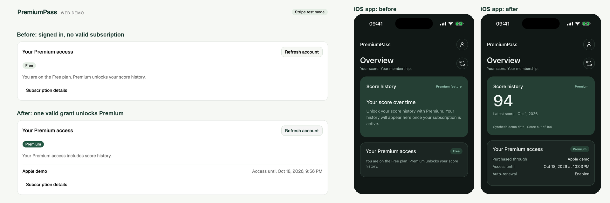

# PremiumPass


**A hands-on demo lab for cross-platform subscription management: sell one
subscription on the web, iOS, and Android, then try out and understand how every
app keeps the same answer.** Use it on your own or as workshop material.
Everything runs in test mode with synthetic data; nothing here is a product or a
library.

**Read the docs as a website:** [phillippbertram.github.io/subscription-consolidation-workshop](https://phillippbertram.github.io/subscription-consolidation-workshop/)

> [!NOTE]
> **Work in progress.** The local web flow with Stripe test payments works end
> to end. Real Google Play and Apple Sandbox purchases and the AWS deployment
> are prepared but not fully verified yet. Details: [TASKS](docs/TASKS.md).


PremiumPass is a small demo app. Users sign in, start on the **Free** plan, and
unlock a (synthetic) score history with **Premium**. Wherever they paid, every
app has to give the same answer to one question:

> **Is this user Premium right now?**

Combining several payment providers into that one answer is called
_subscription consolidation_. This lab shows how to do it, step by step, with
readable code and test scenarios you can run locally. Under the hood:
[Concepts](docs/CONCEPTS.md) explains the status translation, a worked example,
and the glossary.

## See it in action



_Website and iOS app show the same answer, because both ask the backend, never the payment page._

**Who it is for:** developers who add subscriptions to a web or mobile app, and
anyone running a workshop on payments, webhooks, or reliable backend processing.

**Built with:** TypeScript · Hono · React · Expo (React Native) · Auth0 ·
DynamoDB · SQS · AWS CDK · Stripe, App Store, and Google Play test modes.

## Why this is harder than it looks

Each challenge is something you can trigger yourself in the demo.

| Challenge                                                                            | How the demo solves it                         | See it                                                           |
| ------------------------------------------------------------------------------------ | ---------------------------------------------- | ---------------------------------------------------------------- |
| **Different languages:** Stripe says `past_due`, Apple `4`, Google `IN_GRACE_PERIOD` | Translate everything into one shared model     | [Several sources at once](docs/try-it/several-sources.md)        |
| **A success page is not a payment:** the checkout redirect opens without paying      | Only verified provider state grants access     | [A first purchase](docs/try-it/first-purchase.md)                |
| **Purchases must reach the right user:** a restore on another account                | Bind every purchase to the internal user ID    | [Purchase ownership](docs/STORE_PURCHASES.md#purchase-ownership) |
| **Several sources at once:** Apple ends, Stripe is still paid                        | Access is the union of all valid grants        | [Several sources at once](docs/try-it/several-sources.md)        |
| **Unreliable events:** webhooks arrive late, twice, or never                         | Idempotent processing and scheduled repair     | [Missed updates and expiry](docs/try-it/missed-updates.md)       |
| **Time matters:** a subscription ends without any notification                       | Every request compares the end time with _now_ | [Several sources at once](docs/try-it/several-sources.md)        |

## What you need

The local path needs Node, pnpm, Docker, a free Auth0 tenant, and a Stripe
sandbox. Real store purchases and the AWS deployment need their own accounts,
devices, or billable resources. The [setup overview](docs/setup/README.md) lists
the prior knowledge, tools, and accounts for each step. Store accounts cost a
registration fee and their verification can take days, so register early.

## Quick start

Besides Auth0 and Stripe, you need Node and pnpm (versions in `.nvmrc` /
`package.json`) and Docker. No AWS account, store account, or Xcode for the
first steps.

```sh
pnpm install --frozen-lockfile
pnpm dev
```

Before `pnpm dev` works, connect Auth0 and Stripe once:
the **[setup guide](docs/setup/README.md)** walks you through it, with a check
after each step, up to your first test purchase.

## Set up and try it

1. **Set up locally:** [Workspace](docs/setup/workspace.md),
   [Auth0](docs/setup/auth0.md), and [Stripe](docs/setup/stripe.md), up to your
   first test purchase. The [setup overview](docs/setup/README.md) lists tools
   and accounts for every step.
2. **[Try it out](docs/try-it/README.md):** six scenarios against the running
   system, each with the result you should see and the code behind it.
3. **Add platforms (optional):** [Apple + iOS app](docs/setup/apple.md),
   [Google + Android app](docs/setup/google.md), and [AWS](docs/setup/aws.md).

Finish with [Cleanup](docs/DEVELOPMENT.md#cleanup) to pause, reset, or remove everything.

## What is inside

| Folder      | Contents                                                                                                                                                                |
| ----------- | ----------------------------------------------------------------------------------------------------------------------------------------------------------------------- |
| `apps/`     | [Web](apps/web/README.md) (React), [Mobile](apps/mobile/README.md) (Expo), the developer [CLI](apps/cli/README.md), and the local [Admin console](apps/admin/README.md) |
| `services/` | [API](services/api/README.md), one webhook per store, the [subscription worker](services/subscription-worker/README.md), and the outbox publisher                       |
| `packages/` | Shared code; the access rules live in [`domain`](packages/domain/README.md)                                                                                             |
| `infra/`    | [AWS CDK stack](infra/README.md) for an optional cloud deployment                                                                                                       |

| Guide                                     | Read it for                                               |
| ----------------------------------------- | --------------------------------------------------------- |
| [Concepts](docs/CONCEPTS.md)              | The core idea, the status translation table, the glossary |
| [Architecture](docs/ARCHITECTURE.md)      | Components, data flow, and what runs locally vs. in AWS   |
| [Payments](docs/PAYMENTS.md)              | Stripe flow, retries, and the exact access rules          |
| [Reconciliation](docs/RECONCILIATION.md)  | How missed updates are repaired                           |
| [Outbox](docs/OUTBOX.md)                  | How every saved change gets announced, even after a crash |
| [Data model](docs/DYNAMODB_DATA_MODEL.md) | Records, keys, and atomic writes in one DynamoDB table    |
| [Development](docs/DEVELOPMENT.md)        | Everyday commands, logs, and local demo tools             |
| [Decisions](docs/DECISIONS.md)            | Why the project uses these approaches                     |

## What this is not

- **Not a production payment system.** Stripe test mode, Apple Sandbox, and
  Google Play license tests only; all data is synthetic.
- **Not a library.** It is readable example code with comments that explain the
  _why_; copy ideas, not modules.
- **Not finished everywhere.** Which parts are verified locally or in AWS is
  tracked in [TASKS](docs/TASKS.md).

Contributing or working with an AI agent? Read [AGENTS.md](AGENTS.md) first.
Code and docs are in English. There is no automated test suite; changes are
checked with formatting, linting, type checks, builds, and manual flows.

## Support

Did this workshop help you understand how to combine Stripe, App Store, and
Google Play subscriptions into one reliable answer? If it saved you time or a
few headaches, a coffee helps keep this demo up to date and supports more
hands-on examples like it. Thank you! ☕

<a href="https://buymeacoffee.com/phillippbertram"></a>
