# PremiumPass

PremiumPass is a hands-on subscription demo: sign in, buy a test subscription,
and unlock synthetic score history. Web and Mobile share one backend account
and the same Free/Premium access rules.

Use your own **Auth0 tenant**, **Stripe test environment**, and optionally
**Apple sandbox** and **AWS development account**. All application data is
synthetic; this project is not a production payment service.

## What happens in the demo?

1. Sign in through Auth0.
2. See your account and current access in Web or Mobile.
3. Buy through Stripe Checkout, Google Play license testing, or Apple Sandbox.
4. The backend verifies the provider's state and updates your subscription.
5. Refresh to see Premium access. Cancellation keeps access until its verified
   boundary; another valid subscription can still grant access.

A successful checkout screen is not proof of Premium access. The backend makes
that decision, including expiration checks on every protected request.

```mermaid
---
config:
  theme: base
  themeVariables:
    fontFamily: Arial, Helvetica, sans-serif
    fontSize: 14px
    primaryTextColor: '#0f172a'
    lineColor: '#64748b'
    edgeLabelBackground: '#ffffff'
    clusterBkg: '#f8fafc'
    clusterBorder: '#cbd5e1'
  flowchart:
    curve: linear
    nodeSpacing: 30
    rankSpacing: 48
---
flowchart LR
    Clients["Web / Mobile"] <-->|"Login / API access token"| Auth0["Auth0"]
    Clients -->|"Bearer token"| Backend["PremiumPass backend"]
    Backend -->|"Profile / access"| Clients
    Backend -.->|"Public signing keys (JWKS)"| Auth0
    Clients -->|"Test purchase"| Providers["Stripe / Apple Sandbox / Google Play"]
    Providers <-->|"Events / verification"| Backend
    Backend --> Data[("Subscriptions and access")]
    classDef default fill:#f8fafc,stroke:#94a3b8,color:#0f172a,stroke-width:1.5px,rx:10,ry:10
    classDef client fill:#eff6ff,stroke:#3b82f6,color:#1e3a8a,stroke-width:1.5px,rx:12,ry:12
    classDef identity fill:#fff7ed,stroke:#f97316,color:#9a3412,stroke-width:2px,rx:12,ry:12
    classDef service fill:#f0fdfa,stroke:#0d9488,color:#115e59,stroke-width:1.5px,rx:12,ry:12
    classDef queue fill:#f5f3ff,stroke:#8b5cf6,color:#5b21b6,stroke-width:1.5px,rx:10,ry:10
    classDef data fill:#f0fdf4,stroke:#22c55e,color:#166534,stroke-width:1.5px
    classDef failure fill:#fff1f2,stroke:#f43f5e,color:#9f1239,stroke-width:1.5px,rx:10,ry:10
    classDef stripe fill:#635bff,stroke:#4f46e5,color:#ffffff,stroke-width:1.5px,rx:12,ry:12
    classDef apple fill:#27272a,stroke:#18181b,color:#ffffff,stroke-width:1.5px,rx:12,ry:12
    classDef google fill:#e8f0fe,stroke:#4285f4,color:#174ea6,stroke-width:1.5px,rx:12,ry:12
    linkStyle default stroke:#64748b,stroke-width:1.5px
    class Clients client
    class Auth0 identity
    class Backend service
    class Providers queue
    class Data data
```

## Start here

1. Read **[Concepts](docs/CONCEPTS.md)**: the idea in one picture, plus a glossary.
2. Follow **[Getting started](docs/GETTING_STARTED.md)**: local website, Auth0
   login, and your first Stripe test purchase, with a check after each step.
3. Continue with the learning path below.

The first path needs no AWS account or Xcode. Docker runs DynamoDB Local and
ElasticMQ; the API, webhooks, worker, and website run on your computer.
Auth0 and Stripe remain real external services in development/test mode.

## Learning path

Modules 1–6 run locally with Auth0, Stripe test mode, and Docker. Modules 7–8
need store or AWS accounts. `T…` IDs refer to manual exercises in the linked guides.

| Module                    | You learn                                                     | Read                                                                                                  | Try                                                                                   |
| ------------------------- | ------------------------------------------------------------- | ----------------------------------------------------------------------------------------------------- | ------------------------------------------------------------------------------------- |
| 1. Login and tokens       | Auth0 login, backend token checks, scope ≠ purchase           | [Auth0](docs/AUTH0_SETUP.md), [`auth.ts`](services/api/src/auth.ts)                                   | [T01–T03, T05](docs/AUTH0_SETUP.md#manual-verification)                               |
| 2. First purchase         | Checkout, signed webhook, queue, worker verification          | [Payments](docs/PAYMENTS.md#payment-flow)                                                             | [T06–T09](docs/PAYMENTS.md#manual-checks)                                             |
| 3. Consolidation          | Translate provider states, combine grants, check time         | [Concepts](docs/CONCEPTS.md), [Access policy](docs/PAYMENTS.md#access-policy)                         | [T04, T22](docs/PAYMENTS.md#manual-checks)                                            |
| 4. Reliability            | Duplicates, revisions, atomic commit, outbox, DLQ             | [Processing and retries](docs/PAYMENTS.md#processing-and-retries)                                     | [T10–T18](docs/PAYMENTS.md#manual-checks), [outbox](docs/DEVELOPMENT.md#local-outbox) |
| 5. Repair missed updates  | Reconciliation and expiration                                 | [Reconciliation](docs/RECONCILIATION.md)                                                              | [T20–T21](docs/DEVELOPMENT.md#local-reconciliation-and-expiration)                    |
| 6. Complimentary Premium  | Access without a purchase, audited and revocable              | [Complimentary access](docs/PAYMENTS.md#complimentary-access)                                         | [CLI commands](docs/DEVELOPMENT.md#complimentary-premium)                             |
| 7. Native store purchases | Mobile login, Google Play / Apple purchase, ownership binding | [Mobile](apps/mobile/README.md), [Google Play](docs/GOOGLE_PLAY.md), [Apple](docs/APPLE_PURCHASES.md) | [Apple device checks](docs/APPLE_PURCHASES.md#manual-device-checks)                   |
| 8. AWS                    | CDK stack, least-privilege IAM, cloud webhooks                | [Architecture](docs/ARCHITECTURE.md#aws-deployment-topology), [AWS](infra/README.md)                  | [Deployed checks](infra/README.md#verify-the-deployed-path)                           |

Finish with [Cleanup](docs/DEVELOPMENT.md#cleanup) to pause, reset, or remove the environment.

## Reference guides

| Topic                                                      | Guide                                                                      |
| ---------------------------------------------------------- | -------------------------------------------------------------------------- |
| Terms and the core idea                                    | [Concepts](docs/CONCEPTS.md)                                               |
| Components, data flow, and what runs where                 | [Architecture](docs/ARCHITECTURE.md)                                       |
| Commands, logs, and local demo tools                       | [Development](docs/DEVELOPMENT.md)                                         |
| Entities, relationships, database keys, and atomic updates | [Data model and ER diagrams](docs/DYNAMODB_DATA_MODEL.md#logical-er-model) |
| Product boundaries and learning goals                      | [Project plan](PROJECT_PLAN.md)                                            |
| Why the project uses these approaches                      | [Decisions](docs/DECISIONS.md)                                             |

The workspace separates `apps/` (Web, Mobile, and the developer CLI), `services/` (executables),
`packages/` (shared code), and `infra/` (CDK and local queue definitions).
Each component README links to its code.

## Project status

Guides explain how the system works. Which parts are implemented and verified,
locally or in AWS, is recorded only in [TASKS](docs/TASKS.md).

For implementation work, read [AGENTS.md](AGENTS.md). Project text and code use
English. The project has no automated test suite; verification uses formatting,
lint, typechecking, builds, and targeted manual checks.
