# PremiumPass

PremiumPass is a hands-on subscription demo: sign in, buy a test subscription,
and unlock synthetic score history. Web and Mobile share one backend account
and the same Free/Premium access rules.

Use your own **Auth0 tenant**, **Stripe test environment**, and optionally
**Apple sandbox** and **AWS development account**. All application data is
synthetic; this project is not a production payment service.

## What happens in the demo?

1. Sign in through Auth0.
2. See your account and current access in Web or Mobile.
3. Buy through Stripe Checkout, Google Play license testing, or Apple Sandbox.
4. The backend verifies the provider's state and updates your subscription.
5. Refresh to see Premium access. Cancellation keeps access until its verified
   boundary; another valid subscription can still grant access.

A successful checkout screen is not proof of Premium access. The backend makes
that decision, including expiration checks on every protected request.

```mermaid
---
config:
  theme: base
  themeVariables:
    fontFamily: Arial, Helvetica, sans-serif
    fontSize: 14px
    primaryTextColor: '#0f172a'
    lineColor: '#64748b'
    edgeLabelBackground: '#ffffff'
    clusterBkg: '#f8fafc'
    clusterBorder: '#cbd5e1'
  flowchart:
    curve: linear
    nodeSpacing: 30
    rankSpacing: 48
---
flowchart LR
    Clients["Web / Mobile"] <-->|"Login / API access token"| Auth0["Auth0"]
    Clients -->|"Bearer token"| Backend["PremiumPass backend"]
    Backend -->|"Profile / access"| Clients
    Backend -.->|"Public signing keys (JWKS)"| Auth0
    Clients -->|"Test purchase"| Providers["Stripe / Apple Sandbox / Google Play"]
    Providers <-->|"Events / verification"| Backend
    Backend --> Data[("Subscriptions and access")]
    classDef default fill:#f8fafc,stroke:#94a3b8,color:#0f172a,stroke-width:1.5px,rx:10,ry:10
    classDef client fill:#eff6ff,stroke:#3b82f6,color:#1e3a8a,stroke-width:1.5px,rx:12,ry:12
    classDef identity fill:#fff7ed,stroke:#f97316,color:#9a3412,stroke-width:2px,rx:12,ry:12
    classDef service fill:#f0fdfa,stroke:#0d9488,color:#115e59,stroke-width:1.5px,rx:12,ry:12
    classDef queue fill:#f5f3ff,stroke:#8b5cf6,color:#5b21b6,stroke-width:1.5px,rx:10,ry:10
    classDef data fill:#f0fdf4,stroke:#22c55e,color:#166534,stroke-width:1.5px
    classDef failure fill:#fff1f2,stroke:#f43f5e,color:#9f1239,stroke-width:1.5px,rx:10,ry:10
    classDef stripe fill:#635bff,stroke:#4f46e5,color:#ffffff,stroke-width:1.5px,rx:12,ry:12
    classDef apple fill:#27272a,stroke:#18181b,color:#ffffff,stroke-width:1.5px,rx:12,ry:12
    classDef google fill:#e8f0fe,stroke:#4285f4,color:#174ea6,stroke-width:1.5px,rx:12,ry:12
    linkStyle default stroke:#64748b,stroke-width:1.5px
    class Clients client
    class Auth0 identity
    class Backend service
    class Providers queue
    class Data data
```

## Start here

Follow **[Getting started](docs/GETTING_STARTED.md)** for a local website,
Auth0 login, and your first Stripe test purchase. It includes prerequisites,
configuration files, startup order, and checks after each step.

The first path needs no AWS account or Xcode. Docker runs DynamoDB Local and
ElasticMQ; the API, webhooks, worker, and website run on your computer.
Auth0 and Stripe remain real external services in development/test mode.

| You want to…                                            | Continue here                              |
| ------------------------------------------------------- | ------------------------------------------ |
| Run the project with your own accounts                  | [Getting started](docs/GETTING_STARTED.md) |
| Understand components and data flow                     | [Architecture](docs/ARCHITECTURE.md)       |
| Run commands, inspect logs, or change local demo access | [Development](docs/DEVELOPMENT.md)         |
| Stop, reset, or remove the environment                  | [Cleanup](docs/DEVELOPMENT.md#cleanup)     |

## Extend the demo

| Extension                                         | What you will add                                                                            |
| ------------------------------------------------- | -------------------------------------------------------------------------------------------- |
| [Mobile](apps/mobile/README.md)                   | Expo development build, Auth0 login, and score dashboard on Simulator/iPhone                 |
| [Google Play test purchases](docs/GOOGLE_PLAY.md) | Android build, native purchase/restore, verified backend access, and lifecycle notifications |
| [Apple Sandbox](docs/APPLE_PURCHASES.md)          | Native purchase/restore and local Server Notifications through ngrok                         |
| [AWS](infra/README.md)                            | CDK-managed API, provider webhooks, DynamoDB, and queue processing                           |

Google Play is the next native test-purchase path; implementation and Apple's
deferred account-dependent verification are tracked in [TASKS](docs/TASKS.md).
Local features and cloud wiring differ. The AWS guide identifies the supported
paths. Google cloud purchase/Restore endpoints and notification processing are
prepared with default-off configuration. Stripe, Apple, and Google reconciliation
share a five-minute schedule with separate opt-in switches; external setup and live verification
remain outstanding. Cloud Stripe checkout and Apple client sync remain incomplete.

## Understand the system

| Topic                                                      | Guide                                                                      |
| ---------------------------------------------------------- | -------------------------------------------------------------------------- |
| Login, permissions, and client configuration               | [Auth0](docs/AUTH0_SETUP.md)                                               |
| Checkout, verified payments, retries, and access rules     | [Payments](docs/PAYMENTS.md)                                               |
| Missed subscription updates and expiration                 | [Reconciliation](docs/RECONCILIATION.md)                                   |
| Entities, relationships, database keys, and atomic updates | [Data model and ER diagrams](docs/DYNAMODB_DATA_MODEL.md#logical-er-model) |
| Product boundaries and learning goals                      | [Project plan](PROJECT_PLAN.md)                                            |
| Why the project uses these approaches                      | [Decisions](docs/DECISIONS.md)                                             |

The workspace separates `apps/` (Web, Mobile, and the developer CLI), `services/` (executables),
`packages/` (shared code), and `infra/` (CDK and local queue definitions).
Start with the architecture guide; each component README links to its code.

## Project progress

[TASKS.md](docs/TASKS.md) is the sole implementation-status and verification
record. It distinguishes local checks, device evidence, and live AWS/provider
flows. Google provider mocks, outbox publication, and scheduled reconciliation
are tracked there; diagrams do not imply those features are complete.

For implementation work, read [AGENTS.md](AGENTS.md). Project text and code use
English. The project has no automated test suite; verification uses formatting,
lint, typechecking, builds, and targeted manual checks.
