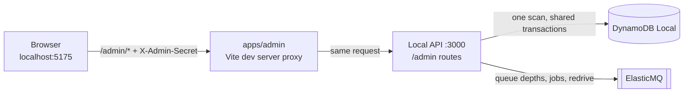

# Admin console

A local browser console that shows **what the backend knows right now and why**:
users, their subscriptions and grants, the access computed from them, processing
markers, the outbox, and the queues. It also offers the actions an operator
needs, and every write goes through the same shared transactions as the worker
and the CLI. It runs **only locally**; the deployed API has no admin routes.

## Start it

1. Choose a secret and put it into `config/.env`. A simple passphrase works:

   ```sh
   ADMIN_SECRET=<your passphrase>
   ```

   Under 16 characters the API and `pnpm config:check` print a hint, because a
   short secret is easy to guess while the API listens on the LAN. For a long
   random one, use `openssl rand -base64 32`.

2. Restart the API so it reads the new setting. `pnpm dev` syncs `config/.env`
   on every start; with single processes, run `pnpm config:sync` first. The API
   log line `server.started` then reports `adminRoutes: enabled`.
3. Start the console and open `http://localhost:5175`:

   ```sh
   pnpm dev:admin
   ```

4. Enter the same secret. The tab keeps it until you close it; the lock icon
   forgets it earlier.

Without `ADMIN_SECRET` the console shows "Admin routes are disabled". Every
other part of the project works the same with or without it.

## How it is built



The API Lambda in AWS is built from the same service but registers no admin
routes; there is nothing to reach there.

| Piece                                                                      | Responsibility                                                                    |
| -------------------------------------------------------------------------- | --------------------------------------------------------------------------------- |
| [`apps/admin`](../apps/admin/README.md)                                    | React pages, secret prompt, preview-then-apply forms; holds no logic about access |
| [`services/api/src/admin/`](../services/api/src/admin/routes.ts)           | Secret check, table snapshot, consistency checks, actions, queue access           |
| [`api-contracts/admin`](../packages/api-contracts/src/admin.ts)            | Request and response schemas shared by the console and the API                    |
| [`subscription-processing`](../packages/subscription-processing/README.md) | The admin-grant transaction and processing store, shared with the CLI and worker  |

The API computes everything the console shows from one read with one clock, and
answers with a single `GET /admin/state`. The pages only filter and display it,
so all numbers on screen refer to the same moment.

## Protection

The admin secret keeps other people and other websites out of a local tool. It
is not an identity system.

- **Local entry only.** `services/api/src/local.ts` registers the admin routes;
  `lambda.ts` never imports them, so they are not even part of the Lambda bundle.
  They also refuse to start unless the API uses the fixed `premiumpass-local`
  table at `127.0.0.1:8000`.
- **Off by default.** Without `ADMIN_SECRET` every `/admin/*` request answers
  `404 admin_disabled`. Any passphrase enables them; under 16 characters the
  API logs `admin.secret_short` and the console shows a hint, but nothing is
  blocked. Surrounding whitespace stops the API at startup.
- **Own secret, own header.** Admin routes read `X-Admin-Secret` and compare
  SHA-256 digests in constant time. They never accept an Auth0 token, and the
  secret unlocks no user route.
- **No CORS.** `/admin` sits outside the `/v1` CORS rule. The browser reaches it
  through the console's own origin (Vite proxy). Another website could only
  send the custom header after a CORS preflight, which the API never approves.
- **Not in the build.** The console asks for the secret at runtime and stores
  it in `sessionStorage`. `ADMIN_API_URL` has no `VITE_` prefix, so not even the
  proxy target reaches the bundle.
- **Server-set actor.** Admin grants record `admin-console:<OS user>`; a form
  cannot choose the actor. Debug logging records only metadata for `/admin`.
- **LAN mode.** `pnpm dev:api:lan` binds the API to all interfaces, admin routes
  included; the secret still applies. Use a long random secret there, or leave
  `ADMIN_SECRET` empty while testing on a phone if you do not need the console.

**Demo simplification.** One shared secret names no person, every request scans
the whole table, and the audit is not tamper-proof. A hosted admin would need
individual admin identities (for example an Auth0 role or SSO), authorization
per action, and indexes or a read model instead of scans.

## Pages

| Page        | Answers                                        | Shows                                                                                                                 |
| ----------- | ---------------------------------------------- | --------------------------------------------------------------------------------------------------------------------- |
| Overview    | Is the system healthy, and what happened last? | Counts, the pipeline from webhook to consumer with live numbers, consistency checks, recent activity                  |
| Users       | Who has access now, from which source?         | Users with access, sources, and snapshot state; all subscriptions sorted by access end, with owner binding            |
| User detail | Why does this user have exactly this access?   | Each source evaluated like `deriveEntitlements`, computed versus stored snapshot, linked provider IDs, timeline, audit, checkouts, actions |
| Outbox      | Has every committed change been announced?     | Pending and sent entries, waiting time, the change (free → premium), the lifecycle of one entry                       |
| Processing  | What did the worker do, and is anything stuck? | Queue depths, DLQ redrive, processing markers with store completion, unrecognized records                             |

**Timeline.** A processed job or admin change with an outbox entry changed
access. One without an entry verified something without changing access; the
aggregate revision still moved, which explains gaps in the outbox sequence.

## Consistency checks

Pure functions over the snapshot, the queues, and the request time
([`checks.ts`](../services/api/src/admin/checks.ts)). They mirror the risks in
the [code review rules](../AGENTS.md#code-review-rules).

| Check                 | Rule                                                                            | Severity |
| --------------------- | ------------------------------------------------------------------------------- | -------- |
| Owner bindings        | A provider owner record names another user than the stored subscription         | Critical |
| Snapshot drift        | Stored `ENTITLEMENTS` tier or `effectiveUntil` differs from access computed now | Warning  |
| Outbox waiting        | A pending entry is older than 60 seconds                                        | Warning  |
| Store completion      | An Apple finish or Google acknowledgement is still missing after 60 seconds     | Warning  |
| Dead letters          | The work or event DLQ holds messages                                            | Warning  |
| Work queue            | ElasticMQ does not answer                                                       | Warning  |
| Records recognized    | An item matches no known key pattern or fails its schema                        | Warning  |
| Unbound subscriptions | A provider subscription has no owner binding and no demo marker                 | Info     |

## Actions

Every write follows the same steps: **preview** (no writes) → **apply** with the
same request or run ID → result. A double submit therefore replays the stored
receipt or produces the same job IDs, which the worker skips.

| Action                       | What happens                                                                                             | Shared code                                   |
| ---------------------------- | -------------------------------------------------------------------------------------------------------- | --------------------------------------------- |
| Grant / revoke complimentary | Grant, audit receipt, snapshot, and outbox entry in one guarded transaction                              | `changeAdminGrant` from `/admin-grants`       |
| Refresh from providers       | One reconciliation job per stored Stripe, Apple, or Google subscription; the worker verifies and commits | Job schemas from `billing-contracts`          |
| Expiration check             | One expiration job, only when a stored boundary has passed                                               | The worker's expiration processor             |
| Redrive the work DLQ         | Send each dead letter back to the work queue, then delete it from the DLQ                                | Worker idempotency through completion markers |

The console holds no provider keys: a refresh queues references, and the worker
reads current provider state. It refreshes **known** subscriptions only; finding
one that was never stored (a missed first webhook) stays with
`pnpm cli reconcile`. Not offered: publishing the outbox (the publisher stays a
separate process, so you can watch it), the CLI's demo overrides `seed` and
`set`, direct Stripe repair, and editing or deleting records. DynamoDB Admin on
`127.0.0.1:8001` edits raw items, bypassing every guarantee.

## Data loading

- **One scan per request.** `GET /admin/state` reads the table with one
  paginated, consistent `Scan` and sorts items by key pattern with Zod schemas.
  User requests never scan; this is acceptable only for the small local table.
- **One clock.** Access comes from `deriveEntitlements`, the function the user
  API uses, evaluated at the request time shown as "Read at".
- **Never returned:** Google purchase tokens (a refresh reads them on the server
  only), provider credentials, and checkout URLs (not stored anyway).

Commands and settings: [Development](DEVELOPMENT.md#admin-console). Record
layout: [Data model](DYNAMODB_DATA_MODEL.md).
