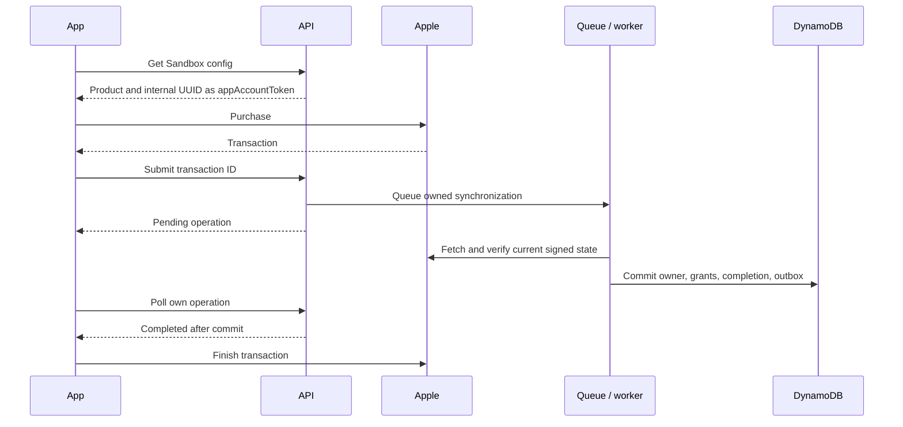
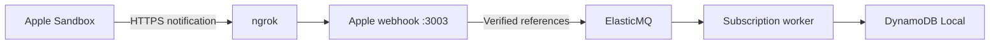

# Apple Sandbox purchases

Add native purchase/restore to the [local demo](GETTING_STARTED.md). Use a physical
iPhone, an Apple Developer Program membership with permission to create App Store
Connect resources, and a Sandbox Apple Account. Complete the
[mobile configuration](../apps/mobile/README.md#configure-the-app) first; prepare
the resources below before the signed iPhone build.

## Prepare your Apple resources

| Step | Create or configure                                                                     | Keep for configuration                                             |
| ---- | --------------------------------------------------------------------------------------- | ------------------------------------------------------------------ |
| 1    | Explicit bundle ID in your developer account; matching App Store Connect app            | Bundle ID, also used for Xcode signing and `IOS_BUNDLE_IDENTIFIER` |
| 2    | Active Paid Applications Agreement and required account information                     | Permission to test In-App Purchases                                |
| 3    | One subscription group and monthly auto-renewable subscription, with price/localization | Product ID, e.g. `premiumpass.premium.monthly.v2`                  |
| 4    | Sandbox Apple Account under Users and Access                                            | Device sandbox sign-in; separate from the app's Auth0 identity     |
| 5    | In-App Purchase key under Users and Access → Integrations → In-App Purchase             | Key ID, Issuer ID, downloaded `.p8` file                           |

Use your own registered identifiers consistently. The configured Apple product
maps to the internal `premium_monthly` plan. The worker needs an **In-App Purchase
key**, not a general App Store Connect API key. Keep the downloaded private key
outside the app and repository.
[Apple setup](https://developer.apple.com/help/app-store-connect/configure-in-app-purchase-settings/overview-for-configuring-in-app-purchases/)
· [Generate the key](https://developer.apple.com/help/app-store-connect/configure-in-app-purchase-settings/generate-keys-for-in-app-purchases/).

## Enable local processing

Edit the ignored `.env` files prepared by Getting started:

| File                                | Values to set                                                            |
| ----------------------------------- | ------------------------------------------------------------------------ |
| `services/api/.env`                 | `APPLE_ENABLED=true`, `APPLE_PRODUCT_ID`, local `SUBSCRIPTION_QUEUE_URL` |
| `services/apple-webhook/.env`       | Same enable flag, product, queue; `APPLE_BUNDLE_ID`                      |
| `services/subscription-worker/.env` | Same enable flag, product, bundle and queue; credentials below           |
| `apps/mobile/.env`                  | `IOS_BUNDLE_IDENTIFIER` matching the registered bundle                   |

Only the worker loads the private key:

```dotenv
APPLE_IAP_KEY_ID=YOUR_KEY_ID
APPLE_IAP_ISSUER_ID=YOUR_ISSUER_UUID
APPLE_IAP_PRIVATE_KEY_PATH="/absolute/path/SubscriptionKey_YOUR_KEY_ID.p8"
```

Use an absolute path; `~` is not expanded. API and worker must use the same local
table. Keep existing Stripe configuration: the shared worker still requires it.
Restart the stack after changes. Apple verification needs network access to Apple
and always targets Sandbox; there is no production or mock fallback.

```sh
curl --fail http://127.0.0.1:3003/health
```

**Expected:** `appleEnabled` is `true`. This confirms configuration, not a purchase.

## Build and purchase on iPhone

1. Grant the Native Auth0 client/user `write:checkout` as described in
   [Auth0 setup](AUTH0_SETUP.md#application-access-policy), then sign out/in.
2. Follow the [iPhone LAN and signing steps](../apps/mobile/README.md#run-on-a-physical-iphone).
   Rebuild the development client for the native `expo-iap` module.
3. On the iPhone, open **Settings → Developer → Sandbox Apple Account** and sign
   in with the tester created in App Store Connect. This is separate from Auth0
   login. Set Xcode's scheme **StoreKit Configuration** to **None** for real
   Sandbox testing. Product metadata can
   take time to become available; simulation is a different verification path.
   [Apple sandbox testing](https://developer.apple.com/documentation/storekit/testing-in-app-purchases-with-sandbox).
4. Sign into PremiumPass with a synthetic Free user and choose **Subscribe**.
   After the worker commits, refresh Web and Mobile and compare their access.



Restore and unfinished-transaction recovery reuse this path. A timeout leaves the
transaction unfinished; restore or reopen after fixing the cause. **Manage Apple
subscription** opens Apple's native sheet and synchronizes known subscriptions
when it closes. Existing Premium normally hides a new purchase. The development
Sandbox override in Developer tools permits deliberate duplicate-purchase
exercises; it never bypasses server ownership or signature checks.

## Receive Apple notifications through ngrok

The iPhone calls the API over LAN. Apple needs a public HTTPS endpoint to deliver
lifecycle changes to the separate local notification service.



1. Create your own ngrok account and install the CLI using the
   [ngrok quickstart](https://ngrok.com/docs/share-localhost/quickstart)
   (`brew install ngrok` on macOS). Configure its
   authtoken locally with `ngrok config add-authtoken YOUR_AUTHTOKEN`; do not
   save the actual token in repository files or documentation. Use the installation
   and account steps only; browser-login protection would block Apple notifications.
2. With the enabled Apple ingress running, open a separate terminal:

   ```sh
   ngrok http 3003
   ```

3. Copy the public **HTTPS** origin. In App Store Connect → your app → App
   Information → App Store Server Notifications, set **Sandbox Server URL** to
   `https://YOUR_NGROK_HOST/v1/webhooks/apple` and select **Version 2**.
   [Apple URL configuration](https://developer.apple.com/help/app-store-connect/configure-in-app-purchase-settings/enter-server-urls-for-app-store-server-notifications/).
4. Update that URL whenever the tunnel address changes. Forward only port 3003;
   do not expose the database, admin UI, or API through this tunnel.
5. Request an Apple test notification, then check its delivery status. The
   following optional command uses the existing worker credentials and installed
   Apple library; it makes a real Sandbox test-notification request, not a purchase:

   ```sh
   pnpm --filter @premiumpass/subscription-worker exec tsx --env-file=.env -e '
   import { createAppleClient, readAppleSettings, readLocalAppleCredentials } from "@premiumpass/apple-store";
   async function main() {
     const settings = readAppleSettings(process.env);
     if (!settings) { throw new Error("Enable Apple first."); }
     const client = createAppleClient(settings, readLocalAppleCredentials(process.env));
     const result = await client.requestTestNotification();
     if (!result.testNotificationToken) { throw new Error("No test notification token returned."); }
     await new Promise((resolve) => setTimeout(resolve, 5000));
     const status = await client.getTestNotificationStatus(result.testNotificationToken);
     console.log(status.sendAttempts ?? "Delivery pending; check the tunnel request inspector.");
   }
   main().catch(() => { console.error("Test request failed; check Apple settings and network access."); process.exitCode = 1; });
   '
   ```

   Expect a POST and HTTP 200 in ngrok's local request inspector. The response
   for a verified test is `{"received":true,"test":true}`; no subscription job
   or Premium grant is created. If pending, inspect the incoming request before
   issuing another test. [Apple test notification API](https://apple.github.io/app-store-server-library-node/classes/AppStoreServerAPIClient.html#requestTestNotification).

6. Exercise a real Sandbox renewal/cancellation with tunnel and worker running.
   Follow `apple.notification_queued` and worker processing into the local
   subscription records, then refresh access. This separately verifies the
   processing path that a `TEST` notification does not exercise.

| Result                                         | Meaning                                                      |
| ---------------------------------------------- | ------------------------------------------------------------ |
| `400`                                          | Invalid notification/signature                               |
| `503`                                          | Disabled ingress, unavailable verification, or queue failure |
| `200` for supported lifecycle event            | Queue accepted; worker completion still needs checking       |
| Verified `TEST` or intentionally ignored event | Acknowledged without a subscription change                   |

## Processing and ownership

The worker verifies Sandbox, bundle, product, signed state, and `appAccountToken`.
`Sandbox:<originalTransactionId>` is permanently bound to one internal user;
restoring with another Auth0 identity cannot transfer it. A transaction commits
ownership, subscription, all-provider entitlements, completion, and any outbox
change together. Conflicts reload current state; duplicates do not extend access.

Apple grace follows its signed boundary. Disabling renewal keeps access until
verified expiry; expiration/revocation removes only this provider's grant.
See [shared access policy](PAYMENTS.md#access-policy) and [Apple records](DYNAMODB_DATA_MODEL.md#apple-sandbox-records).

## AWS notification processing

Use the [AWS setup](../infra/README.md#deploy) with `APPLE_ENABLED=true`, your bundle
and product IDs, and `APPLE_SECRET_ARN`. Create a separate Secrets Manager JSON
secret with `keyId`, `issuerId`, and `privateKey` (complete P-256 PEM, with newlines
encoded as `\n`). Only the worker reads it; the webhook needs no private key.

Register **AppleWebhookUrl** instead of ngrok as the Sandbox URL. Verify TEST
and lifecycle delivery separately. The signed account token must reference a
profile in the AWS table; local users are not copied there. Authenticated cloud
Apple config/sync/completion wiring is still absent, so this is not the complete
cloud mobile purchase/restore path. Runtime secret caching lasts five minutes.

## Manual device checks

| Check                                                                 | Expected result                                                |
| --------------------------------------------------------------------- | -------------------------------------------------------------- |
| Purchase as Free user; compare Web/Mobile                             | Matching internal user, verified Apple grant, protected scores |
| Restart/restore; restore as another user                              | Stable ownership; wrong-user restore rejected                  |
| T10–T12: duplicates, delayed notifications, concurrent Stripe changes | Current state wins; no lost or duplicate grant                 |
| T13/T14: renewal disabled, expiry, grace                              | Access follows verified boundaries                             |
| T15: stop worker/provider access during purchase                      | Pending verification; no premature finish or access            |
| Manage subscription, close sheet                                      | Refreshed renewal state and retained paid access               |
| End Apple while Stripe remains valid                                  | Premium remains                                                |
| Development-only duplicate override                                   | Store outcome visible; ownership checks still enforced         |

Device, provider, and AWS evidence belong in [P07](TASKS.md#p07-apple-sandbox-and-google-mocks).

## Cleanup

Pause by stopping ngrok. For a longer pause or retirement, remove this demo's
**Sandbox Server URL** in App Store Connect, or replace it with the intended AWS
URL. Changing URLs redirects subsequent delivery; it does not migrate records.

Use the device's Sandbox subscription management to turn off renewal if retiring
a test subscription. Clearing purchase history is a separate destructive Sandbox
operation; it does not clear PremiumPass records or reassign ownership.
[Sandbox account settings](https://developer.apple.com/help/app-store-connect/test-in-app-purchases/manage-sandbox-apple-account-settings/).

Revoke an In-App Purchase key only if it was dedicated to this demo and no other
app/backend uses it; remove its local `.p8` file afterward. Keep shared developer
accounts and signing assets. Continue with [overall cleanup](DEVELOPMENT.md#cleanup).
