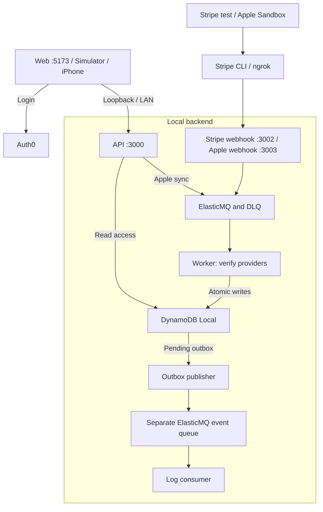
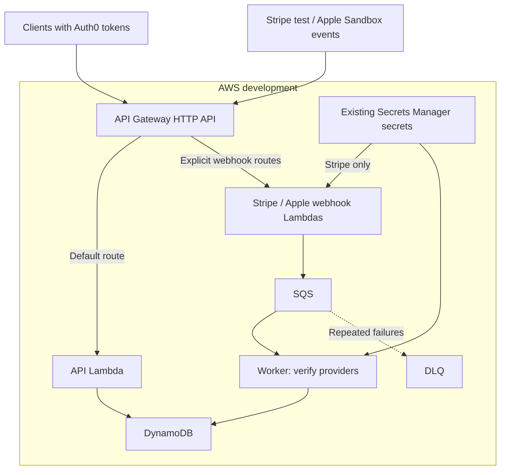

# Architecture

PremiumPass has two paths: **authenticated reads/actions** through the API and
**provider notifications** through signature-verifying webhooks. Both meet at
subscriptions in DynamoDB. [Product overview](../README.md) · [Setup](GETTING_STARTED.md).

## Responsibilities

| Layer                       | Responsibility                                                                         | Start reading                                                                                                                                                                                                                                                              |
| --------------------------- | -------------------------------------------------------------------------------------- | -------------------------------------------------------------------------------------------------------------------------------------------------------------------------------------------------------------------------------------------------------------------------- |
| Clients                     | Login, display backend access, initiate purchases                                      | [Web](../apps/web/README.md), [Mobile](../apps/mobile/README.md)                                                                                                                                                                                                           |
| API                         | Verify Auth0 tokens/scopes, resolve user, serve profile/access, initiate local billing | [API](../services/api/README.md)                                                                                                                                                                                                                                           |
| Webhooks                    | Verify provider signatures and enqueue references                                      | [Stripe](../services/stripe-webhook/README.md), [Apple](../services/apple-webhook/README.md)                                                                                                                                                                               |
| Worker                      | Verify current provider state/ownership; persist atomically                            | [Worker](../services/subscription-worker/README.md)                                                                                                                                                                                                                        |
| Outbox publisher / consumer | Publish committed snapshots; log accepted events without access writes                 | [Outbox](../services/outbox-publisher/README.md)                                                                                                                                                                                                                           |
| Shared packages             | Domain rules, persistence, contracts, SDK construction, logging                        | [Domain](../packages/domain/src/subscriptions.ts), [HTTP contracts](../packages/api-contracts/README.md), [queue contracts](../packages/billing-contracts/README.md), [AWS clients](../packages/aws-clients/README.md), [Apple adapter](../packages/apple-store/README.md) |

Hono belongs to HTTP services. Domain code receives ordinary values and a clock,
not HTTP contexts. Each executable owns its configuration and local/Lambda entry
points; services do not import other services.

## Local development topology

`pnpm dev` starts the five app processes and Docker/table initialization.
Stripe CLI, Mobile, ngrok, the optional outbox publisher/log consumer, and the
local reconciliation watcher run separately. Apple stays disabled until
configured. API checkout and worker verification call external provider APIs.
No AWS credentials are required. Docker provides storage/queue
services; application code runs on the host. [Commands](DEVELOPMENT.md#run-and-check).

## AWS deployment topology

The backend verifies Auth0; Gateway has no JWT/Lambda authorizer. Webhook routes
verify their own signatures. Apple is disabled by default. The grouped webhook box contains two independent Lambdas. Only the worker reads
the Apple private key; the Stripe webhook reads its signing secret. Lambda logs
go to CloudWatch.

Cloud checkout/cancellation, browser CORS, and authenticated Apple synchronization
are not fully wired. This topology shows notification processing, not complete
local/cloud feature parity. See [AWS boundaries](../infra/README.md#resources-and-boundaries)
and the sole [verification record](TASKS.md).

## Follow a feature

- [Stripe checkout and processing](PAYMENTS.md#payment-flow): payment → verified state → access.
- [Apple purchase and notifications](APPLE_PURCHASES.md): client synchronization and lifecycle events converge in the worker.
- [Reconciliation and expiration](RECONCILIATION.md): repair missed updates and apply verified access boundaries.
- [Data model](DYNAMODB_DATA_MODEL.md): ownership, aggregate revision, completion markers, and outbox.

Local outbox publication uses a separate ElasticMQ queue and log consumer. The
EventBridge adapter has no deployed bus/rule or cloud runtime wiring. Local
reconciliation enqueues Stripe, known Apple Sandbox, and Google mock refreshes
plus due expiration jobs through the subscription worker. Independent Google mock state supports
suppressed-event exercises; cloud reconciliation remains outstanding in P09.
API access and expiry checks do not depend on event publication or
consumer success.
