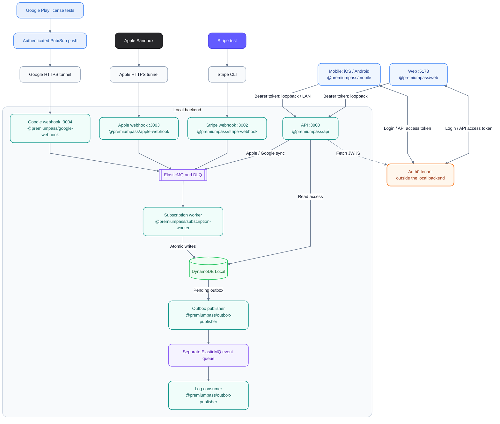
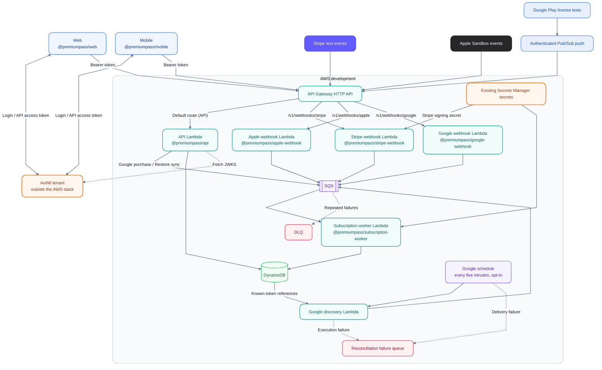

# Architecture

PremiumPass has two paths: **authenticated reads/actions** through the API and
**provider notifications** through verified webhook ingress. Both meet at
subscriptions in DynamoDB. [Product overview](../README.md) · [Setup](GETTING_STARTED.md).

## System overview

The overview shows responsibilities shared by the local and prepared AWS paths.
The topology diagrams below identify the actual runtime boundaries and optional
components. Blue marks clients, orange identity/secrets, teal services, violet
queues/scheduling, green storage, and rose failure queues. Provider cards retain
their own colors; labels and shapes identify each component as well.

## Responsibilities

| Layer                       | Responsibility                                                                                 | Start reading                                                                                                                                |
| --------------------------- | ---------------------------------------------------------------------------------------------- | -------------------------------------------------------------------------------------------------------------------------------------------- |
| Clients                     | Login, display backend access, initiate purchases                                              | [Web](../apps/web/README.md), [Mobile](../apps/mobile/README.md)                                                                             |
| Auth0                       | Authenticate users, issue API access tokens, publish public signing keys                       | [Auth0](AUTH0_SETUP.md)                                                                                                                      |
| API                         | Verify Auth0 tokens/scopes, resolve user, serve profile/access, handle enabled billing actions | [API](../services/api/README.md)                                                                                                             |
| Webhooks                    | Verify event signatures or Pub/Sub identity, then enqueue references                           | [Stripe](../services/stripe-webhook/README.md), [Apple](../services/apple-webhook/README.md), [Google](../services/google-webhook/README.md) |
| Worker                      | Verify current provider state/ownership; persist atomically                                    | [Worker](../services/subscription-worker/README.md)                                                                                          |
| Outbox publisher / consumer | Publish committed snapshots; log accepted events without access writes                         | [Outbox](../services/outbox-publisher/README.md)                                                                                             |

Hono belongs to HTTP services. Domain code receives ordinary values and a clock,
not HTTP contexts. Each executable owns its configuration and supported runtime
entry points; services do not import other services.

## Shared packages

These libraries are imported by apps and services; they are not separate running
processes. Workspace names come from each package's `package.json`.

| Workspace package                                                           | Responsibility                                                                                          |
| --------------------------------------------------------------------------- | ------------------------------------------------------------------------------------------------------- |
| [`@premiumpass/api-contracts`](../packages/api-contracts/README.md)         | Shared HTTP request/response schemas and types for API, Web, and Mobile                                 |
| [`@premiumpass/billing-contracts`](../packages/billing-contracts/README.md) | Provider event allowlist and queue job schemas/types                                                    |
| [`@premiumpass/domain`](../packages/domain/src/subscriptions.ts)            | Subscription and access rules across providers                                                          |
| [`@premiumpass/persistence`](../packages/persistence/src/index.ts)          | DynamoDB subscription storage and database configuration                                                |
| [`@premiumpass/aws-clients`](../packages/aws-clients/README.md)             | AWS SDK client construction for local and cloud use                                                     |
| [`@premiumpass/apple-store`](../packages/apple-store/README.md)             | Apple Sandbox configuration, API client, and signed-data verification                                   |
| [`@premiumpass/google-play`](../packages/google-play/README.md)             | Google Play configuration, Developer API client, test-purchase verification, and Pub/Sub authentication |
| [`@premiumpass/logging`](../packages/logging/src/index.ts)                  | Shared structured logging and log-level configuration                                                   |

## Local development topology

App and service labels include their exact workspace names. Ports and Lambda
labels distinguish how the same services run locally and in AWS.

Publisher and log consumer are separate processes from the same
`@premiumpass/outbox-publisher` workspace package.

`pnpm dev` starts the five app processes and Docker/table initialization.
Stripe CLI, Mobile/Metro, HTTPS tunnels, Google ingress, the optional outbox
publisher/log consumer, and the local reconciliation watcher run separately.
Apple and Google stay disabled until configured. API checkout and worker
verification/completion call external provider APIs. Google ingress authenticates
Pub/Sub push identity; the worker fetches fresh purchase state from Google.

Docker provides storage/queue services; application code runs on the host.
AWS credentials are not required locally. Enabled Google purchase processing uses
its own service-account key file. [Commands](DEVELOPMENT.md#run-and-check) ·
[Google setup](GOOGLE_PLAY.md).

## AWS deployment topology

The CDK workspace [`@premiumpass/infra`](../infra/README.md) defines the AWS
resources. The backend verifies Auth0; Gateway has no JWT/Lambda authorizer.
Web and Mobile obtain access tokens directly from Auth0. The API verifies their
signature, issuer, audience, and time claims using cached public keys from the
configured issuer's fixed JWKS URL, then checks scopes and user ownership. Auth0
is not called for every API request and does not store or grant Premium access.
The API resolves verified `iss` / `sub` to its internal UUID; the
[logical ER model](DYNAMODB_DATA_MODEL.md#logical-er-model) shows how that profile
relates to subscriptions and processing records. This flow also applies locally.
Provider ingress verifies event signatures or Google Pub/Sub identity. Apple and
Google are disabled by default. Only the worker reads Apple/Google private keys;
the Stripe webhook reads its signing secret. Lambda logs go to CloudWatch.

The stack prepares authenticated Google configuration, purchase/Restore sync, and
owner-bound completion polling through the default API integration. The API uses
the same Auth0 and scope checks as locally, enqueues references, and reads Google
completion markers; verification, acknowledgement, and grant writes belong to
the worker. Google API queue/marker permissions and worker secret/data permissions
are conditional on explicit opt-in. Cloud Stripe checkout/cancellation, browser
CORS, and authenticated Apple config/sync/completion remain incomplete.
The stack also prepares Stripe/Apple/Google notification processing. Google topics, push
subscriptions, and Play Console resources remain external setup. This diagram
shows code wiring, not deployed or provider-verified evidence.
The same Google opt-in enables paginated known-token discovery on a five-minute
schedule. Discovery scans and enqueues; only the worker calls Google and writes
access. Failure delivery is separate from the worker DLQ. The small-table scan,
retry behavior, and manual preview are owned by the
[reconciliation guide](RECONCILIATION.md#cloud-google-reconciliation).
See [AWS boundaries](../infra/README.md#resources-and-boundaries) and the sole
[verification record](TASKS.md).

## Worker boundaries

[`runtime.ts`](../services/subscription-worker/src/runtime.ts) owns shared
configuration/connections and a typed provider switch. Provider factories assemble
the matching processor, source, and store; SDK clients and credentials load only
when needed. `processor.ts`, `source.ts`, and `store.ts` live together
under `packages/subscription-processing/src/providers/stripe`, `apple`, `google`,
and `google-mock`. The [processing package](../packages/subscription-processing/README.md)
owns shared provider and persistence code; the [worker guide](../services/subscription-worker/README.md)
owns transport and runtime composition.

The [CLI](../apps/cli/README.md) owns prompts, commands, local demo edits, and
local reconciliation discovery. It imports the processing package through public
exports, without importing worker source. Both executables use the same verified
processing and atomic commit paths. CLI provider settings have explicit shell/CLI/
worker-fallback precedence; its database and queue destinations stay fixed to Compose.

Provider stores prepare ownership checks, subscription writes, and processing
markers. The shared [`DynamoDbProcessingStore`](../packages/subscription-processing/src/processing/dynamodb-processing.ts)
combines these with the aggregate revision guard, profile check, access snapshot,
and optional outbox entry in one atomic transaction. Every provider uses this
shared commit path so concurrent updates preserve other valid grants.
Apple finish and Google acknowledgement follow the commit; durable markers let
retries resume completion. [Processing and retries](PAYMENTS.md#processing-and-retries).

## Follow a feature

- [Stripe checkout and processing](PAYMENTS.md#payment-flow): payment → verified state → access.
- [Apple purchase and notifications](APPLE_PURCHASES.md): client synchronization and lifecycle events converge in the worker.
- [Google Play purchases and notifications](GOOGLE_PLAY.md): Android purchase/restore, authenticated Pub/Sub ingress, and backend acknowledgement.
- [Reconciliation and expiration](RECONCILIATION.md): repair missed updates and apply verified access boundaries.
- [Data model](DYNAMODB_DATA_MODEL.md): ownership, aggregate revision, completion markers, and outbox.

Local outbox publication uses a separate ElasticMQ queue and log consumer. The
EventBridge adapter has no deployed bus/rule or cloud runtime wiring. Local
reconciliation enqueues Stripe, known Apple Sandbox/Google Play test subscriptions,
and Google mock refreshes plus due expiration jobs through the subscription worker.
Independent Google mock state supports suppressed-event exercises. The opt-in
Google cloud path prepares scheduled reference discovery; other cloud discovery
and live reconciliation evidence remain outstanding in P09.
API access and expiry checks do not depend on event publication or
consumer success.

## Diagram presentation

Mermaid source stays in the Markdown files. The diagrams use a base theme,
`classDef` for fill/border/text colors, role-specific shapes, neutral runtime
containers, and labeled solid/dashed connections.
[Flowchart styling](https://mermaid.js.org/syntax/flowchart.html#classes) ·
[Theme configuration](https://mermaid.js.org/config/theming.html).

Mermaid also supports image/icon nodes, but icon packs must be registered by the
renderer. A Markdown file cannot register those packs itself. The SVG overview
therefore embeds Apple, Google, Auth0, and Stripe vector paths and requires no
external image/font requests. It is a conceptual view; edit it alongside changes
to component responsibilities. The Mermaid topologies own the detailed wiring.
[Mermaid icon packs](https://mermaid.js.org/config/icons.html) ·
[Embedded logo sources](https://github.com/iconify/icon-sets/blob/master/json/logos.json).
