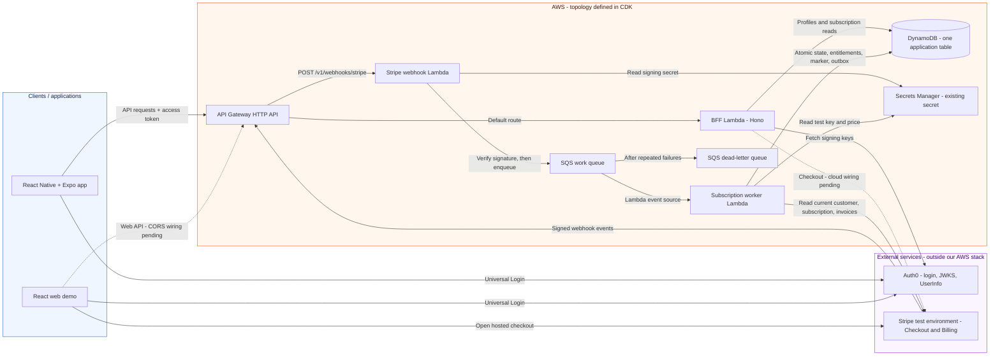
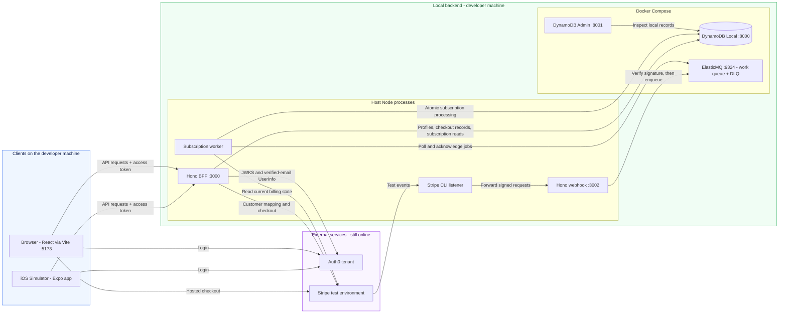

# PremiumPass architecture

This overview separates **clients**, **AWS resources**, and **external services**. The AWS view describes the topology defined in CDK; it does not imply a completed deployment. The local view shows how to run the purchase flow today. Verification evidence and task status remain in [TASKS.md](TASKS.md).

## AWS deployment topology

Blue contains client applications, orange contains AWS infrastructure, and purple contains external services. Solid arrows describe implemented integrations; the dotted checkout and web-API arrows mark missing cloud wiring. Labels identify the operation or data flow; ordinary HTTP responses are omitted.

The boundary represents what PremiumPass controls, not the underlying hosting provider of Auth0 or Stripe. Hosting the web application's assets is not configured in this stack; the web client currently runs through Vite on the developer's machine.

| Component       | Responsibility and boundary                                                                                                                                                                                         |
| --------------- | ------------------------------------------------------------------------------------------------------------------------------------------------------------------------------------------------------------------- |
| Clients         | Sign in with Auth0 and call the API using an access token. The web demo opens hosted Checkout; the mobile app reads the resulting entitlement. Neither client grants itself Premium.                                |
| API Gateway     | Routes `$default` to the BFF and the explicit Stripe POST route to the webhook Lambda. No JWT or Lambda authorizer is configured in the Gateway.                                                                    |
| BFF Lambda      | Verifies JWT signature, issuer, audience, expiry, and scopes in the backend. Derives user ownership from the validated identity and evaluates access from subscriptions at request time.                            |
| Webhook Lambda  | Authenticates Stripe through its signature over unchanged request bytes. It requires no Auth0 token and acknowledges a supported event only after queue acceptance.                                                 |
| Worker Lambda   | Resolves the stored customer owner, retrieves current Stripe state, verifies paid periods, and derives the union of valid subscription grants. Its domain processing does not use Hono.                             |
| DynamoDB        | Stores identity/profile mappings, checkout records, subscriptions, entitlement snapshots, processed-event markers, and pending outbox entries in one table. These are record types, not separate database services. |
| SQS / DLQ       | Buffers asynchronous work and retries failures. Repeated failures move to the queue's DLQ; successful state commits and event markers make duplicate delivery safe.                                                 |
| Secrets Manager | Existing secret referenced by ARN. The webhook and worker read it at runtime; CDK does not create or populate it. No secret values are embedded in the diagram or template.                                         |
| CloudWatch Logs | Each Lambda writes to its own log group. Log edges are omitted from the diagram to keep the request and event paths readable.                                                                                       |

**Cloud checkout limitation:** The BFF Lambda currently has no checkout service injected, billing write permissions, or web CORS configuration. Checkout and verified-email lookup work through the local BFF. The dotted arrows are intended cloud connections, not working cloud checkout or browser CORS. The main application read routes and processing resources are defined in CDK. See [infrastructure boundaries](../infra/README.md).

## Local development topology

The local purchase flow uses real Auth0 and Stripe test services. Node processes and Docker replace the AWS execution environment; no AWS deployment is needed. The Expo app runs in the iOS Simulator, and the web app runs in the browser. Their local API address is `http://127.0.0.1:3000`.

There is no API Gateway or Lambda runtime in this local path. The BFF and webhook listen on separate ports; Stripe CLI must forward to **3002**, not the BFF on 3000. ElasticMQ messages are in-memory, while DynamoDB data uses a persistent Docker volume. BFF, webhook and worker each read their own service `.env`. BFF and worker share the Stripe test environment and DynamoDB table; webhook and worker share the queue URL. The webhook requires only queue configuration and its signing secret. Root `pnpm dev` starts Docker and the four Node processes; Stripe CLI and Mobile remain separate.

The local flow is: sign in → start checkout → pay in Stripe test mode → receive a signed event → enqueue → verify current provider state → commit subscriptions and entitlements → reload the mobile dashboard. A checkout success redirect does not grant access.

Use the [payments guide](PAYMENTS.md) for setup, checkout and processing diagrams, access rules, and manual checks.

## Planned extensions and their placement

These components are deliberately kept out of the implemented topology above. Their scope and acceptance criteria are in the task backlog.

| Task                               | Placement                                     | Planned connection                                                                                                                                                                                                     |
| ---------------------------------- | --------------------------------------------- | ---------------------------------------------------------------------------------------------------------------------------------------------------------------------------------------------------------------------- |
| P07 - Apple/Google provider mocks  | PremiumPass backend/local development tooling | Separate mock provider state and adapters feeding the shared processing path. They are not real external App Store or Google Play integrations. The existing P05 scenario script only writes marked local demo grants. |
| P08 - Outbox publisher             | AWS Lambda, scheduled                         | Read pending DynamoDB outbox entries and publish to EventBridge, then mark accepted entries as sent.                                                                                                                   |
| P08 - EventBridge and log consumer | AWS event bus and Lambda                      | Distribute domain events to an observable consumer. Access checks do not depend on this consumer.                                                                                                                      |
| P09 - Reconciliation               | AWS scheduled Lambda                          | Inspect known accounts/subscriptions and submit work to SQS to repair missed notifications through the same processing path.                                                                                           |

The worker already saves pending outbox records atomically with state. EventBridge publication and scheduled reconciliation are not yet wired into the CDK stack. The API still checks expiry on every access request, even if no event arrives at an expiration boundary.

## Source of truth

- [CDK stack](../infra/src/stack.ts): AWS resources, routes, roles, and event source mapping.
- [Compose services](../compose.yaml): local database, admin GUI, and queue broker.
- [BFF app](../services/bff/src/app.ts) and [Lambda entry](../services/bff/src/lambda.ts): user authentication, routes, and cloud composition.
- [Local BFF](../services/bff/src/local.ts), [webhook entry](../services/stripe-webhook/src/local.ts) and [worker entry](../services/subscription-worker/src/local.ts): local checkout, webhook, and worker composition.
- [Processor](../services/subscription-worker/src/processing/processor.ts): provider reads and transactional processing.
- [Data model](DYNAMODB_DATA_MODEL.md): exact keys, fields, and examples.
