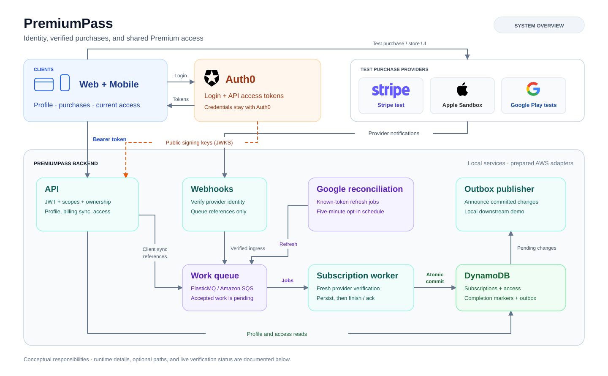
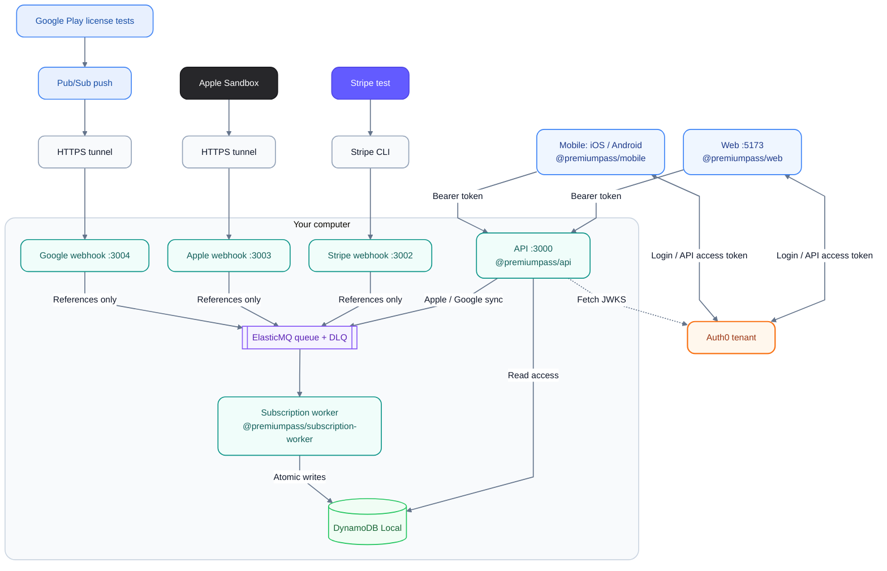
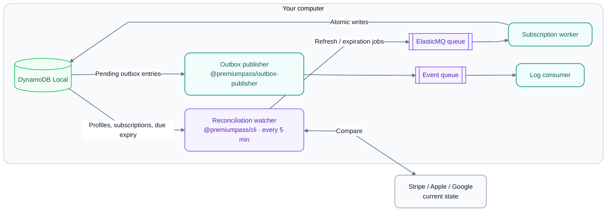
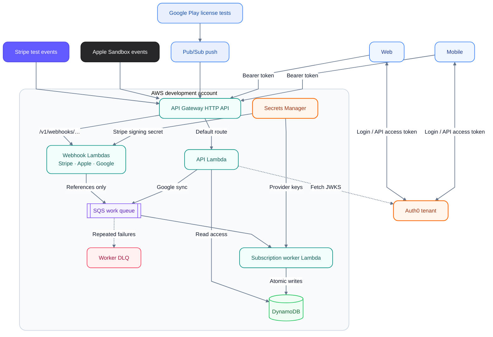
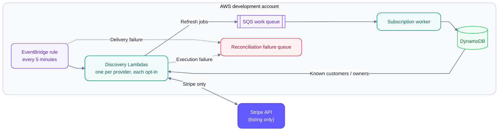

# Architecture

PremiumPass has two paths: **authenticated reads/actions** through the API and
**provider notifications** through verified webhook ingress. Both meet at
subscriptions in DynamoDB. New to the terms? Start with [Concepts](CONCEPTS.md).
[Product overview](../README.md) · [Setup](GETTING_STARTED.md).

## System overview

The overview shows responsibilities shared by the local and prepared AWS paths.
The topology diagrams below identify the actual runtime boundaries and optional
components. Blue marks clients, orange identity/secrets, teal services, violet
queues/scheduling, green storage, and rose failure queues. Provider cards retain
their own colors; labels and shapes identify each component as well.

## Responsibilities

| Layer                       | Responsibility                                                                                 | Start reading                                                                                                                                |
| --------------------------- | ---------------------------------------------------------------------------------------------- | -------------------------------------------------------------------------------------------------------------------------------------------- |
| Clients                     | Login, display backend access, initiate purchases                                              | [Web](../apps/web/README.md), [Mobile](../apps/mobile/README.md)                                                                             |
| Auth0                       | Authenticate users, issue API access tokens, publish public signing keys                       | [Auth0](AUTH0_SETUP.md)                                                                                                                      |
| API                         | Verify Auth0 tokens/scopes, resolve user, serve profile/access, handle enabled billing actions | [API](../services/api/README.md)                                                                                                             |
| Webhooks                    | Verify event signatures or Pub/Sub identity, then enqueue references                           | [Stripe](../services/stripe-webhook/README.md), [Apple](../services/apple-webhook/README.md), [Google](../services/google-webhook/README.md) |
| Worker                      | Verify current provider state/ownership; persist atomically                                    | [Worker](../services/subscription-worker/README.md)                                                                                          |
| Developer CLI               | Inspect and edit local demo state; preview or trigger reconciliation                           | [CLI](../apps/cli/README.md)                                                                                                                 |
| Outbox publisher / consumer | Publish committed snapshots; log accepted events without access writes                         | [Outbox](../services/outbox-publisher/README.md)                                                                                             |

Hono belongs to HTTP services. Domain code receives ordinary values and a clock,
not HTTP contexts. Each executable owns its configuration and supported runtime
entry points; services do not import other services.

## Shared packages

These libraries are imported by apps and services; they are not separate running
processes. Workspace names come from each package's `package.json`.

| Workspace package                                                                       | Responsibility                                                                                          |
| --------------------------------------------------------------------------------------- | ------------------------------------------------------------------------------------------------------- |
| [`@premiumpass/api-contracts`](../packages/api-contracts/README.md)                     | Shared HTTP request/response schemas and types for API, Web, and Mobile                                 |
| [`@premiumpass/billing-contracts`](../packages/billing-contracts/README.md)             | Provider event allowlist and queue job schemas/types                                                    |
| [`@premiumpass/domain`](../packages/domain/README.md)                                   | Subscription and access rules across providers                                                          |
| [`@premiumpass/persistence`](../packages/persistence/src/index.ts)                      | DynamoDB subscription storage and database configuration                                                |
| [`@premiumpass/aws-clients`](../packages/aws-clients/README.md)                         | AWS SDK client construction for local and cloud use                                                     |
| [`@premiumpass/apple-store`](../packages/apple-store/README.md)                         | Apple Sandbox configuration, API client, and signed-data verification                                   |
| [`@premiumpass/google-play`](../packages/google-play/README.md)                         | Google Play configuration, Developer API client, test-purchase verification, and Pub/Sub authentication |
| [`@premiumpass/subscription-processing`](../packages/subscription-processing/README.md) | Shared provider processors, ownership checks, and atomic subscription/access/outbox writes              |
| [`@premiumpass/logging`](../packages/logging/src/index.ts)                              | Shared structured logging and log-level configuration                                                   |

## Local development topology

Labels include each process's workspace name and local port. The first picture
shows requests and provider notifications; the second shows background work.

### Local requests and notifications

### Local background work

| Runs                  | Processes                                                                                           |
| --------------------- | --------------------------------------------------------------------------------------------------- |
| In Docker             | DynamoDB Local and ElasticMQ; all application code runs on your computer, without AWS credentials   |
| Started by `pnpm dev` | API, Stripe and Apple webhooks, worker, Web, and the reconciliation watcher (now, then every 5 min) |
| Started separately    | Stripe CLI, Metro (Mobile), HTTPS tunnels, Google webhook, outbox publisher and log consumer        |

Apple and Google stay disabled until configured. The outbox publisher and log
consumer are two processes from the same workspace package.
[Commands](DEVELOPMENT.md#run-and-check) · [Google setup](GOOGLE_PLAY.md).

## AWS deployment topology

The same processes run as Lambdas behind one API Gateway. The first picture
shows requests and notifications; the second shows reconciliation and the
failure queues.

### AWS requests and notifications

### AWS reconciliation and failure paths

The CDK workspace [`@premiumpass/infra`](../infra/README.md) defines these
resources. The request flow is the same as locally:

- **Login:** Web and Mobile get access tokens directly from Auth0. Gateway has no
  authorizer; the API verifies signature, issuer, audience, and time with cached
  keys from the fixed JWKS URL, then checks scopes and ownership. Auth0 is not
  called per request and never grants Premium.
- **Identity:** the API maps verified `iss` / `sub` to an internal UUID; the
  [logical ER model](DYNAMODB_DATA_MODEL.md#logical-er-model) shows the records.
- **Webhooks:** each verifies its provider's signature (Google: Pub/Sub identity)
  and only enqueues references. Only the worker reads Apple/Google private keys.
- **Opt-in providers:** Apple, Google, and each reconciliation target are off by
  default. Enabling one adds only the IAM permissions it needs.
- **Reconciliation:** one five-minute rule with three separate Lambdas and its own
  failure queue; see the [reconciliation guide](RECONCILIATION.md#cloud-reconciliation).

Google topics, push subscriptions, and Play Console resources are external setup;
CDK does not create them. IAM details: [AWS boundaries](../infra/README.md#resources-and-boundaries).

## What runs where

The diagrams show code wiring. This table shows which paths exist locally and
which the CDK stack prepares. Verification status lives only in [TASKS](TASKS.md).

| Feature                                  | Local                      | AWS stack                   |
| ---------------------------------------- | -------------------------- | --------------------------- |
| Login, profile, and access reads         | ✓                          | ✓                           |
| Stripe checkout and cancellation         | ✓                          | — not wired                 |
| Stripe notifications                     | ✓ via Stripe CLI           | ✓                           |
| Apple purchase sync from the app         | ✓                          | — not wired                 |
| Apple notifications                      | ✓ via ngrok                | ✓ opt-in                    |
| Google purchase sync and Restore         | ✓                          | ✓ opt-in                    |
| Google notifications (Pub/Sub push)      | ✓ via HTTPS tunnel         | ✓ opt-in                    |
| Reconciliation for Stripe, Apple, Google | ✓ watcher in `pnpm dev`    | ✓ opt-in schedule           |
| Expiration jobs                          | ✓                          | — (API still checks expiry) |
| Google mock scenarios                    | ✓                          | —                           |
| Outbox publication                       | ✓ ElasticMQ + log consumer | — EventBridge adapter only  |
| Browser CORS for the website             | ✓                          | — not configured            |
| Complimentary Premium (CLI)              | ✓                          | —                           |

API access and expiry checks never wait for the outbox, an event consumer, or an
expiration job.

## Where the logic lives

| Piece             | Code                                                                                                  | Responsibility                                                                       |
| ----------------- | ----------------------------------------------------------------------------------------------------- | ------------------------------------------------------------------------------------ |
| Worker runtime    | [`runtime.ts`](../services/subscription-worker/src/runtime.ts)                                        | Configuration, connections, and the switch that picks a provider processor           |
| Provider adapters | [`providers/<provider>/`](../packages/subscription-processing/src/providers/stripe/processor.ts)      | `processor.ts` (steps), `source.ts` (provider API), `store.ts` (keys and markers)    |
| Retry loop        | [`retry.ts`](../packages/subscription-processing/src/processing/retry.ts)                             | Skip duplicates; retry a lost compare-and-swap race with fresh reads                 |
| Shared commit     | [`dynamodb-processing.ts`](../packages/subscription-processing/src/processing/dynamodb-processing.ts) | Revision guard, profile check, access snapshot, and outbox entry in one transaction  |
| Access rules      | [`subscriptions.ts`](../packages/domain/src/subscriptions.ts)                                         | Translate provider states and combine all grants; no I/O                             |
| Admin grants      | [`admin-grants/`](../packages/subscription-processing/src/admin-grants/processor.ts)                  | Grant/revoke rules, audit receipts, idempotency                                      |
| Developer CLI     | [`apps/cli`](../apps/cli/README.md)                                                                   | Prompts, local demo edits, local reconciliation; database and queue fixed to Compose |

Three rules hold for every provider:

- **One commit path.** All writers use the shared transaction, so concurrent
  updates never drop another provider's valid grant.
- **Commit first, then tell the store.** Apple finish and Google acknowledgement
  run after the commit; a durable marker lets a retry resume that last step.
- **Shared code is not a permission check.** The CLI and the worker use the same
  processing package, but each caller authorizes its own operator.

[Processing and retries](PAYMENTS.md#processing-and-retries) explains the failure cases.

## Follow a feature

- [Stripe checkout and processing](PAYMENTS.md#payment-flow): payment → verified state → access.
- [Apple purchase and notifications](APPLE_PURCHASES.md): client synchronization and lifecycle events converge in the worker.
- [Google Play purchases and notifications](GOOGLE_PLAY.md): Android purchase/restore, authenticated Pub/Sub ingress, and backend acknowledgement.
- [Reconciliation and expiration](RECONCILIATION.md): repair missed updates and apply verified access boundaries.
- [Data model](DYNAMODB_DATA_MODEL.md): ownership, aggregate revision, completion markers, and outbox.

## Maintaining the diagrams

Mermaid diagrams live in the Markdown files and define only the colors they use.
The [SVG overview](images/architecture-overview.svg) embeds provider logos
because Markdown renderers cannot load Mermaid icon packs; update it when a
component's responsibility changes.
