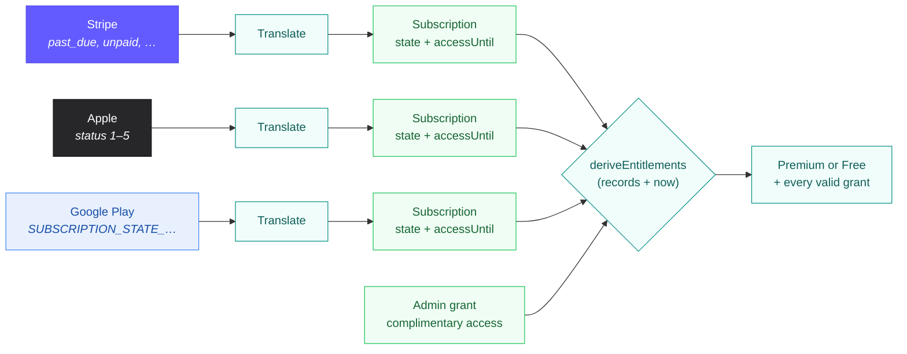
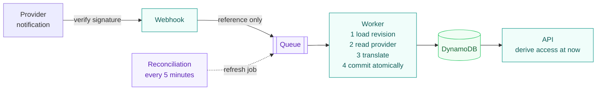

# Concepts: one Premium, many payment providers

A user can pay on the website (Stripe), on an iPhone (Apple), or on Android
(Google Play). PremiumPass still answers one question: **is this user Premium
right now?** This page explains the idea behind that answer. Read it before the
provider guides; the [glossary](#glossary) explains the terms used everywhere else.

## The idea in one picture

Every provider speaks its own language. The backend translates each purchase
into the same **subscription** shape, then combines all of them with the current
time into one **entitlement**.

The translation lives in each provider adapter; the combination is one pure
function in [`packages/domain/src/subscriptions.ts`](../packages/domain/src/subscriptions.ts)
([package guide](../packages/domain/README.md)). API reads, the worker, and the
CLI all call that same function.

## Four rules to remember

1. **The backend decides.** A checkout redirect, a store success callback, or
   an Auth0 scope grants nothing. Only a verified provider state does.
2. **Events are hints, not facts.** A webhook carries a reference. The worker
   then asks the provider for the _current_ state, so late or duplicate events
   cannot apply stale data.
3. **All valid grants count.** Access is the union of every valid source.
   Ending an Apple subscription cannot remove valid Stripe or admin access.
4. **Time is part of the rule.** Each grant has an end. The API compares it with
   the current time on every request, even if no expiry event ever arrives.

## Same meaning, different words

The translation table is the heart of consolidation. Each provider status maps
to one normalized state; the state decides how long access lasts.

| Normalized state | Stripe                         | Apple                               | Google Play                            | Access                            |
| ---------------- | ------------------------------ | ----------------------------------- | -------------------------------------- | --------------------------------- |
| `active`         | `active`                       | `1` Active                          | `ACTIVE`, `CANCELED` (renewal off)     | Until `accessUntil`               |
| `trialing`       | `trialing`                     | —                                   | —                                      | Until `accessUntil`               |
| `past_due`       | `past_due`                     | `3` Billing retry, `4` Grace period | `IN_GRACE_PERIOD`                      | Short grace after the paid period |
| `pending`        | `incomplete`                   | —                                   | `PENDING`                              | None                              |
| `paused`         | `paused`                       | —                                   | `ON_HOLD`, `PAUSED`                    | None                              |
| `canceled`       | `canceled`                     | —                                   | —                                      | None                              |
| `expired`        | `incomplete_expired`, `unpaid` | `2` Expired                         | `EXPIRED`, `PENDING_PURCHASE_CANCELED` | None                              |
| `revoked`        | —                              | `5` Revoked                         | —                                      | None                              |
| Unknown          | Any other value                | Any other value                     | Any other value                        | None; shown as a warning          |

Google states are shortened; the full value starts with `SUBSCRIPTION_STATE_`.
The exact grace rules per provider are in the [access policy](PAYMENTS.md#access-policy).
Code: `normalizeProviderStatus` in the domain package.

## A worked example

A user bought Premium twice: on the website until **November 1** and on an
iPhone until **October 20**. Renewal is turned off for both.

| Moment     | Valid grants  | Result  | `effectiveUntil` (next re-check) |
| ---------- | ------------- | ------- | -------------------------------- |
| October 18 | Stripe, Apple | Premium | October 20                       |
| October 21 | Stripe        | Premium | November 1                       |
| November 2 | none          | Free    | none                             |

`effectiveUntil` is the earliest boundary of any grant, not the end of all
access. On October 20 the user stays Premium; only the reason changes.

## How a change arrives

All providers follow the same path. Reconciliation is the safety net for a
notification that never arrived.

The worker's four steps are the same for Stripe, Apple, and Google, and one
shared [retry loop](../packages/subscription-processing/src/processing/retry.ts)
repeats them when another writer was faster. Compare
[`stripe/processor.ts`](../packages/subscription-processing/src/providers/stripe/processor.ts)
with [`google/processor.ts`](../packages/subscription-processing/src/providers/google/processor.ts):
only the provider calls differ. Apple and Google add a fifth step after the
commit: tell the store the purchase was processed (finish / acknowledge).

## Glossary

| Term               | Meaning                                                                                                                |
| ------------------ | ---------------------------------------------------------------------------------------------------------------------- |
| Provider           | Where the user paid: Stripe, Apple, Google Play, or a local demo record                                                |
| Subscription       | Our record of one purchase, already translated into the normalized shape                                               |
| Normalized state   | Our shared status vocabulary (`active`, `past_due`, …); the original value stays in `providerStatus`                   |
| Grant              | One reason a user has Premium right now, with an end time (`validUntil`)                                               |
| Admin grant        | Complimentary Premium given through the CLI, independent of any purchase                                               |
| Entitlements       | The combined result: `tier` (free/premium), `features`, every valid grant, and warnings                                |
| `accessUntil`      | End of the verified, paid period of one subscription                                                                   |
| `graceUntil`       | Extra time after a failed renewal; never longer than the provider or the policy allows                                 |
| `effectiveUntil`   | The next moment the combined access must be re-evaluated                                                               |
| `verifiedAt`       | Last time the backend confirmed this subscription with the provider                                                    |
| Ownership binding  | Proof which user a purchase belongs to: Stripe customer mapping, Apple `appAccountToken`, Google `obfuscatedAccountId` |
| Aggregate revision | Version number of all of one user's access data; a write succeeds only if nobody changed it since reading              |
| Completion marker  | Record that an event was fully processed, so a duplicate delivery is skipped                                           |
| Outbox             | A "please announce this change" record, saved in the same transaction as the change itself                             |
| Reconciliation     | A scheduled re-check with the provider that repairs missed notifications                                               |
| Expiration job     | Background work that recomputes access once a stored boundary has passed                                               |
| Idempotency key    | Client-chosen ID that makes a retried request (e.g. checkout) return the same result                                   |
| Correlation ID     | ID that follows one event through webhook, queue, and worker logs                                                      |
| DLQ                | Dead-letter queue: where a job lands after repeated failures, ready for inspection and redrive                         |
| Scope              | Auth0 permission to _call_ an API route; it never proves a purchase                                                    |
| JWKS               | Auth0's public signing keys; the API uses them to verify access tokens                                                 |

## Continue

- [Payments](PAYMENTS.md): the Stripe flow and the full access policy.
- [Architecture](ARCHITECTURE.md): which process does what, locally and in AWS.
- [Data model](DYNAMODB_DATA_MODEL.md): how these records are stored.
- [Reconciliation](RECONCILIATION.md): how missed updates are repaired.
