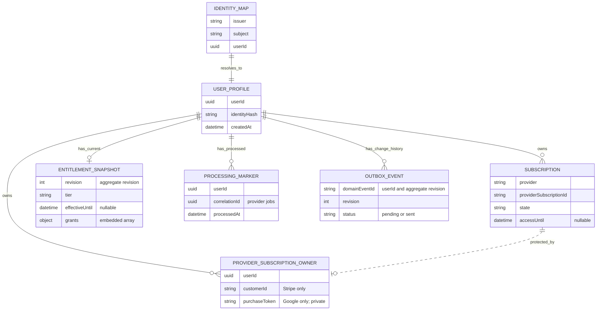
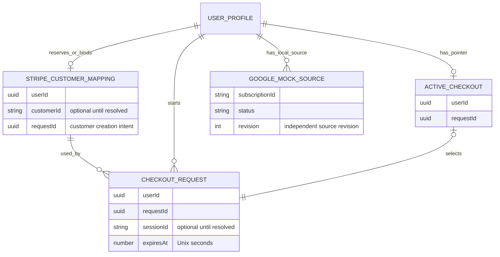

# DynamoDB data model

One table holds identities, subscriptions, and processing records. Start with
[architecture](ARCHITECTURE.md); [Payments](PAYMENTS.md) explains the access rules.

## Logical ER model

These are logical record types in **one DynamoDB table**, not SQL tables or
database-enforced foreign keys. `||` means exactly one, `o|` zero or one, and
`o{` zero or many. Lines describe relationships, not the order of writes.
Selected fields explain each record; the sections below contain full key layouts.

### Account, access, and processing



Auth0 stores login credentials externally. Only after token verification does
the API map the exact issuer/subject pair to a profile. The current application
creates one mapping/profile pair; it does not merge identities by email. See
[authentication flow](ARCHITECTURE.md#aws-deployment-topology).

A profile can exist before billing or the first entitlement snapshot. It can
own several subscriptions, including expired ones and overlapping providers.
Verified provider processing creates the immutable owner binding; local demo
subscriptions can exist without one. Processing markers belong to the user;
their provider-specific references and finish/acknowledgement fields are below.

The worker atomically saves subscription, owner binding, current snapshot, marker,
and an outbox event when access/domain state changes. A snapshot's `grants` array
is embedded derived data. Outbox records retain their own revision and access
snapshot; they do not point to an immutable historical `ENTITLEMENTS` row.
API access is recalculated from subscriptions and current time, so an old snapshot
cannot extend access. A scope alone never grants Premium.

### Checkout and local mock extensions



The logical Stripe customer mapping uses forward/reverse records after binding.
Customer creation and checkout session references can remain unresolved; an active
pointer selects a stored request and is not proof of payment. A checkout request
does not directly create a subscription: verified worker processing does that.
Google mock source rows are local-only inputs; their derived subscriptions and
immutable owners use the core model above. Complimentary admin grants are planned
in [P13](TASKS.md#p13-admin-granted-complimentary-premium) and have no stored record
type yet.

| Logical record                                | DynamoDB record family / details                                                                                                                          |
| --------------------------------------------- | --------------------------------------------------------------------------------------------------------------------------------------------------------- |
| Identity map / profile                        | [`IDENTITY#H / MAP`, `USER#U / PROFILE`](#identity-and-profile)                                                                                           |
| Subscription                                  | [`USER#U / SUB#provider#reference`](#subscriptions)                                                                                                       |
| Entitlement snapshot / outbox / Stripe marker | [`ENTITLEMENTS`, `OUTBOX#U:R`, `EVENT#stripe#E`](#subscription-processing-records)                                                                        |
| Provider owner / store marker                 | [Stripe](#subscription-processing-records), [Apple](#apple-sandbox-records), [Google](#google-play-records), [Google mock](#local-reconciliation-records) |
| Stripe customer / checkout request / pointer  | [`CUSTOMER#stripe`, `CHECKOUT#U#Q`, `CHECKOUT#ACTIVE`](#stripe-customer-and-checkout-records)                                                             |
| Google mock source / local expiration marker  | [`MOCK#google#USER#U`, `EVENT#local_expiration#E`](#local-reconciliation-records)                                                                         |

## Table structure

String `pk` and `sk` form the primary key. Other fields belong to application
records. No secondary indexes or TTL are configured. Local table:
`premiumpass-local`; AWS uses the generated name from `DYNAMODB_TABLE_NAME`.
Both use on-demand billing. [Retention and cleanup](../infra/README.md#cleanup).

Shorthand: `U` = internal UUID, `H` = SHA-256 of JSON `[issuer, subject]`,
`C` = Stripe customer ID, `Q` = request UUID, `S` = subscription ID,
`E` = event ID, `R` = aggregate revision.

## Identity and profile

| PK / SK              | Fields                                | Purpose                               |
| -------------------- | ------------------------------------- | ------------------------------------- |
| `IDENTITY#H` / `MAP` | `issuer`, `subject`, `userId`         | Resolve exact verified Auth0 identity |
| `USER#U` / `PROFILE` | `userId`, `identityHash`, `createdAt` | Stable internal profile               |

Both records are created in one conditional transaction. Concurrent first
requests converge by rereading the winning mapping. Existing inconsistent
mappings fail; no fabricated profile or email-based linking is allowed.
The hash is a lookup key, not encryption. Email, display name, and tokens are not
stored. Changing the issuer creates a different identity even with the same subject.

## Subscriptions

Each subscription is `USER#U` / `SUB#<provider>#<providerSubscriptionId>`.
Records are written by verified processing or explicitly local demo tools.

| Field                                          | Meaning                                                                                             |
| ---------------------------------------------- | --------------------------------------------------------------------------------------------------- |
| `userId`, `provider`, `providerSubscriptionId` | Owner and namespaced source identity                                                                |
| `productId`                                    | Internal mapping; only `premium_monthly` grants access                                              |
| `state`, `providerStatus`                      | Normalized state and original provider state                                                        |
| `cancelAtPeriodEnd`                            | Renewal disabled; not immediate revocation                                                          |
| `accessUntil`, `graceUntil`                    | Verified UTC access/grace boundaries or null; [provider-specific limits](PAYMENTS.md#access-policy) |
| `verifiedAt`                                   | Last successful source verification, UTC                                                            |
| `revision`                                     | Positive source revision; distinct from aggregate revision                                          |
| `demoScenario`                                 | Optional `p05-local-demo` marker protecting reserved local records                                  |

Synthetic document shape (timestamps illustrate a record, not current access):

```json
{
  "pk": "USER#389f7e6b-2f11-423c-ba09-110e64cc1e7f",
  "sk": "SUB#stripe#sub_SYNTHETIC",
  "userId": "389f7e6b-2f11-423c-ba09-110e64cc1e7f",
  "provider": "stripe",
  "providerSubscriptionId": "sub_SYNTHETIC",
  "productId": "premium_monthly",
  "state": "active",
  "providerStatus": "active",
  "cancelAtPeriodEnd": false,
  "accessUntil": "2026-11-01T12:00:00.000Z",
  "graceUntil": null,
  "verifiedAt": "2026-10-01T12:00:00.000Z",
  "revision": 1
}
```

Zod validates persisted fields/ownership before API responses. Unknown product
or status strings remain visible but grant nothing; malformed records fail
closed. Expired records remain stored; expiry is evaluated during reads.

## Stripe customer and checkout records

| PK / SK                                | Fields beyond keys                                                                                              |
| -------------------------------------- | --------------------------------------------------------------------------------------------------------------- |
| `USER#U` / `CUSTOMER#stripe`           | `userId`, creation `requestId`, `createdAt`, optional `customerId`                                              |
| `PROVIDER#stripe#CUSTOMER#C` / `OWNER` | `userId`, `customerId`                                                                                          |
| `CHECKOUT#U#Q` / `REQUEST`             | Owner/request IDs, fingerprint, customer/price IDs, return URLs, `createdAt`, `expiresAt`, optional `sessionId` |
| `USER#U` / `CHECKOUT#ACTIVE`           | `userId`, `requestId`                                                                                           |

Creation intent is durable; forward/reverse customer mappings bind atomically.
Checkout reservation compares the active pointer, and session attachment requires
the same fingerprint. Missing provider references mean unresolved work, not
permission to purchase again. These technical times use Unix seconds. Hosted
checkout URLs, payment payloads, and emails are not persisted.
[Recovery behavior](PAYMENTS.md#checkout-and-recovery).

## Subscription processing records

| PK / SK                           | Main fields and role                                                                                                                    |
| --------------------------------- | --------------------------------------------------------------------------------------------------------------------------------------- |
| `USER#U` / `ENTITLEMENTS`         | `userId`, aggregate `revision`, `tier`, `features`, `effectiveUntil`, `evaluatedAt`, `grants`, `warnings`                               |
| `PROVIDER#stripe#SUB#S` / `OWNER` | Immutable `userId` / `customerId` binding                                                                                               |
| `EVENT#stripe#E` / `PROCESSED`    | Owner/event/type/correlation IDs, `processedAt`, outcome (`changed` or `verified`), aggregate revision                                  |
| `OUTBOX#U:R` / `EVENT`            | Stable `domainEventId=U:R`, owner/revision, `SubscriptionChanged`, pending status, provider/correlation IDs, timestamp and entitlements |

Writers read aggregate revision **before** subscriptions and provider state.
The transaction checks that revision, profile, ownership, and absent completion
marker before committing all records. A conflict reloads and recomputes.
Separate consistent reads alone are not an atomic snapshot.

A duplicate event makes no writes. An unchanged new verification updates the
aggregate/verification metadata without another domain-change outbox event.
Grant source revisions can therefore differ from the aggregate revision.
The local publisher scans pending events and conditionally changes only their
status to `sent`, adding `sentAt` and `publishedEventId` after transport acceptance.
The stable `domainEventId` survives retries; the transport ID can change. A crash
after acceptance but before the update can publish a duplicate. No subscription,
aggregate, or completion marker changes during publication. Outbox records have
no automatic TTL cleanup. [Publisher behavior](../services/outbox-publisher/README.md).

## Apple sandbox records

| PK / SK                                                        | Meaning                                                                                               |
| -------------------------------------------------------------- | ----------------------------------------------------------------------------------------------------- |
| `USER#U` / `SUB#apple#Sandbox:<originalTransactionId>`         | Normalized subscription lineage                                                                       |
| `PROVIDER#apple#SUB#Sandbox:<originalTransactionId>` / `OWNER` | Immutable internal owner                                                                              |
| `EVENT#apple#Sandbox#<eventId>` / `PROCESSED`                  | User, submitted reference, verified `finishTransactionId`, type, `processedAt`, optional `finishedAt` |

Client sync uses a generated operation UUID; notifications use Apple's verified
notification UUID. Local reconciliation uses
`reconcile_<run-uuid>_<originalTransactionId>` and stores the latest signed
transaction ID as its finish target; the submitted reference is the known lineage.
The processing marker and finish target commit atomically with
access. A conditional `UpdateItem` records `finishedAt` only after Apple finish
succeeds; it does not change grants, revisions, or outbox. Owner-only API polling
reports completion only then. See [Apple processing](APPLE_PURCHASES.md#processing-and-ownership).

## Google Play records

`G` below is `<packageName>:<sha256(purchaseToken)>`. Raw tokens never appear in
the public subscription view or outbox. Unlike the digest, a purchase token is
private backend data and must not be logged or placed in client configuration.

| PK / SK                                | Purpose                                                                                         |
| -------------------------------------- | ----------------------------------------------------------------------------------------------- |
| `USER#U` / `SUB#google#G`              | Normalized, test-verified subscription; safe digest reference                                   |
| `PROVIDER#google#SUB#G` / `OWNER`      | Immutable `userId`, package name, private purchase token for future provider refresh            |
| `EVENT#google#<eventId>` / `PROCESSED` | User, digest reference, event type, `needsAcknowledgement`, commit time, optional `completedAt` |

The owner binding, subscription, aggregate revision/access, processing marker,
and changed-state outbox commit atomically through the same all-provider path.
Only then does the worker acknowledge Google and conditionally save `completedAt`.
A lost response repeats provider verification/acknowledgement without replaying
the domain commit. API operation polling requires both the owner and recorded
completion. Notifications derive the owner from Google's verified account UUID;
client jobs additionally require a match with the authenticated user's UUID.
Local and cloud API polling use a strongly consistent marker read and require
`eventType=client.sync`. Conditional cloud API IAM adds only `GetItem` for
`EVENT#google#*`; marker completion and provider-owner writes belong to the worker.

Reconciliation reads the private owner/token record with a consistent read and
validates its owner, package, and hash against the stored subscription. Tokens
are retained so missed updates can be checked; token retirement and encrypted
production storage/lifecycle are outside the local demo.

## Local reconciliation records

| PK / SK                                               | Fields and role                                                                                                             |
| ----------------------------------------------------- | --------------------------------------------------------------------------------------------------------------------------- |
| `MOCK#google#USER#U` / `SUB#mock_google_<id>`         | Independent synthetic provider state: owner, ID, status, access/grace, renewal flag, source revision and update time        |
| `PROVIDER#google_mock#SUB#mock_google_<id>` / `OWNER` | Immutable owner established with the independent source                                                                     |
| `EVENT#google_mock#E` / `PROCESSED`                   | Owner/subscription, correlation ID and completion time; atomic with derived `SUB`, entitlement snapshot and optional outbox |
| `EVENT#local_expiration#E` / `PROCESSED`              | Owner and completion time; atomic with the recalculated snapshot and outbox                                                 |

Google mock source changes require an existing profile and compare the source
revision. They do not write derived `USER#U / SUB#google_mock#…` rows. Processing
reads the aggregate revision before the source and guards both revisions plus
ownership at commit. Source absence/errors never delete derived subscriptions.
The old `demo-p05-*` seed records have no independent source and are not discovered
as managed Google mocks. Local source records share this table for convenience;
they remain a separate authority for the synthetic provider exercise.

Stripe reconciliation uses existing customer mappings and processing markers.
Its event ID is `reconcile_<run-uuid>_<subscription-id>`; a run retries with stable
IDs, while later runs can reverify. Expiration uses `expire_<run-uuid>_<user-id>`.
Processing markers and outbox records have no automatic cleanup or TTL.

## Access patterns

| Operation                                            | Pattern                                                                                                                                                 |
| ---------------------------------------------------- | ------------------------------------------------------------------------------------------------------------------------------------------------------- |
| Identity/profile/customer/checkout/completion lookup | Consistent `GetItem` by full key                                                                                                                        |
| All subscriptions for a user                         | Paginated consistent `Query`, `pk=USER#U`, `begins_with(sk, 'SUB#')`                                                                                    |
| Identity creation                                    | Conditional transaction for mapping + profile                                                                                                           |
| Customer/checkout reservation                        | Conditional puts/transactions with owner/request comparisons                                                                                            |
| Provider commit                                      | Transaction: subscription, aggregate, owner, completion, optional outbox                                                                                |
| Local reconciliation discovery                       | Paginated profile `Scan` and subscription `Query`, then Stripe customer/provider discovery, known Apple lineage refresh, and Google mock source `Query` |
| Cloud Google reconciliation discovery                | Paginated consistent `Scan` filtered to package-scoped Google owner records; project owner UUID, private token, package and keys; enqueue refresh only  |
| Local outbox discovery                               | Paginated consistent `Scan` filtered by `OUTBOX#`, `EVENT`, and pending status; reads the whole table                                                   |
| Outbox publication marker                            | Conditional `UpdateItem` on the existing pending event after per-entry transport acceptance                                                             |
| Local CLI edit/seed                                  | Aggregate-guarded transaction in the fixed local table; seeding touches only its marked demo rows                                                       |

User-facing flows use no table scan. Local outbox discovery scans the small demo
table without an index; filters do not reduce read capacity. Local Stripe
reconciliation discovers provider subscriptions through the stored customer and
reuses processing. The local five-minute reconciliation watcher also scans
profiles. Cloud Google discovery scans known owner records, without a new record
type, cursor, or database writes; run/job IDs travel in the schedule event and
queue. Its scan filter does not enforce an IAM key boundary. Production-scale
indexes/resumable discovery and other providers' cloud schedules are not wired.
Direct DynamoDB Admin edits bypass these guarantees.

Sources: [user store](../services/api/src/dynamodb-users.ts),
[checkout store](../services/api/src/billing/dynamodb-billing.ts),
[subscription reads](../packages/persistence/src/subscriptions.ts),
[shared processing transaction](../packages/subscription-processing/src/processing/dynamodb-processing.ts),
[Stripe persistence](../packages/subscription-processing/src/providers/stripe/store.ts),
[Apple persistence](../packages/subscription-processing/src/providers/apple/store.ts),
[Google persistence](../packages/subscription-processing/src/providers/google/store.ts),
[Google discovery reads](../packages/subscription-processing/src/providers/google/reconciliation-store.ts),
and [Google mock persistence](../packages/subscription-processing/src/providers/google-mock/store.ts).
