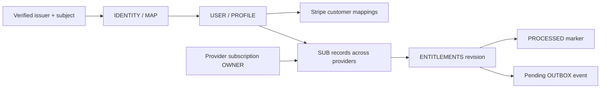

# DynamoDB data model

One table holds identities, subscriptions, and processing records. Start with
[architecture](ARCHITECTURE.md); [Payments](PAYMENTS.md) explains the access rules.

## Relationships



The last three records participate in the worker transaction; arrows show
relationships, not separate sequential writes. API access is recalculated from
subscriptions and current time, so an old snapshot cannot extend access.

## Table structure

String `pk` and `sk` form the primary key. Other fields belong to application
records. No secondary indexes or TTL are configured. Local table:
`premiumpass-local`; AWS uses the generated name from `DYNAMODB_TABLE_NAME`.
Both use on-demand billing. [Retention and cleanup](../infra/README.md#cleanup).

Shorthand: `U` = internal UUID, `H` = SHA-256 of JSON `[issuer, subject]`,
`C` = Stripe customer ID, `Q` = request UUID, `S` = subscription ID,
`E` = event ID, `R` = aggregate revision.

## Identity and profile

| PK / SK              | Fields                                | Purpose                               |
| -------------------- | ------------------------------------- | ------------------------------------- |
| `IDENTITY#H` / `MAP` | `issuer`, `subject`, `userId`         | Resolve exact verified Auth0 identity |
| `USER#U` / `PROFILE` | `userId`, `identityHash`, `createdAt` | Stable internal profile               |

Both records are created in one conditional transaction. Concurrent first
requests converge by rereading the winning mapping. Existing inconsistent
mappings fail; no fabricated profile or email-based linking is allowed.
The hash is a lookup key, not encryption. Email, display name, and tokens are not
stored. Changing the issuer creates a different identity even with the same subject.

## Subscriptions

Each subscription is `USER#U` / `SUB#<provider>#<providerSubscriptionId>`.
Records are written by verified processing or explicitly local demo tools.

| Field                                          | Meaning                                                                                             |
| ---------------------------------------------- | --------------------------------------------------------------------------------------------------- |
| `userId`, `provider`, `providerSubscriptionId` | Owner and namespaced source identity                                                                |
| `productId`                                    | Internal mapping; only `premium_monthly` grants access                                              |
| `state`, `providerStatus`                      | Normalized state and original provider state                                                        |
| `cancelAtPeriodEnd`                            | Renewal disabled; not immediate revocation                                                          |
| `accessUntil`, `graceUntil`                    | Verified UTC access/grace boundaries or null; [provider-specific limits](PAYMENTS.md#access-policy) |
| `verifiedAt`                                   | Last successful source verification, UTC                                                            |
| `revision`                                     | Positive source revision; distinct from aggregate revision                                          |
| `demoScenario`                                 | Optional `p05-local-demo` marker protecting reserved local records                                  |

Synthetic document shape (timestamps illustrate a record, not current access):

```json
{
  "pk": "USER#389f7e6b-2f11-423c-ba09-110e64cc1e7f",
  "sk": "SUB#stripe#sub_SYNTHETIC",
  "userId": "389f7e6b-2f11-423c-ba09-110e64cc1e7f",
  "provider": "stripe",
  "providerSubscriptionId": "sub_SYNTHETIC",
  "productId": "premium_monthly",
  "state": "active",
  "providerStatus": "active",
  "cancelAtPeriodEnd": false,
  "accessUntil": "2026-11-01T12:00:00.000Z",
  "graceUntil": null,
  "verifiedAt": "2026-10-01T12:00:00.000Z",
  "revision": 1
}
```

Zod validates persisted fields/ownership before API responses. Unknown product
or status strings remain visible but grant nothing; malformed records fail
closed. Expired records remain stored; expiry is evaluated during reads.

## Stripe customer and checkout records

| PK / SK                                | Fields beyond keys                                                                                              |
| -------------------------------------- | --------------------------------------------------------------------------------------------------------------- |
| `USER#U` / `CUSTOMER#stripe`           | `userId`, creation `requestId`, `createdAt`, optional `customerId`                                              |
| `PROVIDER#stripe#CUSTOMER#C` / `OWNER` | `userId`, `customerId`                                                                                          |
| `CHECKOUT#U#Q` / `REQUEST`             | Owner/request IDs, fingerprint, customer/price IDs, return URLs, `createdAt`, `expiresAt`, optional `sessionId` |
| `USER#U` / `CHECKOUT#ACTIVE`           | `userId`, `requestId`                                                                                           |

Creation intent is durable; forward/reverse customer mappings bind atomically.
Checkout reservation compares the active pointer, and session attachment requires
the same fingerprint. Missing provider references mean unresolved work, not
permission to purchase again. These technical times use Unix seconds. Hosted
checkout URLs, payment payloads, and emails are not persisted.
[Recovery behavior](PAYMENTS.md#checkout-and-recovery).

## Subscription processing records

| PK / SK                           | Main fields and role                                                                                                                    |
| --------------------------------- | --------------------------------------------------------------------------------------------------------------------------------------- |
| `USER#U` / `ENTITLEMENTS`         | `userId`, aggregate `revision`, `tier`, `features`, `effectiveUntil`, `evaluatedAt`, `grants`, `warnings`                               |
| `PROVIDER#stripe#SUB#S` / `OWNER` | Immutable `userId` / `customerId` binding                                                                                               |
| `EVENT#stripe#E` / `PROCESSED`    | Owner/event/type/correlation IDs, `processedAt`, outcome (`changed` or `verified`), aggregate revision                                  |
| `OUTBOX#U:R` / `EVENT`            | Stable `domainEventId=U:R`, owner/revision, `SubscriptionChanged`, pending status, provider/correlation IDs, timestamp and entitlements |

Writers read aggregate revision **before** subscriptions and provider state.
The transaction checks that revision, profile, ownership, and absent completion
marker before committing all records. A conflict reloads and recomputes.
Separate consistent reads alone are not an atomic snapshot.

A duplicate event makes no writes. An unchanged new verification updates the
aggregate/verification metadata without another domain-change outbox event.
Grant source revisions can therefore differ from the aggregate revision.
Outbox publication is P08; pending records have no automatic TTL cleanup.

## Apple sandbox records

| PK / SK                                                        | Meaning                                                     |
| -------------------------------------------------------------- | ----------------------------------------------------------- |
| `USER#U` / `SUB#apple#Sandbox:<originalTransactionId>`         | Normalized subscription lineage                             |
| `PROVIDER#apple#SUB#Sandbox:<originalTransactionId>` / `OWNER` | Immutable internal owner                                    |
| `EVENT#apple#Sandbox#<eventId>` / `PROCESSED`                  | User, transaction reference, type, and committed completion |

Client sync uses a generated operation UUID; notifications use Apple's verified
notification UUID. Completion is visible only to its owner and is written in the
same transaction as access. See [Apple processing](APPLE_PURCHASES.md#processing-and-ownership).

## Access patterns

| Operation                                            | Pattern                                                                                           |
| ---------------------------------------------------- | ------------------------------------------------------------------------------------------------- |
| Identity/profile/customer/checkout/completion lookup | Consistent `GetItem` by full key                                                                  |
| All subscriptions for a user                         | Paginated consistent `Query`, `pk=USER#U`, `begins_with(sk, 'SUB#')`                              |
| Identity creation                                    | Conditional transaction for mapping + profile                                                     |
| Customer/checkout reservation                        | Conditional puts/transactions with owner/request comparisons                                      |
| Provider commit                                      | Transaction: subscription, aggregate, owner, completion, optional outbox                          |
| Local CLI edit/seed                                  | Aggregate-guarded transaction in the fixed local table; seeding touches only its marked demo rows |

Application flows use no table scan. Local Stripe reconciliation discovers
provider subscriptions through the stored customer and reuses processing.
Scheduled discovery and outbox publication access patterns remain future work.
Direct DynamoDB Admin edits bypass these guarantees.

Sources: [user store](../services/api/src/dynamodb-users.ts),
[checkout store](../services/api/src/billing/dynamodb-billing.ts),
[subscription reads](../packages/persistence/src/subscriptions.ts),
[processing store](../services/subscription-worker/src/processing/dynamodb-processing.ts).
