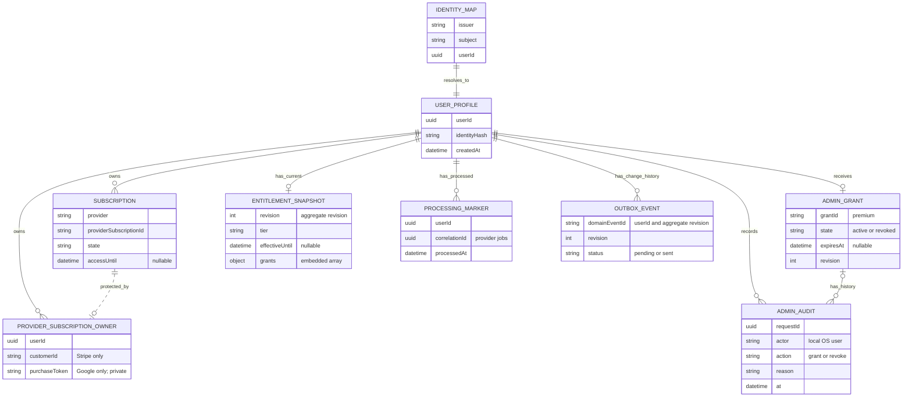
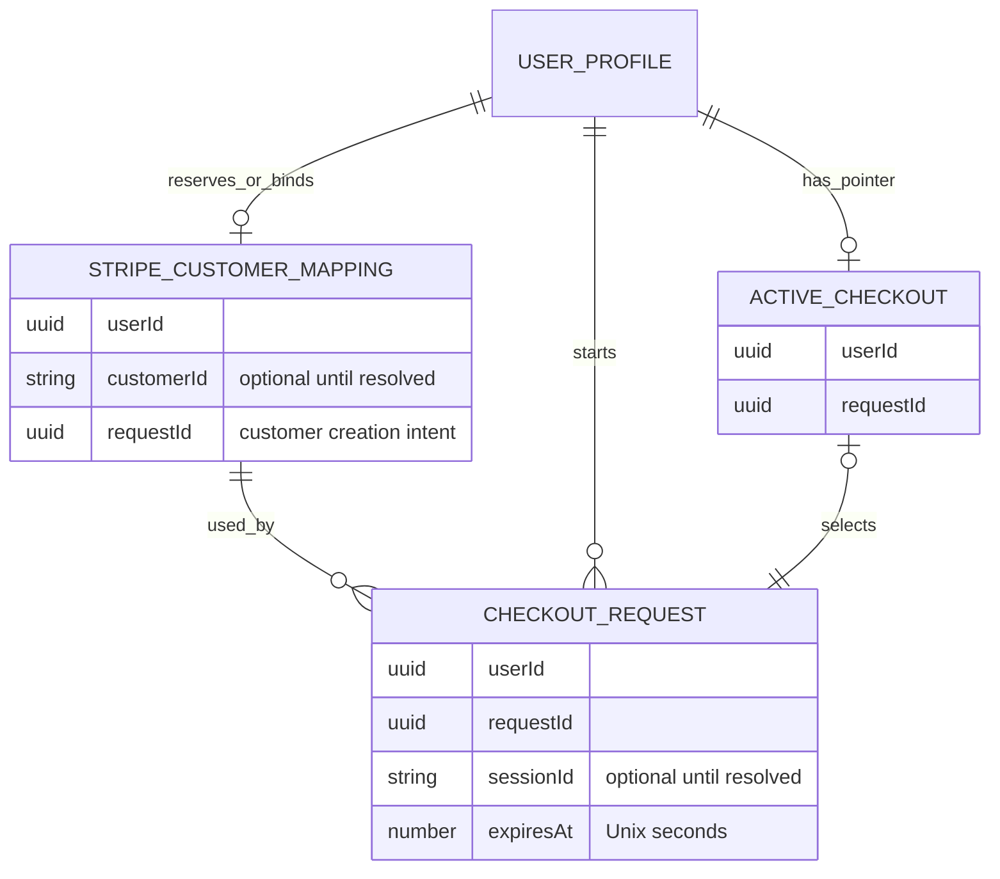

# DynamoDB data model

One table holds identities, subscriptions, and processing records. Start with
[architecture](ARCHITECTURE.md); [Payments](PAYMENTS.md) explains the access rules.

## Logical ER model

These are logical record types in **one DynamoDB table**, not SQL tables or
database-enforced foreign keys. `||` means exactly one, `o|` zero or one, and
`o{` zero or many. Lines describe relationships, not the order of writes.
Selected fields explain each record; the sections below contain full key layouts.

### Account, access, and processing



Auth0 stores login credentials externally. Only after token verification does
the API map the exact issuer/subject pair to a profile. The current application
creates one mapping/profile pair; it does not merge identities by email. See
[authentication flow](ARCHITECTURE.md#aws-deployment-topology).

A profile can exist before billing or the first entitlement snapshot. It can
own several subscriptions, including expired ones and overlapping providers.
Verified provider processing creates the immutable owner binding; local demo
subscriptions can exist without one. Processing markers belong to the user;
their provider-specific references and finish/acknowledgement fields are below.

- **One commit:** the worker saves subscription, owner binding, snapshot, marker,
  and (only when access changed) an outbox event together.
- **Snapshots are derived:** the `grants` array is a cached result. Each outbox
  record keeps its own copy; there is no history of `ENTITLEMENTS` rows.
- **The API recomputes:** access comes from subscriptions, admin grants, and the
  current time, so an old snapshot can never extend access.

### Checkout extensions



- A Stripe customer mapping becomes a forward and a reverse record once bound.
- Customer and checkout session IDs may stay unresolved for a while. The active
  pointer selects a request; it is not proof of payment.
- A checkout request never creates a subscription; only verified worker
  processing does.
- Admin grants: [complimentary access records](#complimentary-access-records).

| Logical record                                | DynamoDB record family / details                                                                            |
| --------------------------------------------- | ----------------------------------------------------------------------------------------------------------- |
| Identity map / profile                        | [`IDENTITY#H / MAP`, `USER#U / PROFILE`](#identity-and-profile)                                             |
| Subscription                                  | [`USER#U / SUB#provider#reference`](#subscriptions)                                                         |
| Entitlement snapshot / outbox / Stripe marker | [`ENTITLEMENTS`, `OUTBOX#U:R`, `EVENT#stripe#E`](#subscription-processing-records)                          |
| Provider owner / store marker                 | [Stripe](#subscription-processing-records), [Apple](#apple-sandbox-records), [Google](#google-play-records) |
| Stripe customer / checkout request / pointer  | [`CUSTOMER#stripe`, `CHECKOUT#U#Q`, `CHECKOUT#ACTIVE`](#stripe-customer-and-checkout-records)               |
| Local expiration marker                       | [`EVENT#local_expiration#E`](#local-reconciliation-records)                                                 |

## Table structure

String `pk` and `sk` form the primary key. Other fields belong to application
records. No secondary indexes or TTL are configured. Local table:
`premiumpass-local`; AWS uses the generated name from `DYNAMODB_TABLE_NAME`.
Both use on-demand billing. [Retention and cleanup](setup/aws.md#cleanup).

Shorthand: `U` = internal UUID, `H` = SHA-256 of JSON `[issuer, subject]`,
`C` = Stripe customer ID, `Q` = request UUID, `S` = subscription ID,
`E` = event ID, `R` = aggregate revision.

## Identity and profile

| PK / SK              | Fields                                | Purpose                               |
| -------------------- | ------------------------------------- | ------------------------------------- |
| `IDENTITY#H` / `MAP` | `issuer`, `subject`, `userId`         | Resolve exact verified Auth0 identity |
| `USER#U` / `PROFILE` | `userId`, `identityHash`, `createdAt` | Stable internal profile               |

- Both records are created in one conditional transaction. Concurrent first
  logins converge by rereading the winning mapping; inconsistent mappings fail.
- No email-based linking: a different issuer means a different identity, even
  with the same subject.
- The hash is a lookup key, not encryption. Email, display name, and tokens are
  not stored.

## Subscriptions

Each subscription is `USER#U` / `SUB#<provider>#<providerSubscriptionId>`.
Records are written by verified processing or explicitly local demo tools.

| Field                                          | Meaning                                                                                             |
| ---------------------------------------------- | --------------------------------------------------------------------------------------------------- |
| `userId`, `provider`, `providerSubscriptionId` | Owner and namespaced source identity                                                                |
| `productId`                                    | Internal plan: `premium_monthly`, or Stripe `premium_daily`, grants access                          |
| `state`, `providerStatus`                      | Normalized state and original provider state                                                        |
| `cancelAtPeriodEnd`                            | Renewal disabled; not immediate revocation                                                          |
| `accessUntil`, `graceUntil`                    | Verified UTC access/grace boundaries or null; [provider-specific limits](PAYMENTS.md#access-policy) |
| `verifiedAt`                                   | Last successful source verification, UTC                                                            |
| `revision`                                     | Positive source revision; distinct from aggregate revision                                          |
| `demoScenario`                                 | Optional `p05-local-demo` marker protecting reserved local records                                  |

Synthetic document shape (timestamps illustrate a record, not current access):

```json
{
  "pk": "USER#389f7e6b-2f11-423c-ba09-110e64cc1e7f",
  "sk": "SUB#stripe#sub_SYNTHETIC",
  "userId": "389f7e6b-2f11-423c-ba09-110e64cc1e7f",
  "provider": "stripe",
  "providerSubscriptionId": "sub_SYNTHETIC",
  "productId": "premium_monthly",
  "state": "active",
  "providerStatus": "active",
  "cancelAtPeriodEnd": false,
  "accessUntil": "2026-11-01T12:00:00.000Z",
  "graceUntil": null,
  "verifiedAt": "2026-10-01T12:00:00.000Z",
  "revision": 1
}
```

Zod validates every record before the API returns it. Unknown products or
statuses stay visible but grant nothing; malformed records fail closed. Expired
records stay stored; expiry is checked on every read.

## Complimentary access records

| Key                                | Contents                                                                                                                                               |
| ---------------------------------- | ------------------------------------------------------------------------------------------------------------------------------------------------------ |
| `USER#U` / `ADMIN_GRANT#premium`   | `userId`, stable `grantId=premium`, `state`, nullable `expiresAt`, source `revision`, `createdAt`, `updatedAt`                                         |
| `USER#U` / `ADMIN_AUDIT#requestId` | `requestId`, `userId`, `action`, OS `actor`, `reason`, requested `expiresAt`, `at`, `aggregateRevision`, `outcome`, full `before`/`after` grant values |

- **Separate from purchases:** the grant is not a `SUB#` record and has no
  provider or product reference. Revocation keeps the record and its history.
- **Audit = idempotency receipt:** audit entries are append-only through the CLI
  and have no TTL. A replayed request ID writes nothing. They are not tamper-proof
  against someone with local database access.
- **Same guard as providers:** the CLI transaction checks profile and aggregate
  revision, then writes grant, receipt, snapshot, and outbox entry. Every provider
  commit loads and preserves the grant.
- **In the snapshot:** `grants` entries are `source=provider` (finite
  `validUntil`) or `source=admin` (nullable `validUntil`). The publisher still
  accepts older provider entries without `source`.
- **Reads:** consistent `GetItem` for the grant; a paginated query on
  `ADMIN_AUDIT#` for history. The user API shows only grant ID, revision, expiry.

## Stripe customer and checkout records

| PK / SK                                | Fields beyond keys                                                                                                        |
| -------------------------------------- | ------------------------------------------------------------------------------------------------------------------------- |
| `USER#U` / `CUSTOMER#stripe`           | `userId`, creation `requestId`, `createdAt`, optional `customerId`                                                        |
| `PROVIDER#stripe#CUSTOMER#C` / `OWNER` | `userId`, `customerId`                                                                                                    |
| `CHECKOUT#U#Q` / `REQUEST`             | Owner/request IDs, fingerprint, `planId`, customer/price IDs, return URLs, `createdAt`, `expiresAt`, optional `sessionId` |
| `USER#U` / `CHECKOUT#ACTIVE`           | `userId`, `requestId`                                                                                                     |

- The customer creation intent is stored first; forward and reverse mappings
  then bind atomically.
- A new checkout must compare the active pointer; attaching a session requires
  the same request fingerprint.
- The selected `planId`, concrete `priceId`, and fingerprint belong to the purchase attempt. A lookup
  key can move to a new offer; retries still use the stored price, including when
  a concurrent request wins the reservation. The existing hash format already
  includes the plan. Records without `planId` are read as `premium_monthly`,
  preserving older monthly attempts without a database migration.
- A missing provider reference means unfinished work, not permission to buy again.
- Times here are Unix seconds. Checkout URLs, payment payloads, and emails are
  never stored. [Recovery behavior](PAYMENTS.md#checkout-and-recovery).

## Subscription processing records

| PK / SK                           | Main fields and role                                                                                                                    |
| --------------------------------- | --------------------------------------------------------------------------------------------------------------------------------------- |
| `USER#U` / `ENTITLEMENTS`         | `userId`, aggregate `revision`, `tier`, `features`, `effectiveUntil`, `evaluatedAt`, `grants`, `warnings`                               |
| `PROVIDER#stripe#SUB#S` / `OWNER` | Immutable `userId` / `customerId` binding                                                                                               |
| `EVENT#stripe#E` / `PROCESSED`    | Owner/event/type/correlation IDs, `processedAt`, outcome (`changed` or `verified`), aggregate revision                                  |
| `OUTBOX#U:R` / `EVENT`            | Stable `domainEventId=U:R`, owner/revision, `SubscriptionChanged`, pending status, provider/correlation IDs, timestamp and entitlements |

**Writing:**

1. Read the aggregate revision **before** subscriptions and provider state.
2. Commit everything in one transaction that checks that revision, the profile,
   ownership, and that no completion marker exists yet.
3. On conflict, reload and recompute (see the shared retry loop).

- A duplicate event writes nothing. A new verification without changes updates
  the aggregate but adds no outbox event, so source and aggregate revisions differ.

**Publishing:** the publisher scans pending outbox entries and, after the
transport accepted one, conditionally sets `status=sent`, `sentAt`, and
`publishedEventId`. The `domainEventId` stays stable across retries; a crash
between acceptance and update can publish a duplicate. Publication never touches
subscriptions or markers. There is no TTL cleanup. [Why an outbox](OUTBOX.md) ·
[Publisher](../services/outbox-publisher/README.md).

## Apple sandbox records

| PK / SK                                                        | Meaning                                                                                               |
| -------------------------------------------------------------- | ----------------------------------------------------------------------------------------------------- |
| `USER#U` / `SUB#apple#Sandbox:<originalTransactionId>`         | Normalized subscription lineage                                                                       |
| `PROVIDER#apple#SUB#Sandbox:<originalTransactionId>` / `OWNER` | Immutable internal owner                                                                              |
| `EVENT#apple#Sandbox#<eventId>` / `PROCESSED`                  | User, submitted reference, verified `finishTransactionId`, type, `processedAt`, optional `finishedAt` |

| Source         | Event ID                                       |
| -------------- | ---------------------------------------------- |
| Client sync    | Generated operation UUID                       |
| Notification   | Apple's verified notification UUID             |
| Reconciliation | `reconcile_<run-uuid>_<originalTransactionId>` |

The marker and its finish target commit with access. After Apple confirms the
finish, a conditional `UpdateItem` adds `finishedAt` (nothing else changes);
only then does owner-only API polling report completion.
[Apple processing](STORE_PURCHASES.md#apple-processing-and-ownership).

## Google Play records

`G` below is `<packageName>:<sha256(purchaseToken)>`. Raw tokens never appear in
the public subscription view or outbox. Unlike the digest, a purchase token is
private backend data and must not be logged or placed in client configuration.

| PK / SK                                | Purpose                                                                                         |
| -------------------------------------- | ----------------------------------------------------------------------------------------------- |
| `USER#U` / `SUB#google#G`              | Normalized, test-verified subscription; safe digest reference                                   |
| `PROVIDER#google#SUB#G` / `OWNER`      | Immutable `userId`, package name, private purchase token for future provider refresh            |
| `EVENT#google#<eventId>` / `PROCESSED` | User, digest reference, event type, `needsAcknowledgement`, commit time, optional `completedAt` |

- **Commit, then acknowledge:** owner binding, subscription, access, marker, and
  outbox commit together through the shared path. Only then does the worker
  acknowledge Google and save `completedAt`. A retry repeats verification and
  acknowledgement, never the domain commit.
- **Owner:** notifications take it from Google's verified account UUID; client
  jobs must also match the authenticated user.
- **Polling:** a consistent marker read that requires the owner, `completedAt`,
  and `eventType=client.sync`. In AWS the API may only `GetItem` on
  `EVENT#google#*`; all writes belong to the worker.
- **Reconciliation:** reads the private token record and checks owner, package,
  and hash against the subscription. Tokens are kept for that purpose; token
  retirement and encrypted production storage are outside the demo.

## Local reconciliation records

| PK / SK                                  | Fields and role                                                             |
| ---------------------------------------- | --------------------------------------------------------------------------- |
| `EVENT#local_expiration#E` / `PROCESSED` | Owner and completion time; atomic with the recalculated snapshot and outbox |

- **Event IDs:** Stripe `reconcile_<run-uuid>_<subscription-id>`, expiration
  `expire_<run-uuid>_<user-id>`; stable within a run, new in the next.
  Markers and outbox records have no TTL.

## Access patterns

| Operation                                            | Pattern                                                                                           |
| ---------------------------------------------------- | ------------------------------------------------------------------------------------------------- |
| Identity/profile/customer/checkout/completion lookup | Consistent `GetItem` by full key                                                                  |
| All subscriptions for a user                         | Paginated consistent `Query`, `pk=USER#U`, `begins_with(sk, 'SUB#')`                              |
| Identity creation                                    | Conditional transaction for mapping + profile                                                     |
| Customer/checkout reservation                        | Conditional puts/transactions with owner/request comparisons                                      |
| Provider commit                                      | Transaction: subscription, aggregate, owner, completion, optional outbox                          |
| Local reconciliation discovery                       | Paginated profile `Scan` and subscription `Query`, then per-provider discovery                    |
| Cloud reconciliation discovery                       | Paginated `Scan` of known owner records per provider; enqueue refresh only                        |
| Local outbox discovery                               | Paginated `Scan` for pending `OUTBOX#` entries; reads the whole table                             |
| Outbox publication marker                            | Conditional `UpdateItem` on the existing pending event after per-entry transport acceptance       |
| Local CLI edit/seed                                  | Aggregate-guarded transaction in the fixed local table; seeding touches only its marked demo rows |
| Local admin console state                            | One paginated consistent `Scan` of the whole local table per request; never in AWS                |

- **User requests never scan.** Only background discovery (reconciliation,
  outbox) and the local [admin console](ADMIN_CONSOLE.md) scan this small demo
  table; filters do not reduce read capacity and are not IAM boundaries.
- **Demo simplification:** a production system would add indexes and resumable
  discovery instead of scans.
- Direct edits in DynamoDB Admin bypass all of these guarantees.

Sources: [user store](../services/api/src/dynamodb-users.ts),
[checkout store](../services/api/src/billing/dynamodb-billing.ts),
[subscription reads](../packages/persistence/src/subscriptions.ts),
[shared processing transaction](../packages/subscription-processing/src/processing/dynamodb-processing.ts),
[Stripe persistence](../packages/subscription-processing/src/providers/stripe/store.ts),
[Apple persistence](../packages/subscription-processing/src/providers/apple/store.ts),
[Google persistence](../packages/subscription-processing/src/providers/google/store.ts),
and [Google discovery reads](../packages/subscription-processing/src/providers/google/reconciliation-store.ts).
