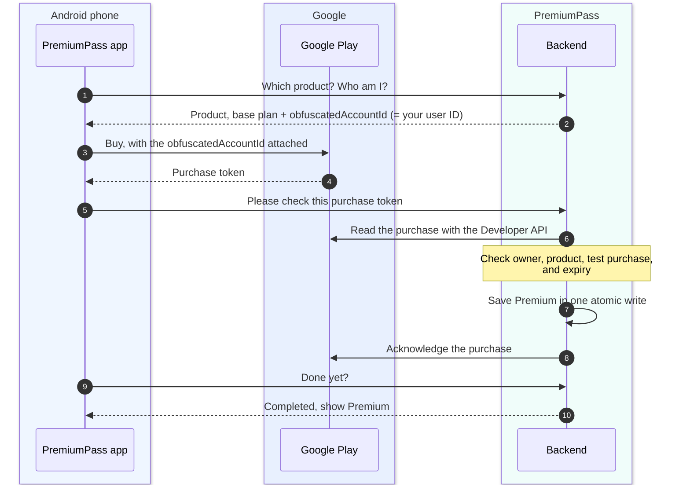
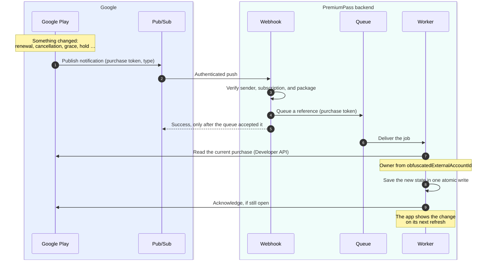

# Google Play test purchases

Set up one Premium subscription for real Google Play **license-test purchases**.
Start with the local [Getting started](GETTING_STARTED.md) path. The
`pnpm cli google-mock` command is a separate synthetic exercise that needs no
Google account.

Use your own development accounts, synthetic application data, and Google's test
payment instruments. Do not make production purchases.

## How a purchase works

Three parties take part: the **app** shows Google Play's purchase sheet,
**Google Play** takes the payment, and the **backend** decides about Premium.



| Who     | Does                                                                 | Never does                                    |
| ------- | -------------------------------------------------------------------- | --------------------------------------------- |
| App     | Fetch config, open the purchase sheet, send the purchase token, wait | Grant Premium or acknowledge the purchase     |
| Backend | Verify with Google, check the owner, save access, acknowledge        | Trust what the app says without asking Google |

**What is the `obfuscatedAccountId` for?** It is Google's equivalent of Apple's
`appAccountToken`: the app attaches our internal user ID to the purchase, and
Google returns it as `obfuscatedExternalAccountId` when the backend reads the
purchase. That proves which PremiumPass account bought the subscription, also
for a restore or a notification that arrives later. A different ID means the
purchase is rejected.

**How is a purchase completed?** Google requires every new purchase to be
_acknowledged_; otherwise it refunds the purchase automatically (after about
three minutes for license testers, three days in production). Here only the
backend acknowledges, and only after Premium is saved (step 8). If anything
fails before that, a retry or Restore picks the purchase up again, and the
saved completion marker prevents a second grant.

## How later changes arrive

After the purchase, the app is no longer needed. Renewals, cancellations, grace
periods, and account holds reach the backend as **Real-time developer
notifications (RTDN)**. Google does not call the backend directly: it publishes
to a **Pub/Sub** topic, and Pub/Sub pushes each message to the webhook.



- **Only a reference is queued.** The notification says _that_ something
  changed, not the full state. The worker always reads the current purchase from
  Google, so a late or repeated message cannot apply stale data.
- **Success only after the queue accepted it.** If queuing fails, the webhook
  answers 503 and Pub/Sub delivers the message again.
- **Duplicates are harmless.** The job ID comes from the Pub/Sub message ID, and
  a completion marker makes a second delivery a no-op.
- **Lost notifications are repaired.** Every five minutes, reconciliation asks
  Google again about known purchase tokens ([Reconciliation](RECONCILIATION.md)).
- Test messages from Play Console are acknowledged without any job.

## Setup order

| When                     | Action                                                                                | Ready when                                                           |
| ------------------------ | ------------------------------------------------------------------------------------- | -------------------------------------------------------------------- |
| Now                      | Prepare the developer account, app, package name, and license testers                 | Account requirements are cleared and the identifiers are recorded    |
| With the Android build   | Upload a signed Billing-enabled AAB to internal testing; configure the subscription   | Test release is available and the monthly base plan is active        |
| With backend integration | Configure API access and lifecycle notifications                                      | Backend can verify purchases and receive authenticated notifications |
| End to end               | Install, sign in, buy with a test instrument, restore, and exercise lifecycle changes | Purchase, restore, and lifecycle checks behave as described below    |

Console labels can vary by language and account. The linked official pages were
reviewed on October 18, 2026.

## 1. Prepare the account and app

Use a [Google Play developer account](https://play.google.com/console/) whose
owner can complete the verification and agreements shown in its Dashboard.
Set up/link the Google payments profile required for billing products. Follow
the account's actual requirements; completing this guide does not verify an
account. [Google account and billing prerequisites](https://developer.android.com/google/play/billing/getting-ready).

Create an app named **PremiumPass**, choose its language, **App**, and **Free**
download. The subscription is a separate product. Complete required declarations
for the internal release using the actual demo behavior.

Choose the final unique Android package name **before uploading**. For example,
`com.yourcompany.premiumpass` is a placeholder to replace with your own identifier.
Set `GOOGLE_PLAY_PACKAGE_NAME` in `config/.env`. The sync passes it to the backend
and to the app as `ANDROID_PACKAGE_NAME`, which controls `android.package` in
[app.config.ts](../apps/mobile/app.config.ts), so app and backend cannot disagree. The default `com.example.premiumpass`
is for local verification only and is rejected by the signed-upload command.
The iOS bundle ID setting does not change Android.
An uploaded app's package name cannot later be changed.
[Internal release setup](https://support.google.com/googleplay/android-developer/answer/9845334?hl=en).

Internal testing is sufficient for this demo. The closed-testing requirements
for production access on newer personal accounts are a separate path; no public
production release is planned.
[Testing requirements](https://support.google.com/googleplay/android-developer/answer/14151465?hl=en).

## 2. Register the license tester

At the developer-account level, open **Settings → License testing**. Add a list
containing the Google account you will use in the device's Play Store and save.
This is separate from the app's internal-test invitation. Both lists should
contain the intended tester. [License testing setup](https://support.google.com/googleplay/android-developer/answer/6062777?hl=en).

During purchases, check the selected Google account and the test-purchase notice.
Choose **Test card, always approves** for the first purchase. If ordinary payment
methods appear without the test notice, stop and fix the tester/account setup.
Internal-track membership alone does not prevent real charges.
[Billing test behavior](https://developer.android.com/google/play/billing/test).

## 3. Upload the Android test build

The Android build must contain Google Play Billing support and use the chosen
package name. Upload a signed **Android App Bundle (AAB)** and configure Play App
Signing as prompted. Google requires a Billing-enabled upload to unlock the
billing product features. Use the local build commands below; an iOS JavaScript
export is not an Android native build.
[Billing-enabled build prerequisite](https://developer.android.com/google/play/billing/getting-ready).

In **Test and release → Testing → Internal testing**, create a release and add
the AAB. In **Testers**, select your tester email list, save, and roll out the
internal release. Use the opt-in link with that Google account, join the test,
and install from Google Play on Android hardware or a Play-enabled emulator.
Allow time for the release to become available.
[Internal track instructions](https://support.google.com/googleplay/android-developer/answer/9845334?hl=en).

After initial setup, license testers can also sideload development builds with
the same package name. This does not remove the Console/product setup requirement.
[Development-build testing](https://developer.android.com/google/play/billing/test).

### Local Android build

Install Android Studio with its bundled JDK, Android SDK/platform-tools, Android
SDK Platform 36, Build Tools 36.0.0, NDK 27.1.12297006, and CMake 3.22.1 (the
pinned Expo native defaults). The `mobile:android*` commands pick the JDK and
SDK themselves. Gradle needs JDK 17-21, so they use `JAVA_HOME` if it points to
such a JDK, otherwise the JDK bundled with Android Studio, otherwise a JDK
registered with macOS `java_home`. A newer system JDK, such as the current
Homebrew `openjdk`, is skipped because JDK 26 fails in Gradle's jlink step. Set
`ANDROID_HOME` if the SDK is not in Android Studio's default location. Windows
is not covered. Then:

```sh
pnpm mobile:android:doctor
pnpm --filter @premiumpass/mobile run prebuild:android
pnpm mobile:android
```

`mobile:android` installs a development build; Expo Go cannot load the native
Auth0/IAP modules. For an emulator, use `EXPO_PUBLIC_API_URL=http://10.0.2.2:3000`;
for a device, use the Mac's LAN address with `pnpm dev:api:lan`. The generated app
allows local HTTP for this demo. Register the Android Auth0 callback/logout URLs
before signing in: [Native configuration](AUTH0_SETUP.md#add-the-native-application).

For a Play upload, set `GOOGLE_PLAY_PACKAGE_NAME`, increment
`ANDROID_VERSION_CODE` for each upload, and configure the four
`ANDROID_UPLOAD_KEY*` settings in `config/.env` (see the template). Only the
app receives the upload-key settings. Create a dedicated upload keystore
with Android Studio's signed-bundle wizard or `keytool`; keep and back it up
privately. Use an absolute keystore path. Then:

```sh
pnpm mobile:android:aab
```

This regenerates Android without cleaning the iOS project and runs Gradle
`app:bundleRelease`. Output is
`apps/mobile/android/app/build/outputs/bundle/release/app-release.aab`.
The command rejects placeholder packages/missing signing configuration; generated
release builds do not fall back to the debug signing key. Credentials are read
from the environment, never command-line password arguments.

Before choosing an upload identity, `pnpm mobile:android:aab --unsigned` exercises
native compilation with no upload key. That bundle cannot be uploaded to Play.
Add `--verbose` for Gradle dependency/build diagnostics.
[Local release-build background](https://docs.expo.dev/guides/local-app-production/).

## 4. Create the subscription and base plan

Open **Monetize with Play → Products → Subscriptions → Create subscription**.
Use these recommended demo values; record any different IDs for the integration.

| Field                 | Recommended value                                                         |
| --------------------- | ------------------------------------------------------------------------- |
| Product ID            | `premium_monthly`                                                         |
| Name                  | `PremiumPass Premium`                                                     |
| Benefit               | `Synthetic score history`                                                 |
| Base plan ID          | `monthly`                                                                 |
| Renewal type / period | Auto-renewing / Monthly                                                   |
| Price                 | EUR 4.99/month in Germany; include the tester's Play country if different |
| Offers / free trial   | None for the first exercise                                               |

Save the subscription, add the base plan, configure price/region availability,
save, and **Activate** the base plan. A saved draft is insufficient. Product IDs
cannot be changed/reused after creation; activated base-plan IDs also cannot be
changed/reused. Offers are optional.
[Subscription and base-plan instructions](https://support.google.com/googleplay/android-developer/answer/140504?hl=en).

Record the selected grace-period and account-hold settings for the later payment
failure exercise. Backend access must follow verified provider state and the
project's [access policy](PAYMENTS.md#access-policy); a Console setting alone
does not implement that mapping.

## 5. Prepare backend API access

The backend needs its own Google identity to read purchase state.

1. In your Google Cloud development project (create one if you have none; step 6
   uses the same project), prepare the identity in four small steps:
   1. Enable the API: open the
      [Google Play Android Developer API](https://console.developers.google.com/apis/api/androidpublisher.googleapis.com/)
      page and click **Enable**.
   2. Create the service account: **IAM & Admin → Service Accounts → Create
      service account**. If you arrive through **Create credentials** instead
      (for example from the API's page), the wizard first asks what data you
      access: choose **Application data**, which creates a service account.
      **User data** would create an OAuth client for a signed-in Google user,
      which a background backend cannot use. In the form, enter a display name
      such as `PremiumPass Play backend`, an ID such as
      `premiumpass-play-backend`, and a one-line description. The ID needs 6-30
      lowercase letters, digits, or dashes and cannot be changed later. The
      optional **Permissions** and **Principals with access** steps stay empty:
      Play access is granted in Play Console (step 2), not through Cloud IAM.
      Click **Create and close**.
   3. Copy the account email,
      `premiumpass-play-backend@<project-id>.iam.gserviceaccount.com`. Step 2
      needs it, and so do the identifiers you record at the end of this guide.
   4. Create the key the worker reads: open the account, then **Keys → Add key →
      Create new key → JSON**. The file downloads once and cannot be downloaded
      again. Keep it outside Git (see the rules below).
2. In Play Console, open **Users and permissions → Invite new users**, enter the
   service-account email, and restrict app access to PremiumPass.
3. Grant only **View financial data, orders, and cancellation survey responses**
   and **Manage orders and subscriptions**, never developer-account admin access.
   The older Cloud-project linking workflow is no longer required.
   [Official API access setup](https://developers.google.com/android-publisher/getting_started).

If **Create new key** is unavailable, the organization policy
`iam.disableServiceAccountKeyCreation` is enforced on the project (Google
enables it by default for organizations created since May 3, 2024). Ask the
organization's administrator or use a project outside that organization.
[Create and delete service account keys](https://docs.cloud.google.com/iam/docs/keys-create-delete).

A long-lived JSON key is a deliberate demo simplification: it works the same
locally and in AWS, where it is stored as a Secrets Manager secret (see
[AWS notification processing](#aws-notification-processing)). For workloads
outside Google Cloud, Google recommends Workload Identity Federation with
short-lived tokens instead. A production setup would have to decide between
federation and keys, and define key rotation, before launch. This guide
implements neither.

| Rule                     | Why                                                                                      |
| ------------------------ | ---------------------------------------------------------------------------------------- |
| Key stays on backend     | Keep a downloaded JSON key outside Git; never in `EXPO_PUBLIC_*`, chat, or documentation |
| Explicit key file        | The worker reads `GOOGLE_PLAY_SERVICE_ACCOUNT_FILE`; there is no implicit ADC fallback   |
| Server-side verification | `purchases.subscriptionsv2.get` checks product, base plan, expiry, owner, `testPurchase` |
| Client callback ≠ access | A success callback or a pending purchase grants nothing                                  |

[Subscription response reference](https://developers.google.com/android-publisher/api-ref/rest/v3/purchases.subscriptionsv2).

## 6. Prepare lifecycle notifications

Google reports renewals, cancellations, and expiry through **Real-time developer
notifications (RTDN)** on Pub/Sub.

1. In the same Cloud project, enable **Cloud Pub/Sub** and create a topic, for
   example `premiumpass-play-rtdn`.
2. Grant `google-play-developer-notifications@system.gserviceaccount.com` the
   **Pub/Sub Publisher** role on that topic.
3. Create a subscription. A pull subscription can receive the setup test message
   before our receiver exists.
4. In **Monetize → Monetization setup → Real-time developer notifications**,
   enter `projects/<project-id>/topics/premiumpass-play-rtdn`, enable
   subscription and voided-purchase notifications, save, and send a test message.
   [RTDN setup](https://developer.android.com/google/play/billing/getting-ready).
5. Once the HTTPS receiver from step 7 runs, switch to an **authenticated push**
   subscription with its own push-auth service account and audience. The
   console fields are listed in [Create the push subscription](#create-the-push-subscription).
   [Authenticated push setup](https://docs.cloud.google.com/pubsub/docs/authenticate-push-subscriptions).

Three Google identities are involved and must stay separate:

| Identity                                                                            | Does                                            | Has                                                                                                                                |
| ----------------------------------------------------------------------------------- | ----------------------------------------------- | ---------------------------------------------------------------------------------------------------------------------------------- |
| Google's publisher `google-play-developer-notifications@system.gserviceaccount.com` | Publishes Play's notifications to the topic     | **Pub/Sub Publisher** on the topic (step 2)                                                                                        |
| Our backend service account                                                         | Reads purchases through the Play Developer API  | Play Console access (step 5) and a JSON key that only the worker holds                                                             |
| Our push-auth service account                                                       | Is the identity Pub/Sub signs its push token as | No roles and no key of its own; Pub/Sub's service agent gets **Token Creator** on it ([form guide](#create-the-push-subscription)) |

**Why a separate push-auth account?** A push token proves only one thing: "this
call comes from our subscription". Google requires some service account once
authentication is on, but not a dedicated one, and the receiver would accept the
backend account too, because it only compares the token's email. That would make
the account with Play API access the one that the Pub/Sub service agent may
mint tokens for, and the receiver would trust that powerful identity. A
dedicated account without rights can prove nothing but "I am the push sender".
If its token leaks, an attacker can send fake notifications, which the worker
re-checks with Google anyway, but cannot read purchases. This is least privilege,
not a technical requirement.

- The receiver validates Google's JWT signature, issuer, audience, expiry, and
  the expected service-account email.
- A notification only says "something changed": the worker always reads fresh
  state from the Google API before writing.
- Do not point Google at the Apple webhook, and keep DynamoDB/ElasticMQ private.
- Pub/Sub can cost money even for license tests; check
  [Pub/Sub pricing](https://cloud.google.com/pubsub/pricing) first.

## 7. Enable local processing

Set these once in `config/.env`; `pnpm config:sync` gives each program its part:

| Setting                                                                                 | Programs that receive it                                   |
| --------------------------------------------------------------------------------------- | ---------------------------------------------------------- |
| `GOOGLE_PLAY_ENABLED=true`, package name, product ID, base plan ID                      | API, Google webhook, worker, CLI; the app gets the package |
| `GOOGLE_PLAY_SERVICE_ACCOUNT_FILE`                                                      | Worker and CLI only: no ingress holds the billing key      |
| The three `GOOGLE_PLAY_PUSH_*` settings ([next section](#create-the-push-subscription)) | Google webhook only                                        |

With `GOOGLE_PLAY_ENABLED=true`, the sync stops until all of these are set and
the key file exists, so a half-configured provider never reaches a service.

Then:

1. Restart `pnpm dev`. It syncs first and also starts the Google receiver on
   port 3004, which answers `503 google_not_configured` while
   `GOOGLE_PLAY_ENABLED` is not `true`.
2. Run `pnpm webhooks:listen` in another terminal to start the Stripe listener and
   a shared Apple/Google ngrok tunnel. Use
   `https://YOUR_NGROK_HOST/v1/webhooks/google` from ngrok's HTTPS origin.
   [Shared forwarding and prerequisites](DEVELOPMENT.md#receive-provider-webhooks-together).
3. Use that HTTPS URL as `GOOGLE_PLAY_PUSH_AUDIENCE` and as the Pub/Sub
   audience and endpoint, then create the subscription as described next.

### Create the push subscription

Create it once the receiver is reachable from the internet: locally after
`pnpm webhooks:listen` prints the ngrok origin, in AWS after the deploy outputs
`GoogleWebhookUrl`.

**Before you open the form,** create the push-auth service account, because the
form can only select an account that already exists. In **IAM & Admin → Service
Accounts → Create service account**, name it for its single job, for example
`premiumpass-play-push`. Skip the optional roles and keys: it never calls an API
itself, Pub/Sub only signs tokens in its name. Copy its email,
`premiumpass-play-push@<project-id>.iam.gserviceaccount.com`; it becomes
`GOOGLE_PLAY_PUSH_SERVICE_ACCOUNT_EMAIL`. Then check two permissions in **IAM**
if creating the subscription fails or authenticated deliveries are rejected:

- The Pub/Sub service agent
  `service-<project-number>@gcp-sa-pubsub.iam.gserviceaccount.com` needs
  **Service Account Token Creator** on the push-auth service account (or on the
  project).
- Whoever creates the subscription must be allowed to act as the push-auth
  account, for example with **Service Account User** on it.

**The form.** Open the topic from step 6.1 and add a subscription to it. The
form is titled **Add subscription to topic** and shows the topic read-only.
Alternatively use **Pub/Sub → Subscriptions → Create subscription** and select
the topic yourself. Fill the form from top to bottom; the console marks required
fields with `*`.

| Field in the form                 | Local (ngrok)                                        | AWS                                                                                   | Notes                                                                                                                                                                        |
| --------------------------------- | ---------------------------------------------------- | ------------------------------------------------------------------------------------- | ---------------------------------------------------------------------------------------------------------------------------------------------------------------------------- |
| **Subscription ID** `*`           | `premiumpass-play-push`                              | the same                                                                              | Below the field the console prints `Subscription name: projects/<project-id>/subscriptions/`. That prefix plus your ID is the full name for `GOOGLE_PLAY_PUSH_SUBSCRIPTION`. |
| **Topic name** (shown, read-only) | `projects/<project-id>/topics/premiumpass-play-rtdn` | the same                                                                              | Must be the topic from step 6.1, the one Play Console publishes to. If it shows another topic, cancel and open the right one.                                                |
| **Delivery type**                 | **Push**                                             | **Push**                                                                              | Not Pull (it has no endpoint and served only the setup test message), and not Write to BigQuery or Write to Cloud Storage.                                                   |
| **Endpoint URL** `*`              | `https://YOUR_NGROK_HOST/v1/webhooks/google`         | `GoogleWebhookUrl` from the deploy outputs                                            | A public HTTPS address with a valid certificate.                                                                                                                             |
| **Enable authentication**         | checked                                              | checked                                                                               | Without Google's signed token the receiver answers 401.                                                                                                                      |
| **Service account** `*`           | the push-auth account                                | the push-auth account                                                                 | Appears after you check authentication; the console shows "A service account must be selected for push authentication" until you choose one. Never the backend account.      |
| **Audience (optional)**           | the same URL as the endpoint                         | a stable HTTPS identifier, for example `https://billing.example.com/google-play-push` | Optional in the console, but the receiver compares the token's audience with `GOOGLE_PLAY_PUSH_AUDIENCE`, so enter it explicitly and keep both identical.                    |
| **Enable payload unwrapping**     | unchecked                                            | unchecked                                                                             | When checked, Pub/Sub sends only the raw decoded message. The receiver needs Pub/Sub's default JSON envelope.                                                                |
| Everything below the form fields  | defaults                                             | defaults                                                                              | Optional. Under **Expiration period**, choose **Never expire** if the demo may sit idle, because Pub/Sub can delete an inactive subscription.                                |

Locally, audience and endpoint are the same URL for simplicity. Google does not
require that: the audience is only a value that the token carries, which is why
the AWS column can use a stable name before the API URL exists. A free ngrok URL
changes on restart; then update the subscription's endpoint and audience,
`GOOGLE_PLAY_PUSH_AUDIENCE`, and restart the Google receiver (`pnpm dev`, or
`pnpm dev:webhook:google` when it runs alone).

[Create a push subscription](https://docs.cloud.google.com/pubsub/docs/create-push-subscription)
· [Authenticated push](https://docs.cloud.google.com/pubsub/docs/authenticate-push-subscriptions).

**Which console value goes where.** The same three settings are read by the local
receiver and by the AWS Lambda; each is validated at startup.

| Console value                                                                      | Local setting in `config/.env`           | Cloud setting in `config/.env`        |
| ---------------------------------------------------------------------------------- | ---------------------------------------- | ------------------------------------- |
| Audience (HTTPS URL)                                                               | `GOOGLE_PLAY_PUSH_AUDIENCE`              | `CLOUD_GOOGLE_PLAY_PUSH_AUDIENCE`     |
| Service account email of the push-auth account                                     | `GOOGLE_PLAY_PUSH_SERVICE_ACCOUNT_EMAIL` | the same setting                      |
| Full subscription name `projects/<project-id>/subscriptions/premiumpass-play-push` | `GOOGLE_PLAY_PUSH_SUBSCRIPTION`          | `CLOUD_GOOGLE_PLAY_PUSH_SUBSCRIPTION` |

The sync writes the local values to the local receiver and the cloud values to
`infra/.env` under the receiver's variable names; `pnpm config:check` rejects a
bare subscription ID.

The topic name is entered only in Play Console; the receiver never reads it.
Instead it compares the `subscription` field of every message with
`GOOGLE_PLAY_PUSH_SUBSCRIPTION`, so a message from any other subscription is
rejected.

**Test it.** In Play Console send the test message from step 6.4. The receiver
answers `200` with `{"received":true,"test":true}` and queues no purchase work.
`GET /health` on the receiver shows `googleEnabled`.

**What the receiver answers.** Pub/Sub counts only HTTP `102`, `200`, `201`,
`202`, and `204` as acknowledgement. Every other status is a negative
acknowledgement, and Pub/Sub redelivers the message with an exponential backoff
of up to 60 seconds, so fixing the cause lets the same message arrive on a later
attempt. Every rejection below also writes a `google.notification_rejected` log
line with the same reason ([log events](DEVELOPMENT.md#follow-a-provider-event-through-the-logs)).
[Push delivery](https://docs.cloud.google.com/pubsub/docs/push).

| Response                                             | Meaning                                                                | Typical cause and fix                                                                                                                           |
| ---------------------------------------------------- | ---------------------------------------------------------------------- | ----------------------------------------------------------------------------------------------------------------------------------------------- |
| `200` `{"received":true}`                            | Notification queued                                                    | Normal                                                                                                                                          |
| `200` `{"received":true,"test":true}`                | Play's test message; no purchase work                                  | Normal, proves the whole path                                                                                                                   |
| `200` `{"received":true,"ignored":true}`             | Valid, but nothing to do (for example a one-time product)              | Normal                                                                                                                                          |
| `401` `authentication_required`                      | No `Authorization: Bearer` header                                      | **Enable authentication** is off on the subscription                                                                                            |
| `401` `invalid_push_identity`                        | The token failed signature, expiry, audience, or service-account check | Audience or service account in the subscription differs from `GOOGLE_PLAY_PUSH_AUDIENCE` or `GOOGLE_PLAY_PUSH_SERVICE_ACCOUNT_EMAIL`            |
| `400` `invalid_notification`                         | Not Pub/Sub's envelope, wrong subscription, or unreadable message      | **Payload unwrapping** is on, `GOOGLE_PLAY_PUSH_SUBSCRIPTION` does not match the full name, or something other than Play published to the topic |
| `400` `package_mismatch`                             | The message is for another app                                         | `GOOGLE_PLAY_PACKAGE_NAME` differs from the Play app, or the topic is shared with another app                                                   |
| `503` `google_not_configured`                        | Google is switched off in this service                                 | `GOOGLE_PLAY_ENABLED` is not `true`; restart after changing it                                                                                  |
| `503` `queue_unavailable`                            | The queue did not accept the job                                       | ElasticMQ or SQS is down; Pub/Sub retries on its own                                                                                            |
| `503` `google_webhook_unavailable` (AWS)             | The Lambda could not initialize                                        | Missing or invalid Google, push, or queue settings in the stack; read the Lambda's `google.webhook_unavailable` log entry                       |
| `502` or `404` (only through `pnpm webhooks:listen`) | The local receiver is offline, or the path is wrong                    | Start `pnpm dev:webhook:google`; the router forwards only `/v1/webhooks/google` and the Apple path                                              |

Locally, invalid push settings stop the service at startup with an error in its
terminal instead of an HTTP response.

### Purchase flow details

The overview is in [How a purchase works](#how-a-purchase-works). Locally the
app calls `GET /v1/billing/google/config`, then `POST /v1/billing/google/sync`
with the token, and polls `/sync/:operationId`; the API only queues the job, and
the subscription worker does the Google calls.

- The `obfuscatedAccountId` is our internal user ID. Only Google's API response
  proves ownership, never the app's claim.
- The app never acknowledges purchases. The worker acknowledges after the
  commit; a retry resumes acknowledgement without repeating the domain write.
- Restore and foreground recovery use the same sync path. **Manage** opens
  Google Play; changes refresh when the app returns.
- Grace uses Google's verified expiry; account hold, pause, and expiry grant no
  Google access. Public IDs contain only a token hash; the raw token stays in the
  private provider record and the queue. [Google records](DYNAMODB_DATA_MODEL.md#google-play-records).
- Not supported: plan replacements (`linkedPurchaseToken`), offers or trials,
  more base plans, and production purchases.

**Missed updates:** configure Google in the [CLI's own environment](../apps/cli/README.md#configuration),
run `pnpm cli reconcile --provider google --dry-run`, then without `--dry-run`.
This refreshes stored tokens only; an unknown first purchase needs sync/Restore
or RTDN. [Reconciliation](RECONCILIATION.md).

## AWS notification processing

The CDK stack can run the same Google path in AWS: protected billing routes in
the API Lambda, `POST /v1/webhooks/google`, and a Google webhook Lambda. It stays
off until `GOOGLE_PLAY_ENABLED=true`. CDK creates no Google topic, subscription,
account, key, or Play Console product.

1. **Secret:** store the billing service-account JSON (`type=service_account`,
   `client_email`, `private_key` with its PEM newlines) as a Secrets Manager
   secret in the selected account/region. Only the worker reads it.
   [AWS secret access](https://docs.aws.amazon.com/secretsmanager/latest/apireference/API_GetSecretValue.html).
2. **Configuration:** in `config/.env`, set `CLOUD_GOOGLE_PLAY_ENABLED=true`,
   `GOOGLE_PLAY_SECRET_ARN`, `CLOUD_GOOGLE_PLAY_PUSH_AUDIENCE`, and
   `CLOUD_GOOGLE_PLAY_PUSH_SUBSCRIPTION`. Package, product, base plan, and the
   push service-account email are shared with the local setup. The deploy
   script syncs `infra/.env` first.
3. **Audience:** choose a stable HTTPS identifier such as
   `https://billing.example.com/google-play-push` and set the same value in
   Pub/Sub. It may differ from the receiver URL, so you can configure it before
   the API URL exists. [Google push authentication](https://docs.cloud.google.com/pubsub/docs/authenticate-push-subscriptions).
4. **Deploy:** follow [AWS setup and dry runs](../infra/README.md#deploy), then
   use the `GoogleWebhookUrl` output as the Pub/Sub push endpoint, with the
   fields from [Create the push subscription](#create-the-push-subscription).
   Never point a live subscription at an undeployed endpoint.
5. **Verify separately:** identity rejection, a valid TEST push (it queues no
   purchase work), queue acceptance, worker completion, and cloud owner records.

| Component | Permissions when Google is enabled                 | Never gets                                |
| --------- | -------------------------------------------------- | ----------------------------------------- |
| Webhook   | Queue send; verifies Pub/Sub JWTs with public keys | Database or secret access                 |
| API       | Queue send; read Google completion markers         | Google key; provider-record writes        |
| Worker    | Google secret; Google record families in the table | Any Google permission while Google is off |

Queue failures return 503 so Pub/Sub retries. Cloud credentials are cached for up
to five minutes; an expired key is never reused after a failed reload. Local key
files and cloud secrets are separate; neither falls back to the other.

### Authenticated cloud purchase and Restore

The API Lambda uses the same billing adapter and Auth0 checks as the local API;
no extra scopes or Gateway authorizer are added.

| Request                                                                   | Required scopes             | Successful result                                                            |
| ------------------------------------------------------------------------- | --------------------------- | ---------------------------------------------------------------------------- |
| `GET /v1/billing/google/config`                                           | `read:me`, `write:checkout` | 200: public product settings and this cloud user's internal UUID             |
| `POST /v1/billing/google/sync` with `{"purchaseToken":"SYNTHETIC_TOKEN"}` | `write:checkout`            | 202: `operationId` and `status=pending`, only after confirmed SQS acceptance |
| `GET /v1/billing/google/sync/<operationId>`                               | `read:me`                   | 200: `status=pending` or `status=completed` for the authenticated owner      |

| Situation                               | Response                                      |
| --------------------------------------- | --------------------------------------------- |
| Committed but not yet acknowledged      | `pending`                                     |
| Unknown or another user's `operationId` | `pending` (reveals nothing about other users) |
| Google disabled, queue failure          | 503 (after authentication and scope checks)   |
| Malformed input or operation ID         | 400                                           |
| Body over 8 KiB                         | 413 `google_request_too_large`                |

**Switching the app to AWS:** set `EXPO_PUBLIC_API_URL` to the `ApiUrl` output,
keep the Auth0 settings, and rebuild. Fetch the config from that API before
buying: Google's `obfuscatedExternalAccountId` must match the **cloud** profile.
Local profiles and purchases are not copied, so restoring a purchase bound to a
local user is rejected; use a separate license-test purchase.

Verify token/scope rejection, two distinct users, pending → completed polling,
wrong-user polling, Restore, acknowledgement retry, and Premium access. Cloud
reconciliation needs its own switch, `RECONCILIATION_GOOGLE_ENABLED=true`
([shared schedule](RECONCILIATION.md#cloud-reconciliation)).

## Ready for the first integration run

Keep a private setup record (not in the repository): package name,
product/base-plan IDs, regions, internal opt-in link, tester account, Cloud
project ID, backend service-account email, and topic/subscription names.

The first run verifies Android login, test purchase, backend-owned access,
acknowledgement, Restore, and wrong-user rejection. Google refunds
unacknowledged license-test purchases after about **three minutes**, which is
why the backend must commit first and retry acknowledgement durably. Use Play
Billing Lab later for renewal, grace, and account hold.
[Purchase testing and acknowledgement timing](https://developer.android.com/google/play/billing/test).

## Troubleshooting

### "The item you were attempting to purchase could not be found"

Google Play's purchase dialog shows this message, in the device language. The
app only starts a purchase after Play has returned the product, base plan, and
offer token (`buy()` in
[use-google-purchase.ts](../apps/mobile/src/features/subscriptions/google/use-google-purchase.ts)).
A wrong product ID, base plan, or package name would therefore keep the
Subscribe button disabled, and the app shows the reason beneath it. The usual
cause of this dialog is the **Google account** Play buys with.

For a sideloaded build, such as the development app started from Metro, Play
buys with the account that downloaded the app. If none of the device's accounts
did, it uses the **first account** on the device. If that is not your license
tester, the dialog fails while the app is unpublished.
[Testing with sideloaded builds](https://developer.android.com/google/play/billing/test).

1. Check that the exact tester email is in **Settings → License testing**. This
   account-level list is separate from the internal-test email list.
2. Keep only the license tester on the phone's Google accounts while testing,
   or make it the first one.
3. As a decisive test, install the signed build through the internal-test
   opt-in link (**Internal testing → Testers → How testers join your test →
   Copy link**) and buy there. If that works, the product setup is fine.
   Uninstall the development app first: the two builds are signed differently
   and cannot replace each other.
4. Update the Play Store app and clear its cache after changing products or
   testers; new configuration can take time to appear.
5. Read the **Details** line under the error in the app. It shows Play's own
   code and message, for example `item-unavailable`, and can be selected and
   copied. Only if it is empty, read `adb logcat` around the attempt.

### Test subscriptions renew every five minutes, or get refunded

License-test subscriptions run on an accelerated clock, so behavior that takes
a month in production happens within minutes:

| Test behavior                | What happens                                                                                     |
| ---------------------------- | ------------------------------------------------------------------------------------------------ |
| Renewal                      | A monthly plan renews about every **5 minutes**, so `accessUntil` lies only minutes ahead        |
| End of the test subscription | It renews at most **six times**, then ends on its own                                            |
| Acknowledgement window       | A purchase that is not acknowledged within about **3 minutes** is refunded and revoked by Google |
| Emails                       | The tester gets a cancellation email for such a refund; Google does not document renewal emails  |

Google calls these times approximate and recommends reading the purchase state
after each expiry, which the worker does for every notification. The Play
Console's **Orders** tab shows whether an order was refunded. Logs and the
database use UTC, while emails show your local time.
[Test subscription timing](https://developer.android.com/google/play/billing/test).

In this project, a tester also received several identical "Important information
about your subscription" emails (German: "Wichtige Informationen zu deinem Abo"),
a minute apart, before such a cancellation. Google's page does not mention them.
Treat them as a hint that a purchase is still unacknowledged, and check the log.

**Was the purchase acknowledged?** The worker acknowledges only after it has
saved access, and it logs `subscription.processed` only after the
acknowledgement succeeded. Follow the purchase by its `providerSubscriptionId`
([log events](DEVELOPMENT.md#follow-a-provider-event-through-the-logs)):

| In the log                                                                                                            | Meaning                                                                                                                                                                             |
| --------------------------------------------------------------------------------------------------------------------- | ----------------------------------------------------------------------------------------------------------------------------------------------------------------------------------- |
| `google.notification_received` with `SUBSCRIPTION_PURCHASED`, then `subscription.processed` with `provider: "google"` | Saved and acknowledged; Google will not refund it                                                                                                                                   |
| `subscription.failed` and `queue.retry` for that purchase                                                             | Not acknowledged. `code` names the cause; for example `google_not_configured` means the worker's `.env` lacks `GOOGLE_PLAY_ENABLED=true`. After about 3 minutes, the refund follows |
| `voided_purchase`, `SUBSCRIPTION_REVOKED`, or `SUBSCRIPTION_EXPIRED` a few minutes after the purchase                 | Google refunded an unacknowledged purchase. Make a new test purchase after fixing the cause                                                                                         |
| `SUBSCRIPTION_RENEWED` about every 5 minutes, each followed by `subscription.processed` with a later `accessUntil`    | The accelerated renewal working as intended                                                                                                                                         |
| `eventTime` minutes older than the log line's `time`                                                                  | Delivery was late: the receiver was down or rejecting, and Pub/Sub retried                                                                                                          |

`pnpm cli list <user-id>` shows the stored state and `accessUntil` of every
subscription without reading the logs.

## Cleanup

Pause through the internal-test track and cancel retained test subscriptions.
Stopping local processes does not stop renewals, notifications, or Cloud
resources, and the Google Cloud project and the Play app may be shared with other
projects. Remove only what this demo created, in this order:

1. **Stop the notification flow.** In **Monetize → Monetization setup →
   Real-time developer notifications**, untick **Enable real-time
   notifications** and save. Google's page documents only enabling them, so the
   label may differ.
   [RTDN setup](https://developer.android.com/google/play/billing/getting-ready).
2. **Delete the Pub/Sub resources.** Delete the subscription(s) first (the pull
   and the authenticated push subscription), then the topic, for example
   `premiumpass-play-rtdn`. Deleting a topic does not delete its subscriptions;
   they stay behind showing `_deleted-topic_`. The **Pub/Sub Publisher** grant
   for `google-play-developer-notifications@system.gserviceaccount.com` was set
   on the topic: revoke it if you keep the topic. Revoke the token-creator grant
   of the Pub/Sub service agent only if you added it for this demo and no other
   push subscription in the project uses it.
   [Delete a topic](https://docs.cloud.google.com/pubsub/docs/delete-topic).
3. **Remove the service accounts.** For the backend account, open **Keys** and
   delete the JSON key you created. If you are retiring the account, disable it
   first when unsure whether anything still uses it, then delete it. Do the same
   for the push-auth account. A deleted account can be undeleted for 30 days, and
   its role bindings are purged automatically within 60 days.
   [Delete and undelete service accounts](https://docs.cloud.google.com/iam/docs/service-accounts-delete-undelete).
4. **Remove the Play Console access.** Under **Users and permissions**, remove
   the backend service account's user so the invitation does not outlive the
   account. Keep your license-tester list and the app itself.
5. **Remove AWS and local copies.** For a deployed stack, follow
   [AWS cleanup](../infra/README.md#cleanup) and schedule deletion of the Google
   secret only if it is dedicated and unused. Delete the downloaded key file, remove
   the Google settings from `config/.env` (set `GOOGLE_PLAY_ENABLED=false`), and
   run `pnpm config:sync`.

Leave **Google Play Android Developer API** and **Cloud Pub/Sub** enabled if
other work in the Cloud project uses them. If the project was created only for
this demo, deleting the whole project removes all Cloud resources above at once;
Google keeps a deleted project recoverable for a limited time. Verify the
project ID before you do. Keep shared developer accounts and Play apps. Continue
with [overall cleanup](DEVELOPMENT.md#cleanup).
