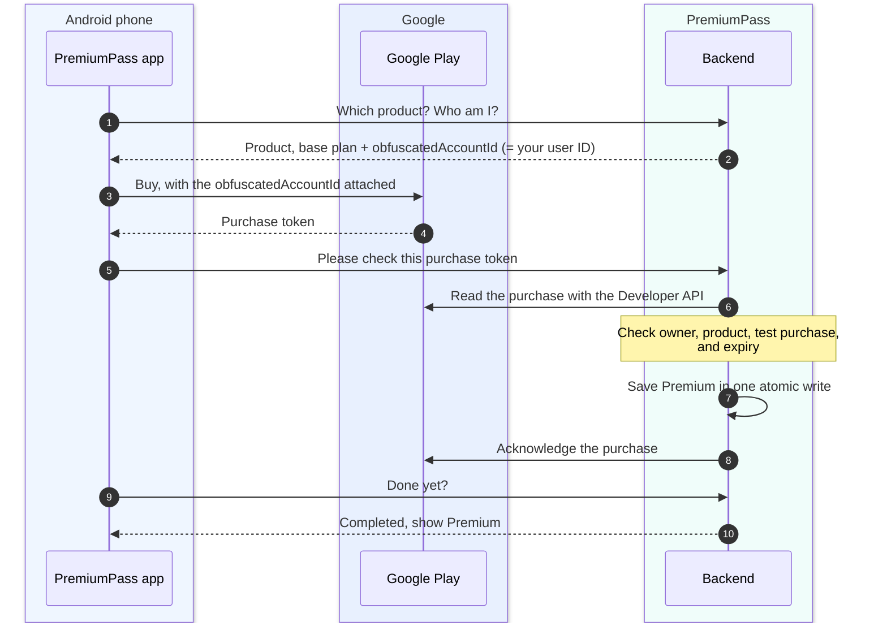

# Google Play test purchases

Set up one Premium subscription for real Google Play **license-test purchases**.
Start with the local [Getting started](GETTING_STARTED.md) path. The
`pnpm cli google-mock` command is a separate synthetic exercise that needs no
Google account.

Use your own development accounts, synthetic application data, and Google's test
payment instruments. Do not make production purchases.

## How a purchase works

Three parties take part: the **app** shows Google Play's purchase sheet,
**Google Play** takes the payment, and the **backend** decides about Premium.



| Who     | Does                                                                 | Never does                                    |
| ------- | -------------------------------------------------------------------- | --------------------------------------------- |
| App     | Fetch config, open the purchase sheet, send the purchase token, wait | Grant Premium or acknowledge the purchase     |
| Backend | Verify with Google, check the owner, save access, acknowledge        | Trust what the app says without asking Google |

**What is the `obfuscatedAccountId` for?** It is Google's equivalent of Apple's
`appAccountToken`: the app attaches our internal user ID to the purchase, and
Google returns it as `obfuscatedExternalAccountId` when the backend reads the
purchase. That proves which PremiumPass account bought the subscription, also
for a restore or a notification that arrives later. A different ID means the
purchase is rejected.

**How is a purchase completed?** Google requires every new purchase to be
_acknowledged_; otherwise it refunds the purchase automatically (after about
three minutes for license testers, three days in production). Here only the
backend acknowledges, and only after Premium is saved (step 8). If anything
fails before that, a retry or Restore picks the purchase up again, and the
saved completion marker prevents a second grant.

**Later changes** such as renewals, cancellations, or account holds arrive as
Real-time developer notifications (Pub/Sub) and go through steps 6–8 without
the app.

## Setup order

| When                     | Action                                                                                | Ready when                                                           |
| ------------------------ | ------------------------------------------------------------------------------------- | -------------------------------------------------------------------- |
| Now                      | Prepare the developer account, app, package name, and license testers                 | Account requirements are cleared and the identifiers are recorded    |
| With the Android build   | Upload a signed Billing-enabled AAB to internal testing; configure the subscription   | Test release is available and the monthly base plan is active        |
| With backend integration | Configure API access and lifecycle notifications                                      | Backend can verify purchases and receive authenticated notifications |
| End to end               | Install, sign in, buy with a test instrument, restore, and exercise lifecycle changes | Purchase, restore, and lifecycle checks behave as described below    |

Console labels can vary by language and account. The linked official pages were
reviewed on October 18, 2026.

## 1. Prepare the account and app

Use a [Google Play developer account](https://play.google.com/console/) whose
owner can complete the verification and agreements shown in its Dashboard.
Set up/link the Google payments profile required for billing products. Follow
the account's actual requirements; completing this guide does not verify an
account. [Google account and billing prerequisites](https://developer.android.com/google/play/billing/getting-ready).

Create an app named **PremiumPass**, choose its language, **App**, and **Free**
download. The subscription is a separate product. Complete required declarations
for the internal release using the actual demo behavior.

Choose the final unique Android package name **before uploading**. For example,
`com.yourcompany.premiumpass` is a placeholder to replace with your own identifier.
Set `ANDROID_PACKAGE_NAME` in `apps/mobile/.env`; it controls `android.package` in
[app.config.ts](../apps/mobile/app.config.ts). The default `com.example.premiumpass`
is for local verification only and is rejected by the signed-upload command.
The iOS bundle ID setting does not change Android.
An uploaded app's package name cannot later be changed.
[Internal release setup](https://support.google.com/googleplay/android-developer/answer/9845334?hl=en).

Internal testing is sufficient for this demo. The closed-testing requirements
for production access on newer personal accounts are a separate path; no public
production release is planned.
[Testing requirements](https://support.google.com/googleplay/android-developer/answer/14151465?hl=en).

## 2. Register the license tester

At the developer-account level, open **Settings → License testing**. Add a list
containing the Google account you will use in the device's Play Store and save.
This is separate from the app's internal-test invitation. Both lists should
contain the intended tester. [License testing setup](https://support.google.com/googleplay/android-developer/answer/6062777?hl=en).

During purchases, check the selected Google account and the test-purchase notice.
Choose **Test card, always approves** for the first purchase. If ordinary payment
methods appear without the test notice, stop and fix the tester/account setup.
Internal-track membership alone does not prevent real charges.
[Billing test behavior](https://developer.android.com/google/play/billing/test).

## 3. Upload the Android test build

The Android build must contain Google Play Billing support and use the chosen
package name. Upload a signed **Android App Bundle (AAB)** and configure Play App
Signing as prompted. Google requires a Billing-enabled upload to unlock the
billing product features. Use the local build commands below; an iOS JavaScript
export is not an Android native build.
[Billing-enabled build prerequisite](https://developer.android.com/google/play/billing/getting-ready).

In **Test and release → Testing → Internal testing**, create a release and add
the AAB. In **Testers**, select your tester email list, save, and roll out the
internal release. Use the opt-in link with that Google account, join the test,
and install from Google Play on Android hardware or a Play-enabled emulator.
Allow time for the release to become available.
[Internal track instructions](https://support.google.com/googleplay/android-developer/answer/9845334?hl=en).

After initial setup, license testers can also sideload development builds with
the same package name. This does not remove the Console/product setup requirement.
[Development-build testing](https://developer.android.com/google/play/billing/test).

### Local Android build

Install Android Studio with its bundled JDK, Android SDK/platform-tools, Android
SDK Platform 36, Build Tools 36.0.0, NDK 27.1.12297006, and CMake 3.22.1 (the
pinned Expo native defaults). Set `ANDROID_HOME` and
`JAVA_HOME` if automatic macOS discovery does not find them. Then:

```sh
pnpm mobile:android:doctor
pnpm --filter @premiumpass/mobile run prebuild:android
pnpm mobile:android
```

`mobile:android` installs a development build; Expo Go cannot load the native
Auth0/IAP modules. For an emulator, use `EXPO_PUBLIC_API_URL=http://10.0.2.2:3000`;
for a device, use the Mac's LAN address with `pnpm dev:api:lan`. The generated app
allows local HTTP for this demo. Register the Android Auth0 callback/logout URLs
before signing in: [Native configuration](AUTH0_SETUP.md#add-the-native-application).

For a Play upload, set `ANDROID_PACKAGE_NAME`, increment `ANDROID_VERSION_CODE`
for each upload, and configure the four `ANDROID_UPLOAD_KEY*` settings in the
ignored `apps/mobile/.env` (see its example). Create a dedicated upload keystore
with Android Studio's signed-bundle wizard or `keytool`; keep and back it up
privately. Use an absolute keystore path. Then:

```sh
pnpm mobile:android:aab
```

This regenerates Android without cleaning the iOS project and runs Gradle
`app:bundleRelease`. Output is
`apps/mobile/android/app/build/outputs/bundle/release/app-release.aab`.
The command rejects placeholder packages/missing signing configuration; generated
release builds do not fall back to the debug signing key. Credentials are read
from the environment, never command-line password arguments.

Before choosing an upload identity, `pnpm mobile:android:aab --unsigned` exercises
native compilation with no upload key. That bundle cannot be uploaded to Play.
Add `--verbose` for Gradle dependency/build diagnostics.
[Local release-build background](https://docs.expo.dev/guides/local-app-production/).

## 4. Create the subscription and base plan

Open **Monetize with Play → Products → Subscriptions → Create subscription**.
Use these recommended demo values; record any different IDs for the integration.

| Field                 | Recommended value                                                         |
| --------------------- | ------------------------------------------------------------------------- |
| Product ID            | `premium_monthly`                                                         |
| Name                  | `PremiumPass Premium`                                                     |
| Benefit               | `Synthetic score history`                                                 |
| Base plan ID          | `monthly`                                                                 |
| Renewal type / period | Auto-renewing / Monthly                                                   |
| Price                 | EUR 4.99/month in Germany; include the tester's Play country if different |
| Offers / free trial   | None for the first exercise                                               |

Save the subscription, add the base plan, configure price/region availability,
save, and **Activate** the base plan. A saved draft is insufficient. Product IDs
cannot be changed/reused after creation; activated base-plan IDs also cannot be
changed/reused. Offers are optional.
[Subscription and base-plan instructions](https://support.google.com/googleplay/android-developer/answer/140504?hl=en).

Record the selected grace-period and account-hold settings for the later payment
failure exercise. Backend access must follow verified provider state and the
project's [access policy](PAYMENTS.md#access-policy); a Console setting alone
does not implement that mapping.

## 5. Prepare backend API access

The backend needs its own Google identity to read purchase state.

1. In your Google Cloud development project, enable **Google Play Android
   Developer API** and create a dedicated backend service account.
2. In Play Console, open **Users and permissions → Invite new users**, enter the
   service-account email, and restrict app access to PremiumPass.
3. Grant only **View financial data, orders, and cancellation survey responses**
   and **Manage orders and subscriptions**, never developer-account admin access.
   The older Cloud-project linking workflow is no longer required.
   [Official API access setup](https://developers.google.com/android-publisher/getting_started).

| Rule                     | Why                                                                                      |
| ------------------------ | ---------------------------------------------------------------------------------------- |
| Key stays on backend     | Keep a downloaded JSON key outside Git; never in `EXPO_PUBLIC_*`, chat, or documentation |
| Explicit key file        | The worker reads `GOOGLE_PLAY_SERVICE_ACCOUNT_FILE`; there is no implicit ADC fallback   |
| Server-side verification | `purchases.subscriptionsv2.get` checks product, base plan, expiry, owner, `testPurchase` |
| Client callback ≠ access | A success callback or a pending purchase grants nothing                                  |

[Subscription response reference](https://developers.google.com/android-publisher/api-ref/rest/v3/purchases.subscriptionsv2).

## 6. Prepare lifecycle notifications

Google reports renewals, cancellations, and expiry through **Real-time developer
notifications (RTDN)** on Pub/Sub.

1. In the same Cloud project, enable **Cloud Pub/Sub** and create a topic, for
   example `premiumpass-play-rtdn`.
2. Grant `google-play-developer-notifications@system.gserviceaccount.com` the
   **Pub/Sub Publisher** role on that topic.
3. Create a subscription. A pull subscription can receive the setup test message
   before our receiver exists.
4. In **Monetize → Monetization setup → Real-time developer notifications**,
   enter `projects/<project-id>/topics/premiumpass-play-rtdn`, enable
   subscription and voided-purchase notifications, save, and send a test message.
   [RTDN setup](https://developer.android.com/google/play/billing/getting-ready).
5. Once the HTTPS receiver from step 7 runs, switch to an **authenticated push**
   subscription with its own push-auth service account and audience.
   [Authenticated push setup](https://docs.cloud.google.com/pubsub/docs/authenticate-push-subscriptions).

Three Google identities are involved and must stay separate: Google's publisher
account, our backend service account, and the push-auth account.

- The receiver validates Google's JWT signature, issuer, audience, expiry, and
  the expected service-account email.
- A notification only says "something changed": the worker always reads fresh
  state from the Google API before writing.
- Do not point Google at the Apple webhook, and keep DynamoDB/ElasticMQ private.
- Pub/Sub can cost money even for license tests; check
  [Pub/Sub pricing](https://cloud.google.com/pubsub/pricing) first.

## 7. Enable local processing

| File                                | Settings                                                                                                                     |
| ----------------------------------- | ---------------------------------------------------------------------------------------------------------------------------- |
| `services/api/.env`                 | `GOOGLE_PLAY_ENABLED=true`, `GOOGLE_PLAY_PACKAGE_NAME`, `GOOGLE_PLAY_PRODUCT_ID`, `GOOGLE_PLAY_BASE_PLAN_ID`                 |
| `services/subscription-worker/.env` | Same four values plus `GOOGLE_PLAY_SERVICE_ACCOUNT_FILE` (only the worker holds the key)                                     |
| `services/google-webhook/.env`      | Copy from `.env.example`; same product values plus push audience, expected service-account email, and full subscription name |

Then:

1. Restart API and worker. Start `pnpm dev:webhook:google` separately.
2. Expose `http://127.0.0.1:3004/v1/webhooks/google` through your HTTPS tunnel.
3. Use that HTTPS URL as `GOOGLE_PLAY_PUSH_AUDIENCE` and as the Pub/Sub
   audience and endpoint. Grant the Pub/Sub service agent the token-creator
   permission from the [authenticated-push guide](https://docs.cloud.google.com/pubsub/docs/authenticate-push-subscriptions)
   and keep the wrapped payload format.

### Purchase flow details

The overview is in [How a purchase works](#how-a-purchase-works). Locally the
app calls `GET /v1/billing/google/config`, then `POST /v1/billing/google/sync`
with the token, and polls `/sync/:operationId`; the API only queues the job, and
the subscription worker does the Google calls.

- The `obfuscatedAccountId` is our internal user ID. Only Google's API response
  proves ownership, never the app's claim.
- The app never acknowledges purchases. The worker acknowledges after the
  commit; a retry resumes acknowledgement without repeating the domain write.
- Restore and foreground recovery use the same sync path. **Manage** opens
  Google Play; changes refresh when the app returns.
- Grace uses Google's verified expiry; account hold, pause, and expiry grant no
  Google access. Public IDs contain only a token hash; the raw token stays in the
  private provider record and the queue. [Google records](DYNAMODB_DATA_MODEL.md#google-play-records).
- Not supported: plan replacements (`linkedPurchaseToken`), offers or trials,
  more base plans, and production purchases.

**Missed updates:** configure Google in the [CLI's own environment](../apps/cli/README.md#configuration),
run `pnpm cli reconcile --provider google --dry-run`, then without `--dry-run`.
This refreshes stored tokens only; an unknown first purchase needs sync/Restore
or RTDN. [Reconciliation](RECONCILIATION.md).

## AWS notification processing

The CDK stack can run the same Google path in AWS: protected billing routes in
the API Lambda, `POST /v1/webhooks/google`, and a Google webhook Lambda. It stays
off until `GOOGLE_PLAY_ENABLED=true`. CDK creates no Google topic, subscription,
account, key, or Play Console product.

1. **Secret:** store the billing service-account JSON (`type=service_account`,
   `client_email`, `private_key` with its PEM newlines) as a Secrets Manager
   secret in the selected account/region. Only the worker reads it.
   [AWS secret access](https://docs.aws.amazon.com/secretsmanager/latest/apireference/API_GetSecretValue.html).
2. **Configuration:** in `infra/.env`, set `GOOGLE_PLAY_ENABLED=true`, the
   package/product/base-plan values, `GOOGLE_PLAY_SECRET_ARN`, the push audience,
   the expected push service-account email, and the full subscription name.
3. **Audience:** choose a stable HTTPS identifier such as
   `https://billing.example.com/google-play-push` and set the same value in
   Pub/Sub. It may differ from the receiver URL, so you can configure it before
   the API URL exists. [Google push authentication](https://docs.cloud.google.com/pubsub/docs/authenticate-push-subscriptions).
4. **Deploy:** follow [AWS setup and dry runs](../infra/README.md#deploy), then
   use the `GoogleWebhookUrl` output as the Pub/Sub push endpoint. Never point a
   live subscription at an undeployed endpoint.
5. **Verify separately:** identity rejection, a valid TEST push (it queues no
   purchase work), queue acceptance, worker completion, and cloud owner records.

| Component | Permissions when Google is enabled                 | Never gets                                |
| --------- | -------------------------------------------------- | ----------------------------------------- |
| Webhook   | Queue send; verifies Pub/Sub JWTs with public keys | Database or secret access                 |
| API       | Queue send; read Google completion markers         | Google key; provider-record writes        |
| Worker    | Google secret; Google record families in the table | Any Google permission while Google is off |

Queue failures return 503 so Pub/Sub retries. Cloud credentials are cached for up
to five minutes; an expired key is never reused after a failed reload. Local key
files and cloud secrets are separate; neither falls back to the other.

### Authenticated cloud purchase and Restore

The API Lambda uses the same billing adapter and Auth0 checks as the local API;
no extra scopes or Gateway authorizer are added.

| Request                                                                   | Required scopes             | Successful result                                                            |
| ------------------------------------------------------------------------- | --------------------------- | ---------------------------------------------------------------------------- |
| `GET /v1/billing/google/config`                                           | `read:me`, `write:checkout` | 200: public product settings and this cloud user's internal UUID             |
| `POST /v1/billing/google/sync` with `{"purchaseToken":"SYNTHETIC_TOKEN"}` | `write:checkout`            | 202: `operationId` and `status=pending`, only after confirmed SQS acceptance |
| `GET /v1/billing/google/sync/<operationId>`                               | `read:me`                   | 200: `status=pending` or `status=completed` for the authenticated owner      |

| Situation                               | Response                                      |
| --------------------------------------- | --------------------------------------------- |
| Committed but not yet acknowledged      | `pending`                                     |
| Unknown or another user's `operationId` | `pending` (reveals nothing about other users) |
| Google disabled, queue failure          | 503 (after authentication and scope checks)   |
| Malformed input or operation ID         | 400                                           |
| Body over 8 KiB                         | 413 `google_request_too_large`                |

**Switching the app to AWS:** set `EXPO_PUBLIC_API_URL` to the `ApiUrl` output,
keep the Auth0 settings, and rebuild. Fetch the config from that API before
buying: Google's `obfuscatedExternalAccountId` must match the **cloud** profile.
Local profiles and purchases are not copied, so restoring a purchase bound to a
local user is rejected; use a separate license-test purchase.

Verify token/scope rejection, two distinct users, pending → completed polling,
wrong-user polling, Restore, acknowledgement retry, and Premium access. Cloud
reconciliation needs its own switch, `RECONCILIATION_GOOGLE_ENABLED=true`
([shared schedule](RECONCILIATION.md#cloud-reconciliation)).

## Ready for the first integration run

Keep a private setup record (not in the repository): package name,
product/base-plan IDs, regions, internal opt-in link, tester account, Cloud
project ID, backend service-account email, and topic/subscription names.

The first run verifies Android login, test purchase, backend-owned access,
acknowledgement, Restore, and wrong-user rejection. Google refunds
unacknowledged license-test purchases after about **three minutes**, which is
why the backend must commit first and retry acknowledgement durably. Use Play
Billing Lab later for renewal, grace, and account hold.
[Purchase testing and acknowledgement timing](https://developer.android.com/google/play/billing/test).

**Cleanup:** pause through the internal-test track and cancel retained test
subscriptions. Stopping local processes does not stop renewals or Cloud
resources; remove only demo-specific subscriptions, topics, and keys.
