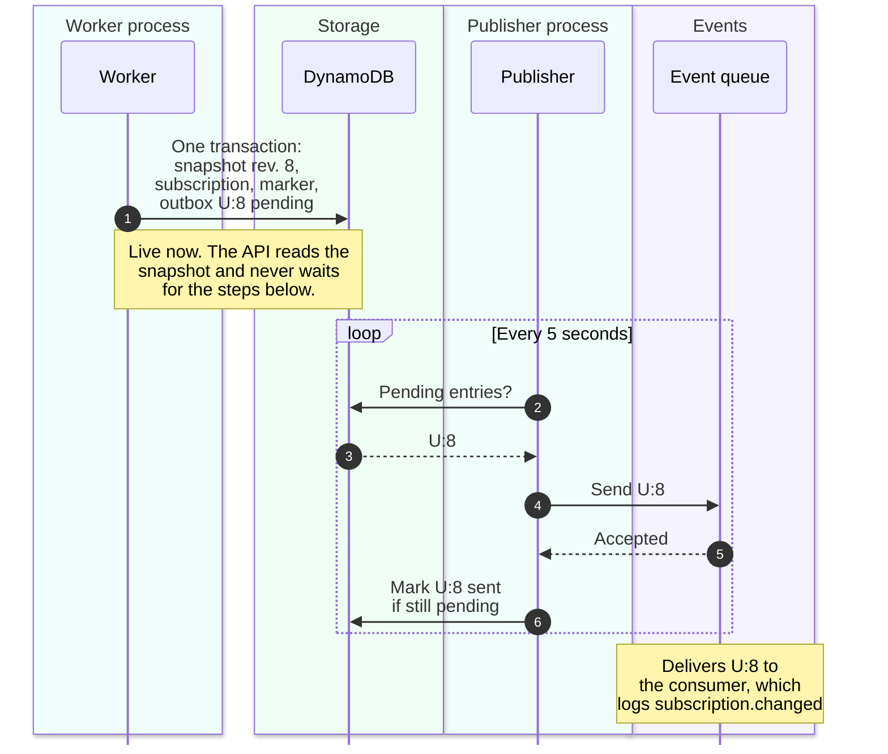

# Outbox: reliable change events

Whenever a user's subscriptions or access change, PremiumPass publishes its own
`SubscriptionChanged` event, so that **other systems can react**: send a welcome
email, update a report, sync a CRM. Premium itself never needs this event. The
API reads access straight from the database, and the apps keep asking the API.

The **outbox** is how that event is published reliably: no event is lost when a
process crashes, and no event goes out for a change that was never saved.

> [!NOTE]
> In this lab the only listener writes a log line. The event is optional for
> the product and exists to show reliable publishing. Stop the publisher and
> Premium still works; the events simply wait.

## In short

| Question                  | Answer                                                                                                                                |
| ------------------------- | ------------------------------------------------------------------------------------------------------------------------------------- |
| What is published?        | One `SubscriptionChanged` event per change, carrying the user's complete access snapshot                                              |
| When?                     | A subscription changed, an access boundary passed, or a complimentary grant changed; a check that finds nothing new publishes nothing |
| Where to?                 | An event queue: ElasticMQ locally. EventBridge is planned for AWS; only the adapter exists                                            |
| Who listens?              | Today a log consumer (`pnpm dev:events`). Email, reporting, or a CRM could follow; none are built                                     |
| Who does not use it?      | The API, the website and apps, and the payment providers                                                                              |
| What does the outbox add? | Every saved change is published at least once, and only saved changes are published                                                   |

## Why not send the event right after saving?

The change goes to DynamoDB, the event goes to a queue. These are two systems,
and no transaction spans both. Whatever the order, a crash in between leaves one
step done and the other not:


A retry does not rescue "save, then publish" either. After a crash, the work
queue redelivers the job, the worker finds the job's completion marker and skips
it as a duplicate, and nothing remembers the missing event. This trap is known
as the **dual-write problem**. The outbox avoids it by saving the event _as
data_ in the same transaction as the change and sending it later from a separate
process.

## The idea, pictured as a mailroom

![An office mailroom with four stations. The clerk (subscription worker) updates the file and writes the letter in one move. The cabinet with an out-tray (DynamoDB) keeps the letter as a pending outbox entry. The mail carrier (outbox publisher) posts waiting letters every five seconds, then stamps the copy as sent. The post office (event queue and consumer) delivers every letter at least once. Notes: the API never waits for a letter; a stopped carrier only delays letters; a crash before the stamp posts a letter again, and its reference number reveals the copy.](images/outbox-mailroom.svg)

A careful clerk does not promise to "post the letter later". They put the letter
into the out-tray **in the same move** that files the change; the drawer only
closes with both inside. A mail carrier empties the tray on regular rounds,
posts each letter, and stamps the office copy "sent" afterwards.

| In the mailroom                  | In PremiumPass                                                                                      |
| -------------------------------- | --------------------------------------------------------------------------------------------------- |
| Clerk                            | Every writer that changes access: provider and expiration jobs, admin grants, CLI demo edits        |
| Letter in the out-tray           | Outbox entry `OUTBOX#<user-id>:<revision>` with `status: pending`, in the same DynamoDB transaction |
| Mail carrier on rounds           | Outbox publisher, every five seconds with `pnpm dev:outbox`                                         |
| Post office                      | Event queue                                                                                         |
| "Sent" stamp on the copy         | `status: sent`, `sentAt`, `publishedEventId`                                                        |
| Reference number on every letter | `domainEventId` = `<user-id>:<revision>`, identical on every retry                                  |
| Recipient                        | Event consumer; today it logs `subscription.changed`                                                |

## One change, end to end

A user cancels on the website. The worker verifies the new Stripe state and
commits it. Everything after the first step happens in a separate process.



`U` stands for the internal user ID; `8` is the user's new aggregate revision.
The pending entry already is the event, so the publisher never recalculates
access. Publication later adds `sentAt` and `publishedEventId`, the queue's
receipt. A pending entry looks like this:

```jsonc
{
  "pk": "OUTBOX#<user-id>:8",
  "sk": "EVENT",
  "domainEventId": "<user-id>:8", // stable reference number
  "userId": "<user-id>",
  "revision": 8,
  "type": "SubscriptionChanged",
  "status": "pending", // "sent" after publication
  "providerEventId": "<provider-event-id>",
  "correlationId": "<correlation-id>", // in every log line
  "createdAt": "2026-10-21T09:15:00.000Z",
  "entitlements": {
    // The committed snapshot at revision 8, not a diff
    "tier": "premium",
    "features": ["score_history"],
    "effectiveUntil": "2026-11-21T09:14:58.000Z",
    "evaluatedAt": "2026-10-21T09:15:00.000Z",
    "grants": [/* every valid grant at this revision */],
    "warnings": [],
  },
}
```

## What you can rely on

- **No lost event.** A saved change always has its pending entry, and the
  publisher retries it until the queue accepts it. A stopped publisher only
  delays events.
- **No event without a change.** An entry exists only if its change was committed.
- **Copies are possible.** A crash after sending but before marking `sent` sends
  the event again, with the same `domainEventId`. This is _at-least-once_
  delivery. Exactly once would need sending and marking in one atomic step,
  which is the same two-system problem again.
- **No order promise.** A retried event can arrive after a newer one. Every event
  carries the full snapshot of its revision, and revisions can have gaps.
- **`sent` means accepted by the queue**, not processed by a listener.

A future listener with real side effects therefore skips a `domainEventId` it
has already handled and ignores revisions older than the last one it applied.
[Duplicates and crashes](try-it/duplicates-and-crashes.md) walks through each
crash moment.

## See it yourself

Let an event wait in the outbox, then publish it. This needs `pnpm local:up`,
the website with `pnpm dev`, and a user who has signed in once.

1. Start the consumer with `pnpm dev:events`. Leave `pnpm dev:outbox` stopped.
2. Run `pnpm cli seed <user-id> active`. **Expect:** after a refresh, the
   website shows Premium, although no event has been published yet.
3. Run `pnpm outbox:publish --dry-run`. **Expect:** an `outbox.preview` line
   with `<user-id>:<revision>`. The [admin console](ADMIN_CONSOLE.md) lists the
   entry as pending and warns once it is older than 60 seconds.
4. Run `pnpm outbox:publish`. **Expect:** `outbox.sent` in this terminal and
   `subscription.changed` in the consumer terminal, with the same `domainEventId`.
5. Clean up with `pnpm cli seed <user-id> free` and one more `pnpm outbox:publish`.

| File                                                                                                             | What to look for                                                      |
| ---------------------------------------------------------------------------------------------------------------- | --------------------------------------------------------------------- |
| [`processing/dynamodb-processing.ts`](../packages/subscription-processing/src/processing/dynamodb-processing.ts) | `commit`: the outbox entry joins the same transaction as the change   |
| [`outbox-publisher/src/publisher.ts`](../services/outbox-publisher/src/publisher.ts)                             | Send first, mark second; only an entry with its own receipt is marked |
| [`outbox-publisher/src/store.ts`](../services/outbox-publisher/src/store.ts)                                     | The pending scan and the conditional `sent` update                    |
| [`outbox-publisher/src/events.ts`](../services/outbox-publisher/src/events.ts)                                   | The `SubscriptionChanged` shape and the `<user-id>:<revision>` rule   |

## Demo simplifications

The pattern is complete; the plumbing around it is kept small. None of the
following is decided for a cloud version.

- **Queue or broker.** An event with any number of listeners fits a broker, such
  as an EventBridge bus or an SNS topic, that hands a copy to every subscriber,
  often with one SQS queue per listener for its own buffer, retries, and DLQ. A
  plain queue gives each message to one consumer only. Locally, the single
  ElasticMQ queue stands in for the broker, which is fine for one log consumer.
- **Polling.** The publisher scans the whole table every five seconds, and
  entries are kept forever. Production would need an index for pending entries
  and a retention policy. DynamoDB Streams could replace the polling; the
  entries and their guarantees would stay the same.
- **In-memory transport.** ElasticMQ loses accepted messages on restart, and the
  CDK stack has no event bus or rule yet.

## Continue

- [Data model](DYNAMODB_DATA_MODEL.md#subscription-processing-records): the
  outbox record next to the snapshot and the completion marker.
- [Publisher README](../services/outbox-publisher/README.md): batches, logs, and
  the EventBridge boundary.
