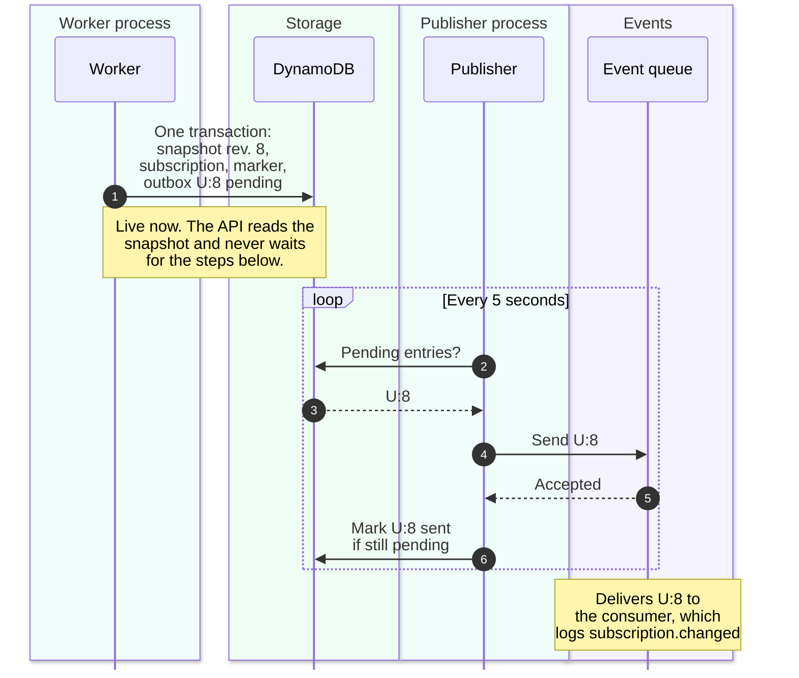
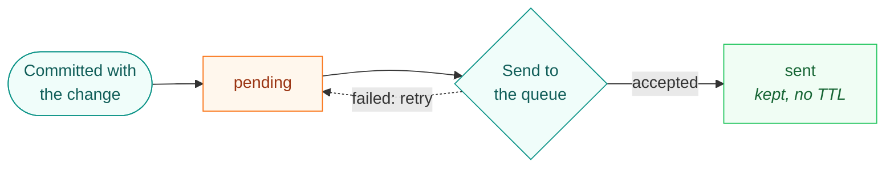
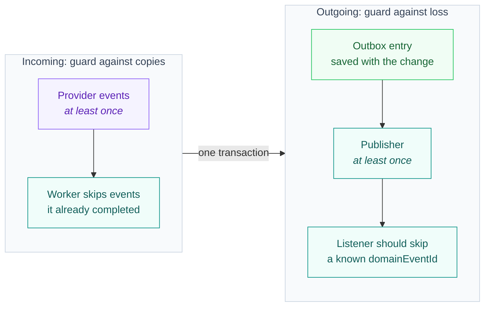

# Outbox: announce every change, lose none

When a user's access changes, the backend saves the change. Other parts of a
system often want to hear about it too: a welcome email, a report, a CRM, another
service. The **outbox** makes sure that every saved change is announced, even
when a process crashes at the worst possible moment. This page shows the
problem, gives the idea a picture, and then follows one change through PremiumPass.

> [!NOTE]
> Premium access never depends on the outbox. The API reads access straight
> from the database and checks the clock. The outbox only decides whether
> _others_ hear about a change. Today the only listener writes a log line.

## The problem: two systems, no shared transaction

After a provider confirms a purchase, two things should happen: **save** the
new state in DynamoDB and **announce** it on an event queue (ElasticMQ locally,
EventBridge in AWS). These are two different systems, and no transaction spans
both. Whatever the order, a crash between the two steps leaves one done and the
other not.


| Order           | A crash in between leaves                       | Effect                                                      |
| --------------- | ----------------------------------------------- | ----------------------------------------------------------- |
| Save, then send | The change saved, the announcement lost         | Others never learn that the user is Premium                 |
| Send, then save | The announcement out, the save failed           | Others act on a change that does not exist                  |
| Outbox          | The change and a pending announcement, together | The announcement goes out later; at worst it goes out twice |

Retrying does not rescue "save, then send" in this project. After a crash, the
queue redelivers the job, the worker finds the job's completion marker, and
skips it as a duplicate. That marker is exactly what keeps duplicate provider
events harmless, but it also means nothing remembers the missing announcement.
This trap is known as the **dual-write problem**.

## The idea, pictured as a mailroom

![An office mailroom with four stations. The clerk (subscription worker) updates the file and writes the letter in one move. The cabinet with an out-tray (DynamoDB) keeps the letter as a pending outbox entry. The mail carrier (outbox publisher) posts waiting letters every five seconds, then stamps the copy as sent. The post office (event queue and consumer) delivers every letter at least once. Notes: the API never waits for a letter; a stopped carrier only delays letters; a crash before the stamp posts a letter again, and its reference number reveals the copy.](images/outbox-mailroom.svg)

A careful clerk does not promise to "post the letter later". They write the
letter and put it into the out-tray **in the same move** that files the change,
and the drawer only closes with both inside. A mail carrier empties the tray on
regular rounds, posts each letter, and stamps the office copy "sent" afterwards.

| In the mailroom                  | In PremiumPass                                                                               |
| -------------------------------- | -------------------------------------------------------------------------------------------- |
| Clerk                            | Every writer that changes access: provider and expiration jobs, admin grants, CLI demo edits |
| File and out-tray in one drawer  | Access snapshot and outbox entry in **one** DynamoDB transaction                             |
| Letter waiting in the tray       | `OUTBOX#<user-id>:<revision>` with `status: pending`                                         |
| Mail carrier on rounds           | Outbox publisher, every five seconds with `pnpm dev:outbox`                                  |
| Post office                      | Event queue: ElasticMQ locally; EventBridge in AWS (adapter only, not wired)                 |
| "Sent" stamp on the copy         | `status: sent`, `sentAt`, `publishedEventId`                                                 |
| Reference number on every letter | `domainEventId` = `<user-id>:<revision>`, identical on every retry                           |
| Recipient                        | Event consumer; today it logs `subscription.changed`                                         |

Two consequences follow from the picture:

- **A letter can arrive twice, but never zero times.** If the carrier posts a
  letter and is interrupted before stamping the copy, the next round posts it
  again. This is called _at-least-once_ delivery.
- **The stamp means "the post office took it", not "the recipient acted on it".**
  `sent` records transport acceptance only.

## One change, end to end

A user cancels on the website. The worker verifies the new Stripe state and
commits it. Everything after the first step happens in a separate process.



`U` stands for the internal user ID; `8` is the user's new aggregate revision.
The pending entry carries everything the announcement needs, so the publisher
never recalculates access. Publication later adds `sentAt` and
`publishedEventId`, the queue's receipt. A pending entry looks like this:

```jsonc
{
  "pk": "OUTBOX#<user-id>:8",
  "sk": "EVENT",
  "domainEventId": "<user-id>:8", // stable reference number
  "userId": "<user-id>",
  "revision": 8,
  "type": "SubscriptionChanged",
  "status": "pending", // "sent" after publication
  "providerEventId": "<provider-event-id>",
  "correlationId": "<correlation-id>", // in every log line
  "createdAt": "2026-10-21T09:15:00.000Z",
  "entitlements": {
    // The committed snapshot at revision 8, not a diff
    "tier": "premium",
    "features": ["score_history"],
    "effectiveUntil": "2026-11-21T09:14:58.000Z",
    "evaluatedAt": "2026-10-21T09:15:00.000Z",
    "grants": [/* every valid grant at this revision */],
    "warnings": [],
  },
}
```

## The life of one entry



A failed send, a rejected entry, or a crash before marking leaves the entry
pending for the next pass. The publisher sends first and marks second, never
the other way round: marking first could lose an announcement in a crash;
sending first can only repeat one. The mark is a conditional update
(`status = pending`), so it never overwrites an existing `sent` marker or
recreates a deleted entry.

## When something crashes

| Crash or failure                                | In the database                  | What happens next                                                                          | Result                                     |
| ----------------------------------------------- | -------------------------------- | ------------------------------------------------------------------------------------------ | ------------------------------------------ |
| Worker crashes before its commit                | Nothing                          | The work queue redelivers the job, which runs again                                        | Nothing lost, nothing doubled              |
| Worker crashes after its commit                 | Change and pending entry         | The redelivered job finds the completion marker and stops; the publisher sends             | Announced once, as planned                 |
| Publisher stopped or event queue down           | Pending entry                    | The next pass sends it; the [admin console](ADMIN_CONSOLE.md) warns after 60 seconds       | Announced late; access unaffected          |
| The queue rejects one entry of a batch          | That entry stays pending         | Accepted entries are marked one by one; the rejected one is retried                        | No entry is marked without its own receipt |
| Publisher crashes after sending, before marking | Entry still pending              | The next pass sends it again                                                               | Duplicate with the same `domainEventId`    |
| Two publishers run at the same time             | Both read the same pending entry | Both may send; the conditional update lets only one mark it                                | Duplicate with the same `domainEventId`    |
| Consumer fails                                  | Entry already `sent`             | The event queue retries after 30 seconds and moves it to the event DLQ after five receives | `sent` never meant "processed"             |

Every row ends in "announced", "announced late", or "announced twice". None ends
in "silently lost", which is the point of the pattern.

## Copies and order: rules for listeners

Today's consumer only logs, so a duplicate log line is expected and harmless. A
future consumer with real side effects (sending an email, updating a CRM) needs
three rules. They are guidance, not implemented code:

1. **Skip known IDs.** Remember each handled `domainEventId` and ignore a copy.
2. **Let the newest revision win.** The publisher does not promise order: a
   retried entry can arrive after a newer one. Every event carries the full
   snapshot of its revision, so a consumer can ignore any revision older than
   the last one it applied.
3. **Expect gaps.** A check that finds nothing new still advances the revision
   but writes no entry, so `U:7` can be followed by `U:9`.

## Inbox and outbox: both ends of one idea

Copies are normal on both ends of the worker. Each end has a stable ID to
recognize them.



The worker recognizes a completed event by its completion marker
(`EVENT#…/PROCESSED`), which makes processing a provider event safe to repeat.
The outbox entry makes sure our own announcement is not forgotten. Both are
written in the same transaction as the change.

## When an entry is written

Only a real change creates an entry: a changed subscription, a passed access
boundary, or a changed grant. Every writer uses the same
[shared commit](../packages/subscription-processing/src/processing/dynamodb-processing.ts).

| Situation                                                         | Outbox entry                    |
| ----------------------------------------------------------------- | ------------------------------- |
| Provider job (Stripe, Apple, Google) with a changed state         | Yes                             |
| An access boundary has passed (expiration job)                    | Yes                             |
| Complimentary Premium granted or revoked                          | Yes                             |
| Local CLI demo edits (`pnpm cli seed`, `pnpm cli set`)            | Yes                             |
| A fresh check that finds nothing new (for example reconciliation) | No; the revision still advances |
| A duplicate job                                                   | No; nothing is written          |

## Demo simplifications

The pattern is complete; the plumbing around it is kept small so you can watch
it in a terminal.

| In this demo                        | Why it fits the lab                    | Open for production                                                    |
| ----------------------------------- | -------------------------------------- | ---------------------------------------------------------------------- |
| The publisher scans the whole table | No extra index; easy to read           | An indexed access pattern for pending entries                          |
| Polling every five seconds          | Start, stop, and crash it on purpose   | Polling interval or change data capture (see below)                    |
| Entries are kept forever            | The admin console can show the history | A retention policy for sent entries                                    |
| ElasticMQ keeps messages in memory  | Runs without AWS                       | EventBridge bus, rules, and target retries; not wired in the CDK stack |
| The consumer only logs              | Shows delivery without side effects    | Idempotent consumers that follow the rules above                       |

**An alternative carrier.** Instead of polling, DynamoDB Streams could hand each
new outbox entry to a Lambda function or EventBridge Pipes. The entry and its
guarantees stay the same; only the carrier changes. The polling publisher fits
this lab better because you can stop it, run single passes, and watch entries
wait. Nothing is decided for a cloud version yet.

**Queue or broker?** An announcement is a fact with any number of listeners,
so it fits a broker such as an EventBridge bus or an SNS topic, which hands a
copy to every subscriber. A queue gives each message to one consumer only: right
for incoming work like the worker's jobs, but two listeners on one queue would
split the events between them. A common shape is a broker with one SQS queue
per listener, so each listener gets its own buffer, retries, and DLQ. Locally,
the single ElasticMQ queue stands in for the broker; that is fine for one log
consumer. This is a recommendation, not a decision.

## See it yourself

Let a letter wait in the tray, then send it. This needs `pnpm local:up`, the
website with `pnpm dev`, and a user who has signed in once.

1. Start the consumer with `pnpm dev:events`. Leave `pnpm dev:outbox` stopped.
2. Run `pnpm cli seed <user-id> active`. **Expect:** after a refresh, the
   website shows Premium, although nothing has been announced yet.
3. Run `pnpm outbox:publish --dry-run`. **Expect:** an `outbox.preview` line
   with `<user-id>:<revision>`. The [admin console](ADMIN_CONSOLE.md) lists the
   entry as pending and warns once it is older than 60 seconds.
4. Run `pnpm outbox:publish`. **Expect:** `outbox.sent` in this terminal and
   `subscription.changed` in the consumer terminal, with the same `domainEventId`.
5. Clean up with `pnpm cli seed <user-id> free` and one more `pnpm outbox:publish`.

[Duplicates and crashes](try-it/duplicates-and-crashes.md) shows the same flow
with a real Stripe cancellation.

| File                                                                                                             | What to look for                                                      |
| ---------------------------------------------------------------------------------------------------------------- | --------------------------------------------------------------------- |
| [`processing/dynamodb-processing.ts`](../packages/subscription-processing/src/processing/dynamodb-processing.ts) | `commit`: the outbox entry joins the same transaction as the change   |
| [`outbox-publisher/src/publisher.ts`](../services/outbox-publisher/src/publisher.ts)                             | Send first, mark second; only an entry with its own receipt is marked |
| [`outbox-publisher/src/store.ts`](../services/outbox-publisher/src/store.ts)                                     | The pending scan and the conditional `sent` update                    |
| [`outbox-publisher/src/events.ts`](../services/outbox-publisher/src/events.ts)                                   | The `SubscriptionChanged` shape and the `<user-id>:<revision>` rule   |

## Why it works this way

<details>
<summary>Why not send the event from the worker and simply retry until it works?</summary>

Retries live inside the process. If the process dies, the retry dies with it,
and the redelivered job is skipped because its completion marker already
exists. The outbox entry is a retry that survives the crash, because it is
stored data instead of a running loop.

</details>

<details>
<summary>Why not one transaction across DynamoDB and the event queue?</summary>

There is none. DynamoDB transactions cover DynamoDB items only, and neither SQS
nor EventBridge can join them. The outbox moves the announcement into the
database, so one local transaction is enough.

</details>

<details>
<summary>Why not exactly once?</summary>

The publisher would have to send and mark in one atomic step, which is the same
two-system problem again. Instead, every announcement carries a stable ID, and a
listener with side effects skips copies. At-least-once plus a stable ID is the
usual, honest guarantee.

</details>

<details>
<summary>Does the outbox make access faster or more correct?</summary>

No. Access comes from the stored subscriptions and the current time on every
request. Stop the publisher and Premium still works; only the announcements wait.

</details>

## Continue

- [Data model](DYNAMODB_DATA_MODEL.md#subscription-processing-records): the
  outbox record next to the snapshot and the completion marker.
- [Publisher README](../services/outbox-publisher/README.md): batches, logs, and
  the EventBridge boundary.
- [Reconciliation](RECONCILIATION.md): the safety net for incoming events that
  never arrived.
