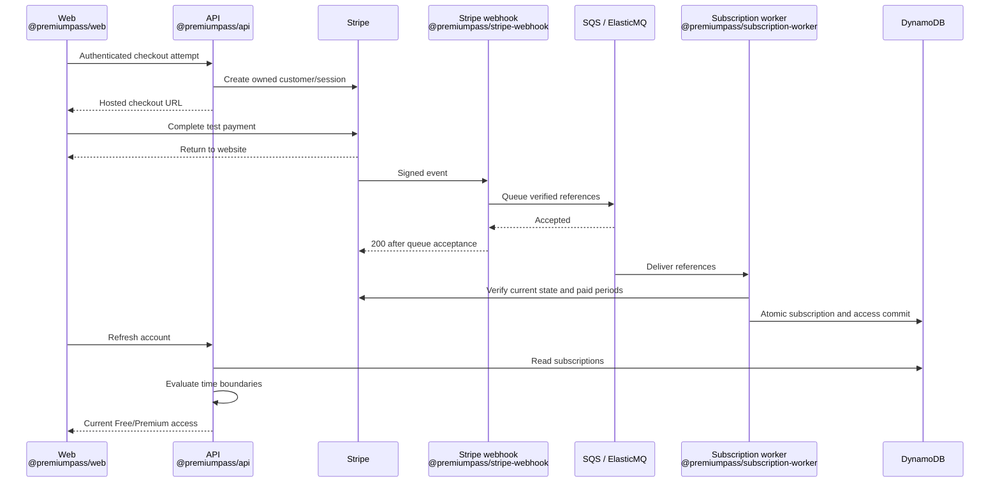

# Payments and subscriptions

**Premium starts after backend verification.** A redirect, client badge, or scope
alone grants nothing. This is the central guide for Stripe test payments and
shared access rules. Start with [Getting started](GETTING_STARTED.md); the idea
behind combining providers is in [Concepts](CONCEPTS.md). Native purchases are in
[Google Play](GOOGLE_PLAY.md) and [Apple Sandbox](APPLE_PURCHASES.md).

## Payment flow



## Stripe test setup

1. In your Stripe Dashboard, select a **sandbox/test environment**. Under
   **Product catalog → Add product**, create **PremiumPass Premium** with
   two recurring prices: **EUR 4.99/month** with lookup key `premium_monthly`
   and **EUR 1.00/day** with lookup key `premium_daily`. Both use flat-rate,
   licensed billing (not metered), quantity one, and no trial. Set each
   **Lookup key** in its price details/edit options. Daily means an automatically
   renewing subscription, not a one-time day pass. Copy the product's `prod_...` ID from
   the product details. The API will resolve the concrete `price_...` ID.
   [Product/price setup](https://docs.stripe.com/products-prices/manage-prices).
2. In that same environment, open **API keys** and reveal the test secret key
   (`sk_test_...`). The current backend accepts this key type; a publishable
   `pk_test_...` or restricted `rk_test_...` key will not work. No Stripe key is
   needed in Web. Copy the secret and product ID into API and worker, and the
   two lookup keys into API only, using the
   [configuration map](GETTING_STARTED.md#5-connect-the-configuration).
   [Find API keys](https://docs.stripe.com/keys).
3. Install the [Stripe CLI](https://docs.stripe.com/stripe-cli), then run:

   ```sh
   stripe login
   pnpm stripe:listen
   ```

4. Confirm the CLI login selected the same account and test environment. Put its
   `whsec_...` secret in `config/.env` as `STRIPE_WEBHOOK_SECRET`; only the Stripe webhook receives it. Leave the listener
   running. It forwards the supported events to port 3002. Never use `--live`.
5. Return to [Getting started, step 5](GETTING_STARTED.md#5-connect-the-configuration).
   Restart the webhook after changing its secret.

No Dashboard endpoint is needed locally. The webhook needs the signing secret
and queue; the worker needs the API key, product ID, database, and queue. Secret
values must never use `VITE_` or `EXPO_PUBLIC_` variables.
Do not create a customer or subscription manually in Stripe: start checkout from
the website so the backend creates the ownership mappings.

| First-run problem                        | Fix                                                                                                                             |
| ---------------------------------------- | ------------------------------------------------------------------------------------------------------------------------------- |
| `checkout_unavailable`                   | Set and uncomment all four Stripe values in the API `.env`, then restart                                                        |
| `stripe_price_invalid` / price not found | Check lookup key, active price/product and the selected daily/monthly interval, configured `prod_` ID, and matching environment |
| `verified_email_required`                | Complete [Auth0 email verification](AUTH0_SETUP.md#web-and-api-setup), then sign out/in                                         |
| No events in the listener after payment  | Check its account/environment; keep it running before starting checkout                                                         |

## Products, offers, and price changes

These identifiers have different jobs:

| Identifier                                      | Meaning                                           | Where it is used                                                 |
| ----------------------------------------------- | ------------------------------------------------- | ---------------------------------------------------------------- |
| Product `prod_...`                              | The Premium service, across price generations     | API validates new offers; worker and CLI recognize subscriptions |
| Lookup keys `premium_monthly` / `premium_daily` | The current offer for each billing period         | API resolves it for each new purchase attempt                    |
| Price `price_...`                               | A specific amount, currency, and billing interval | Stored in the attempt; used by Checkout and invoice verification |
| Subscription `sub_...`                          | One customer's contract using a concrete price    | Worker verifies owner, current state, and paid service periods   |

The internal plans are `premium_monthly` and `premium_daily`; neither is a
Stripe Product ID. Both unlock the same `score_history` feature. Daily billing
is available only through Stripe; native Apple/Google purchases stay monthly.
The configured Stripe product defines which service grants access. Every price
of that product that matches its plan is eligible: `premium_daily` requires
`day × 1`, and `premium_monthly` requires `month × 1`. The worker checks both
the verified price interval and the subscription plan metadata;
there is no separate price-ID allowlist. Product names and metadata alone never
establish access, and neither does an active subscription without payment evidence.

For example, `premium_monthly` initially points to a **EUR 4.99/month** price.
To charge **EUR 6.99/month** for future purchases in the same sandbox:

1. Create a new active, recurring EUR 6.99/month price on the **same product**,
   using the same flat-rate, licensed billing model and tax behavior.
2. Transfer `premium_monthly` to the new price. Stripe's Prices API supports
   `lookup_key=premium_monthly` with `transfer_lookup_key=true` on creation or
   update. Assigning the key without transferring an existing assignment fails.
   [Lookup keys](https://docs.stripe.com/products-prices/manage-prices#lookup-keys).
3. New attempts now resolve the new price without changing app configuration or
   restarting the API. An already reserved attempt keeps its old price. The demo
   performs one lookup per new intent without a cache; a production cache would
   need an explicit maximum age for old offers.
4. Check existing subscriptions and new purchases separately. Changing the key or
   the product's default price does not change existing contracts. Old customers
   retain their old price and access follows their verified paid periods.
5. Archive the old price when it should no longer be sold. Existing subscriptions
   can still renew. Existing Checkout Sessions are retrieved without resolving
   the offer again. If an unfinished attempt has no session and Stripe rejects
   creation with the archived price, keep the attempt for recovery; never silently
   substitute the new price. Use the existing recovery/expiry rules below.

Only daily and monthly test offers are supported. Selecting a period creates a
new purchase; it does not change an existing subscription. Moving an existing
subscription to another period/price, mid-cycle prorations, yearly plans, and
production pricing require
separate work. No subscription is migrated automatically by this implementation.

### Update an existing local setup

Keep the existing Stripe product, customers, subscriptions, and local records.
Replace `STRIPE_PRICE_ID` with `STRIPE_PRODUCT_ID` in API, worker, and CLI
configuration. In the API, replace the earlier single `STRIPE_PRICE_LOOKUP_KEY`
with `STRIPE_MONTHLY_PRICE_LOOKUP_KEY=premium_monthly` and add
`STRIPE_DAILY_PRICE_LOOKUP_KEY=premium_daily`. Assign each key to its matching
price on the same product. All processes must use the
same Stripe environment and product. Restart the API, worker, and reconciliation
watcher together after updating their configuration. No database reset or record
migration is needed; old purchase fingerprints remain valid. Stored attempts
without a `planId` are read as monthly because they predate daily billing.

The old environment variable is not a fallback. Leaving all API Stripe settings
unset disables checkout; partially configured settings fail with a setup error.
For a separately authorized AWS rollout, update the existing secret from
`priceId` to `productId` and coordinate worker/discovery configuration. The
existing secret cache can take five minutes to refresh. CDK synthesis does not
modify the secret or deploy anything, and cloud checkout remains outside scope.

## Checkout and recovery

The website sends `POST /v1/billing/stripe/checkout-session` with
`{"planId":"premium_monthly"}` or `{"planId":"premium_daily"}` and a UUID
`Idempotency-Key` per purchase attempt. Other plan values are rejected.
The API validates Auth0 scopes, origin, input, and a matching verified email from
Auth0 `/userinfo`. Server configuration selects the allowed product, price lookup
key, and return URLs. The client cannot select an arbitrary Stripe price or lookup key.

In Web, choose **Daily** or **Monthly** before checkout. The amount is shown in
Stripe Checkout rather than hard-coded in the app. Once an attempt starts,
selection is locked: session storage keeps its request ID and plan together, and
the backend persists its plan and concrete price before creating the session.
Returning from Checkout, reloading, or retrying after a lost response preserves
that selection. Legacy browser entries containing only a UUID resume as monthly.
**Start a new attempt** unlocks selection only after the backend reports the old
attempt expired or completed; the usual active-subscription checks still apply.
A different plan sent under the same request ID yields an idempotency conflict,
including if two requests race. Canceling renewal applies to either period.

| Situation                                                     | Behavior                                                                                                |
| ------------------------------------------------------------- | ------------------------------------------------------------------------------------------------------- |
| Retry the same attempt and parameters                         | Reuse its stored price and owned customer/session, even after a lookup-key transfer; no second purchase |
| Reuse the key with different parameters                       | Conflict                                                                                                |
| Another unfinished attempt or blocking subscription exists    | New purchase blocked                                                                                    |
| Previous session finished and no subscription blocks purchase | **Start a new attempt** permits a fresh request; backend rechecks Stripe                                |
| Provider outcome is unknown                                   | Keep the durable attempt; do not fabricate success or delete the lock                                   |

Ownership follows **verified Auth0 identity → internal UUID → Stripe customer →
subscription**. Email is contact data, never an ownership key. The customer intent,
reverse mapping, and checkout reservation are described in the [data model](DYNAMODB_DATA_MODEL.md#stripe-customer-and-checkout-records).

### Self-service cancellation

On Web, choose **Cancel subscription** and confirm. The API verifies the stored
owner and current Stripe customer/metadata before scheduling period-end
cancellation. Repeated requests are safe. Webhook/worker processing updates the
read model; refresh if still pending. Paid access remains until its verified
boundary. Local CLI edits do not cancel the Stripe contract.

## Processing and retries

| Stage                       | Success                                                               | Failure / recovery                                                            |
| --------------------------- | --------------------------------------------------------------------- | ----------------------------------------------------------------------------- |
| Webhook                     | Verify unchanged bytes; enqueue minimal references; acknowledge `200` | Invalid signature/live/Connect event: `400`; queue failure: `503`             |
| Worker                      | Read current provider state and paid invoices; commit atomically      | Provider/database failure: retry through queue; no access extension           |
| Concurrent write            | Commit against the loaded aggregate revision                          | Reload local and provider state; bounded retry                                |
| Duplicate delivery          | Existing completion marker; acknowledge                               | Crash before commit leaves no partial state; crash afterward is safe to retry |
| Repeated processing failure | Work remains recoverable                                              | Visibility 360 s; five failed receives lead to DLQ                            |

Valid but unsupported Stripe events are intentionally acknowledged without jobs.
A failed payment is a business state, not automatically a technical queue failure.
Subscription, all-provider entitlement snapshot, ownership, completion marker,
and optional outbox record commit together. Only a domain change adds an outbox
entry. API access does not wait for outbox publication.

Local ElasticMQ messages are volatile; registered cloud endpoints and the local
CLI have different redelivery behavior. See [Stripe delivery](https://docs.stripe.com/webhooks).
The demo verifies the configured product and the selected daily/monthly billing period, then
checks paid invoice lines against the actual subscription item and its price.
Archived prices remain eligible; the current lookup key is irrelevant to access.
Invoice history is bounded; complex discounts, prorations, and out-of-band payments are outside scope.

## Reconciliation and expiration

The [Reconciliation guide](RECONCILIATION.md) owns missed-event discovery,
provider differences, expiration processing, retry guarantees, and run diagnostics.
It also links to local commands and the T20/T21 exercises.

Repair uses the existing worker and atomic processing path. Provider failures
never extend access or erase verified state; API access independently enforces
the boundaries in the policy below.

## Access policy

The API derives access from subscription records, the independent admin grant,
and the current time, not the stored entitlement snapshot. The subscription
policy below applies to `premium_monthly` and Stripe `premium_daily`; both
grant `score_history`. Access uses the paid invoice period, never a locally added
day or month. The existing failed-renewal grace remains at most **24 hours**,
also for daily subscriptions; it is not a second paid day or an indefinite
extension. Normal active access expires exactly at the verified boundary.

| State                                                        | Access                                                                                                         |
| ------------------------------------------------------------ | -------------------------------------------------------------------------------------------------------------- |
| `active`, `trialing`                                         | Until verified `accessUntil`; checkout offers no trial                                                         |
| Active, renewal disabled                                     | Same verified boundary                                                                                         |
| `past_due`                                                   | Prior access plus stored grace; Apple uses signed grace, other providers cap it at 24 hours after prior access |
| Initial failure, pending, paused, canceled, expired, revoked | None                                                                                                           |
| Unknown product/status                                       | None; mapping warning remains visible                                                                          |
| Provider outage                                              | Existing boundaries remain; no extension                                                                       |

Three rules apply to every row:

- **Boundaries are exclusive:** access ends at `now >= validUntil`. Retries never
  restart a grace period.
- **All valid grants combine:** ending Apple cannot remove valid Stripe access.
  `effectiveUntil` is the next re-check, not necessarily the end of Premium.
- **Only paid time counts:** a Stripe custom cancellation date can shorten a paid
  period; only the covered part is granted.

Google needs no extra grace, because its verified expiry already includes it:

| Google state        | Stored as                  | Access                               |
| ------------------- | -------------------------- | ------------------------------------ |
| `IN_GRACE_PERIOD`   | `past_due`                 | Until Google's verified `expiryTime` |
| `CANCELED`          | `active`, renewal disabled | Until the verified expiry            |
| `ON_HOLD`, `PAUSED` | `paused`                   | None                                 |

The raw provider state stays stored for consistency checks. All mappings side by
side: [Concepts](CONCEPTS.md#same-meaning-different-words).

### Complimentary access

An administrator can grant Premium without a purchase through
[the CLI](DEVELOPMENT.md#complimentary-premium).

| Question                             | Answer                                                                         |
| ------------------------------------ | ------------------------------------------------------------------------------ |
| How many grants per user?            | One, active until a UTC expiry or until revoked                                |
| What does `null` expiry mean?        | Unbounded, but **only** for an admin grant; a purchase always needs a boundary |
| What happens at the expiry?          | The API stops access immediately; no worker needs to run                       |
| Does it replace login or scopes?     | No, both remain required                                                       |
| Can provider changes affect it?      | No; reconciliation, cancellation, and outages never change the admin grant     |
| Does revoking it affect purchases?   | No; other valid sources keep granting access                                   |
| What do Web and Mobile show?         | “Complimentary Premium”, separate from subscriptions                           |
| Who sees the audit reason and actor? | Local administrators only; the user API does not return them                   |

The grant, its audit receipt, the access snapshot, and the outbox entry commit in
one transaction, guarded by the same revision as provider updates. Reusing a
request ID is safe: the audit receipt turns the retry into a no-op.

## Manual checks

Use accounts created by this demo. Unrelated `stripe trigger` fixtures normally
lack the required ownership mappings.

| Scenario                                                      | Expected result                                               |
| ------------------------------------------------------------- | ------------------------------------------------------------- |
| T04 / T22: Free → active → expired, including no expiry event | Premium history returns 403 → 200 → 403                       |
| T06: real Stripe test purchase; refresh Web/Mobile            | Same internal user gains Premium after processing             |
| T07: duplicate/concurrent checkout attempt                    | One owned purchase attempt                                    |
| T08 / T09: invalid signature / unavailable queue              | 400 / 503; no false acceptance                                |
| T10 / T11: duplicate / older event                            | One domain effect; current provider state wins                |
| T12: concurrent provider changes                              | No lost update; valid remaining grants preserved              |
| T13 / T14: period-end cancellation / failed renewal           | Paid boundary retained; grace expires without retry extension |
| T15: provider timeout or 429                                  | Bounded retries; no invented access                           |
| T16 / T17: persistent failure, then fix and redrive           | DLQ; subsequent processing succeeds without duplicate grants  |
| T18: crash before/after transaction                           | No partial writes; retry after commit is harmless             |

For access-only scenarios, use the [local subscription CLI](DEVELOPMENT.md#local-subscription-cli).
Isolated clocks/fixtures are not real provider evidence. T06 needs a real Stripe
test payment; T16/T17 can also be repeated in AWS.

### Verify daily and monthly purchases

1. With a synthetic Free user, select **Daily** and open Checkout. Confirm it
   shows the daily price and recurring interval before paying with a test card.
   After worker processing, refresh Web and Mobile: both should show Premium,
   and the website subscription details should identify Premium Daily.
2. Repeat with a separate Free user selecting **Monthly**. Confirm the monthly
   price, Premium access, and Premium Monthly details.
3. Leave a daily checkout unpaid and return to Web. Selection stays Daily and
   locked, including after a reload. Retrying must reuse the same session.
   Once Stripe reports that session expired, retry to reveal **Start a new
   attempt**, clear it, and select Monthly. An open checkout is not replaced.
4. Schedule period-end cancellation for either plan. Renewal stops, but access
   follows its verified paid boundary. Check that the other provider grants, if
   present, still keep Premium active when the daily grant expires.
5. In isolated fixtures, verify that a daily lookup pointing to a monthly price,
   a subscription with mismatched plan metadata, and an unsupported interval do
   not grant access. Check daily expiry, failed-renewal grace, and legacy monthly
   attempt recovery separately. Worker and CLI must agree on both plans.

### Verify a lookup-key transfer in the sandbox

Use synthetic users A and B with this app's ownership mappings. This exercise
changes only the project's test catalog; never run it in live mode.

1. Complete a purchase as A at EUR 4.99/month; confirm Premium after worker processing.
2. As B, start a checkout but leave it unpaid. Record its session ID and price ID
   from the sandbox Dashboard; keep the attempt within its expiry/recovery window.
3. Create the EUR 6.99/month price and transfer the key as described above. Retry
   B's same attempt: it must return the same session and price. Complete it and
   confirm B also gains Premium at the original price.
4. Start a fresh purchase using another synthetic app user. Confirm Checkout uses
   EUR 6.99/month. Archive the old price and run CLI reconciliation in dry-run mode
   for A and B: their existing paid access must remain recognized. Then perform
   the normal repair path and refresh the account to confirm the same result.
5. Keep another synthetic user's unpaid Checkout Session open, then remove the
   lookup-key assignment temporarily. A fresh attempt by a different user must
   fail with `stripe_price_invalid`; resuming the unpaid session must still work.
   Restore the assignment when finished.

Use isolated provider fixtures for invalid products, live flags, unpaid/mismatched
invoice lines, interrupted session creation, and simultaneous reservations across
an offer change. Fixtures must not become runtime fallbacks. Compare worker and
CLI results, and verify dry-run mode makes no commits or queue submissions.
Local fixture checks do not prove actual Stripe delivery or renewals. Record
which checks ran and any missing sandbox evidence only in [P06](TASKS.md#p06-stripe-purchase-and-reliable-processing).

If access stays Free, check listener forwarding → `webhook.queued` → worker
`subscription.processed` → subscription records in DynamoDB Admin. Match event
and correlation IDs. A 200 webhook response proves queue acceptance only.
For local DLQ recovery: fix the cause, receive the message, send its unchanged
body to the work queue, and delete the DLQ copy only after successful send.

## Register the cloud webhook

The AWS stack processes Stripe notifications but does not start checkout (see
[what runs where](ARCHITECTURE.md#what-runs-where)). Cloud notifications need
matching owners in the AWS table; local records are not copied to AWS.

1. In the intended AWS account/region, create a Secrets Manager JSON secret with
   `secretKey`, `productId`, `webhookSecret`, using the default encryption key.
   Until an endpoint exists, use `PENDING_ENDPOINT_REGISTRATION` as the signing
   secret; keep purchases stopped until it is replaced.
2. Set `STRIPE_SECRET_ARN` in `config/.env`, follow [deployment](../infra/README.md#deploy),
   and copy the exact `StripeWebhookUrl` output.
3. In Stripe Workbench → Webhooks, add a **Your account / Snapshot** destination
   for that URL, using API version `2026-09-30.endive` (the installed Stripe SDK baseline).
   Subscribe to `checkout.session.completed`, `customer.subscription.created`,
   `customer.subscription.updated`, `customer.subscription.deleted`,
   `invoice.paid`, and `invoice.payment_failed`.
4. Replace `webhookSecret` with that destination's secret. It differs from the
   CLI secret; runtime caches can take five minutes to refresh.
5. Verify delivery, worker completion, and owned subscription/access records
   separately.

## Cleanup

To pause, stop the CLI listener. To retire the integration, first cancel only
project-specific test subscriptions in Web or the Stripe test Dashboard and
allow their changes to process. Remove the project's webhook destination when
no longer needed; archive its product/price if retiring future test purchases.
Do not reset an entire shared test environment or rotate shared keys.
[Stripe cancellation](https://docs.stripe.com/billing/subscriptions/cancel).

Deleting local data does not cancel Stripe subscriptions. Continue with the
[overall cleanup sequence](DEVELOPMENT.md#cleanup).
