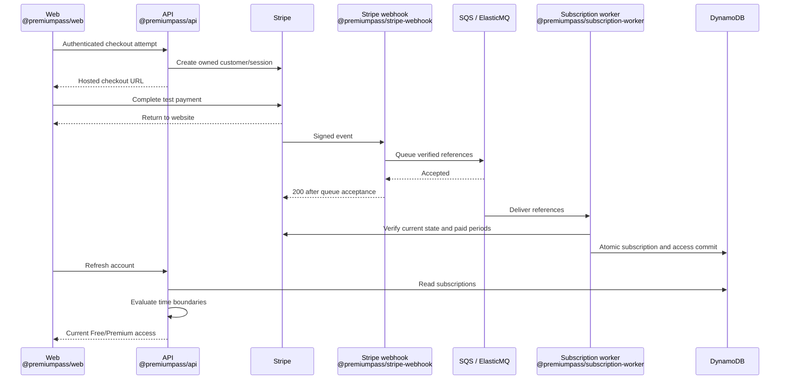

# Payments and subscriptions

**Premium starts after backend verification.** A redirect, client badge, or scope
alone grants nothing. This is the central guide for Stripe test payments and
shared access rules. Start with [Getting started](GETTING_STARTED.md); native
purchases are in [Apple Sandbox](APPLE_PURCHASES.md). Prepare the next Android
extension with [Google Play test setup](GOOGLE_PLAY.md); its runtime integration
and evidence are tracked in [P12](TASKS.md#p12-google-play-test-purchases).

## Payment flow



## Stripe test setup

1. In your Stripe Dashboard, select a **sandbox/test environment**. Under
   **Product catalog → Add product**, create **PremiumPass Premium** with a
   recurring **EUR 4.99/month** price: flat-rate, licensed (not metered), no trial.
   Open the saved price and copy its `price_...` ID, not the `prod_...` product ID.
   [Product/price setup](https://docs.stripe.com/products-prices/manage-prices).
2. In that same environment, open **API keys** and reveal the test secret key
   (`sk_test_...`). The current backend accepts this key type; a publishable
   `pk_test_...` or restricted `rk_test_...` key will not work. No Stripe key is
   needed in Web. Copy the secret and price ID into API and worker using the
   [configuration map](GETTING_STARTED.md#5-connect-the-configuration).
   [Find API keys](https://docs.stripe.com/keys).
3. Install the [Stripe CLI](https://docs.stripe.com/stripe-cli), then run:

   ```sh
   stripe login
   pnpm stripe:listen
   ```

4. Confirm the CLI login selected the same account and test environment. Put its
   `whsec_...` secret in `services/stripe-webhook/.env` as `STRIPE_WEBHOOK_SECRET`. Leave the listener
   running. It forwards the supported events to port 3002. Never use `--live`.
5. Return to [Getting started, step 5](GETTING_STARTED.md#5-connect-the-configuration).
   Restart the webhook after changing its secret.

No Dashboard endpoint is needed locally. The webhook needs the signing secret
and queue; the worker needs the API key, price, database, and queue. Secret values
must never use `VITE_` or `EXPO_PUBLIC_` variables.
Do not create a customer or subscription manually in Stripe: start checkout from
the website so the backend creates the ownership mappings.

| First-run problem                        | Fix                                                                                     |
| ---------------------------------------- | --------------------------------------------------------------------------------------- |
| `checkout_unavailable`                   | Set and uncomment both Stripe values in the API `.env`, then restart                    |
| `stripe_price_invalid` / price not found | Check active monthly price, `price_` ID, and matching key/environment                   |
| `verified_email_required`                | Complete [Auth0 email verification](AUTH0_SETUP.md#web-and-api-setup), then sign out/in |
| No events in the listener after payment  | Check its account/environment; keep it running before starting checkout                 |

## Checkout and recovery

The website sends `POST /v1/billing/stripe/checkout-session` with
`{"planId":"premium_monthly"}` and a UUID `Idempotency-Key` per purchase attempt.
The API validates Auth0 scopes, origin, input, and a matching verified email from
Auth0 `/userinfo`. Server configuration selects price and return URLs.

| Situation                                                     | Behavior                                                                 |
| ------------------------------------------------------------- | ------------------------------------------------------------------------ |
| Retry the same attempt and parameters                         | Reuse the owned customer/session; no second purchase                     |
| Reuse the key with different parameters                       | Conflict                                                                 |
| Another unfinished attempt or blocking subscription exists    | New purchase blocked                                                     |
| Previous session finished and no subscription blocks purchase | **Start a new attempt** permits a fresh request; backend rechecks Stripe |
| Provider outcome is unknown                                   | Keep the durable attempt; do not fabricate success or delete the lock    |

Ownership follows **verified Auth0 identity → internal UUID → Stripe customer →
subscription**. Email is contact data, never an ownership key. The customer intent,
reverse mapping, and checkout reservation are described in the [data model](DYNAMODB_DATA_MODEL.md#stripe-customer-and-checkout-records).

### Self-service cancellation

On Web, choose **Cancel subscription** and confirm. The API verifies the stored
owner and current Stripe customer/metadata before scheduling period-end
cancellation. Repeated requests are safe. Webhook/worker processing updates the
read model; refresh if still pending. Paid access remains until its verified
boundary. Local CLI edits do not cancel the Stripe contract.

## Processing and retries

| Stage                       | Success                                                               | Failure / recovery                                                            |
| --------------------------- | --------------------------------------------------------------------- | ----------------------------------------------------------------------------- |
| Webhook                     | Verify unchanged bytes; enqueue minimal references; acknowledge `200` | Invalid signature/live/Connect event: `400`; queue failure: `503`             |
| Worker                      | Read current provider state and paid invoices; commit atomically      | Provider/database failure: retry through queue; no access extension           |
| Concurrent write            | Commit against the loaded aggregate revision                          | Reload local and provider state; bounded retry                                |
| Duplicate delivery          | Existing completion marker; acknowledge                               | Crash before commit leaves no partial state; crash afterward is safe to retry |
| Repeated processing failure | Work remains recoverable                                              | Visibility 360 s; five failed receives lead to DLQ                            |

Valid but unsupported Stripe events are intentionally acknowledged without jobs.
A failed payment is a business state, not automatically a technical queue failure.
Subscription, all-provider entitlement snapshot, ownership, completion marker,
and optional outbox record commit together. Only a domain change adds an outbox
entry. API access does not wait for outbox publication.

Local ElasticMQ messages are volatile; registered cloud endpoints and the local
CLI have different redelivery behavior. See [Stripe delivery](https://docs.stripe.com/webhooks).
The demo verifies the configured price and paid invoice lines, with a bounded
invoice history; complex discounts, prorations, and out-of-band payments are outside scope.

## Reconciliation and expiration

The [Reconciliation guide](RECONCILIATION.md) owns missed-event discovery,
provider differences, expiration processing, retry guarantees, and run diagnostics.
It also links to local commands and the T20/T21 exercises.

Repair uses the existing worker and atomic processing path. Provider failures
never extend access or erase verified state; API access independently enforces
the boundaries in the policy below.

## Access policy

The API derives access from subscription records and the current time, not the
stored entitlement snapshot. Only `premium_monthly` grants `score_history`.

| State                                                        | Access                                                                                                         |
| ------------------------------------------------------------ | -------------------------------------------------------------------------------------------------------------- |
| `active`, `trialing`                                         | Until verified `accessUntil`; checkout offers no trial                                                         |
| Active, renewal disabled                                     | Same verified boundary                                                                                         |
| `past_due`                                                   | Prior access plus stored grace; Apple uses signed grace, other providers cap it at 24 hours after prior access |
| Initial failure, pending, paused, canceled, expired, revoked | None                                                                                                           |
| Unknown product/status                                       | None; mapping warning remains visible                                                                          |
| Provider outage                                              | Existing boundaries remain; no extension                                                                       |

Boundaries are exclusive (`now < validUntil`); retries never restart grace.
Google's `IN_GRACE_PERIOD` maps to `past_due`, with its provider-verified
`expiryTime` stored directly in `accessUntil`; no extra grace is added.
Google `CANCELED` maps to active with renewal disabled until that expiry;
`ON_HOLD`/`PAUSED` map to paused and grant no Google access. The raw Google state
is retained for consistency checks. [Google flow](GOOGLE_PLAY.md#7-enable-local-processing).
All valid grants are combined: ending Apple cannot remove valid Stripe access.
`effectiveUntil` is the next reevaluation boundary, not necessarily the end of
all Premium access. Stripe custom cancellation dates can shorten a paid period;
only the covered portion is granted. `verifiedAt` is the last successful check.

## Manual checks

Use accounts created by this demo. Unrelated `stripe trigger` fixtures normally
lack the required ownership mappings.

| Scenario                                                      | Expected result                                               |
| ------------------------------------------------------------- | ------------------------------------------------------------- |
| T04 / T22: Free → active → expired, including no expiry event | Premium history returns 403 → 200 → 403                       |
| T06: real Stripe test purchase; refresh Web/Mobile            | Same internal user gains Premium after processing             |
| T07: duplicate/concurrent checkout attempt                    | One owned purchase attempt                                    |
| T08 / T09: invalid signature / unavailable queue              | 400 / 503; no false acceptance                                |
| T10 / T11: duplicate / older event                            | One domain effect; current provider state wins                |
| T12: concurrent provider changes                              | No lost update; valid remaining grants preserved              |
| T13 / T14: period-end cancellation / failed renewal           | Paid boundary retained; grace expires without retry extension |
| T15: provider timeout or 429                                  | Bounded retries; no invented access                           |
| T16 / T17: persistent failure, then fix and redrive           | DLQ; subsequent processing succeeds without duplicate grants  |
| T18: crash before/after transaction                           | No partial writes; retry after commit is harmless             |

For access-only scenarios, use the [local subscription CLI](DEVELOPMENT.md#local-subscription-cli).
Isolated clocks/fixtures are not real provider evidence. T06 needs a real Stripe
test payment; T16/T17 also need AWS evidence for cloud acceptance.

If access stays Free, check listener forwarding → `webhook.queued` → worker
`subscription.processed` → subscription records in DynamoDB Admin. Match event
and correlation IDs. A 200 webhook response proves queue acceptance only.
For local DLQ recovery: fix the cause, receive the message, send its unchanged
body to the work queue, and delete the DLQ copy only after successful send.

## Register the cloud webhook

Cloud Stripe billing initiation is not wired; cloud notifications need matching owners
in the AWS table. Local records are not copied to AWS.

1. In the intended AWS account/region, create a Secrets Manager JSON secret with
   `secretKey`, `priceId`, `webhookSecret`, using the default encryption key.
   Until an endpoint exists, use `PENDING_ENDPOINT_REGISTRATION` as the signing
   secret; keep purchases stopped until it is replaced.
2. Set `STRIPE_SECRET_ARN` in `infra/.env`, follow [deployment](../infra/README.md#deploy),
   and copy the exact `StripeWebhookUrl` output.
3. In Stripe Workbench → Webhooks, add a **Your account / Snapshot** destination
   for that URL, using API version `2026-09-30.endive` (the installed Stripe SDK baseline).
   Subscribe to `checkout.session.completed`, `customer.subscription.created`,
   `customer.subscription.updated`, `customer.subscription.deleted`,
   `invoice.paid`, and `invoice.payment_failed`.
4. Replace `webhookSecret` with that destination's secret. It differs from the
   CLI secret; runtime caches can take five minutes to refresh.
5. Verify delivery, worker completion, and owned subscription/access records
   separately. Record actual evidence in [P06](TASKS.md#p06-stripe-purchase-and-reliable-processing).

## Cleanup

To pause, stop the CLI listener. To retire the integration, first cancel only
project-specific test subscriptions in Web or the Stripe test Dashboard and
allow their changes to process. Remove the project's webhook destination when
no longer needed; archive its product/price if retiring future test purchases.
Do not reset an entire shared test environment or rotate shared keys.
[Stripe cancellation](https://docs.stripe.com/billing/subscriptions/cancel).

Deleting local data does not cancel Stripe subscriptions. Continue with the
[overall cleanup sequence](DEVELOPMENT.md#cleanup).
