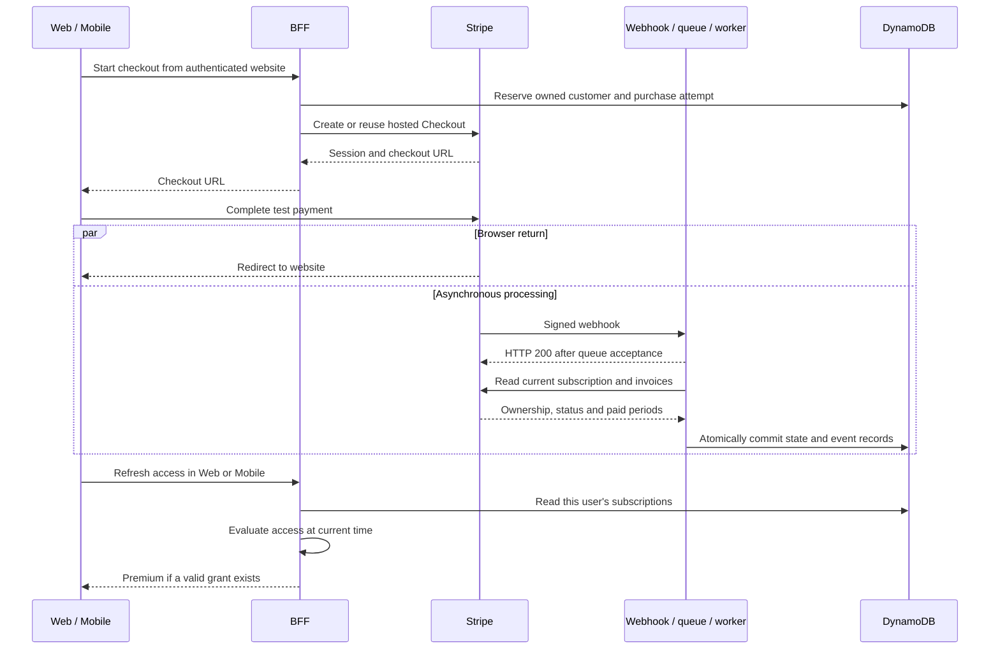
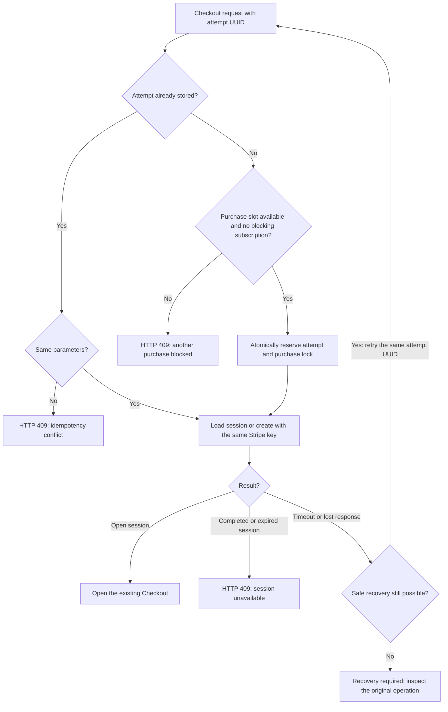
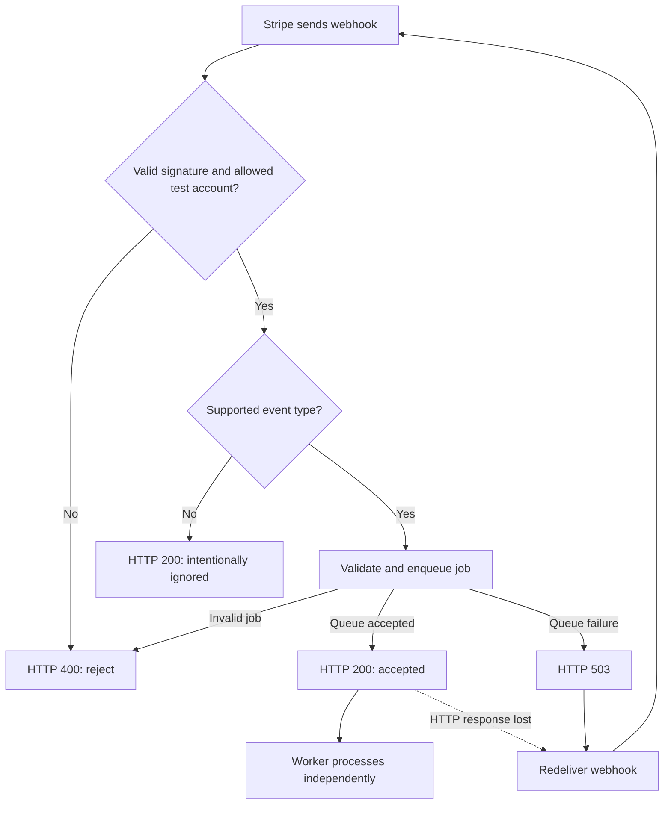
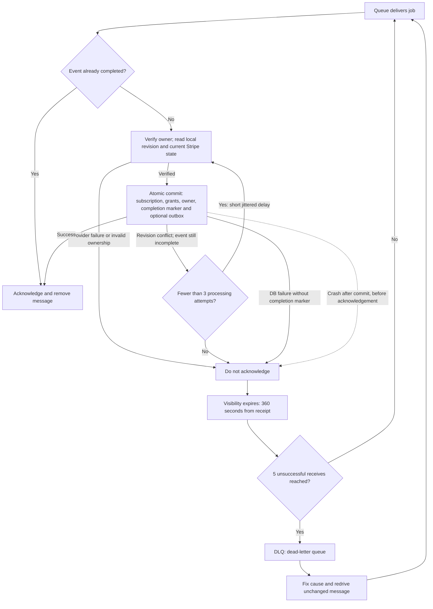

# Payments and subscriptions

**A payment becomes Premium only after backend verification.** Checkout redirects, client badges and scopes alone never grant access. Use synthetic accounts and Stripe test mode only.

[Flow](#payment-flow) · [Local setup](#local-startup) · [Checkout](#checkout-and-recovery) · [Processing](#processing-and-retries) · [Access](#access-policy) · [Manual checks](#manual-checks) · [AWS webhook](#register-the-cloud-webhook)

## Payment flow



Client refreshes run independently of the worker: a refresh before its commit can still return Free. The failure paths are split into [checkout recovery](#checkout-and-recovery), [webhook delivery](#webhook-delivery) and [worker retries](#worker-retries).

**Ownership:** Auth0 issuer/subject → internal user UUID → Stripe customer → subscription. Email is contact data, never an ownership key. See [database records](DYNAMODB_DATA_MODEL.md#stripe-customer-and-checkout-records) and [architecture](ARCHITECTURE.md) for details.

## Local startup

1. Create **PremiumPass Premium** in one Stripe test environment: **EUR 4.99/month**, flat-rate licensed usage, quantity one, no trial. Keep its `price_...` ID and `sk_test_...` key in ignored server configuration.
2. Configure the [Auth0 SPA](AUTH0_SETUP.md#7-configure-the-spa-for-p06) and a verified synthetic user shared with Mobile. Website origin: `http://localhost:5173`; scopes: `openid profile email read:me write:checkout`. Mobile also needs `read:premium`; sign in again after permission changes.
3. Copy the examples only when the corresponding `.env` does not exist; preserve existing settings:

   | Local file                                                                                   | Required configuration                                                                            |
   | -------------------------------------------------------------------------------------------- | ------------------------------------------------------------------------------------------------- |
   | [BFF](../services/bff/.env.example) → `services/bff/.env`                                    | Auth0, local DynamoDB, `WEB_ORIGIN=http://localhost:5173`, `STRIPE_SECRET_KEY`, `STRIPE_PRICE_ID` |
   | [Webhook](../services/stripe-webhook/.env.example) → `services/stripe-webhook/.env`          | Local `SUBSCRIPTION_QUEUE_URL`, `STRIPE_WEBHOOK_SECRET`                                           |
   | [Worker](../services/subscription-worker/.env.example) → `services/subscription-worker/.env` | Same database/key/price as BFF, same queue URL as webhook                                         |
   | [Web](../apps/web/.env.example) → `apps/web/.env`                                            | Public Auth0 SPA settings and `VITE_API_URL=http://127.0.0.1:3000`                                |

   Never put Stripe secrets in `VITE_` variables. Leaving both BFF Stripe settings unset disables checkout.

4. Start Docker Desktop. With the [Stripe CLI](https://docs.stripe.com/stripe-cli), select the same test environment:

   ```sh
   stripe login
   pnpm stripe:listen
   ```

   Copy the listener's secret into the webhook's `STRIPE_WEBHOOK_SECRET`; keep that terminal running. Never use `--live`.

5. In another terminal, run `pnpm dev` from the repository root. It starts DynamoDB, ElasticMQ, BFF (**3000**), webhook (**3002**), worker and website (**5173**). Restart after `.env` changes. Start [Mobile](../apps/mobile/README.md) separately.
6. Sign into Web and Mobile; compare their internal user IDs. Complete checkout with [Stripe test details](https://docs.stripe.com/testing), then refresh both clients.

No AWS credentials are needed locally. ElasticMQ messages disappear when its container stops; DynamoDB data persists. `Ctrl+C` stops app processes; `pnpm local:down` also stops Docker. [Installation and individual commands](../README.md#installation-and-local-startup).

## Checkout and recovery

`POST /v1/billing/stripe/checkout-session` requires a user access token with `write:checkout`, `openid`, `email`, JSON `{"planId":"premium_monthly"}` and a UUID `Idempotency-Key`. It returns `sessionId`, `url`, `expiresAt`.

Before the flow below, the BFF validates token, scopes, browser origin and input, then resolves the internal user. Auth0 `/userinfo` must return a matching subject and verified email; otherwise checkout fails, including `403 verified_email_required` for missing verification. Email is synchronized to the owned Stripe customer, never to DynamoDB or logs. Customer, price, quantity and return URLs are derived server-side.



| Recovery boundary                                       | Rule                                                                              |
| ------------------------------------------------------- | --------------------------------------------------------------------------------- |
| Existing subscription                                   | Only `canceled` / `incomplete_expired` are exempt from the subscription guard     |
| Return via Cancel                                       | Session stays open; retry the same attempt                                        |
| Session expires after one hour                          | Replacement requires Stripe-confirmed expiration                                  |
| Completed session, even after later cancellation        | Purchase lock remains; no automatic repurchase/unlock                             |
| Missing customer/session ID after an uncertain response | Recovery stops after 23 hours / 20 minutes; inspect the original Stripe operation |

Never delete mappings or reset locks to bypass recovery. Exact errors and checks: [checkout service](../services/bff/src/billing/checkout-service.ts).

## Processing and retries

Local development uses ElasticMQ; the AWS configuration uses SQS. Webhook redelivery and worker retries are independent: an accepted webhook can still have an unfinished job.

### Webhook delivery

The webhook verifies Stripe's signature against unchanged request bytes, without Auth0. Live mode and Connect events are rejected. The queue receives only validated references and trace metadata.



Registered endpoints follow [Stripe's delivery retry policy](https://docs.stripe.com/webhooks#automatic-retries). Local CLI forwarding may require a manual resend. Repeated delivery cannot repair a bad signature or invalid configuration; fix the cause first.

### Worker retries

The worker checks stored customer ownership against Stripe metadata, then reads aggregate revision → subscriptions → current Stripe state. Delayed webhook payloads never directly overwrite state. Payment verification requires the configured product/price and matching paid invoice lines; `active` or a nominal period end alone proves no payment. Metadata cannot create missing ownership mappings.



- **Commit semantics:** Grants include all providers. An outbox entry is added only for a domain change; an unchanged refresh updates verification metadata and aggregate revision. A lost commit response is also resolved by checking the completion marker before retrying. Jobs without a subscription are ignored and acknowledged.
- **Payment failure is a business state:** `invoice.payment_failed` follows normal processing and the [access policy](#access-policy); it is not itself a technical error requiring a queue retry.
- **AWS settings:** Retention 4 days / 14 days in DLQ; worker timeout 60 s, batch size 1, concurrency 2, partial failure reporting.
- **Demo limits:** At most 100 recent paid invoices; incomplete relevant history/truncated lines fail processing. No full discounts, out-of-band payments, prorations or complex billing changes. [Invoice checks](../services/subscription-worker/src/processing/stripe-source.ts).
- **Later work:** Pending outbox records have no TTL. Publication is [P08](TASKS.md#p08-outbox-publisher-and-eventbridge); scheduled missed-event repair is [P09](TASKS.md#p09-reconciliation-and-expiration). Premium access does not wait for outbox publication. Verification evidence and remaining local/live scenarios are tracked in [P06](TASKS.md#p06-stripe-purchase-and-reliable-processing).

## Access policy

The BFF verifies the user token/scope, loads that user's subscriptions and evaluates them against the current time. It never trusts the stored entitlement snapshot or a client badge. Only `premium_monthly` grants `score_history`.

| State                                                                  | Access                                                                     |
| ---------------------------------------------------------------------- | -------------------------------------------------------------------------- |
| `active`, `trialing`                                                   | Until verified `accessUntil`; checkout offers no trials                    |
| Active with period-end cancellation                                    | Same paid boundary                                                         |
| `past_due`                                                             | Existing paid access plus stored grace; Apple uses its verified grace boundary, other providers cap grace at `accessUntil + 24 hours` |
| Initial failure, `pending`, `paused`, `canceled`, `expired`, `revoked` | None                                                                       |
| Unknown product/status                                                 | None; return a mapping warning                                             |
| Provider outage                                                        | Existing limits still apply; no extension                                  |

- Boundaries are exclusive: `now < validUntil`. No prior paid boundary means no grace; retries cannot extend it.
- Combine all valid grants: ending one provider never removes another's access.
- `effectiveUntil` means the **next reevaluation boundary**, not necessarily the end of all Premium access. `verifiedAt` records the last successful verification, not current provider health.
- Stripe `incomplete` → `pending`; `incomplete_expired` / `unpaid` → `expired`. Apple sandbox maps verified numeric store statuses; the remaining Apple/Google demo records use mock conventions. See [Apple purchases](APPLE_PURCHASES.md). [Domain rules](../packages/domain/src/subscriptions.ts).

| Endpoint                        | Requirement                  | Result                                              |
| ------------------------------- | ---------------------------- | --------------------------------------------------- |
| `GET /v1/me/subscriptions`      | `read:me`                    | Provider states, boundaries and source revisions    |
| `GET /v1/me/entitlements`       | `read:me`                    | Tier, features, grants, next boundary and warnings  |
| `GET /v1/premium/score-history` | `read:premium` + valid grant | Synthetic history; otherwise `403 premium_required` |

Invalid tokens return `401`, missing scopes `403`; database/schema failures return `500` without access. Responses use `Cache-Control: no-store`.

## Manual checks

Use mapped synthetic users. Unrelated `stripe trigger` fixtures normally lack ownership and cannot activate them.

| Action                                                   | Expected result                                                                     |
| -------------------------------------------------------- | ----------------------------------------------------------------------------------- |
| Complete checkout; compare Web/Mobile                    | Same user becomes Premium after processing                                          |
| Retry/cancel checkout; try a competing tab               | Same session resumes; competing purchase is blocked                                 |
| Repeat an event; deliver an older event                  | No duplicate change; current Stripe state wins                                      |
| Exercise paid/failed renewal and both cancellation modes | Access follows the policy above                                                     |
| Stop worker; separately stop queue                       | Jobs wait; queue outage returns `503`. Resend lost events after local queue restart |
| Fail a job until DLQ, fix cause, redrive                 | Successful processing without duplicate grants                                      |

For access-only demos, use a profile from **DynamoDB Local**, without other active grants when checking expiration:

```sh
pnpm demo:subscription <internal-user-id> active
pnpm demo:subscription <internal-user-id> expiring
pnpm demo:subscription <internal-user-id> multiple
pnpm demo:subscription <internal-user-id> free
```

Refresh after each command. `expiring` lasts 30 seconds: history must then return `403` without another event. `multiple` preserves a Google demo grant when Stripe ends. `free` removes only the two demo records; real Stripe grants remain. More scenarios: [demo script](../services/subscription-worker/scripts/seed-subscription.ts).

**Inspect:** Match `correlationId` / `providerEventId` across `webhook.queued`, `subscription.processed` and failure logs. Check `SUB`, `ENTITLEMENTS`, `PROCESSED`, `OUTBOX` in [DynamoDB Admin](http://127.0.0.1:8001). Local queue counts:

```sh
AWS_ACCESS_KEY_ID=local AWS_SECRET_ACCESS_KEY=local aws \
  --endpoint-url http://127.0.0.1:9324 --region us-east-1 \
  sqs get-queue-attributes \
  --queue-url http://127.0.0.1:9324/000000000000/premiumpass-subscriptions \
  --attribute-names All
```

For DLQ counts, append `-dlq` to the queue name. **Local redrive:** Fix cause → receive → send unchanged body to work queue → delete DLQ copy only after successful send. Preserve the event ID; never purge to hide failures.

## Register the cloud webhook

For a separately authorized AWS setup. `pnpm synth` only generates the template; cloud checkout wiring remains outstanding. Local and AWS ownership records are independent.

1. In the selected account/region, create a Secrets Manager JSON secret using the default encryption key: `secretKey` (test key), `priceId`, `webhookSecret`. If the endpoint does not exist yet, use `PENDING_ENDPOINT_REGISTRATION` for the signing secret; requests fail until replaced. Keep purchases stopped during setup.
2. Put its ARN in `STRIPE_SECRET_ARN` in ignored `infra/.env`. Follow the [deployment guide](../infra/README.md#development-deployment-scripts); use the exact `StripeWebhookUrl` output, without an added stage or slash.
3. In Stripe **Workbench → Webhooks**, create a destination: **Your account**, **Snapshot**, API version `2026-09-30.endive`, webhook endpoint = that URL. Select the six [supported events](../packages/billing-contracts/src/index.ts):

   ```text
   checkout.session.completed
   customer.subscription.created
   customer.subscription.updated
   customer.subscription.deleted
   invoice.paid
   invoice.payment_failed
   ```

4. Replace only `webhookSecret` with the destination's `whsec_...`. This differs from the local CLI secret. No redeployment needed; valid credentials are cached for up to five minutes.
5. Retry a supported delivery: `200` + `webhook.queued` proves acceptance. Separately verify worker logs and AWS records; the purchase must belong to a customer mapped in that AWS table.

Deployment and verification evidence belong only in [P06](TASKS.md#p06-stripe-purchase-and-reliable-processing). [Infrastructure details](../infra/README.md#local-queue-and-stripe-processing-resources).
