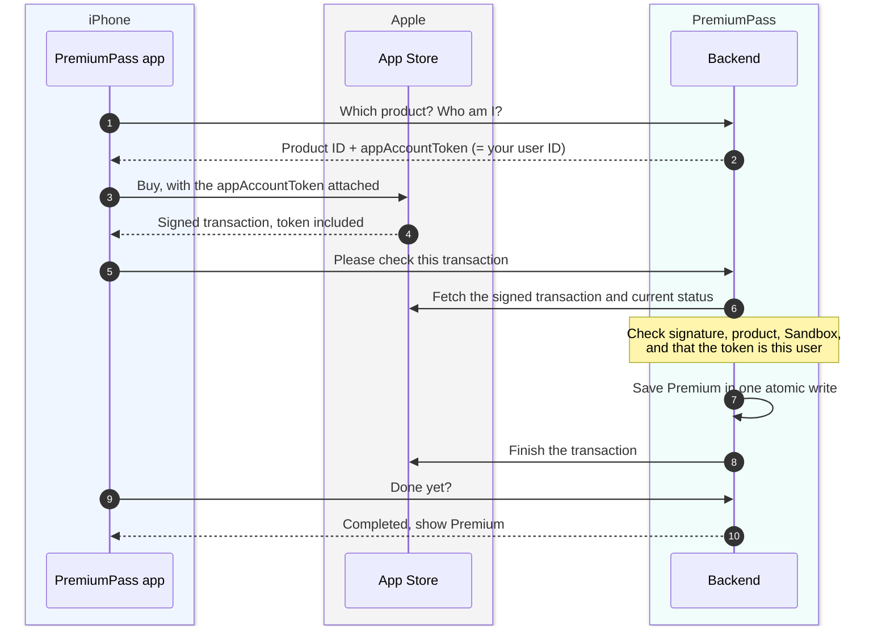
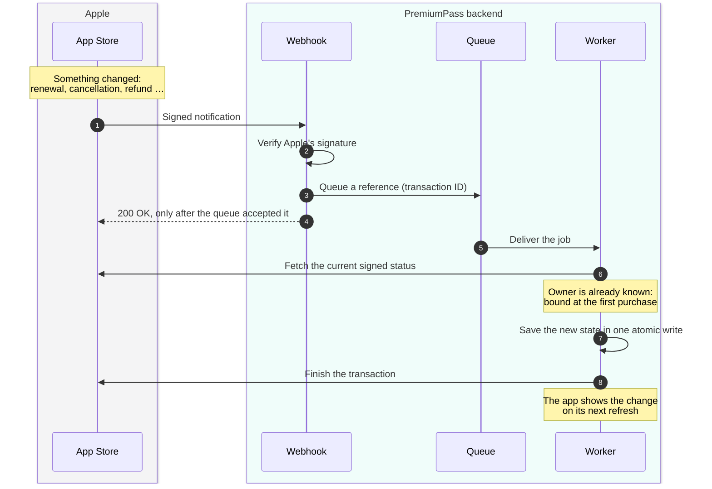
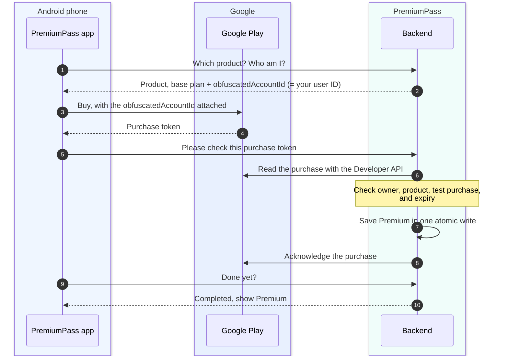
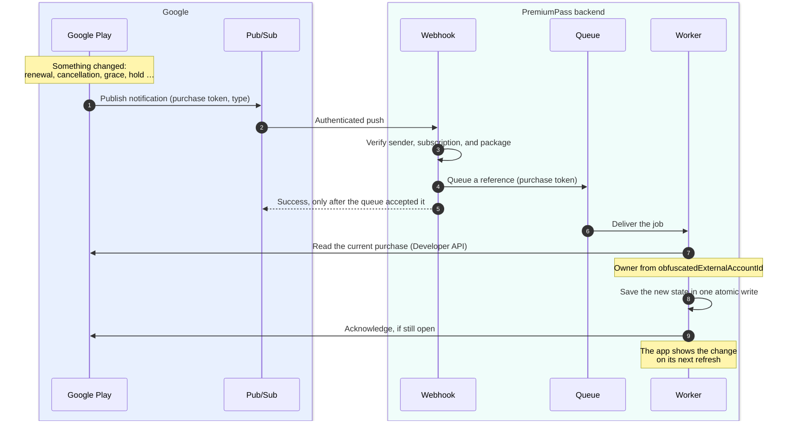

# Store purchases

How a purchase in the iPhone or Android app reaches the right user, and how later
changes arrive without the app. The setup steps are in
[Apple + iOS app](setup/apple.md) and [Google + Android app](setup/google.md);
the Stripe flow and the shared access rules are in [Payments](PAYMENTS.md).

## Purchase ownership

Every purchase must reach the internal user who made it, whatever store sold it.
Each provider carries our user ID differently, and each expects something
different once the backend has committed the purchase:

| Question                                   | Stripe                                 | Apple                                           | Google Play                                    |
| ------------------------------------------ | -------------------------------------- | ----------------------------------------------- | ---------------------------------------------- |
| How does the purchase carry our user ID?   | Stripe customer created by our backend | `appAccountToken` inside the signed transaction | `obfuscatedAccountId` in Google's API response |
| Who tells the backend about the purchase?  | Signed webhook                         | App sync **and** App Store notifications        | App sync **and** Pub/Sub notifications         |
| What must the backend do after the commit? | Nothing                                | Finish the transaction                          | Acknowledge within about three minutes         |

Where in the code:

- [`services/api/src/routes/apple.ts`](../services/api/src/routes/apple.ts) and
  [`routes/google.ts`](../services/api/src/routes/google.ts): the config each app requests.
- [`use-apple-purchase.ts`](../apps/mobile/src/features/subscriptions/apple/use-apple-purchase.ts) and
  [`use-google-purchase.ts`](../apps/mobile/src/features/subscriptions/google/use-google-purchase.ts): the app side.
- [`apple/processor.ts`](../packages/subscription-processing/src/providers/apple/processor.ts) and
  [`google/processor.ts`](../packages/subscription-processing/src/providers/google/processor.ts): the worker side.

The app never finishes or acknowledges a purchase itself. If it did and the
backend then failed, the store would consider the purchase done while access
was never granted; Google would even refund an unacknowledged purchase. The
backend commits first and completes second, with a durable marker for retries.

The app does compare the account token before syncing, but only to give early,
friendly feedback; a modified app could skip that. The real check runs in the
backend with the signed data from Apple or Google, so a restore on the wrong
account is rejected there. The [Apple device checks](setup/apple.md#manual-device-checks)
and the [Google Play integration run](setup/google.md#ready-for-the-first-integration-run)
include that case.

## Apple: how a purchase works

Three parties take part: the **app** shows Apple's purchase sheet, the **App
Store** takes the payment, and the **backend** decides about Premium.

| Who     | Does                                                                    | Never does                                   |
| ------- | ----------------------------------------------------------------------- | -------------------------------------------- |
| App     | Fetch config, open the purchase sheet, send the transaction ID, wait    | Grant Premium or finish the transaction      |
| Backend | Verify with Apple, check the owner, save access, finish the transaction | Trust what the app says without asking Apple |

**What is the `appAccountToken` for?** Apple lets an app attach one UUID to a
purchase, and signs it into the transaction. We use the internal user ID. That
way the backend can prove which PremiumPass account bought the subscription,
even when the purchase arrives later through a notification or a restore. If
the token belongs to a different user, the purchase is rejected.

**How is a transaction completed?** StoreKit keeps every transaction
_unfinished_ until someone finishes it, and delivers unfinished ones again on
the next app start. Here only the backend finishes it, and only after Premium is
saved (step 8, Apple's Finish Transaction API). If anything fails before that,
Apple simply delivers the transaction again; nothing is lost and nothing is
granted twice.

## Apple: how later changes arrive

After the purchase, the app is no longer needed. Renewals, cancellations,
refunds, and billing problems reach the backend as **App Store Server
Notifications**: Apple calls the webhook directly.

- **Only a reference is queued.** Notifications can arrive late, twice, or out
  of order. The worker always asks Apple for the _current_ state, so an old
  notification can never overwrite newer data.
- **200 only after the queue accepted it.** If queuing fails, the webhook
  answers 503 and Apple sends the notification again later.
- **Duplicates are harmless.** A completion marker per notification makes a
  second delivery a no-op.
- **Lost notifications are repaired.** Every five minutes, reconciliation asks
  Apple again about known purchases and queues the same kind of job
  ([Reconciliation](RECONCILIATION.md)).
- `TEST` notifications from App Store Connect are acknowledged without any job.

## Apple: processing and ownership

- **Verification:** Sandbox environment, bundle, product, signed state, and
  `appAccountToken` (our internal user ID).
- **Ownership:** `Sandbox:<originalTransactionId>` is bound to one internal user
  forever; restoring with another Auth0 identity cannot transfer it.
- **One transaction:** ownership, subscription, all-provider entitlements,
  processing marker, and any outbox change commit together. The marker stores the
  exact verified `finishTransactionId`.
- **Concurrency:** conflicts reload current state; duplicates never extend access.

| Interruption                                     | Recovery                                                          |
| ------------------------------------------------ | ----------------------------------------------------------------- |
| Before database commit                           | Retry verification and commit; no Apple finish yet                |
| After commit, before/during Apple finish         | Retry only the stored finish target; do not rewrite grants/outbox |
| Apple finished, but saving `finishedAt` failed   | Repeat the same Apple finish, then record success                 |
| After `finishedAt`, before queue acknowledgement | A duplicate skips both domain writes and Apple finish             |

- Access starts with the commit; API polling stays `pending` until `finishedAt`
  is saved. A finish failure never rolls back or extends access.
- Repeated failures reach the DLQ: fix the cause, then redrive the original message.
- Local ElasticMQ messages are lost on restart. After a queue reset, restore
  purchases to enqueue a new sync. Old demo markers without a finish target also
  need a new sync/Restore.
- Apple grace follows its signed boundary. Turning off renewal keeps access until
  the verified expiry; expiry or revocation removes only the Apple grant.
  [Access policy](PAYMENTS.md#access-policy) · [Apple records](DYNAMODB_DATA_MODEL.md#apple-sandbox-records).

## Google Play: how a purchase works

Three parties take part: the **app** shows Google Play's purchase sheet,
**Google Play** takes the payment, and the **backend** decides about Premium.

| Who     | Does                                                                 | Never does                                    |
| ------- | -------------------------------------------------------------------- | --------------------------------------------- |
| App     | Fetch config, open the purchase sheet, send the purchase token, wait | Grant Premium or acknowledge the purchase     |
| Backend | Verify with Google, check the owner, save access, acknowledge        | Trust what the app says without asking Google |

**What is the `obfuscatedAccountId` for?** It is Google's equivalent of Apple's
`appAccountToken`: the app attaches our internal user ID to the purchase, and
Google returns it as `obfuscatedExternalAccountId` when the backend reads the
purchase. That proves which PremiumPass account bought the subscription, also
for a restore or a notification that arrives later. A different ID means the
purchase is rejected.

**How is a purchase completed?** Google requires every new purchase to be
_acknowledged_; otherwise it refunds the purchase automatically (after about
three minutes for license testers, three days in production). Here only the
backend acknowledges, and only after Premium is saved (step 8). If anything
fails before that, a retry or Restore picks the purchase up again, and the
saved completion marker prevents a second grant.

## Google Play: how later changes arrive

After the purchase, the app is no longer needed. Renewals, cancellations, grace
periods, and account holds reach the backend as **Real-time developer
notifications (RTDN)**. Google does not call the backend directly: it publishes
to a **Pub/Sub** topic, and Pub/Sub pushes each message to the webhook.

- **Only a reference is queued.** The notification says _that_ something
  changed, not the full state. The worker always reads the current purchase from
  Google, so a late or repeated message cannot apply stale data.
- **Success only after the queue accepted it.** If queuing fails, the webhook
  answers 503 and Pub/Sub delivers the message again.
- **Duplicates are harmless.** The job ID comes from the Pub/Sub message ID, and
  a completion marker makes a second delivery a no-op.
- **Lost notifications are repaired.** Every five minutes, reconciliation asks
  Google again about known purchase tokens ([Reconciliation](RECONCILIATION.md)).
- Test messages from Play Console are acknowledged without any job.

## Google Play: purchase details

The overview is in [How a purchase works](#google-play-how-a-purchase-works). Locally the
app calls `GET /v1/billing/google/config`, then `POST /v1/billing/google/sync`
with the token, and polls `/sync/:operationId`; the API only queues the job, and
the subscription worker does the Google calls.

- The `obfuscatedAccountId` is our internal user ID. Only Google's API response
  proves ownership, never the app's claim.
- The app never acknowledges purchases. The worker acknowledges after the
  commit; a retry resumes acknowledgement without repeating the domain write.
- Restore and foreground recovery use the same sync path. **Manage** opens
  Google Play; changes refresh when the app returns.
- Grace uses Google's verified expiry; account hold, pause, and expiry grant no
  Google access. Public IDs contain only a token hash; the raw token stays in the
  private provider record and the queue. [Google records](DYNAMODB_DATA_MODEL.md#google-play-records).
- Not supported: plan replacements (`linkedPurchaseToken`), offers or trials,
  more base plans, and production purchases.
