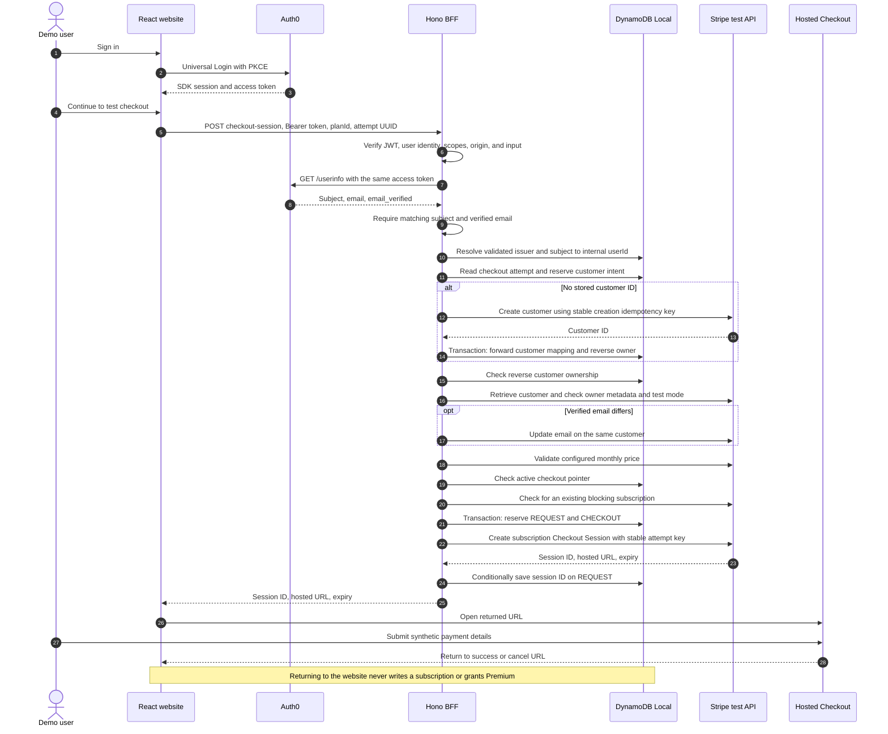
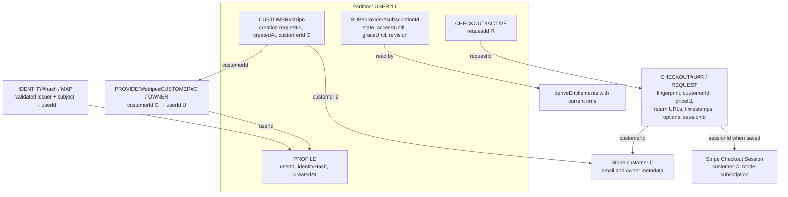
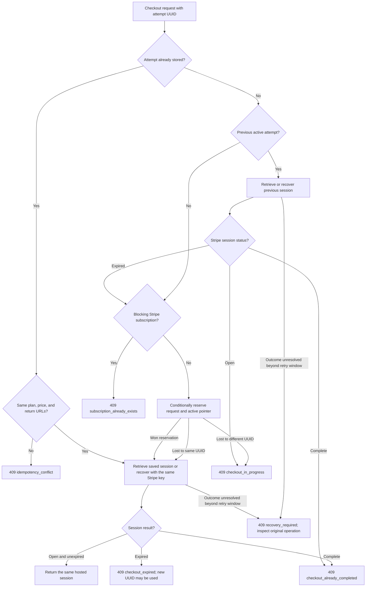
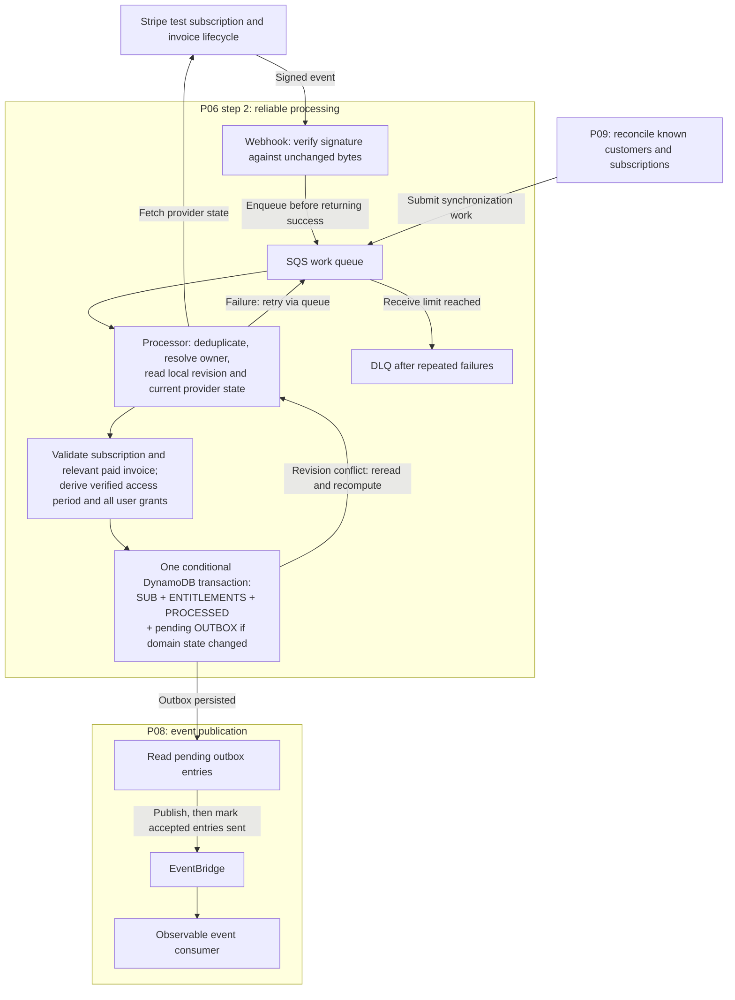
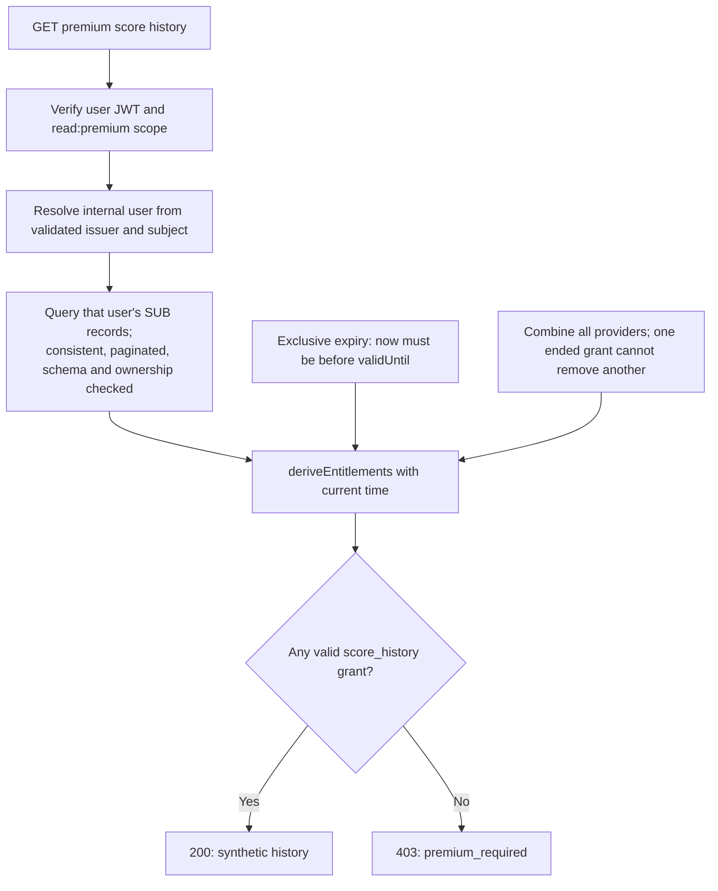

# Stripe, checkout, and subscription flow

This walkthrough connects the checkout code, DynamoDB records, and entitlement rules. The diagrams describe the local implementation and the planned asynchronous processing separately. Implementation status and verification evidence remain in [P06](TASKS.md#p06-stripe-purchase-and-reliable-processing).

For credentials and startup, use [Stripe setup](STRIPE_SETUP.md). For exact stored fields, use the [DynamoDB data model](DYNAMODB_DATA_MODEL.md).

## 1. Different objects, different responsibilities

| Object                  | Meaning                                                                            | Where it lives                                                      |
| ----------------------- | ---------------------------------------------------------------------------------- | ------------------------------------------------------------------- |
| Auth0 identity          | The validated issuer and subject identify the signed-in person                     | Auth0; mapped in DynamoDB                                           |
| Internal user           | Stable PremiumPass UUID used for ownership                                         | DynamoDB `PROFILE` and identity mapping                             |
| Stripe customer         | Billing contact linked to one internal user; includes the verified email           | Stripe `cus_...`; ownership references in DynamoDB                  |
| Checkout attempt        | One application request, retained across retries                                   | DynamoDB `REQUEST`; UUID in browser session storage                 |
| Checkout Session        | Hosted purchase page with an open, complete, or expired state                      | Stripe `cs_test_...`; its ID is saved on the attempt                |
| Stripe subscription     | Recurring billing contract and provider lifecycle                                  | Stripe `sub_...`                                                    |
| Normalized subscription | PremiumPass representation of a provider's subscription and verified access period | DynamoDB `SUB#...`                                                  |
| Entitlement             | A feature granted by any currently valid subscription                              | Currently calculated on API reads; a persisted aggregate is planned |

A complete Checkout Session does not itself establish Premium access. Payment/subscription verification and a write to the application's subscription model must connect those two parts.

## 2. Checkout sequence — implemented locally

This is the successful first-purchase path. The BFF receives only `planId` and an idempotency key from the browser. It derives identity, email, customer, price, and return URLs on the server.

The email is retrieved through the fixed configured Auth0 issuer, not from browser form data or an unverified token decode. Missing verification stops checkout before Stripe is called. It is sent to the owned Stripe customer but is not stored in DynamoDB. Customer creation and the email update are separate so an older creation request can still be retried with identical parameters.

For an existing attempt, the service reuses its persisted parameters and retrieves or recovers its session. It does not repeat the new-attempt reservation shown above. See [retry rules](#4-retries-and-concurrent-purchases).

## 3. DynamoDB relationships — implemented records

DynamoDB has no foreign-key joins here. The arrows describe references checked by application code. `U` means the internal user UUID, `C` the Stripe customer ID, and `R` the browser's checkout-attempt UUID. The customer-creation request has its own separate UUID.

The `SUB#...` shape and read path already exist. The P05 local scenario command writes only its reserved Apple/Google demo records; checkout does not yet write a Stripe `SUB#stripe#sub_...` item.

| Operation                 | Atomic boundary                             | Why it matters                                                 |
| ------------------------- | ------------------------------------------- | -------------------------------------------------------------- |
| Resolve a new user        | Identity mapping + profile transaction      | Concurrent first requests converge on one internal user        |
| Reserve customer creation | Conditional customer-intent put             | Retries share one creation request UUID                        |
| Save the Stripe customer  | Forward mapping + reverse owner transaction | A customer cannot silently move to another user                |
| Reserve checkout          | Request item + active pointer transaction   | Two different attempts cannot both become the current purchase |
| Save session ID           | Conditional request update                  | The fingerprint and any existing session reference must agree  |

These transactions cover DynamoDB only. Stripe creation happens outside them. Persisting the intent before the provider call and reusing Stripe idempotency keys closes the common retry window without pretending there is a transaction spanning both services.

Neither Stripe's hosted URL nor email is stored on the request. The BFF retrieves the URL from Stripe when needed. The customer mapping contains no payment state; the active pointer is a purchase lock, not an entitlement.

## 4. Retries and concurrent purchases

The following decision diagram describes purchase attempts after authentication, verified-email lookup, and customer ownership checks. An Auth0 or Stripe outage stops progress; it does not bypass the checks.

The code also validates the configured price before reserving a new attempt. If another call reserves the same UUID between reads, it reloads that attempt. DynamoDB transient failures can return 500; retry with the same UUID.

- **Cancel is not expiration.** Returning via Cancel leaves the session open. The same attempt can resume it; a different attempt remains blocked.
- **Sessions expire after one hour.** A replacement requires Stripe to report the previous session as expired, not just the local clock to pass its timestamp.
- **Unknown outcomes are conservative.** Customer creation without a saved ID stops automatic recovery after 23 hours. Checkout creation without a saved session ID stops after 20 minutes to preserve the fixed expiry's validity. A known session ID can still be retrieved afterward.
- **Completion retains the lock in this slice.** There is no lifecycle-driven unlock or repair command yet, even if the subscription is later canceled. Do not delete mapping/lock records to bypass this behavior.
- **Existing subscriptions block another purchase.** Only `canceled` and `incomplete_expired` are excluded from this check.

Full errors and recovery guidance are in [Stripe setup](STRIPE_SETUP.md#retries-and-recovery).

## 5. From Stripe subscription to local access — planned processing

The following diagram is the target from the [project plan](../PROJECT_PLAN.md#11-events-and-reliable-processing). The webhook, queue, processor transaction, outbox publisher, and reconciliation path are not part of the current checkout implementation. Their task boundaries are shown explicitly.

The planned worker resolves the stored customer owner and validates the provider references before writing access. A webhook is a trigger to fetch current provider state, not a command to blindly apply an old payload. Neither a success redirect nor `checkout.session.completed` alone is enough to grant Premium.

The completion marker is committed with the resulting state. A failure before commit leaves work retryable; duplicate completed events can be recognized. A condition on the previous user aggregate revision prevents one provider's update from overwriting another provider's grant. Conflicts require rereading both provider state and local data before recomputing.

The outbox prevents the crash window between saving access and publishing its change. Publication is separate from access: a delayed EventBridge consumer must not block Premium reads. A crash after publication may publish twice, so the event keeps a stable domain event ID. Reconciliation submits work through the same processing path to repair missed notifications; it does not implement a second entitlement policy.

## 6. How the API decides Premium access — implemented read path

The current API derives entitlements directly from stored `SUB#...` records. It does not read a materialized `ENTITLEMENTS` item, call Stripe on every request, or use checkout status. The future transaction above must preserve these time and multi-provider rules.

For the entitlement endpoint, the same calculation returns a Free/Premium tier and grants using `read:me`. A malformed database record fails closed with 500. The status-to-access policy is described fully in [Subscriptions](SUBSCRIPTIONS.md#access-policy).

A synthetic lifecycle example shows the separation:

| Event or condition                                                  | Stripe/provider state                  | Application access rule                                                                                        |
| ------------------------------------------------------------------- | -------------------------------------- | -------------------------------------------------------------------------------------------------------------- |
| Checkout opened or payment incomplete                               | Pending purchase                       | No grant from checkout                                                                                         |
| Matching subscription and paid period verified by the future worker | Active with verified `accessUntil`     | Premium while `now < accessUntil`                                                                              |
| Cancellation scheduled for period end                               | Still active, `cancelAtPeriodEnd=true` | Keep access to the same verified boundary                                                                      |
| Renewal payment fails                                               | Past due                               | Prior access plus a fixed stored grace, capped at 24 hours after prior access; no grace for an initial failure |
| Boundary passes with no new event                                   | Row can remain in DynamoDB             | Next API evaluation removes that expired grant                                                                 |
| One provider is revoked while another is valid                      | Multiple subscriptions                 | Preserve the other provider's grant                                                                            |

`effectiveUntil` is the earliest boundary at which the current response needs reevaluation. It is not necessarily the time all Premium access ends. DynamoDB TTL is not an access-control clock.

## 7. Follow the code

| Concern                                          | Source                                                                     |
| ------------------------------------------------ | -------------------------------------------------------------------------- |
| Protected checkout route and input validation    | [app.ts](../services/bff/src/app.ts)                                       |
| Verified email and UserInfo subject check        | [auth0-email.ts](../services/bff/src/billing/auth0-email.ts)               |
| Customer, attempt, and retry orchestration       | [checkout-service.ts](../services/bff/src/billing/checkout-service.ts)     |
| Stripe customer/email/session calls              | [stripe-provider.ts](../services/bff/src/billing/stripe-provider.ts)       |
| Conditional records and transactions             | [dynamodb-billing.ts](../services/bff/src/billing/dynamodb-billing.ts)     |
| Persisted field schemas and provider/store ports | [contracts.ts](../services/bff/src/billing/contracts.ts)                   |
| Subscription reads                               | [dynamodb-subscriptions.ts](../services/bff/src/dynamodb-subscriptions.ts) |
| Pure entitlement calculation                     | [domain/subscriptions.ts](../services/bff/src/domain/subscriptions.ts)     |
| Browser attempt UUID and redirects               | [use-checkout.ts](../apps/web/src/hooks/use-checkout.ts)                   |

For the first hands-on pass, follow sections 2 and 3 while inspecting only your synthetic user's rows in DynamoDB Admin. Then run the [P05 subscription scenarios](SUBSCRIPTIONS.md#local-manual-walkthrough) to observe section 6. Connecting an actual Stripe purchase to those rows is the processing work in section 5.
