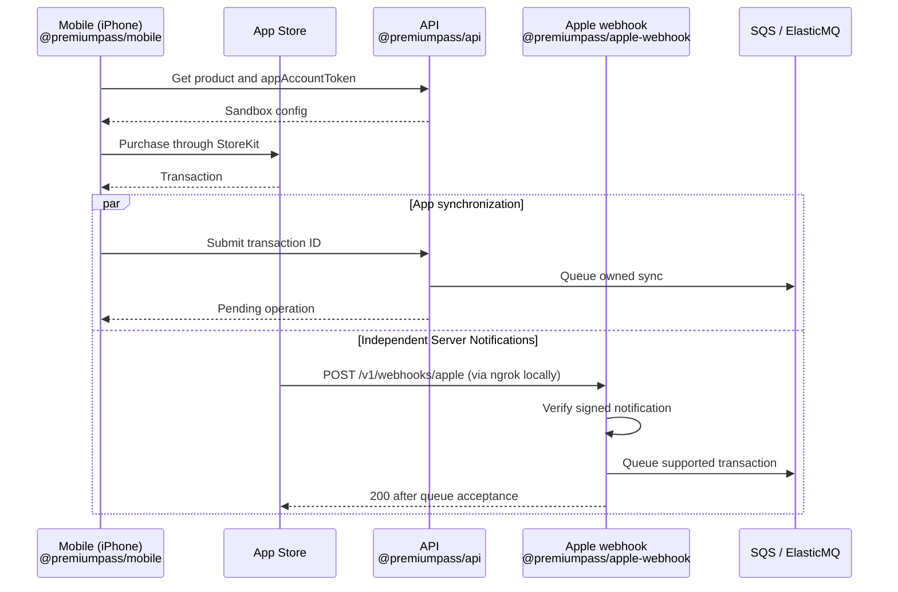
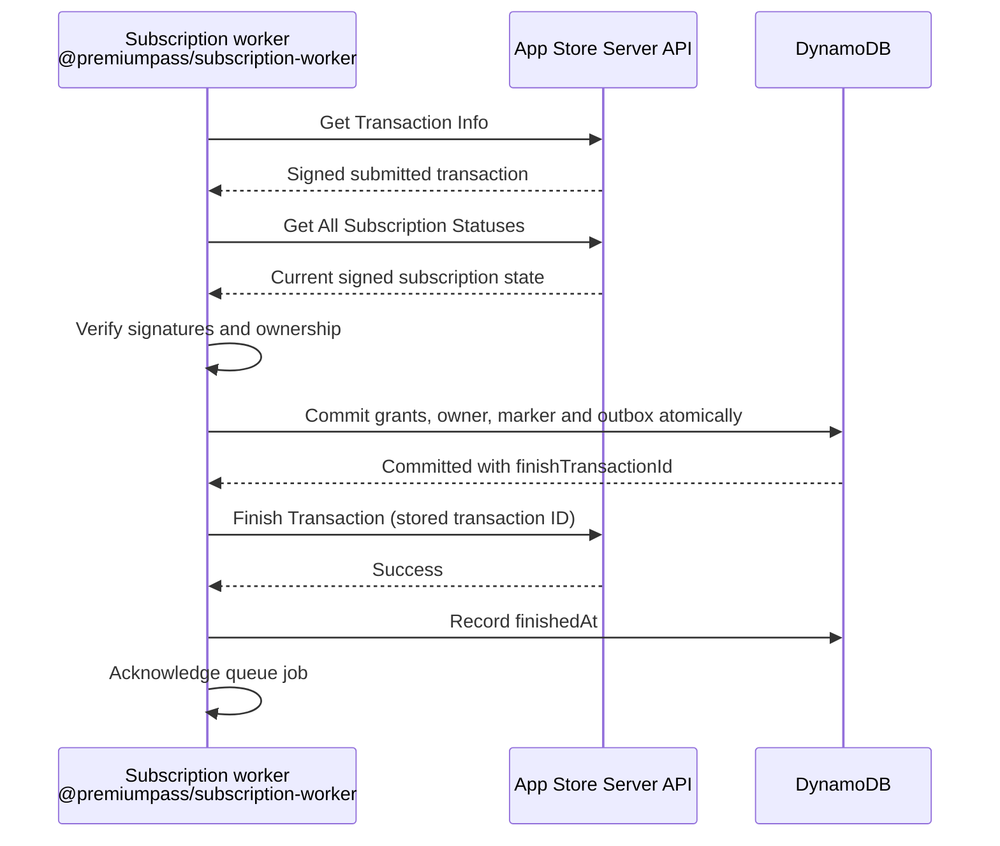
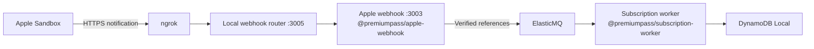

# Apple + iOS app

Run the iOS development app, then add real Sandbox purchases. **Afterwards:**
the app signs in on the Simulator or an iPhone and shows the same access as the
website; with the purchase steps, a Sandbox purchase on the iPhone grants
Premium. Requires the local setup up to [Stripe](stripe.md).

| Part              | Sections                                                                                                       | You need                                                                                  |
| ----------------- | -------------------------------------------------------------------------------------------------------------- | ----------------------------------------------------------------------------------------- |
| App               | [Configure the app](#configure-the-app) to [App checks](#app-checks)                                           | macOS with Xcode, an iOS Simulator, CocoaPods; the Auth0 Native application               |
| Sandbox purchases | [Prepare your Apple resources](#prepare-your-apple-resources) to [Manual device checks](#manual-device-checks) | Apple Developer Program membership, a physical iPhone, a Sandbox Apple Account, and ngrok |

How purchases reach the right user: [Store purchases](../STORE_PURCHASES.md).
How the app is built: [mobile package guide](../../apps/mobile/README.md).
For Android, follow [Google + Android app](google.md).

## Configure the app

You need macOS, Xcode with an iOS Simulator, CocoaPods, and the repository's pinned
toolchain. Follow [Expo's Xcode/Simulator setup](https://docs.expo.dev/workflow/ios-simulator/)
and [install CocoaPods](https://guides.cocoapods.org/using/getting-started.html).
Open Xcode once to finish installation, install an iOS Simulator runtime, and
select Xcode under Settings → Locations → Command Line Tools. Check
`xcodebuild -version` and `pod --version` before building.
Expo Go cannot run the native Auth0/IAP modules; no EAS account is needed.
Create the [Auth0 Native application](auth0.md#add-the-native-application),
then set these in `config/.env` ([setup](workspace.md#2-create-the-configuration)).
`pnpm config:sync` writes `apps/mobile/.env`; the mobile scripts sync first.

| Setting in `config/.env` | The app receives it as        | Your value                                                |
| ------------------------ | ----------------------------- | --------------------------------------------------------- |
| `AUTH0_DOMAIN`           | `EXPO_PUBLIC_AUTH0_DOMAIN`    | Shared with Web and API, without scheme or trailing slash |
| `MOBILE_AUTH0_CLIENT_ID` | `EXPO_PUBLIC_AUTH0_CLIENT_ID` | Native application's Client ID                            |
| `AUTH0_AUDIENCE`         | `EXPO_PUBLIC_AUTH0_AUDIENCE`  | Shared Custom API identifier                              |
| `MOBILE_API_URL`         | `EXPO_PUBLIC_API_URL`         | `http://127.0.0.1:3000` for Simulator                     |
| `APPLE_BUNDLE_ID`        | `IOS_BUNDLE_IDENTIFIER`       | Your signing bundle ID; default `com.example.premiumpass` |

These are public values embedded in the app. Keep secrets out. Match the bundle
ID and Auth0 callback before prebuild. The app uses PKCE and SDK secure storage;
no refresh token is requested. Sign in again when credentials cannot be renewed.

## Run on the iOS Simulator

Keep the configured backend running with `pnpm dev`. For API-only work, use
`pnpm local:up` and `pnpm dev:api` instead. In a separate terminal:

```sh
pnpm mobile:ios
```

This builds/installs the development app and starts Metro. Later JavaScript work
only needs `pnpm dev:mobile`; press `i` to open the installed iOS app. Rebuild after
native dependency, Auth0 domain, scheme, or bundle changes. Edit `apps/mobile/app.config.ts`,
not generated native settings, for persistent configuration.

**Check:** sign in, open Account and Developer tools, and compare the internal
user ID with Web. Simulator can reach the Mac's loopback address.

## Run on a physical iPhone

1. Connect and trust the device; enable iOS Developer Mode. Use the same trusted
   Wi-Fi network. Set your registered bundle ID in `.env` and use your own Xcode
   signing team. For Apple Sandbox, prepare the Apple resources first.
2. Stop an older loopback API and run the full stack with LAN access:

   ```sh
   HOST=0.0.0.0 pnpm dev
   ```

3. In the mobile terminal, set the Mac's private IPv4 address or `.local` hostname:

   ```sh
   export EXPO_PUBLIC_API_URL=http://your-mac.local:3000
   ```

   Replace `your-mac` with `scutil --get LocalHostName` output and append `.local`.
   Open this URL plus `/health` in iPhone Safari and expect `{"status":"ok"}`.
   `localhost` on the phone refers to the phone, not the Mac.

4. Apply native configuration and select the connected device:

   ```sh
   pnpm --filter @premiumpass/mobile run prebuild:ios
   cd apps/mobile/ios
   pod install
   cd ../../..
   pnpm mobile:ios --device
   ```

   If signing is required, open `apps/mobile/ios/PremiumPass.xcworkspace` in Xcode,
   add your Apple account in Settings → Accounts, then select the app target and
   your team under Signing & Capabilities with automatic signing enabled. Retry.
   The prebuild script uses `--no-clean` to preserve existing signing settings.
   Allow Local Network access
   on the device. Stop an older localhost-only Metro process first.

5. For later runs, use `pnpm dev:mobile:lan` in the terminal with the API override.
   Alternatively save the LAN URL as `MOBILE_API_URL` in `config/.env`; an
   exported value lasts only for that shell. The API address does not change the Auth0 callback URL.

## App checks

- Sign in as A, refresh/restart, and confirm stable identity; sign in as B and
  confirm separate records. Sign-out hides account data; failures stay visible.
- Start a refresh and sign out before it completes; sign in as B and confirm no
  cached data from A appears. Cancel logout and confirm A's data reloads.
- Background/foreground the app and disconnect/reconnect networking; verify
  subscription refresh, bounded retries, and an explicit offline message on an
  uncached load. Dashboard refresh must also refresh an already visible history.
- Free shows no fabricated score history. Premium loads protected scores.
  Expiry/refresh hides stale data; network failures show retry instead of Free.
- Let Premium expire while offline; cached Premium/history must disappear. After
  reconnecting or a verified Sandbox purchase, confirm access/history reload.
- Billing shows active grants as access sources; Subscription history includes
  previous records. Switch tabs and expand history rows, including on a narrow device.
- Developer tools start collapsed. Session details clear on background/sign-out;
  raw tokens are revealed only on demand and must not appear in logs/screenshots.
- Open Account → **This device** on iOS and Android: the bundle ID or package
  name must equal `IOS_BUNDLE_IDENTIFIER` / `ANDROID_PACKAGE_NAME`, the OS and
  model must match the phone, and no row may show `unknown`.
- Break one setting on purpose (a wrong `EXPO_PUBLIC_API_URL`, a stopped API, an
  unknown Google product ID) and confirm that the screen names the cause in its
  **Details** line instead of a generic retry message.
- Follow [payment scenarios](../PAYMENTS.md#manual-checks) and the separate
  [Apple device checks](#manual-device-checks).

`pnpm check` exports iOS and Android JavaScript; it does not prove native build, rendering,
or device purchases. Record those results separately in [TASKS](../TASKS.md).

## Prepare your Apple resources

| Step | Create or configure                                                                     | Keep for configuration                                             |
| ---- | --------------------------------------------------------------------------------------- | ------------------------------------------------------------------ |
| 1    | Explicit bundle ID in your developer account; matching App Store Connect app            | Bundle ID, also used for Xcode signing and `IOS_BUNDLE_IDENTIFIER` |
| 2    | Active Paid Applications Agreement and required account information                     | Permission to test In-App Purchases                                |
| 3    | One subscription group and monthly auto-renewable subscription, with price/localization | Product ID, e.g. `premiumpass.premium.monthly.v2`                  |
| 4    | Sandbox Apple Account under Users and Access                                            | Device sandbox sign-in; separate from the app's Auth0 identity     |
| 5    | In-App Purchase key under Users and Access → Integrations → In-App Purchase             | Key ID, Issuer ID, downloaded `.p8` file                           |

Use your own registered identifiers consistently. The configured Apple product
maps to the internal `premium_monthly` plan. The worker needs an **In-App Purchase
key**, not a general App Store Connect API key. Keep the downloaded private key
outside the app and repository.
[Apple setup](https://developer.apple.com/help/app-store-connect/configure-in-app-purchase-settings/overview-for-configuring-in-app-purchases/)
· [Generate the key](https://developer.apple.com/help/app-store-connect/configure-in-app-purchase-settings/generate-keys-for-in-app-purchases/).

## Enable local processing

Set these values once in `config/.env` and run `pnpm config:sync`:

| Setting            | Value                         | Programs that receive it                                            |
| ------------------ | ----------------------------- | ------------------------------------------------------------------- |
| `APPLE_ENABLED`    | `true`                        | API, Apple webhook, worker, CLI                                     |
| `APPLE_PRODUCT_ID` | The subscription's product ID | API, Apple webhook, worker, CLI, AWS                                |
| `APPLE_BUNDLE_ID`  | The registered bundle         | Apple webhook, worker, CLI, AWS; the app as `IOS_BUNDLE_IDENTIFIER` |

The app's bundle identifier and the verified bundle now come from one setting,
so they cannot drift apart. Only the worker and the CLI receive the private key:

```dotenv
APPLE_IAP_KEY_ID=YOUR_KEY_ID
APPLE_IAP_ISSUER_ID=YOUR_ISSUER_UUID
APPLE_IAP_PRIVATE_KEY_PATH="/absolute/path/SubscriptionKey_YOUR_KEY_ID.p8"
```

Use an absolute path; `~` is not expanded. Keep the Stripe settings: the shared
worker still requires them. Restart the stack after changes; `pnpm dev` syncs
first. Apple verification needs network access to Apple
and always targets Sandbox; there is no production or mock fallback.

```sh
curl --fail http://127.0.0.1:3003/health
```

**Expected:** `appleEnabled` is `true`. This confirms configuration, not a purchase.

## Build and purchase on iPhone

1. Grant the Native Auth0 client/user `write:checkout` as described in
   [Auth0 setup](auth0.md#application-access-policy), then sign out/in.
2. Follow the [iPhone LAN and signing steps](#run-on-a-physical-iphone).
   Rebuild the development client for the native `expo-iap` module.
3. On the iPhone, open **Settings → Developer → Sandbox Apple Account** and sign
   in with the tester created in App Store Connect. This is separate from Auth0
   login. Set Xcode's scheme **StoreKit Configuration** to **None** for real
   Sandbox testing. Product metadata can
   take time to become available; simulation is a different verification path.
   [Apple sandbox testing](https://developer.apple.com/documentation/storekit/testing-in-app-purchases-with-sandbox).
4. Sign into PremiumPass with a synthetic Free user and choose **Subscribe**.
   The worker verifies and commits the purchase, then finishes it with Apple.
   The app waits for that completion; compare access in Web and Mobile.

**1. Purchase and processing triggers.** The app buys through StoreKit. Separately,
Apple pushes **App Store Server Notifications** for purchases and later lifecycle
changes, even while the app is closed. Either queue entry starts processing;
delivery order is not guaranteed, and the worker never waits for both.



**2. Worker calls to the App Store Server API.** Each new job follows the same
verification and persistence path. These requests originate in our backend;
notifications arrive independently of them. A webhook `200` confirms queue
acceptance, while the app polls its own API operation until `finishedAt` is saved.



- **Only the backend finishes.** The app never calls `finishTransaction`, and
  automatic StoreKit finishing stays off. The worker calls Apple's
  [Finish Transaction API](https://developer.apple.com/documentation/appstoreserverapi/finish-transaction)
  after the database commit; failures retry from the stored marker
  ([recovery](../STORE_PURCHASES.md#apple-processing-and-ownership)).
- **One path for everything.** Restore and unfinished-transaction recovery reuse
  the same sync. Closing the app or a polling timeout does not cancel queued
  work; restore or reopen to check again.
- **Manage Apple subscription** opens Apple's native sheet and refreshes known
  subscriptions when it closes.
- **Duplicate exercises:** existing Premium normally hides a new purchase. The
  development-only Sandbox switch in Developer tools allows a second purchase;
  it never bypasses server ownership or signature checks.

## Receive Apple notifications through ngrok

The iPhone calls the API over LAN. Apple needs a public HTTPS endpoint to deliver
lifecycle changes to the separate local notification service.



1. Create your own ngrok account and install the CLI using the
   [ngrok quickstart](https://ngrok.com/docs/share-localhost/quickstart)
   (`brew install ngrok` on macOS). Configure its
   authtoken locally with `ngrok config add-authtoken YOUR_AUTHTOKEN`; do not
   save the actual token in repository files or documentation. Use the installation
   and account steps only; browser-login protection would block Apple notifications.
2. With the enabled Apple ingress running, open a separate terminal:

   ```sh
   pnpm webhooks:listen
   ```

   This starts Stripe forwarding and one ngrok tunnel to a local router on port 3005. The same HTTPS origin also accepts Google's webhook path. Do not run a
   second Stripe listener or ngrok process alongside it.
   [Shared forwarding](../DEVELOPMENT.md#receive-provider-webhooks-together).

3. Copy the public **HTTPS** origin. In App Store Connect → your app → App
   Information → App Store Server Notifications, set **Sandbox Server URL** to
   `https://YOUR_NGROK_HOST/v1/webhooks/apple` and select **Version 2**.
   [Apple URL configuration](https://developer.apple.com/help/app-store-connect/configure-in-app-purchase-settings/enter-server-urls-for-app-store-server-notifications/).
4. Update that URL whenever the tunnel address changes. The router forwards only
   the Apple and Google webhook POST paths to ports 3003 and 3004; it does not
   expose the database, admin UI, or API.
5. Request an Apple test notification, then check its delivery status. The
   following optional command uses the existing worker credentials and installed
   Apple library; it makes a real Sandbox test-notification request, not a purchase:

   ```sh
   pnpm --filter @premiumpass/subscription-worker exec tsx --env-file=.env -e '
   import { createAppleClient, readAppleSettings, readLocalAppleCredentials } from "@premiumpass/apple-store";
   async function main() {
     const settings = readAppleSettings(process.env);
     if (!settings) { throw new Error("Enable Apple first."); }
     const client = createAppleClient(settings, readLocalAppleCredentials(process.env));
     const result = await client.requestTestNotification();
     if (!result.testNotificationToken) { throw new Error("No test notification token returned."); }
     await new Promise((resolve) => setTimeout(resolve, 5000));
     const status = await client.getTestNotificationStatus(result.testNotificationToken);
     console.log(status.sendAttempts ?? "Delivery pending; check the tunnel request inspector.");
   }
   main().catch(() => { console.error("Test request failed; check Apple settings and network access."); process.exitCode = 1; });
   '
   ```

   Expect a POST and HTTP 200 in ngrok's local request inspector. The response
   for a verified test is `{"received":true,"test":true}`; no subscription job
   or Premium grant is created. If pending, inspect the incoming request before
   issuing another test. [Apple test notification API](https://apple.github.io/app-store-server-library-node/classes/AppStoreServerAPIClient.html#requestTestNotification).

6. Exercise a real Sandbox renewal/cancellation with tunnel and worker running.
   Follow `apple.notification_queued` and worker processing into the local
   subscription records, then refresh access. This separately verifies the
   processing path that a `TEST` notification does not exercise.

| Result                                         | Meaning                                                      |
| ---------------------------------------------- | ------------------------------------------------------------ |
| `400`                                          | Invalid notification/signature                               |
| `503`                                          | Disabled ingress, unavailable verification, or queue failure |
| `200` for supported lifecycle event            | Queue accepted; worker completion still needs checking       |
| Verified `TEST` or intentionally ignored event | Acknowledged without a subscription change                   |

## Local reconciliation

Configure Apple separately for the [CLI](../../apps/cli/README.md#configuration)
and the [worker](#enable-local-processing), then preview and enqueue a refresh:

```sh
pnpm cli reconcile --user <internal-user-id> --provider apple --dry-run
pnpm cli reconcile --user <internal-user-id> --provider apple
```

- Keep `pnpm dev:worker` running. The commands call the real Apple Sandbox API;
  database and queue stay local.
- Discovery revisits stored `Sandbox:<originalTransactionId>` purchases with
  [Get All Subscription Statuses](https://apple.github.io/app-store-server-library-node/classes/AppStoreServerAPIClient.html#getAllSubscriptionStatuses).
  It cannot find a first purchase that never reached the database; use
  purchase/Restore or a signed notification for that.
- After the commit, the worker finishes the latest signed transaction through the
  same [finish-retry path](../STORE_PURCHASES.md#apple-processing-and-ownership). A retry keeps that exact
  target even if another renewal happens; the next run picks up the renewal.

All-user runs, the watcher, and diagnostics: [Reconciliation](../RECONCILIATION.md).

## AWS notification processing

The AWS stack processes Apple notifications, but has no app-to-API Apple sync:
purchases from the app still need the local API
([what runs where](../ARCHITECTURE.md#what-runs-where)).

1. Create a Secrets Manager JSON secret with `keyId`, `issuerId`, and
   `privateKey` (complete P-256 PEM, newlines encoded as `\n`). Only the worker
   reads it; the webhook needs no private key. Secrets are cached for five minutes.
2. Follow the [AWS setup](aws.md#deploy) with `APPLE_ENABLED=true`,
   your bundle and product IDs, and `APPLE_SECRET_ARN`.
3. Register the **AppleWebhookUrl** output instead of ngrok as the Sandbox URL.
4. Verify TEST and lifecycle delivery separately. The signed account token must
   match a profile in the AWS table; local users are not copied there.

**Cloud reconciliation:** `RECONCILIATION_APPLE_ENABLED=true` (requires
`APPLE_ENABLED=true`) adds Apple to the [shared schedule](../RECONCILIATION.md#cloud-reconciliation).
Discovery only scans known Sandbox purchases and has no Apple key; the worker
verifies and finishes as above.

## Manual device checks

| Check                                                                 | Expected result                                                                         |
| --------------------------------------------------------------------- | --------------------------------------------------------------------------------------- |
| Purchase as Free user; compare Web/Mobile                             | Matching internal user, verified Apple grant, protected scores                          |
| Restart/restore; restore as another user                              | Stable ownership; wrong-user restore rejected                                           |
| T10–T12: duplicates, delayed notifications, concurrent Stripe changes | Current state wins; no lost or duplicate grant                                          |
| T13/T14: renewal disabled, expiry, grace                              | Access follows verified boundaries                                                      |
| T15: stop worker/provider access during purchase                      | Pending verification; no premature finish or access                                     |
| Fail Apple finish after commit; retry the same job                    | Access committed, operation pending; retry finishes without another domain/outbox write |
| Lose response/save after Apple finish; redeliver                      | Repeat the same finish safely; acknowledge only after `finishedAt` is stored            |
| Close app after enqueue, then reopen                                  | Worker completes independently; restored account reflects backend state                 |
| Manage subscription, close sheet                                      | Refreshed renewal state and retained paid access                                        |
| End Apple while Stripe remains valid                                  | Premium remains                                                                         |
| Development-only duplicate override                                   | Store outcome visible; ownership checks still enforced                                  |

## Cleanup

Stop Metro with `Ctrl+C`; sign out before removing the development app if retiring
it. App removal does not cancel subscriptions.

Pause by stopping ngrok. For a longer pause or retirement, remove this demo's
**Sandbox Server URL** in App Store Connect, or replace it with the intended AWS
URL. Changing URLs redirects subsequent delivery; it does not migrate records.

Use the device's Sandbox subscription management to turn off renewal if retiring
a test subscription. Clearing purchase history is a separate destructive Sandbox
operation; it does not clear PremiumPass records or reassign ownership.
[Sandbox account settings](https://developer.apple.com/help/app-store-connect/test-in-app-purchases/manage-sandbox-apple-account-settings/).

Revoke an In-App Purchase key only if it was dedicated to this demo and no other
app/backend uses it; remove its local `.p8` file afterward. Keep shared developer
accounts and signing assets. Continue with [overall cleanup](../DEVELOPMENT.md#cleanup).
