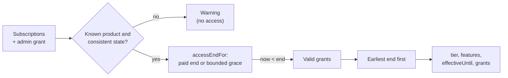

# Domain: access rules

The heart of PremiumPass: pure functions that decide whether a user is Premium.
No HTTP, no database, no provider SDKs. Every caller (API, worker, CLI) passes in
plain records and the current time, so the same rule runs everywhere.

Read [Concepts](../../docs/CONCEPTS.md) first for the idea and the glossary.

## What is inside

| File                                                 | Responsibility                                                              |
| ---------------------------------------------------- | --------------------------------------------------------------------------- |
| [`subscriptions.ts`](src/subscriptions.ts)           | Subscription schema, provider status translation, and `deriveEntitlements`  |
| [`admin-grants.ts`](src/admin-grants.ts)             | Complimentary Premium grant and its validity check                          |
| [`subscription-store.ts`](src/subscription-store.ts) | Read interface the API implements; errors must never look like "no records" |

## How `deriveEntitlements` works

1. **Validate:** only `premium_monthly` counts, and the stored state must match
   what `normalizeProviderStatus` makes of the raw provider status.
2. **Compute an end:** `active`/`trialing` use the verified `accessUntil`;
   `past_due` adds grace (Apple's signed value, otherwise at most 24 hours).
   Every other state grants nothing.
3. **Combine:** every source still valid at `now` becomes a grant, including an
   active admin grant. One ending source never removes another.
4. **Schedule:** grants are sorted by end, so `effectiveUntil` is the next moment
   the result can change.

## Rules for changes

- Keep this package free of I/O. Inject time instead of calling `new Date()`.
- A new provider needs a branch in `normalizeProviderStatus`, a row in the
  [Concepts mapping table](../../docs/CONCEPTS.md#same-meaning-different-words),
  and a grace decision in the [access policy](../../docs/PAYMENTS.md#access-policy).
- Unknown values must fail closed: visible as a warning, never as access.
