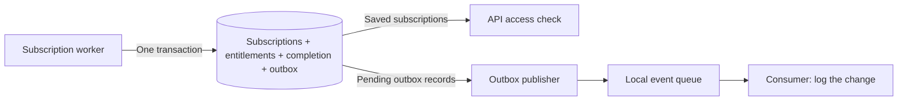

# Outbox publisher

Tells other components that a subscription change has been saved. The outbox is
a database record saying **"this change still needs to be announced"**; the
publisher sends that announcement and records transport acceptance.

Premium access already follows the verified subscription state and its expiration
times in the backend. The publisher does not activate Premium or refresh the app.
If it is stopped, API access still works and pending announcements wait in the
database.

## Example: a user gets Premium

1. The subscription worker checks the current provider state. In one DynamoDB
   transaction, it saves the subscription, the entitlement snapshot, the job's
   completion marker, and a pending `SubscriptionChanged` outbox record.
2. The API can now grant Premium based on the saved subscription and current time.
3. The publisher reads the pending record, sends it to the local event queue,
   and marks it `sent` after the queue accepts it.
4. A separate consumer receives the event and logs `subscription.changed`.



The current consumer **only writes a log entry**. There is no email, push
notification, or automatic UI update attached to it. Future consumers could use
the same event for email or reporting, but those features are not implemented.
For now, this service demonstrates reliable publication separately from payment
processing.

## Why save an outbox record first?

Saving a subscription and sending a message are two separate operations, and no
transaction spans DynamoDB and a queue. Saving the outbox record in the **same
transaction** as the subscription means either both are saved or neither is;
the publisher retries pending announcements after a restart. A crash after
sending but before marking `sent` can repeat a delivery with the same
`domainEventId`: at-least-once publication, not exactly-once consumer execution.
[The outbox guide](../../docs/OUTBOX.md) pictures the problem and what the
pattern guarantees. The local queue's restart limitation is described below.

| Component           | Responsibility                                                                                          |
| ------------------- | ------------------------------------------------------------------------------------------------------- |
| Subscription worker | Check provider state and save subscriptions and entitlements. Incoming payment jobs use its own queue.  |
| Reconciliation      | Find missed provider changes or due access boundaries and submit jobs through the same processing path. |
| Outbox publisher    | Announce changes already committed to our database through a separate outgoing event queue.             |
| Event consumer      | React to those announcements; currently, just log them.                                                 |

## Run locally

Start storage with `pnpm local:up`, then use these commands from the repository
root. No `.env` file is needed. The local entry points use only DynamoDB Local and
ElasticMQ with dummy credentials; they do not load provider keys or AWS profiles.

```sh
pnpm outbox:publish --dry-run
pnpm dev:events
```

In another terminal, run `pnpm outbox:publish` for one pass or `pnpm dev:outbox`
to repeat every five seconds. These are separate from `pnpm dev`. Both processes
stop with `Ctrl+C`; an in-flight publish batch finishes before shutdown.

The publisher/consumer create `premiumpass-events` and
`premiumpass-events-dlq` in the existing ElasticMQ instance on demand. They never
consume the subscription worker's queue. Dry runs create no queues or records.
The publisher targets the fixed `premiumpass-local` table at
`http://127.0.0.1:8000`; environment overrides cannot redirect it to AWS.

Follow `domainEventId` from `outbox.preview` to `outbox.sent` and
`subscription.changed` in the consumer terminal. `publishedEventId` identifies
one transport acceptance and can change on retry. Only compact identifiers,
revision, and tier are logged; no full snapshots or payment payloads.

## Publication behavior

- Scan pending outbox records page by page, including pages with no matches.
  This intentionally simple demo scan reads the whole table; its filter does
  not save read capacity. New concurrent records can wait until the next pass.
- Validate the record and its `userId:revision` identity, then publish batches
  of at most ten. Use the stored timestamp and entitlement snapshot unchanged.
- Set `status=sent`, `sentAt`, and `publishedEventId` only for individually
  accepted events. Missing results, rejected entries, and request failures leave
  records pending. A single-pass run exits nonzero for failed or invalid records.
- Publish before marking sent. A crash between those steps or simultaneous
  publishers can produce duplicates with the same `domainEventId`. The conditional
  update never recreates deleted records or overwrites a prior sent marker.
- Retry pending records on the next pass. Invalid records remain pending and are
  counted in logs; they do not prevent valid records from being published.
- The consumer validates and logs before acknowledging. Failures retry after
  30 seconds and move to the event DLQ after five receives. Duplicate log lines
  are expected; future consumers with business side effects must deduplicate by
  domain ID and account for out-of-order aggregate revisions.

`sent` means transport acceptance, **not** successful consumer processing.
Neither component writes subscriptions or grants access. Records have no TTL.

## EventBridge boundary

[EventBridgeSink](src/eventbridge.ts) maps the same batches to the official SDK's
`PutEvents`, with source `premiumpass.subscriptions`, detail type
`SubscriptionChanged`, and the stable ID inside `detail.domainEventId`.
It checks each response entry rather than interpreting HTTP 200 as batch success.
It also calls `DescribeEventBus` before publishing: AWS can report success when
publishing to a nonexistent bus. This check cannot prevent deletion after the
check and is not proof of a matching rule or target delivery.
[AWS PutEvents behavior](https://docs.aws.amazon.com/eventbridge/latest/userguide/eb-putevents.html).

- **Local queue ≠ EventBridge.** ElasticMQ is a stand-in transport. It shows
  acceptance, retries, and the consumer, but not AWS rules, IAM, or target retries.
- **Messages live in memory.** Restarting ElasticMQ loses accepted events, even
  ones already marked `sent`; keep it running during the exercise.
- **No cloud wiring yet.** The CDK stack has no event bus or rule for the
  outbox ([what runs where](../../docs/ARCHITECTURE.md#what-runs-where)). A cloud
  version must treat failed target delivery and failed Lambda execution as two
  separate retry paths.

Try it: [Duplicates and crashes](../../docs/try-it/duplicates-and-crashes.md).
